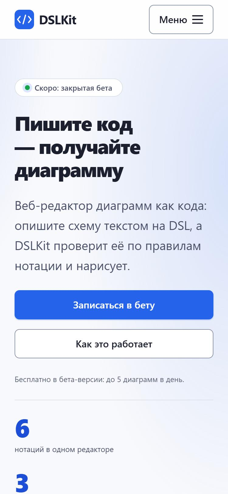
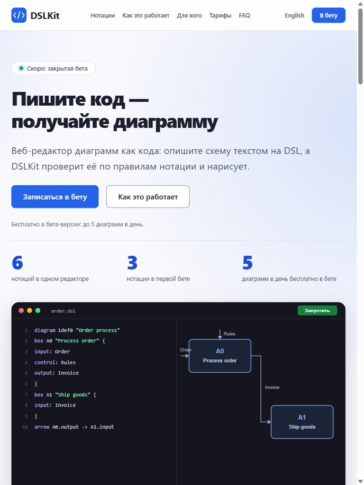
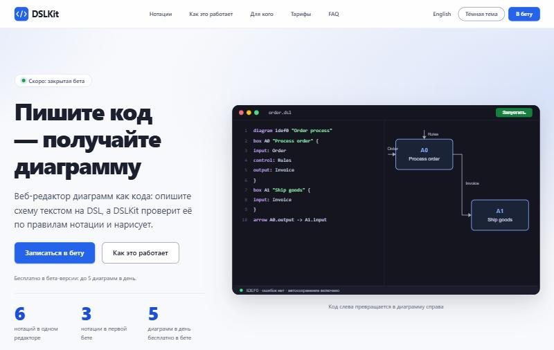

# Лабораторная работа №4. Создание адаптивного макета с использованием CSS

## 1 Цель работы

Освоить современные технологии CSS для создания адаптивных макетов: Flexbox, CSS Grid, медиазапросы, CSS-переменные и методологию БЭМ. Закрепить навыки на примере проекта DSLKit, веб-редактора диаграмм как кода, тематика которого соответствует направлению SaaS и будущему курсовому проекту.

## 2 Краткие теоретические сведения

**Адаптивная вёрстка.** Страница подстраивается под ширину экрана без отдельных версий для каждого устройства. Основой служат гибкие сетки, относительные единицы и медиазапросы.

**Mobile-first.** Базовые стили описывают телефон, а для более широких экранов добавляются правила в запросах `min-width`. Подход проще поддерживать, потому что мобильная версия не перекрывает десктопные правила.

**Flexbox и CSS Grid.** Flexbox выравнивает элементы в одном направлении: шапка, подвал, строки кнопок. Grid описывает двумерную сетку: колонки карточек, макет с боковой панелью, раскладку страницы.

**Медиазапросы.** Правила `@media` включают стили при заданных условиях: ширина окна, тип указателя, предпочтение пониженной анимации.

**БЭМ.** Методология делит интерфейс на блоки, элементы и модификаторы: `card`, `card__title`, `button--primary`. Имена классов описывают назначение, а не внешний вид.

**CSS-переменные.** Пользовательские свойства `--name` задают цвета, шрифты и отступы в одном месте, а тема переключается заменой значений.

## 3 Ход работы

### 3.1 Выбор макета и соответствие теме

Макеты проекта подготовлены в Figma и в виде SVG-файлов: прототипы главной страницы для трёх ширин, мудборд, палитра и типографика находятся в папке `site/design/figma`, экраны приложения в папке `docs/project/figma-svg`. Ссылка на файл Figma хранится в `site/design/figma-link.txt`. Тематика соответствует направлению SaaS: лендинг сервиса с тарифами Free и Pro, вопросами и ответами и списком ожидания, плюс экраны самого приложения.

Анализ макета показал такую структуру: шапка с логотипом, навигацией и действиями, главный блок с примером продукта, секции с карточками, тарифы, вопросы, форма и подвал. Цветовая палитра построена на синем основном цвете `#2563eb` с нейтральными тонами и зелёным акцентом, типографика на шрифтах Inter и JetBrains Mono. Сетка опирается на золотое сечение: колонки главного блока и тарифов относятся как 1 к 1,618, а размеры шрифтов растут с шагом корня из золотого сечения.

### 3.2 Организация CSS-файлов

Стили разделены по назначению. Основной файл `style.css` только подключает остальные в порядке каскада, как показано в таблице 1.

Таблица 1 – Файлы стилей проекта DSLKit

| Файл | Назначение |
|---|---|
| `variables.css` | Цвета, шрифты, шкала размеров, отступы, ширины и точки перелома |
| `base.css` | Сброс отступов, `box-sizing`, базовый шрифт, фокус, служебные классы |
| `components.css` | Кнопки, карточки, шаги, тарифы, вопросы и ответы, форма |
| `header.css` | Шапка, логотип, навигация, бургер-меню, переключатель темы |
| `main.css` | Главный блок и секции страницы |
| `footer.css` | Подвал |
| `pages.css` | Страницы ошибок и политика конфиденциальности |
| `app.css` | Оболочка приложения, дашборд, настройки, приветствие |
| `editor.css` | Экран редактора |
| `adaptive.css` | Медиазапросы mobile-first для публичных страниц |

### 3.3 Переменные CSS

В файле `variables.css` определены цвета светлой и тёмной тем, семейства шрифтов, шкала размеров текста, отступы, радиусы, тени и ширина контейнера. Имена из задания (`--font-family-main`, `--font-size-base`, `--spacing-small`, `--container-max-width`, `--breakpoint-mobile` и другие) заданы как псевдонимы к шкалам проекта. Отступы 8, 16, 24, 40, 64 и 104 пикселя соответствуют числам Фибоначчи, умноженным на 8, поэтому сетка по 8 пикселей совпадает с золотым сечением.

### 3.4 Базовые стили

Файл `base.css` сбрасывает внешние отступы, задаёт `box-sizing: border-box`, шрифт, цвет и межстрочный интервал текста. Интервал равен 1,618 для основного текста, заголовки используют 1,15. Для всех интерактивных элементов определено видимое кольцо фокуса, класс `visually-hidden` скрывает текст только визуально, а правило `prefers-reduced-motion` отключает анимацию для пользователей, которым она мешает.

### 3.5 Шапка и бургер-меню

Шапка закреплена через `position: sticky`. На экранах уже 768 пикселей навигация скрыта, а кнопка «Меню» раскрывает её без JavaScript: скрытый флажок `burger__input` соседствует с меткой и списком, поэтому правило `.burger__input:checked ~ .nav` показывает меню. Флажок остаётся доступным с клавиатуры, фокус подсвечивается на метке. С ширины 768 пикселей бургер исчезает, и навигация превращается в горизонтальное меню на Flexbox.

### 3.6 Сетки Flexbox и Grid

Flexbox применён в шапке, подвале, рядах кнопок и подписях. Grid строит главный блок (две колонки 1 к 1,618), сетку карточек, тарифы, шаги и оболочку приложения с боковой панелью шириной 224 пикселя. Экран редактора использует именованные области `toolbar`, `activity`, `sidebar`, `main`, `problems` и `status`.

### 3.7 Адаптивность

Реализованы три состояния по подходу mobile-first, они перечислены в таблице 2.

Таблица 2 – Точки перелома и поведение страницы

| Ширина | Состояние | Поведение |
|---|---|---|
| менее 576 пикселей | Телефон (базовые стили) | Одна колонка карточек, бургер-меню, кнопки на всю ширину |
| от 576 пикселей | Большой телефон и планшет | Две колонки карточек |
| от 768 пикселей | Планшет | Горизонтальное меню, три факта в ряд, форма с увеличенными отступами |
| от 1024 пикселей | Десктоп | Три колонки карточек, главный блок и тарифы в пропорции золотого сечения, переключатель темы |

Мобильная версия страницы показана на рисунке 1.



Рисунок 1 – Главная страница DSLKit на экране шириной 375 пикселей

Планшетная версия с горизонтальным меню показана на рисунке 2.



Рисунок 2 – Главная страница DSLKit на экране шириной 768 пикселей

Десктопная версия показана на рисунке 3.



Рисунок 3 – Главная страница DSLKit на экране шириной 1280 пикселей

### 3.8 Тёмная тема

Тёмная тема переключается без JavaScript: правило `:root:has(.theme__input:checked)` заменяет значения цветовых переменных. Контраст всех пар текста и фона проверяется автоматическим тестом для обеих тем и соответствует уровню AA стандарта WCAG 2.2.

### 3.9 Кросс-браузерная совместимость

Flexbox и Grid поддерживаются всеми современными браузерами. Для `color-mix()` перед каждым объявлением указано запасное значение, поэтому браузер без поддержки функции использует обычный цвет. Для `backdrop-filter` добавлен префикс `-webkit-`. Автопрефиксер не подключён, так как проект ориентирован на актуальные версии браузеров.

### 3.10 Проверка и тестирование

Автоматические проверки собраны в тестах `labs/04-responsive-css`. Они подтверждают, что каждый класс из HTML имеет правило в стилях, что токены следуют золотому сечению, что отступы кратны 8 пикселям и образуют ряд Фибоначчи, что цвета проходят контраст AA в светлой и тёмной темах, что нет цветов вне файла переменных, что размер шрифта не меньше 12 пикселей, что используются только запросы `min-width` и точки перелома 576, 768 и 1024.

Все файлы стилей прошли проверку валидатором W3C CSS без ошибок, а HTML-страницы проверены валидатором W3C Nu. Геометрия всех элементов страниц сравнивалась до и после перехода на mobile-first при ширинах 500, 800 и 1440 пикселей: различий не найдено. Страницы осмотрены в Chrome на ширинах 375, 768 и 1280 пикселей. Проверка в Firefox, Edge и Safari на реальных устройствах не выполнялась и остаётся задачей на этап приёмки.

### 3.11 Фиксация изменений

Работа выполнена в ветке `feature/responsive-layout`. Коммит с реализацией: https://github.com/KsushaKhadzhinova/DSLKit-Project/commit/eb70a59. Сообщение коммита: `feat: implement responsive layout according to Figma design`.

## 4 Ответы на контрольные вопросы

5. **Сложности при переносе дизайна.** Макеты Figma статичны и не содержат состояний, поэтому состояния наведения, фокуса и ошибки пришлось проектировать самостоятельно. Расхождения с сеткой по 8 пикселей решены шкалой отступов по Фибоначчи.
6. **Медиазапросы.** Правило `@media (min-width: 768px) { .nav { display: block; } }` показывает меню на широких экранах. Запросы включают стили по условию, поэтому одна разметка работает на разных устройствах.
7. **Гибкие сетки.** Проценты считаются от ширины родителя, а единица `fr` делит остаток свободного места между колонками. Запись `1fr 1.618fr` задаёт колонки главного блока без вычисления процентов.

## Заключение

Стили проекта DSLKit разнесены по файлам согласно методологии БЭМ и построены по подходу mobile-first. Реализованы три состояния страницы, бургер-меню без JavaScript, сетки на Flexbox и Grid, переменные CSS и тёмная тема. Золотое сечение заложено в шкалу размеров, отступы и колонки, а автоматические тесты не позволяют отклониться от него. Остаётся проверить страницу в Firefox, Edge и Safari на реальных устройствах.

## Приложение А – Листинг файла variables.css

```css
/* Design tokens. Light theme first, dark theme overrides the colour tokens.
   The golden ratio is the base of the scales: type steps grow by √φ and φ,
   spacing follows the Fibonacci numbers multiplied by 8 px (8, 16, 24, 40, 64, 104). */
:root {
  --phi: 1.618;
  --phi-inverse: 0.618;
  --phi-root: 1.272;

  --color-primary: #2563eb;
  --color-on-primary: #ffffff;
  --color-primary-text: #1d4ed8;
  --color-diagram-paper: #ffffff;
  --color-secondary: #e8efff;
  --color-accent: #16a34a;
  --color-accent-text: #15803d;
  --color-background: #f8f9fc;
  --color-surface: #ffffff;
  --color-border: #dde1e9;
  --color-border-strong: #868ea3;
  --color-text: #1c1f2e;
  --color-text-light: #4a5068;
  --color-muted: #5f6679;
  --color-link: #1d4ed8;
  --color-error: #c81e1e;
  --color-warning: #b45309;
  --color-code-background: #14151f;
  --color-code-text: #cdd6f4;
  --color-glow: rgb(37 99 235 / 0.16);
  --shadow-small: 0 1px 2px rgb(28 31 46 / 0.06), 0 1px 3px rgb(28 31 46 / 0.1);
  --shadow-large: 0 8px 24px rgb(28 31 46 / 0.08), 0 24px 64px rgb(28 31 46 / 0.12);

  --font-sans: 'Inter', system-ui, -apple-system, 'Segoe UI', Roboto, 'Helvetica Neue', Arial, sans-serif;
  --font-mono: 'JetBrains Mono', ui-monospace, 'Cascadia Code', Consolas, 'Courier New', monospace;

  --step--1: calc(1rem / var(--phi-root));
  --step-0: 1rem;
  --step-1: calc(1rem * var(--phi-root));
  --step-2: calc(1rem * var(--phi));
  --step-3: calc(1rem * var(--phi) * var(--phi-root));
  --step-4: calc(1rem * var(--phi) * var(--phi));
  --step-5: calc(1rem * var(--phi) * var(--phi) * var(--phi-root));
  --step-6: calc(1rem * var(--phi) * var(--phi) * var(--phi));

  --columns-golden: 1fr 1.618fr;
  --columns-golden-reverse: 1.618fr 1fr;

  --line-body: var(--phi);
  --line-heading: 1.15;

  --space-1: 8px;
  --space-2: 16px;
  --space-3: 24px;
  --space-4: 40px;
  --space-5: 64px;
  --space-6: 104px;

  --radius-small: 8px;
  --radius-medium: 16px;
  --radius-large: 24px;

  --container: 1200px;
  --measure: 62ch;
  --header-height: 64px;
  --target-size: 48px;
  --target-size-small: 32px;
  --focus-ring: 0 0 0 3px var(--color-background), 0 0 0 5px var(--color-primary);

  --breakpoint-small: 576px;
  --breakpoint-medium: 768px;
  --breakpoint-large: 1024px;

  /* Names required by the lab assignment; they alias the golden-ratio scales above. */
  --font-family-main: var(--font-sans);
  --font-size-base: 16px;
  --font-size-h1: var(--step-5);
  --font-size-h2: var(--step-4);
  --spacing-small: var(--space-1);
  --spacing-medium: var(--space-2);
  --spacing-large: var(--space-3);
  --spacing-xlarge: var(--space-4);
  --container-max-width: var(--container);
  --breakpoint-mobile: 576px;
  --breakpoint-tablet: 768px;
  --breakpoint-desktop: 1024px;
}

/* Dark theme: the checkbox in the header switches it without JavaScript. */
:root:has(.theme__input:checked),
:root[data-theme='dark'] {
  --color-primary: #2563eb;
  --color-secondary: #27304d;
  --color-accent: #22c55e;
  --color-accent-text: #4ade80;
  --color-background: #1e1e2e;
  --color-surface: #181825;
  --color-border: #313244;
  --color-border-strong: #6c7086;
  --color-text: #cdd6f4;
  --color-text-light: #a6adc8;
  --color-muted: #9399b2;
  --color-link: #8bb0ff;
  --color-error: #f38ba8;
  --color-warning: #fab387;
  --color-code-background: #11111b;
  --color-glow: rgb(139 176 255 / 0.14);
  --shadow-small: 0 1px 2px rgb(0 0 0 / 0.3);
  --shadow-large: 0 8px 24px rgb(0 0 0 / 0.35), 0 24px 64px rgb(0 0 0 / 0.4);
  color-scheme: dark;
}

/* Without JavaScript the system preference decides, unless the page was told to stay light. */
@media (prefers-color-scheme: dark) {
  :root:not([data-theme='light']) {
    --color-primary: #2563eb;
    --color-secondary: #27304d;
    --color-accent: #22c55e;
    --color-accent-text: #4ade80;
    --color-background: #1e1e2e;
    --color-surface: #181825;
    --color-border: #313244;
    --color-border-strong: #6c7086;
    --color-text: #cdd6f4;
    --color-text-light: #a6adc8;
    --color-muted: #9399b2;
    --color-link: #8bb0ff;
    --color-error: #f38ba8;
    --color-warning: #fab387;
    --color-code-background: #11111b;
    --color-glow: rgb(139 176 255 / 0.14);
    --shadow-small: 0 1px 2px rgb(0 0 0 / 0.3);
    --shadow-large: 0 8px 24px rgb(0 0 0 / 0.35), 0 24px 64px rgb(0 0 0 / 0.4);
    color-scheme: dark;
  }
}
```

## Приложение Б – Листинг файла base.css

```css
*,
*::before,
*::after {
  box-sizing: border-box;
}

html {
  overflow-x: clip;
  scroll-padding-top: calc(var(--header-height) + var(--space-2));
  -webkit-text-size-adjust: 100%;
  text-size-adjust: 100%;
}

body {
  margin: 0;
  background: var(--color-background);
  color: var(--color-text);
  font-family: var(--font-sans);
  font-size: var(--step-0);
  line-height: var(--line-body);
  text-rendering: optimizeLegibility;
  -webkit-font-smoothing: antialiased;
}

h1,
h2,
h3,
h4,
p,
ul,
ol,
figure,
dl,
dd,
blockquote,
fieldset {
  margin: 0;
}

ul,
ol {
  padding: 0;
  list-style: none;
}

h1,
h2,
h3,
h4 {
  overflow-wrap: break-word;
  hyphens: auto;
  line-height: var(--line-heading);
  letter-spacing: -0.02em;
  text-wrap: balance;
}

p {
  text-wrap: pretty;
}

img,
svg {
  display: block;
  max-width: 100%;
}

a {
  color: var(--color-link);
  text-decoration-thickness: 1px;
  text-underline-offset: 0.2em;
}

a:hover {
  text-decoration-thickness: 2px;
}

button,
input,
select,
textarea {
  font: inherit;
  color: inherit;
}

button {
  cursor: pointer;
}

address {
  font-style: normal;
}

small {
  font-size: var(--step--1);
}

code,
kbd,
pre {
  font-family: var(--font-mono);
  font-size: 0.92em;
  font-feature-settings: 'zero';
}

kbd {
  padding: 2px 6px;
  border: 1px solid var(--color-border-strong);
  border-radius: 4px;
  background: var(--color-surface);
  color: var(--color-text-light);
  font-size: var(--step--1);
  line-height: 1.2;
}

progress {
  accent-color: var(--color-primary);
}

summary {
  cursor: pointer;
}

dialog {
  color: var(--color-text);
}

time {
  white-space: nowrap;
}

[hidden] {
  display: none !important;
}

::selection {
  background: var(--color-secondary);
  color: var(--color-text);
}

:focus-visible {
  outline: 2px solid transparent;
  box-shadow: var(--focus-ring);
  border-radius: var(--radius-small);
}

/* Utilities shared by every page */
.visually-hidden {
  position: absolute;
  width: 1px;
  height: 1px;
  margin: -1px;
  padding: 0;
  border: 0;
  overflow: hidden;
  clip: rect(0 0 0 0);
  clip-path: inset(50%);
  white-space: nowrap;
}

.skip-link {
  position: fixed;
  top: var(--space-1);
  left: var(--space-1);
  z-index: 1000;
  padding: var(--space-1) var(--space-2);
  border-radius: var(--radius-small);
  background: var(--color-primary);
  color: var(--color-on-primary);
  font-weight: 600;
  transform: translateY(-200%);
}

.skip-link:focus {
  transform: translateY(0);
}

.icon {
  flex: none;
  width: 20px;
  height: 20px;
}

.badge {
  display: inline-flex;
  align-items: center;
  padding: 2px var(--space-1);
  border-radius: 999px;
  background: var(--color-secondary);
  color: var(--color-link);
  font-size: var(--step--1);
  font-weight: 600;
  line-height: 1.4;
  white-space: nowrap;
}

.actions {
  display: flex;
  flex-wrap: wrap;
  gap: var(--space-2);
  align-items: center;
}

.link {
  color: var(--color-link);
  font-weight: 600;
}

@media (prefers-reduced-motion: reduce) {
  *,
  *::before,
  *::after {
    animation-duration: 0.01ms !important;
    animation-iteration-count: 1 !important;
    scroll-behavior: auto !important;
    transition-duration: 0.01ms !important;
  }
}

@media (prefers-reduced-motion: no-preference) {
  html {
    scroll-behavior: smooth;
  }
}

/* Elements that have no class of their own still get explicit rules. */
option {
  background: var(--color-surface);
  color: var(--color-text);
}

span {
  font: inherit;
}

button > span,
a > span,
label > span {
  line-height: inherit;
}

.file-tree > li,
.templates > li,
.canvas__history > li {
  margin: 0;
  list-style: none;
}

.icon path,
.icon g,
.icon circle,
.icon rect,
.icon line {
  stroke-linecap: round;
  stroke-linejoin: round;
}
```

## Приложение В – Листинг файла header.css

```css
.header {
  position: sticky;
  top: 0;
  z-index: 100;
  border-bottom: 1px solid var(--color-border);
  background: var(--color-surface);
  background: color-mix(in srgb, var(--color-surface) 82%, transparent);
  -webkit-backdrop-filter: saturate(1.4) blur(14px);
  backdrop-filter: saturate(1.4) blur(14px);
}

.header__inner {
  display: grid;
  grid-template-columns: 1fr auto auto;
  align-items: center;
  gap: var(--space-2);
  width: 100%;
  max-width: calc(var(--container) + var(--space-3) * 2);
  padding-inline: var(--space-3);
  min-height: var(--header-height);
  margin-inline: auto;
}

.header__logo {
  display: inline-flex;
  align-items: center;
  gap: var(--space-1);
  color: var(--color-text);
  font-size: var(--step-1);
  font-weight: 700;
  letter-spacing: -0.02em;
  text-decoration: none;
}

.header__logo-image {
  width: 32px;
  height: 32px;
}

.header__logo-text {
  line-height: 1;
}

/* Burger: a visually hidden checkbox keeps keyboard access */
.burger__input {
  position: absolute;
  width: 1px;
  height: 1px;
  margin: -1px;
  opacity: 0;
  clip-path: inset(50%);
}

.burger__button {
  display: inline-flex;
  grid-column: 3;
  grid-row: 1;
  align-items: center;
  gap: var(--space-1);
  min-height: var(--target-size);
  padding: 0 var(--space-2);
  border: 1px solid var(--color-border-strong);
  border-radius: var(--radius-small);
  cursor: pointer;
  font-weight: 600;
}

.burger__input:focus-visible + .burger__button {
  outline: 2px solid transparent;
  box-shadow: var(--focus-ring);
}

.burger__icon,
.burger__icon::before,
.burger__icon::after {
  display: block;
  width: 18px;
  height: 2px;
  border-radius: 2px;
  background: currentColor;
  transition: transform 200ms ease;
}

.burger__icon {
  position: relative;
}

.burger__icon::before,
.burger__icon::after {
  content: '';
  position: absolute;
  left: 0;
}

.burger__icon::before {
  top: -6px;
}

.burger__icon::after {
  top: 6px;
}

.burger__input:checked + .burger__button .burger__icon {
  background: transparent;
}

.burger__input:checked + .burger__button .burger__icon::before {
  top: 0;
  transform: rotate(45deg);
}

.burger__input:checked + .burger__button .burger__icon::after {
  top: 0;
  transform: rotate(-45deg);
}

.burger__label {
  position: absolute;
  width: 1px;
  height: 1px;
  overflow: hidden;
  clip-path: inset(50%);
  white-space: nowrap;
  line-height: 1;
}

/* Navigation: a collapsed panel on small screens, a row from 1024 px */
.nav {
  display: none;
  grid-column: 1 / -1;
  grid-row: 2;
  padding-bottom: var(--space-2);
}

.burger__input:checked ~ .nav {
  display: block;
}

.nav__list {
  display: flex;
  flex-direction: column;
  align-items: stretch;
  gap: var(--space-1);
}

.nav__link {
  display: inline-flex;
  align-items: center;
  min-height: var(--target-size);
  padding: 0 var(--space-2);
  border-radius: var(--radius-small);
  color: var(--color-text-light);
  font-size: var(--step-0);
  font-weight: 600;
  text-decoration: none;
  transition:
    background-color 160ms ease,
    color 160ms ease;
}

.nav__link:hover {
  background: var(--color-secondary);
  color: var(--color-text);
}

.header__tools {
  display: flex;
  grid-column: 2;
  grid-row: 1;
  align-items: center;
  gap: var(--space-1);
}

.header__lang {
  display: none;
  align-items: center;
  min-height: var(--target-size-small);
  padding: 0 var(--space-1);
  color: var(--color-text-light);
  font-size: var(--step--1);
  font-weight: 600;
  text-decoration: none;
}

.header__lang:hover {
  color: var(--color-text);
}

.theme__input {
  position: absolute;
  width: 1px;
  height: 1px;
  margin: -1px;
  opacity: 0;
  clip-path: inset(50%);
}

.theme__button {
  display: inline-flex;
  align-items: center;
  min-height: var(--target-size-small);
  padding: 0 var(--space-1);
  border: 1px solid var(--color-border-strong);
  border-radius: 999px;
  color: var(--color-text-light);
  cursor: pointer;
  font-size: 0.75rem;
  font-weight: 600;
  white-space: nowrap;
  transition:
    background-color 160ms ease,
    color 160ms ease;
}

.theme__button:hover {
  background: var(--color-secondary);
  color: var(--color-text);
}

.theme__input:focus-visible + .theme__button {
  outline: 2px solid transparent;
  box-shadow: var(--focus-ring);
}

.theme__input:checked + .theme__button {
  background: var(--color-secondary);
  color: var(--color-text);
}

.header__cta {
  display: none;
  min-height: var(--target-size-small);
  padding: 0 var(--space-2);
  font-size: var(--step--1);
}
```

## Приложение Г – Листинг файла main.css

```css
.page {
  display: flex;
  flex-direction: column;
  min-height: 100vh;
  overflow-x: clip;
}

.main {
  flex: 1;
  width: 100%;
  max-width: calc(var(--container) + var(--space-3) * 2);
  padding-inline: var(--space-3);
  margin-inline: auto;
}

/* Hero: text and product window are split by the golden ratio (1 : 1.618) */
.hero {
  position: relative;
  isolation: isolate;
  display: grid;
  grid-template-columns: 1fr;
  align-items: center;
  gap: var(--space-4);
  padding-block: var(--space-5) var(--space-4);
}

.hero::before {
  content: '';
  position: absolute;
  inset: 0 -50vw;
  z-index: -1;
  background:
    radial-gradient(ellipse 55% 70% at 78% 18%, var(--color-glow), transparent 70%),
    radial-gradient(ellipse 40% 50% at 8% 0%, var(--color-glow), transparent 70%);
}

.hero__content {
  display: grid;
  justify-items: start;
  gap: var(--space-3);
}

.hero__badge {
  display: inline-flex;
  align-items: center;
  gap: var(--space-1);
  padding: 4px var(--space-2);
  border: 1px solid var(--color-border);
  border-radius: 999px;
  background: var(--color-surface);
  color: var(--color-text-light);
  font-size: var(--step--1);
  font-weight: 600;
}

.hero__badge::before {
  content: '';
  width: 8px;
  height: 8px;
  border-radius: 50%;
  background: var(--color-accent);
  box-shadow: 0 0 0 4px var(--color-glow);
}

.hero__title {
  font-size: clamp(var(--step-3), 1rem + 3.2vw, var(--step-5));
  font-weight: 800;
  letter-spacing: -0.035em;
}

.hero__lead {
  max-width: var(--measure);
  color: var(--color-text-light);
  font-size: var(--step-1);
}

.hero__cta {
  display: grid;
  gap: var(--space-2);
  justify-items: stretch;
  width: 100%;
  padding: var(--space-3);
  border-radius: var(--radius-large);
  background: var(--color-primary);
  box-shadow: var(--shadow-large);
  color: var(--color-on-primary);
}

.hero__cta-note {
  margin: 0;
  color: var(--color-on-primary);
  font-size: var(--step--1);
  text-align: center;
}

.hero__actions {
  display: flex;
  flex-wrap: wrap;
  gap: var(--space-2);
}

.hero__actions .button {
  flex: 1 1 100%;
}

.hero__note {
  color: var(--color-muted);
  font-size: var(--step--1);
}

.hero__facts {
  display: grid;
  grid-template-columns: 1fr;
  gap: var(--space-3);
  width: 100%;
  padding-top: var(--space-3);
  border-top: 1px solid var(--color-border);
}

.hero__fact {
  display: grid;
  gap: 4px;
}

.hero__fact-value {
  color: var(--color-link);
  font-size: var(--step-4);
  font-weight: 800;
  letter-spacing: -0.03em;
  line-height: 1;
}

.hero__fact-label {
  color: var(--color-text-light);
  font-size: var(--step--1);
}

.hero__figure {
  display: grid;
  gap: var(--space-2);
}

.hero__image {
  width: 100%;
  height: auto;
  aspect-ratio: 1.618;
  border-radius: var(--radius-medium);
  box-shadow: var(--shadow-large);
}

.hero__caption {
  color: var(--color-muted);
  font-size: var(--step--1);
  text-align: center;
}

/* Sections */
.section {
  padding-block: var(--space-4);
}

.section__title {
  margin-bottom: var(--space-2);
  font-size: var(--step-4);
  font-weight: 800;
  letter-spacing: -0.03em;
}

.section__lead {
  max-width: var(--measure);
  margin-bottom: var(--space-4);
  color: var(--color-text-light);
  font-size: var(--step-1);
}

.section > .cards,
.section > .steps,
.section > .plans {
  margin-top: var(--space-4);
}

.section > .section__lead + .cards {
  margin-top: 0;
}
```

## Приложение Д – Листинг файла footer.css

```css
.footer {
  margin-top: var(--space-6);
  border-top: 1px solid var(--color-border);
  background: var(--color-surface);
}

.footer__inner {
  display: grid;
  gap: var(--space-3);
  width: 100%;
  max-width: calc(var(--container) + var(--space-3) * 2);
  padding-inline: var(--space-3);
  margin-inline: auto;
  padding-block: var(--space-5);
}

.footer__list {
  display: flex;
  flex-wrap: wrap;
  gap: var(--space-1) var(--space-3);
}

.footer__link {
  display: inline-flex;
  align-items: center;
  min-height: 24px;
  color: var(--color-text-light);
  text-decoration: none;
}

.footer__link:hover {
  color: var(--color-link);
  text-decoration: underline;
}

.footer__address,
.footer__copy {
  color: var(--color-muted);
  font-size: var(--step--1);
}
```

## Приложение Е – Листинг файла adaptive.css

```css
/* Mobile first: the base styles describe a phone, wider screens add to them.
   Breakpoints: 576, 768 and 1024 px. */
@media (min-width: 576px) {
  .hero__actions .button {
    flex: 0 0 auto;
  }

  .cards {
    grid-template-columns: repeat(2, minmax(0, 1fr));
  }
}

@media (min-width: 576px) {
  .burger__label {
    position: static;
    width: auto;
    height: auto;
    overflow: visible;
    clip-path: none;
  }

  .theme__button {
    padding: 0 var(--space-2);
    font-size: var(--step--1);
  }
}

@media (min-width: 768px) {
  .header__lang,
  .header__cta {
    display: inline-flex;
  }

  .header__inner {
    grid-template-columns: auto 1fr auto;
  }

  .burger__input,
  .burger__button {
    display: none;
  }

  .header__tools {
    grid-column: auto;
    grid-row: auto;
  }

  .nav {
    display: block;
    grid-column: auto;
    grid-row: auto;
    padding-bottom: 0;
  }

  .nav__list {
    flex-flow: row wrap;
    gap: 0;
    justify-content: center;
    align-items: center;
  }

  .nav__link {
    min-height: var(--target-size-small);
    padding: 0 var(--space-1);
    font-size: var(--step--1);
  }

  .hero__facts {
    grid-template-columns: repeat(3, minmax(0, 1fr));
  }

  .section {
    padding-block: var(--space-5);
  }

  .form {
    padding: var(--space-4);
  }

  .form__submit {
    justify-self: start;
  }
}

@media (min-width: 1024px) {
  .header__inner {
    gap: var(--space-3);
  }

  .nav__list {
    gap: var(--space-1);
  }

  .nav__link {
    padding: 0 var(--space-2);
  }

  .hero {
    grid-template-columns: var(--columns-golden);
    gap: var(--space-5);
    padding-block: var(--space-6) var(--space-5);
  }

  .plans {
    grid-template-columns: var(--columns-golden);
  }

  .cards {
    grid-template-columns: repeat(3, minmax(0, 1fr));
  }
}
```

## Приложение Ж – Листинг файла style.css

```css
@import url('variables.css');
@import url('base.css');
@import url('components.css');
@import url('header.css');
@import url('main.css');
@import url('footer.css');
@import url('pages.css');
@import url('app.css');
@import url('editor.css');
@import url('adaptive.css');
```
