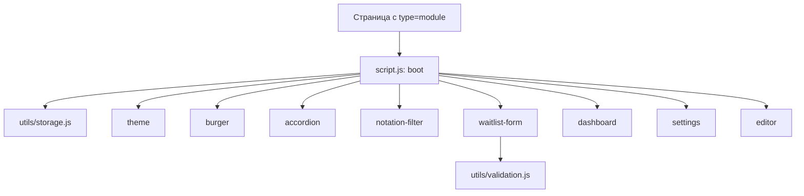

# Лабораторная работа №5. Интерактивный интерфейс на JavaScript

Проект DSLKit (направление SaaS), ветка `feature/javascript-interactivity`. Условие: `materials/text/part-1/Модуль 05…/09. Лабораторная работа №5…`. Отчёты: [`report.md`](report.md) на русском, [`report.en.md`](report.en.md) на английском.

## 1 Цель и задание

Реализовать не менее трёх типов событий и не менее двух интерактивных компонентов, сохранять состояние в LocalStorage, проверять форму, организовать код модулями ES6.

## 2 Структура

| Путь                                                            | Назначение                                                                                              |
| --------------------------------------------------------------- | ------------------------------------------------------------------------------------------------------- |
| `site/js/script.js`                                             | Точка входа (подключена как `type="module"`)                                                            |
| `site/js/utils/storage.js`, `validation.js`                     | Хранилище и проверка полей                                                                              |
| `site/js/components/*.js`                                       | Восемь компонентов: тема, бургер, аккордеон, фильтр нотаций, форма записи, дашборд, настройки, редактор |
| `labs/05-javascript-interactivity/*.test.js`                    | Тесты на jsdom по настоящим страницам сайта                                                             |
| `labs/05-javascript-interactivity/figures/`                     | Скриншоты работы компонентов                                                                            |
| `labs/05-javascript-interactivity/report*.tpl.md`, `report*.md` | Шаблоны и собранные отчёты                                                                              |

## 3 Запуск и проверка

```bash
npm start                 # сайт на http://localhost:5173
npm test                  # все тесты, порог покрытия 100 процентов
npm run lab5:report       # сборка отчётов
npm run format:check
```

## 4 Архитектура



Каждый компонент это функция `initX({ root, storage })`, которая возвращает объект API или `null`, если её разметки нет на странице. Компоненты не обращаются к глобальным `document` и `window`, поэтому их можно тестировать на jsdom.

## 5 События и состояние

- События: `click`, `input`, `change`, `submit`, `keydown`, а также `toggle` и `close`. Делегирование через `event.target.closest`.
- Ключи LocalStorage с префиксом `dslkit.`: `theme`, `notation-filter`, `faq-open`, `waitlist`, `dashboard`, `settings`, `editor-tab`, `editor-view`.
- Форма записи сохраняет заявку в LocalStorage и открывает `thanks.html`, данные в адрес не попадают.

## 6 Тесты и проверки

- Для каждого модуля есть тесты, покрытие всех файлов JavaScript 100 процентов по строкам, ветвлениям и функциям.
- Дополнительная проверка в Chrome: консоль без ошибок, заявка попадает в хранилище, тема сохраняется между страницами, нативный диалог работает.

## 7 Отчёт, сдача и открытые вопросы

Ответы ограничены вопросами n−1, n, n+1 варианта 26 (правило нужно подтвердить у преподавателя). Не выполнено и ждёт решения владельца:

1. Проверка в Firefox и Edge.
2. Снимок вкладки Event Listeners и консоли в инструментах разработчика.
3. PDF для СЭО и титульный лист по СТП.
4. Слияние ветки в `main` после приёмки.
