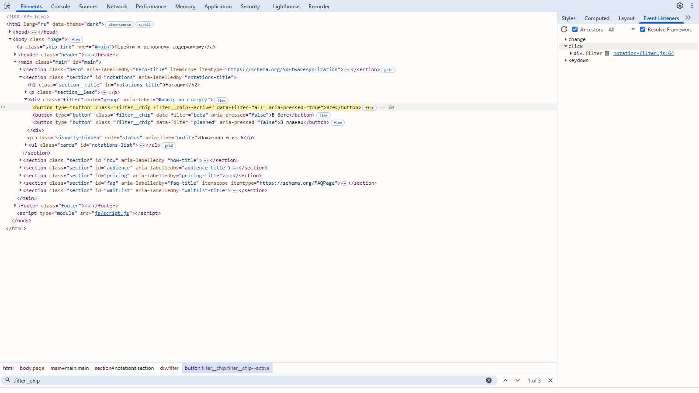
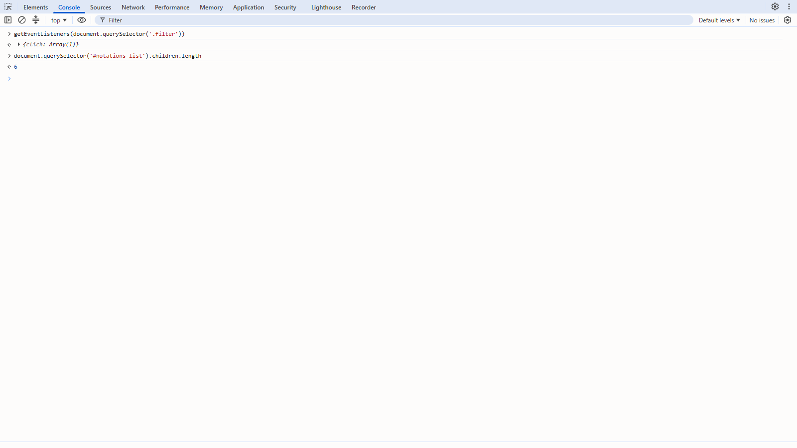
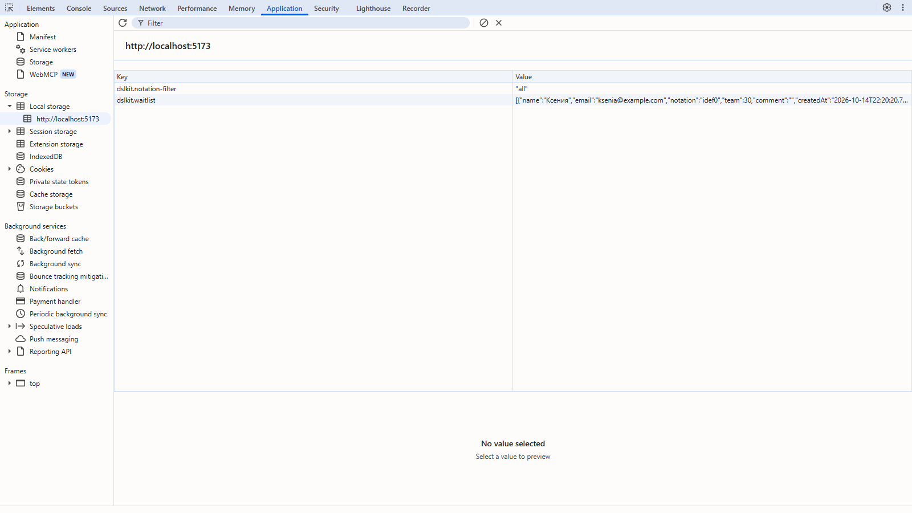

# Лабораторная работа №5. Разработка интерактивного интерфейса на JavaScript

## 1 Цель работы

Освоить основы JavaScript и работу с DOM, научиться обрабатывать события, проверять формы и сохранять состояние в LocalStorage на примере проекта DSLKit, веб-редактора диаграмм как кода, тематика которого соответствует направлению SaaS и будущему курсовому проекту.

## 2 Краткие теоретические сведения

**DOM.** Объектная модель документа представляет страницу в виде дерева узлов. Скрипт ищет узлы методами `getElementById`, `querySelector` и `querySelectorAll`, меняет текст через `textContent`, атрибуты через `setAttribute`, классы через `classList` и создаёт узлы методом `createElement`.

**События.** Обработчики подключаются методом `addEventListener`. Событие всплывает от целевого элемента к родителям, поэтому один обработчик на контейнере обслуживает много элементов: этот приём называется делегированием, а нужный элемент находит `event.target.closest`.

**Формы и валидация.** Событие `submit` отменяется методом `preventDefault`, значения проверяются кодом, а сообщения об ошибках показываются рядом с полями.

**LocalStorage.** Хранилище браузера записывает строки по ключам. Объекты сохраняются через `JSON.stringify` и читаются через `JSON.parse`, а ошибки доступа и разбора обрабатываются блоком `try/catch`.

**ES6+ и модули.** Код использует `const` и `let`, стрелочные функции, шаблонные строки, деструктуризацию и модули `import` и `export`.

## 3 Ход работы

### 3.1 Ветка и структура файлов

Работа выполнена в ветке `feature/javascript-interactivity`. Структура скриптов соответствует условию и показана в таблице 1. Основной файл `script.js` подключён в конце `body` как модуль: `type="module"`.

Таблица 1 – Структура JavaScript-кода проекта DSLKit

| Файл | Назначение |
|---|---|
| `js/script.js` | Точка входа: запускает компоненты, которые нашли свою разметку на странице |
| `js/utils/storage.js` | Безопасная обёртка над LocalStorage с запасным хранилищем в памяти |
| `js/utils/validation.js` | Чистые функции проверки имени, почты, размера команды, нотации и согласия |
| `js/components/theme.js` | Переключение и сохранение темы |
| `js/components/burger.js` | Закрытие меню клавишей Escape и после перехода по ссылке |
| `js/components/accordion.js` | Раскрывающиеся вопросы, открыт только один |
| `js/components/notation-filter.js` | Фильтр карточек нотаций |
| `js/components/waitlist-form.js` | Форма записи в бету с проверкой |
| `js/components/dashboard.js` | Фильтр, поиск и сортировка проектов |
| `js/components/settings.js` | Сохранение настроек |
| `js/components/editor.js` | Вкладки, диалог, автосохранение, переключатель вида |

### 3.2 Работа с DOM

Элементы ищутся по идентификаторам и селекторам, найденные узлы проверяются на `null`, а повторные выборки в цикле заменены ссылками в переменных. Фильтр нотаций создаёт кнопки и область состояния методом `createElement` и задаёт текст через `textContent`, поэтому в разметку не попадает пользовательский ввод. Видимость карточек меняется атрибутом `hidden`, состояние кнопок атрибутом `aria-pressed` и классом `filter__chip--active`.

### 3.3 События

Использованы пять типов событий: `click` (фильтры, вкладки, кнопки), `input` (поиск и проверка полей), `change` (сортировка, настройки, тема), `submit` (форма) и `keydown` (стрелки на вкладках, клавиша Escape, сочетание Ctrl и Enter). Дополнительно применено событие `toggle` для вопросов и событие `close` для диалога. Делегирование используется для кнопок фильтров, вкладок и настроек.

### 3.4 Интерактивные компоненты

Реализовано восемь компонентов, каждый использует события и сохраняет состояние в LocalStorage.

Фильтр нотаций на главной странице делит шесть карточек на группы «в бете» и «в планах». Выбранный фильтр сохраняется, а область `aria-live` сообщает число показанных карточек. Результат показан на рисунке 1.


Рисунок 1 – Фильтр нотаций: выбран статус «В бете», показаны три карточки

Форма записи в бету отменяет стандартную отправку, проверяет все поля и показывает сообщения об ошибках рядом с полями. Ошибочные поля получают `aria-invalid`, фокус переходит на первое из них, а ошибка исчезает, как только значение становится верным. Результат показан на рисунке 2.


Рисунок 2 – Проверка формы: пустое имя и неверная почта подсвечены, сообщения показаны под полями

При верных данных заявка добавляется в список в LocalStorage, в консоль выводится сообщение, и браузер открывает страницу `thanks.html`. Данные не попадают в адрес страницы.

Список проектов на экране дашборда поддерживает фильтр по нотации, поиск по названию и сортировку. Состояние сохраняется, а область `aria-live` сообщает число найденных проектов. Результат показан на рисунке 3.


Рисунок 3 – Дашборд: фильтр IDEF0, поиск «ord» и сортировка по названию дают один проект

Редактор переключает вкладки мышью и стрелками, показывает диалог несохранённых изменений при закрытии файла, переключает автосохранение и вид «Код» и «Холст» на телефоне. Диалог показан на рисунке 4.


Рисунок 4 – Редактор: нативный диалог при закрытии файла с несохранёнными изменениями

Остальные компоненты: переключатель темы запоминает выбор и применяет его на всех страницах, аккордеон вопросов оставляет открытым один ответ и помнит его, настройки сохраняют положение переключателей и списков, меню закрывается клавишей Escape.

### 3.5 Сохранение состояния

Состояние хранится в LocalStorage под ключами с префиксом `dslkit.`: тема, фильтр нотаций, открытый вопрос, заявки, состояние дашборда, настройки, вкладка и вид редактора. Модуль `storage.js` оборачивает чтение и запись в `try/catch` и возвращает запасное значение при ошибке доступа или повреждённых данных. Если LocalStorage недоступен, используется хранилище в памяти.

### 3.6 Обработка ошибок и стандарт ES6+

Чтение и запись данных защищены блоками `try/catch`, а точка входа запускает каждый компонент отдельно: ошибка одного компонента попадает в консоль и не останавливает остальные. Код использует `const` и `let`, стрелочные функции, шаблонные строки, деструктуризацию и модули. Обработчики подключены через `addEventListener`, атрибуты `onclick` не применяются.

### 3.7 Тестирование

Для каждого модуля написаны автоматические тесты на jsdom, которые разбирают настоящие страницы сайта. Тесты проверяют фильтры, форму с верными и неверными данными, восстановление состояния после перезагрузки, ошибки хранилища и отсутствие нужной разметки. Покрытие всех файлов JavaScript равно 100 процентов по строкам, ветвлениям и функциям. Работа компонентов дополнительно проверена в браузере Chrome: консоль не содержит ошибок, заявка попадает в LocalStorage, тема сохраняется между страницами. Проверка в Firefox и Edge и снимок вкладки Event Listeners инструментов разработчика остаются задачей на этап приёмки.

### 3.8 Фиксация изменений

Коммит с реализацией: https://github.com/KsushaKhadzhinova/DSLKit-Project/commit/39efd4f. Сообщение коммита: `feat: add JavaScript interactivity for a SaaS diagram editor`.

### 3.9 Проверка в DevTools

Страница проверена в Chrome 155: обработчики событий просмотрены на панели Elements, а сохранённые данные на панели Application.

Обработчики событий показаны на рисунке 5: у кнопки фильтра нотаций слушатели click, change и keydown навешены на общий контейнер, то есть используется делегирование.



Рисунок 5 – Панель Elements, вкладка Event Listeners для кнопки фильтра

Проверка в консоли показана на рисунке 6: метод getEventListeners возвращает слушатели контейнера, а в списке нотаций шесть карточек.



Рисунок 6 – Консоль: слушатели контейнера фильтра и число карточек

Сохранённое состояние показано на рисунке 7: после отправки формы в LocalStorage появились ключи с префиксом dslkit, среди них dslkit.notation-filter и dslkit.waitlist.



Рисунок 7 – Панель Application: LocalStorage сайта

## Заключение

Для проекта DSLKit написан модульный JavaScript: точка входа, утилиты хранилища и валидации, восемь интерактивных компонентов. Использованы пять типов событий и делегирование, форма проверяется с понятными сообщениями, состояние сохраняется в LocalStorage и восстанавливается после перезагрузки. Автоматические тесты покрывают весь код, а работа компонентов подтверждена в браузере. Остаётся проверить страницы в Firefox и Edge.

## Приложение А – Листинг файла script.js

```js
import { initAccordion } from './components/accordion.js';
import { initBurger } from './components/burger.js';
import { initDashboard } from './components/dashboard.js';
import { initDiagramRunner } from './components/diagram-runner.js';
import { initEditor } from './components/editor.js';
import { initExport } from './components/export-menu.js';
import { registerServiceWorker } from './components/pwa.js';
import { initNotationFilter } from './components/notation-filter.js';
import { initSettings } from './components/settings.js';
import { initTheme } from './components/theme.js';
import { initTour } from './components/tour.js';
import { initWaitlistForm } from './components/waitlist-form.js';
import { getStorage } from './utils/storage.js';

export const COMPONENTS = [
  initTheme,
  initBurger,
  initAccordion,
  initNotationFilter,
  initWaitlistForm,
  initDashboard,
  initSettings,
  initEditor,
  initExport,
  initTour,
  initDiagramRunner,
];

// Starts every component that finds its markup on the page; a failing component is reported and does not stop the others.
export const boot = (root, { components = COMPONENTS, logger = console } = {}) => {
  const storage = getStorage(root.defaultView);
  const started = [];
  components.forEach((init) => {
    try {
      if (init({ root, storage })) started.push(init.name);
    } catch (error) {
      logger.error(`DSLKit: component ${init.name} failed`, error);
    }
  });
  return started;
};

/* node:coverage disable */
if (typeof document !== 'undefined') {
  boot(document);
  registerServiceWorker({ navigator: document.defaultView.navigator });
}
/* node:coverage enable */
```

## Приложение Б – Листинг файла storage.js

```js
export function createMemoryBackend() {
  const map = new Map();
  return {
    getItem(key) {
      return map.has(key) ? map.get(key) : null;
    },
    setItem(key, value) {
      map.set(key, String(value));
    },
    removeItem(key) {
      map.delete(key);
    },
  };
}

export function createStorage(backend, prefix = 'dslkit.') {
  const fullKey = (key) => `${prefix}${key}`;

  return {
    get(key, fallback = null) {
      try {
        const raw = backend.getItem(fullKey(key));
        if (raw === null) {
          return fallback;
        }
        return JSON.parse(raw);
      } catch {
        return fallback;
      }
    },
    set(key, value) {
      try {
        backend.setItem(fullKey(key), JSON.stringify(value));
        return true;
      } catch {
        return false;
      }
    },
    remove(key) {
      try {
        backend.removeItem(fullKey(key));
        return true;
      } catch {
        return false;
      }
    },
  };
}

export function getStorage(win = globalThis) {
  try {
    const local = win.localStorage;
    if (local === undefined || local === null) {
      return createStorage(createMemoryBackend());
    }
    return createStorage(local);
  } catch {
    return createStorage(createMemoryBackend());
  }
}
```

## Приложение В – Листинг файла validation.js

```js
export const NOTATIONS = ['idef0', 'dfd', 'erd', 'bpmn', 'uml', 'petri'];

const NAME_PATTERN = /^\p{L}[\p{L}' ’-]{1,59}$/u;
const EMAIL_PATTERN = /^[^\s@]+@[^\s@.]+(?:\.[^\s@.]+)*\.[^\s@.]{2,}$/;
const MAX_EMAIL_LENGTH = 120;
const MAX_COMMENT_LENGTH = 500;
const MAX_TEAM_SIZE = 500;

export function isValidName(value) {
  if (value === undefined || value === null) {
    return false;
  }
  return NAME_PATTERN.test(String(value).trim());
}

export function isValidEmail(value) {
  const trimmed = String(value).trim();
  return trimmed.length <= MAX_EMAIL_LENGTH && EMAIL_PATTERN.test(trimmed);
}

export function isValidTeamSize(value) {
  if (typeof value === 'number') {
    return Number.isInteger(value) && value >= 0 && value <= MAX_TEAM_SIZE;
  }
  if (typeof value === 'string' && /^\d+$/.test(value.trim())) {
    const number = Number(value.trim());
    return number <= MAX_TEAM_SIZE;
  }
  return false;
}

export function isValidNotation(value) {
  return NOTATIONS.includes(value);
}

export function isValidComment(value = '') {
  return String(value).length <= MAX_COMMENT_LENGTH;
}

export function validateWaitlist({ name, email, notation, team, comment, consent } = {}) {
  const invalid = [];
  if (!isValidName(name)) {
    invalid.push('name');
  }
  if (!isValidEmail(email)) {
    invalid.push('email');
  }
  if (!isValidNotation(notation)) {
    invalid.push('notation');
  }
  if (!isValidTeamSize(team)) {
    invalid.push('team');
  }
  if (!isValidComment(comment)) {
    invalid.push('comment');
  }
  if (consent !== true) {
    invalid.push('consent');
  }
  return invalid;
}
```

## Приложение Г – Листинг файла notation-filter.js

```js
const FILTERS = ['all', 'beta', 'planned'];

const LABELS = {
  ru: {
    group: 'Фильтр по статусу',
    chips: { all: 'Все', beta: 'В бете', planned: 'В планах' },
    shown: (count, total) => `Показано ${count} из ${total}`,
  },
  en: {
    group: 'Filter by status',
    chips: { all: 'All', beta: 'In beta', planned: 'Planned' },
    shown: (count, total) => `Showing ${count} of ${total}`,
  },
};

const createChip = (doc, name, text) => {
  const chip = doc.createElement('button');
  chip.type = 'button';
  chip.className = 'filter__chip';
  chip.dataset.filter = name;
  chip.textContent = text;
  return chip;
};

export const initNotationFilter = ({ root = document, storage } = {}) => {
  const list = root.querySelector('#notations-list');
  const items = list ? [...list.querySelectorAll('li[data-status]')] : [];
  if (items.length === 0) return null;

  const labels = LABELS[root.documentElement.lang === 'ru' ? 'ru' : 'en'];
  const doc = list.ownerDocument;

  const group = doc.createElement('div');
  group.className = 'filter';
  group.setAttribute('role', 'group');
  group.setAttribute('aria-label', labels.group);
  const chips = FILTERS.map((name) => createChip(doc, name, labels.chips[name]));
  group.append(...chips);

  const status = doc.createElement('p');
  status.className = 'visually-hidden';
  status.setAttribute('role', 'status');
  status.setAttribute('aria-live', 'polite');
  list.before(group, status);

  let current = 'all';

  const select = (name) => {
    current = FILTERS.includes(name) ? name : 'all';
    let shown = 0;
    items.forEach((item) => {
      item.hidden = !(current === 'all' || item.dataset.status === current);
      if (!item.hidden) shown += 1;
    });
    chips.forEach((chip) => {
      const active = chip.dataset.filter === current;
      chip.setAttribute('aria-pressed', String(active));
      chip.classList.toggle('filter__chip--active', active);
    });
    status.textContent = labels.shown(shown, items.length);
    storage.set('notation-filter', current);
  };

  group.addEventListener('click', (event) => {
    const chip = event.target.closest('button[data-filter]');
    if (chip) select(chip.dataset.filter);
  });

  select(storage.get('notation-filter', 'all'));

  return { select, current: () => current };
};
```

## Приложение Д – Листинг файла waitlist-form.js

```js
import { validateWaitlist } from '../utils/validation.js';

const FIELDS = ['name', 'email', 'notation', 'team', 'comment', 'consent'];

const readValues = (form) => {
  const field = (id) => form.querySelector(`#${id}`);
  return {
    name: field('name').value,
    email: field('email').value,
    notation: field('notation').value,
    team: field('team').value,
    comment: field('comment').value,
    consent: field('consent').checked,
  };
};

const showState = (form, id, invalid) => {
  const field = form.querySelector(`#${id}`);
  const error = form.querySelector(`#${id}-error`);
  if (error) error.hidden = !invalid;
  if (invalid) field.setAttribute('aria-invalid', 'true');
  else field.removeAttribute('aria-invalid');

  const ids = (field.getAttribute('aria-describedby') ?? '').split(/\s+/).filter((value) => value && value !== `${id}-error`);
  if (invalid && error) ids.push(`${id}-error`);
  if (ids.length > 0) field.setAttribute('aria-describedby', ids.join(' '));
  else field.removeAttribute('aria-describedby');
};

export const initWaitlistForm = ({
  root = document,
  storage,
  now = () => new Date(),
  navigate = (url) => root.defaultView.location.assign(url),
  logger = console,
} = {}) => {
  const form = root.querySelector('#waitlist-form');
  if (!form) return null;

  const validateField = (id) => showState(form, id, validateWaitlist(readValues(form)).includes(id));

  let submitting = false;

  const submit = () => {
    if (submitting) return false;
    const values = readValues(form);
    const invalid = validateWaitlist(values);
    FIELDS.forEach((id) => showState(form, id, invalid.includes(id)));
    if (invalid.length > 0) {
      form.querySelector(`#${invalid[0]}`).focus();
      return false;
    }

    const record = {
      name: values.name.trim(),
      email: values.email.trim(),
      notation: values.notation,
      team: Number(values.team),
      comment: values.comment.trim(),
      createdAt: now().toISOString(),
    };
    const saved = storage.get('waitlist', []);
    const records = Array.isArray(saved) ? saved : [];
    records.push(record);
    storage.set('waitlist', records);
    submitting = true;
    logger.info('DSLKit: заявка сохранена в LocalStorage', record.notation);
    navigate('thanks.html');
    return true;
  };

  form.addEventListener('submit', (event) => {
    event.preventDefault();
    submit();
  });

  form.noValidate = true;

  // While typing only fields already marked invalid are rechecked, so the first error appears on leaving the field.
  const revalidate = (event) => {
    const { id } = event.target;
    if (!FIELDS.includes(id)) return;
    if (event.type === 'change' || event.target.getAttribute('aria-invalid') === 'true') validateField(id);
  };
  form.addEventListener('input', revalidate);
  form.addEventListener('change', revalidate);

  return { validateField, submit };
};
```

## Приложение Е – Листинг файла dashboard.js

```js
const FILTERS = ['all', 'bpmn', 'erd', 'dfd', 'idef0'];
const SORTS = ['newest', 'oldest', 'name'];

const LABELS = {
  ru: { found: (count) => `Найдено проектов: ${count}`, none: 'Проектов не найдено' },
  en: { found: (count) => `Projects found: ${count}`, none: 'No projects found' },
};

const normalize = (saved) => ({
  filter: FILTERS.includes(saved?.filter) ? saved.filter : 'all',
  query: typeof saved?.query === 'string' ? saved.query : '',
  sort: SORTS.includes(saved?.sort) ? saved.sort : 'newest',
});

export const initDashboard = ({ root = document, storage } = {}) => {
  const list = root.querySelector('#project-list');
  if (!list) return null;

  const labels = LABELS[root.documentElement.lang === 'ru' ? 'ru' : 'en'];
  const original = [...list.querySelectorAll('.project-list__item')];
  const chips = [...root.querySelectorAll('.filter__chip[data-filter]')];
  const search = root.querySelector('.app-topbar__search-input');
  const sortSelect = root.querySelector('#project-sort');
  const count = root.querySelector('#project-count');
  const title = (item) => item.querySelector('.project-card__link').textContent.trim();

  let state = normalize(storage.get('dashboard'));

  const sorted = () => {
    if (state.sort === 'oldest') return [...original].reverse();
    if (state.sort === 'name') return [...original].sort((a, b) => title(a).localeCompare(title(b)));
    return original;
  };

  const render = () => {
    const query = state.query.trim().toLowerCase();
    let shown = 0;
    original.forEach((item) => {
      const matches = (state.filter === 'all' || item.dataset.notation === state.filter) && title(item).toLowerCase().includes(query);
      item.hidden = !matches;
      if (matches) shown += 1;
    });
    sorted().forEach((item) => list.append(item));
    chips.forEach((chip) => {
      const active = chip.dataset.filter === state.filter;
      chip.setAttribute('aria-pressed', String(active));
      chip.classList.toggle('filter__chip--active', active);
    });
    if (search) search.value = state.query;
    if (sortSelect) sortSelect.value = state.sort;
    if (count) count.textContent = shown > 0 ? labels.found(shown) : labels.none;
    storage.set('dashboard', state);
  };

  const update = (change) => {
    state = normalize({ ...state, ...change });
    render();
  };

  chips[0]?.parentElement.addEventListener('click', (event) => {
    const chip = event.target.closest('.filter__chip[data-filter]');
    if (chip) update({ filter: chip.dataset.filter });
  });
  search?.addEventListener('input', () => update({ query: search.value }));
  sortSelect?.addEventListener('change', () => update({ sort: sortSelect.value }));

  render();

  return { state: () => ({ ...state }), update };
};
```

## Приложение Ж – Листинг файла editor.js

```js
import { NOTATIONS, TEMPLATES } from '../notations/index.js';
import { ui } from '../notations/messages.js';
import { showCode } from './code-lines.js';
import { initSourceAutosave } from './source-autosave.js';

const VIEWS = ['code', 'canvas'];
const KEY_STEPS = { ArrowRight: 1, ArrowLeft: -1 };

const isPlainObject = (value) => typeof value === 'object' && value !== null && !Array.isArray(value);

// Settings live under one storage key, a damaged value is treated as "no settings".
const createSettings = (storage) => {
  const read = () => {
    const saved = storage.get('settings', {});
    return isPlainObject(saved) ? saved : {};
  };
  return { read, save: (key, value) => storage.set('settings', { ...read(), [key]: value }) };
};

const announceRun = (page, root) => page.dispatchEvent(new root.defaultView.CustomEvent('dslkit:run', { bubbles: true }));

// File tabs: selection, arrow-key navigation and the remembered tab.
const initTabs = ({ page, root, storage, tabs }) => {
  const panels = tabs.map((tab) => root.getElementById(tab.getAttribute('aria-controls')));
  const closeButton = page.querySelector('.editor-tabs__close');
  const tabName = (index) => tabs[index].querySelector('span').textContent.trim();
  const current = () => tabs.findIndex((tab) => tab.getAttribute('aria-selected') === 'true');

  const select = (index, { focus = false } = {}) => {
    tabs.forEach((tab, position) => {
      const active = position === index;
      tab.setAttribute('aria-selected', String(active));
      tab.tabIndex = active ? 0 : -1;
      tab.classList.toggle('editor-tabs__tab--active', active);
      panels[position].hidden = !active;
    });
    if (focus) tabs[index].focus();
    closeButton?.setAttribute('aria-label', `Закрыть файл ${tabName(index)}`);
    storage.set('editor-tab', index);
  };

  const list = page.querySelector('.editor-tabs__list');
  list.addEventListener('click', (event) => {
    const tab = event.target.closest('[role="tab"]');
    if (tab) select(tabs.indexOf(tab));
  });
  list.addEventListener('keydown', (event) => {
    const visible = tabs.filter((tab) => !tab.hidden);
    const position = visible.indexOf(event.target.closest('[role="tab"]'));
    if (position < 0) return;
    let next = position;
    if (event.key in KEY_STEPS) next = (position + KEY_STEPS[event.key] + visible.length) % visible.length;
    else if (event.key === 'Home') next = 0;
    else if (event.key === 'End') next = visible.length - 1;
    else return;
    event.preventDefault();
    select(tabs.indexOf(visible[next]), { focus: true });
  });

  const savedTab = storage.get('editor-tab', null);
  select(Number.isInteger(savedTab) && tabs[savedTab] ? savedTab : Math.max(0, current()));
  return { select, current, tabName, panels, closeButton };
};

// The dialog that asks what to do with unsaved changes when a tab is closed.
const initCloseDialog = ({ page, root, tabs, tabsApi }) => {
  const dialog = root.querySelector('#close-tab-modal');
  const dialogText = dialog?.querySelector('.modal__text');
  const { select, current, tabName, panels, closeButton } = tabsApi;

  const markSaved = () => {
    page.querySelectorAll('.editor-tabs__dot, .editor-topbar__dot').forEach((dot) => dot.remove());
    page.querySelectorAll('.visually-hidden').forEach((note) => {
      if (note.textContent.trim() === 'не сохранено') note.remove();
    });
  };

  const discard = () => {
    const index = current();
    tabs[index].hidden = true;
    panels[index].hidden = true;
    const next = tabs.findIndex((tab) => !tab.hidden);
    if (next >= 0) select(next);
    else if (closeButton) closeButton.hidden = true;
  };

  closeButton?.addEventListener('click', () => {
    if (!dialog) return;
    dialog.returnValue = '';
    if (dialogText) dialogText.textContent = `В файле ${tabName(current())} есть несохранённые изменения.`;
    if (typeof dialog.showModal === 'function') dialog.showModal();
    else dialog.setAttribute('open', '');
  });
  dialog?.addEventListener('close', () => {
    if (dialog.returnValue === 'save') markSaved();
    else if (dialog.returnValue === 'discard') discard();
    dialog.returnValue = '';
  });
  return { markSaved };
};

const initAutosave = ({ page, settings }) => {
  const autosave = page.querySelector('.editor-toolbar__switch');
  if (!autosave) return;
  const status = page.querySelector('.editor-status__cursor');
  const apply = (on) => {
    autosave.setAttribute('aria-checked', String(on));
    if (status) status.textContent = status.textContent.replace(/Автосохранение: (?:вкл|выкл)/, `Автосохранение: ${on ? 'вкл' : 'выкл'}`);
  };
  const saved = settings.read().autosave;
  apply(typeof saved === 'boolean' ? saved : autosave.getAttribute('aria-checked') === 'true');
  autosave.addEventListener('click', () => {
    const on = autosave.getAttribute('aria-checked') !== 'true';
    apply(on);
    settings.save('autosave', on);
  });
};

// Code and canvas views (on a phone only one of them is shown).
const initViews = ({ page, storage }) => {
  const main = page.querySelector('.editor-main');
  const viewButtons = [...page.querySelectorAll('[data-view]')];
  const showView = (view) => {
    if (main) main.dataset.view = view;
    viewButtons.forEach((button) => button.setAttribute('aria-pressed', String(button.dataset.view === view)));
    storage.set('editor-view', view);
  };
  viewButtons.forEach((button) => button.addEventListener('click', () => showView(button.dataset.view)));
  const savedView = storage.get('editor-view', null);
  showView(VIEWS.includes(savedView) ? savedView : 'canvas');
  return { showView, view: () => main?.dataset.view };
};

// The Run button and Ctrl+Enter ask the runner to draw, unless the code has errors: then focus goes to the first problem.
const initRun = ({ page, root }) => {
  const runButtons = [...page.querySelectorAll('.button--run')];
  const run = (event) => {
    event.preventDefault();
    if (runButtons.some((button) => button.getAttribute('aria-disabled') === 'true')) {
      page.querySelector('.problems__location')?.focus();
      return false;
    }
    announceRun(page, root);
    return true;
  };
  page.addEventListener('click', (event) => {
    if (event.target.closest('.button--run')) run(event);
  });
  page.addEventListener('keydown', (event) => {
    if ((event.ctrlKey || event.metaKey) && event.key === 'Enter') run(event);
  });
};

// Templates: the buttons and the notation list replace the code with a starter example and ask the runner to draw it.
const initTemplates = ({ page, root }) => {
  const lang = root.documentElement.lang === 'en' ? 'en' : 'ru';
  const codeLines = page.querySelector('.code__lines');
  const loadTemplate = (key) => {
    if (!codeLines || !(key in TEMPLATES)) return false;
    showCode(root, codeLines, TEMPLATES[key]);
    announceRun(page, root);
    return true;
  };
  page.querySelectorAll('[data-template]').forEach((button) => button.addEventListener('click', () => loadTemplate(button.dataset.template)));
  const picker = page.querySelector('[data-notation-select]');
  if (picker) {
    picker.setAttribute('aria-label', ui('template', {}, lang));
    picker.replaceChildren(
      ...Object.entries(NOTATIONS).map(([key, notation]) => {
        const option = root.createElement('option');
        option.value = key;
        option.textContent = notation.name[lang];
        return option;
      }),
    );
    picker.addEventListener('change', () => loadTemplate(picker.value));
  }
  return loadTemplate;
};

export const initEditor = ({ root = document, storage, ...timing } = {}) => {
  const page = root.querySelector('.app-page--editor');
  const tabs = page ? [...page.querySelectorAll('.editor-tabs__list [role="tab"]')] : [];
  if (tabs.length === 0) return null;

  const settings = createSettings(storage);
  const tabsApi = initTabs({ page, root, storage, tabs });
  const { markSaved } = initCloseDialog({ page, root, tabs, tabsApi });
  initAutosave({ page, settings });
  initRun({ page, root });
  const sourceAutosave = initSourceAutosave({ page, root, storage, onSaved: markSaved, ...timing });
  const loadTemplate = initTemplates({ page, root });
  const { showView, view } = initViews({ page, storage });

  return { select: tabsApi.select, showView, loadTemplate, view, sourceAutosave };
};
```
