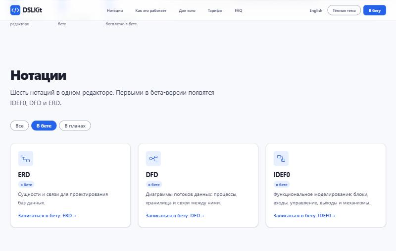
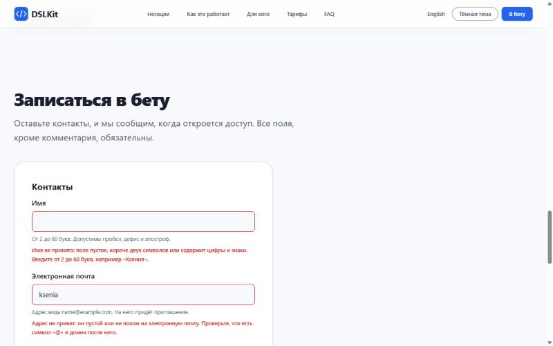
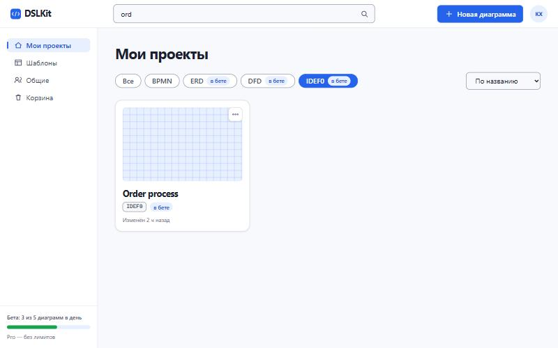
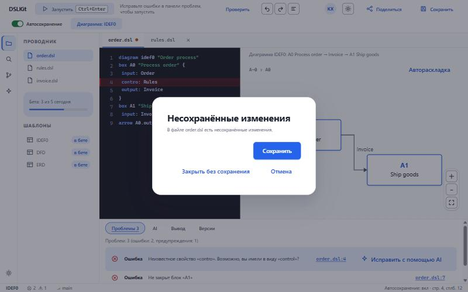

# Лабораторная работа №5. Разработка интерактивного интерфейса на JavaScript

## 1 Цель работы

Освоить основы JavaScript и работу с DOM, научиться обрабатывать события, проверять формы и сохранять состояние в LocalStorage на примере проекта DSLKit, веб-редактора диаграмм как кода, тематика которого соответствует направлению SaaS и будущему курсовому проекту.

## 2 Краткие теоретические сведения

**DOM.** Объектная модель документа представляет страницу в виде дерева узлов. Скрипт ищет узлы методами `getElementById`, `querySelector` и `querySelectorAll`, меняет текст через `textContent`, атрибуты через `setAttribute`, классы через `classList` и создаёт узлы методом `createElement`.

**События.** Обработчики подключаются методом `addEventListener`. Событие всплывает от целевого элемента к родителям, поэтому один обработчик на контейнере обслуживает много элементов: этот приём называется делегированием, а нужный элемент находит `event.target.closest`.

**Формы и валидация.** Событие `submit` отменяется методом `preventDefault`, значения проверяются кодом, а сообщения об ошибках показываются рядом с полями.

**LocalStorage.** Хранилище браузера записывает строки по ключам. Объекты сохраняются через `JSON.stringify` и читаются через `JSON.parse`, а ошибки доступа и разбора обрабатываются блоком `try/catch`.

**ES6+ и модули.** Код использует `const` и `let`, стрелочные функции, шаблонные строки, деструктуризацию и модули `import` и `export`.

## 3 Ход работы

### 3.1 Ветка и структура файлов

Работа выполнена в ветке `feature/javascript-interactivity`. Структура скриптов соответствует условию и показана в таблице 1. Основной файл `script.js` подключён в конце `body` как модуль: `type="module"`.

Таблица 1 – Структура JavaScript-кода проекта DSLKit

| Файл | Назначение |
|---|---|
| `js/script.js` | Точка входа: запускает компоненты, которые нашли свою разметку на странице |
| `js/utils/storage.js` | Безопасная обёртка над LocalStorage с запасным хранилищем в памяти |
| `js/utils/validation.js` | Чистые функции проверки имени, почты, размера команды, нотации и согласия |
| `js/components/theme.js` | Переключение и сохранение темы |
| `js/components/burger.js` | Закрытие меню клавишей Escape и после перехода по ссылке |
| `js/components/accordion.js` | Раскрывающиеся вопросы, открыт только один |
| `js/components/notation-filter.js` | Фильтр карточек нотаций |
| `js/components/waitlist-form.js` | Форма записи в бету с проверкой |
| `js/components/dashboard.js` | Фильтр, поиск и сортировка проектов |
| `js/components/settings.js` | Сохранение настроек |
| `js/components/editor.js` | Вкладки, диалог, автосохранение, переключатель вида |

### 3.2 Работа с DOM

Элементы ищутся по идентификаторам и селекторам, найденные узлы проверяются на `null`, а повторные выборки в цикле заменены ссылками в переменных. Фильтр нотаций создаёт кнопки и область состояния методом `createElement` и задаёт текст через `textContent`, поэтому в разметку не попадает пользовательский ввод. Видимость карточек меняется атрибутом `hidden`, состояние кнопок атрибутом `aria-pressed` и классом `filter__chip--active`.

### 3.3 События

Использованы пять типов событий: `click` (фильтры, вкладки, кнопки), `input` (поиск и проверка полей), `change` (сортировка, настройки, тема), `submit` (форма) и `keydown` (стрелки на вкладках, клавиша Escape, сочетание Ctrl и Enter). Дополнительно применено событие `toggle` для вопросов и событие `close` для диалога. Делегирование используется для кнопок фильтров, вкладок и настроек.

### 3.4 Интерактивные компоненты

Реализовано восемь компонентов, каждый использует события и сохраняет состояние в LocalStorage.

Фильтр нотаций на главной странице делит шесть карточек на группы «в бете» и «в планах». Выбранный фильтр сохраняется, а область `aria-live` сообщает число показанных карточек. Результат показан на рисунке 1.

Рисунок 1 – Фильтр нотаций: выбран статус «В бете», показаны три карточки

Форма записи в бету отменяет стандартную отправку, проверяет все поля и показывает сообщения об ошибках рядом с полями. Ошибочные поля получают `aria-invalid`, фокус переходит на первое из них, а ошибка исчезает, как только значение становится верным. Результат показан на рисунке 2.

Рисунок 2 – Проверка формы: пустое имя и неверная почта подсвечены, сообщения показаны под полями

При верных данных заявка добавляется в список в LocalStorage, в консоль выводится сообщение, и браузер открывает страницу `thanks.html`. Данные не попадают в адрес страницы.

Список проектов на экране дашборда поддерживает фильтр по нотации, поиск по названию и сортировку. Состояние сохраняется, а область `aria-live` сообщает число найденных проектов. Результат показан на рисунке 3.

Рисунок 3 – Дашборд: фильтр IDEF0, поиск «ord» и сортировка по названию дают один проект

Редактор переключает вкладки мышью и стрелками, показывает диалог несохранённых изменений при закрытии файла, переключает автосохранение и вид «Код» и «Холст» на телефоне. Диалог показан на рисунке 4.

Рисунок 4 – Редактор: нативный диалог при закрытии файла с несохранёнными изменениями

Остальные компоненты: переключатель темы запоминает выбор и применяет его на всех страницах, аккордеон вопросов оставляет открытым один ответ и помнит его, настройки сохраняют положение переключателей и списков, меню закрывается клавишей Escape.

### 3.5 Сохранение состояния

Состояние хранится в LocalStorage под ключами с префиксом `dslkit.`: тема, фильтр нотаций, открытый вопрос, заявки, состояние дашборда, настройки, вкладка и вид редактора. Модуль `storage.js` оборачивает чтение и запись в `try/catch` и возвращает запасное значение при ошибке доступа или повреждённых данных. Если LocalStorage недоступен, используется хранилище в памяти.

### 3.6 Обработка ошибок и стандарт ES6+

Чтение и запись данных защищены блоками `try/catch`, а точка входа запускает каждый компонент отдельно: ошибка одного компонента попадает в консоль и не останавливает остальные. Код использует `const` и `let`, стрелочные функции, шаблонные строки, деструктуризацию и модули. Обработчики подключены через `addEventListener`, атрибуты `onclick` не применяются.

### 3.7 Тестирование

Для каждого модуля написаны автоматические тесты на jsdom, которые разбирают настоящие страницы сайта. Тесты проверяют фильтры, форму с верными и неверными данными, восстановление состояния после перезагрузки, ошибки хранилища и отсутствие нужной разметки. Покрытие всех файлов JavaScript равно 100 процентов по строкам, ветвлениям и функциям. Работа компонентов дополнительно проверена в браузере Chrome: консоль не содержит ошибок, заявка попадает в LocalStorage, тема сохраняется между страницами. Проверка в Firefox и Edge и снимок вкладки Event Listeners инструментов разработчика остаются задачей на этап приёмки.

### 3.8 Фиксация изменений

Коммит с реализацией: https://github.com/KsushaKhadzhinova/DSLKit-Project/commit/39efd4f. Сообщение коммита: `feat: add JavaScript interactivity for a SaaS diagram editor`.

## Заключение

Для проекта DSLKit написан модульный JavaScript: точка входа, утилиты хранилища и валидации, восемь интерактивных компонентов. Использованы пять типов событий и делегирование, форма проверяется с понятными сообщениями, состояние сохраняется в LocalStorage и восстанавливается после перезагрузки. Автоматические тесты покрывают весь код, а работа компонентов подтверждена в браузере. Остаётся проверить страницы в Firefox и Edge.

## Приложение А – Листинг файла script.js

{{code:site/js/script.js}}

## Приложение Б – Листинг файла storage.js

{{code:site/js/utils/storage.js}}

## Приложение В – Листинг файла validation.js

{{code:site/js/utils/validation.js}}

## Приложение Г – Листинг файла notation-filter.js

{{code:site/js/components/notation-filter.js}}

## Приложение Д – Листинг файла waitlist-form.js

{{code:site/js/components/waitlist-form.js}}

## Приложение Е – Листинг файла dashboard.js

{{code:site/js/components/dashboard.js}}

## Приложение Ж – Листинг файла editor.js

{{code:site/js/components/editor.js}}
