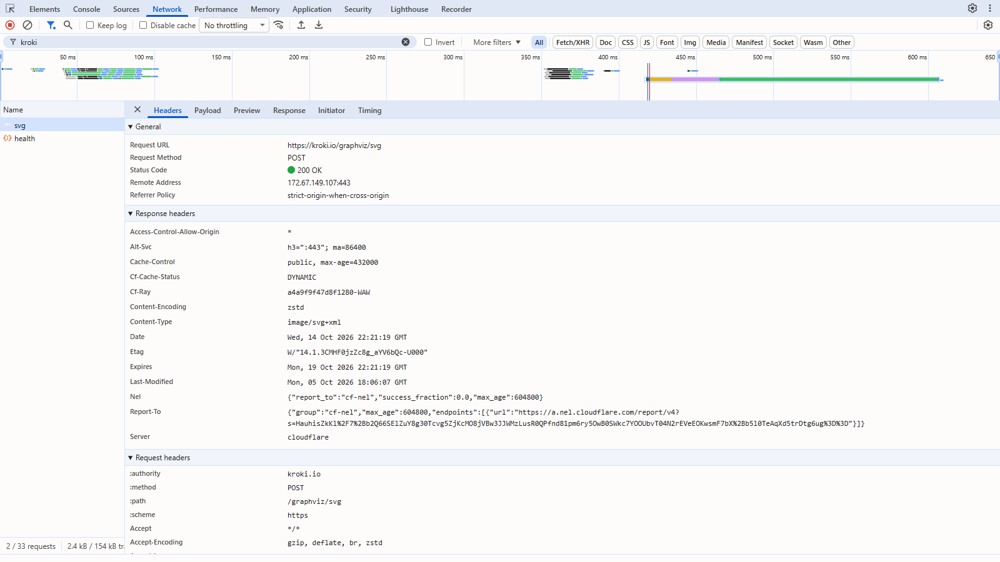
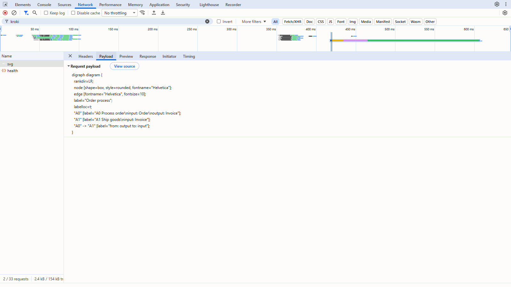
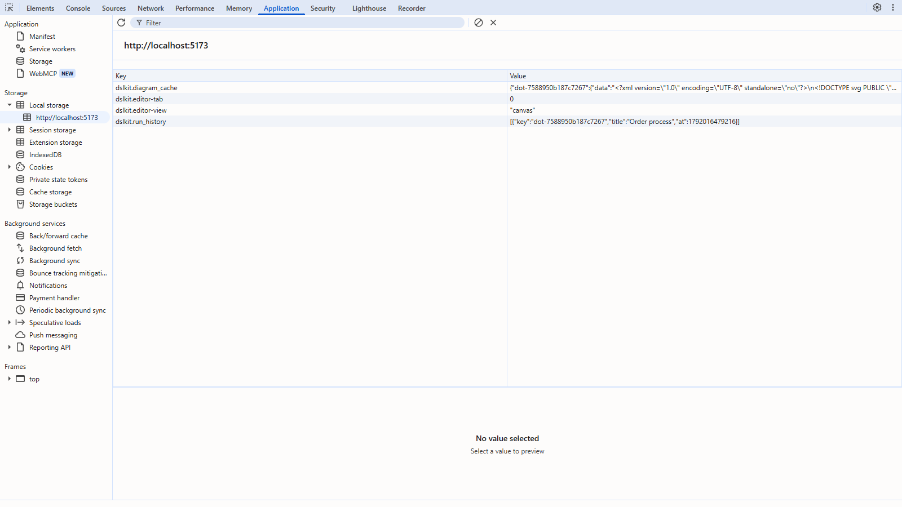
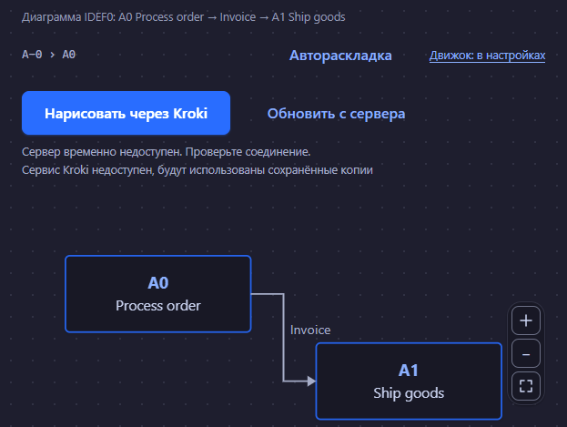

# Laboratory Work No. 6. Working with Browser APIs and Asynchronous Operations

## 1 Purpose of the Work

To master asynchronous programming in JavaScript, the Fetch API, the JSON format and client-side data storage on the example of integrating an external API into the DSLKit project, a web editor for diagrams as code that belongs to the SaaS direction and matches the future course project.

## 2 Brief Theoretical Background

**Asynchrony.** JavaScript runs in a single thread, and long operations (network, timers) are handed to the browser. When an operation finishes, the event loop puts its handler into a queue and calls it when the call stack is empty.

**Promise and async/await.** A Promise represents a result that will appear later and is in one of the states: pending, fulfilled or rejected. The `async/await` syntax lets asynchronous code read like sequential code, and errors are caught by a `try/catch` block.

**Fetch API.** The `fetch` function sends an HTTP request and returns a Promise with a `Response` object. It rejects only on a network error, so the response status must be checked through `response.ok`. The body is read with `json()` and `text()`, and a request is cancelled through `AbortController`.

**JSON and LocalStorage.** Objects become strings with `JSON.stringify` and are restored with `JSON.parse`. LocalStorage keeps strings under keys, works synchronously and holds a few megabytes, so a cache needs a time to live and a size limit.

**Security.** Keys in client code are visible to everyone, so secrets are not kept in a repository, and a foreign response is treated as untrusted. The browser allows a request to another domain only when the server answers with CORS headers.

## 3 Work Progress

### 3.1 Choosing the API and File Structure

The work is done in the branch `feature/async-api-storage`. The open Kroki API (`https://kroki.io`) is chosen for the project: it draws diagrams from text, which is the same task DSLKit solves, so it can be used in the course project too. No key or registration is needed. Two requests are used: `GET /health` checks that the service is available, and `POST /graphviz/svg` accepts Graphviz DOT text and returns an SVG image. The file structure matches the assignment and is shown in table 1.

Table 1 – Structure of the API integration code in the DSLKit project

| File | Purpose |
|---|---|
| `js/api/config.js` | Service address, response format, timeout, number of retries, cache lifetime |
| `js/api/apiService.js` | Requests `fetchData`, `postData`, `checkHealth`, `renderDiagram` and the `ApiError` class |
| `js/storage/localStorage.js` | Read and write wrappers, a cache with a lifetime, the run history |
| `js/utils/dataParser.js` | DSL parsing, DOT building, cache key, SVG cleaning |
| `js/engines/engines.js`, `js/engines/local-engine.js` | The list of generation engines and the own engine that draws in the browser |
| `js/components/diagram-runner.js` | Engine choice from the settings, buttons, loading indicator, error messages, offline mode |
| `js/script.js` | Entry point that starts the component together with the others |

### 3.2 Request Service

The function `createApi` takes a configuration, a `fetch` function and a pause function, so tests replace the network with fake responses. Every request attempt gets its own `AbortController`: it fires on a ten-second timeout or on a signal from the calling code. Errors are turned into the `ApiError` class with the kind `network`, `timeout`, `aborted`, `http` or `invalid`, and the code picks the user message by the kind.

Network errors, timeouts, code 429 and codes 5xx are retried up to three times with a pause that doubles after each attempt, and for code 429 the `Retry-After` header is respected. Client errors such as 400 and 404 are not retried. Identical parallel requests without an abort signal share one Promise. The function `renderDiagram` additionally checks that the response contains `svg` markup and otherwise returns an error of the kind `invalid`.

### 3.3 Storage

The diagram cache keeps the save time together with the data, so the lifetime of 24 hours is checked on reading, and when the cache is full the oldest entries are removed. The run history keeps the last five results without repeats. Both modules work through the shared `storage.js` layer from laboratory work 5, which wraps reads and writes in `try/catch` and returns a fallback value for corrupted data. The keys are named `diagram_cache`, `run_history` and `favorites`.

### 3.4 Data Conversion

The module `dataParser.js` reads the code from the editor: the `diagram` header, `box` blocks with the ports `input`, `control`, `output`, `mechanism`, and `arrow` lines. Unknown lines do not stop a run and go to a list of skipped lines. The model is turned into Graphviz DOT text with quotes, backslashes and line breaks escaped. The server response is treated as untrusted, so before showing it the tags `script`, `foreignObject`, `style`, `use`, `image` and animations, the `on*` attributes, unsafe styles and every `href` link except internal and `http(s)` ones are removed from the SVG. Before a link is checked, control characters are stripped from it because browsers ignore them.

Generation is not limited to a picture from a server. The engine is chosen on the settings page (the field "Diagram generation engine") and read again on every run. Three engines work through Kroki (Graphviz, Mermaid, PlantUML), and the own engine `local-engine.js` places the boxes in columns itself, draws arrows, labels and tooltips, and returns live SVG with separate `g`, `rect` and `text` elements. It sends no requests, so it works without the internet. For the other engines the same model is turned into DOT, Mermaid and PlantUML text, and the choice is kept in the site settings in LocalStorage.

### 3.5 Interface Integration

The editor canvas gets the buttons "Draw with Kroki" and "Refresh from server", a status line with `aria-live`, a line about service availability and a list of the last runs. While a request runs, the canvas has `aria-busy` and the status line shows the loading text; the buttons stay available so keyboard focus is not lost, and a new run cancels the previous request. The page starts a diagram by itself when it opens, and a new engine chosen in the settings is applied from the next run. A successful result is shown in figure 1.

Figure 1 – Editor: the diagram is received from the Kroki service and saved, and a history entry has appeared

A repeated run with the same code takes the saved copy without a request, and the "Refresh from server" button ignores the cache. When a request fails and a copy exists, the canvas shows it with the label "Cached data". Without a copy the user sees a clear message: the server is unavailable, the waiting time is over, too many requests or an unexpected response. Offline mode is shown in figure 2.

Figure 2 – Offline mode: the diagram is shown from LocalStorage with the label "Cached data"

A new run cancels the previous request through `AbortController`, and a cancelled request neither shows an error nor removes the loading indicator of the new one.

### 3.6 Security and Errors

Kroki needs no key, so the repository holds no secrets. For future APIs the files `.env.local` and `site/js/api/config.local.js` are added to `.gitignore`. All requests are wrapped in error handling, details go to the console, and the user gets a short message. The browser request to Kroki is allowed by the CORS policy of the service itself, and the page checks availability through `GET /health`.

### 3.7 Testing

Automated tests are written for the request service, the storage, the data parsing and the component. The network is replaced by a fake `fetch`, so the tests check success, codes 404, 429 and 503, retries with pauses, a timeout, cancellation, merging of identical requests, a wrong response and corrupted storage. Coverage of all JavaScript files is 100 percent for lines, branches and functions. The integration is additionally checked in Chrome with the real Kroki service: the diagram is received, the entry lands in LocalStorage, and offline mode shows the saved copy. Screenshots of the Network and Application tabs and testing in Firefox and Edge remain a task for the acceptance stage.

### 3.8 Committing the Changes

The commit with the implementation: https://github.com/KsushaKhadzhinova/DSLKit-Project/commit/2102742. The commit message: `feat: integrate external API, caching and localStorage for SaaS diagram editor`.

### 3.9 Checking in DevTools

The work was checked in Chrome 155: requests in the Network tab and storage in the Application panel. The storage keys are named after the data (`diagram_cache`, `run_history`) instead of `cached_products` and `search_history` from the assignment example, because the project stores diagrams, not products.

The request to the service is shown in Figure 3: the POST method to kroki.io/graphviz/svg, status 200 and the response type image/svg+xml.

Figure 3 – The Network tab: the request to Kroki

The sent request body is shown in Figure 4: it is the DOT text built from the DSL.

Figure 4 – The Payload tab: the DOT text sent to Kroki

The storage is shown in Figure 5: the diagram cache dslkit.diagram_cache and the run log dslkit.run_history, as well as the editor tab and view.

Figure 5 – The Application panel: the editor LocalStorage

The error state is shown in Figure 6: with the service unavailable and an empty cache the editor reports the problem and keeps the work area.

Figure 6 – The editor with the service unavailable and an empty cache

## Conclusion

The open Kroki API is connected to the DSLKit project: the diagram code from the editor becomes Graphviz DOT, is sent with a `POST` request, and the received SVG is cleaned and drawn on the canvas. Requests run with a timeout, retries and cancellation, results are saved in LocalStorage for 24 hours, and without a connection a saved copy is shown with a label. Automated tests cover all the code, and the integration is confirmed in a browser with the real service. What remains is to attach screenshots of the developer tools and to check the pages in Firefox and Edge.

## Appendix A – Listing of config.js

{{code:site/js/api/config.js}}

## Appendix B – Listing of apiService.js

{{code:site/js/api/apiService.js}}

## Appendix C – Listing of localStorage.js

{{code:site/js/storage/localStorage.js}}

## Appendix D – Listing of dataParser.js

{{code:site/js/utils/dataParser.js}}

## Appendix E – Listing of diagram-runner.js

{{code:site/js/components/diagram-runner.js}}
