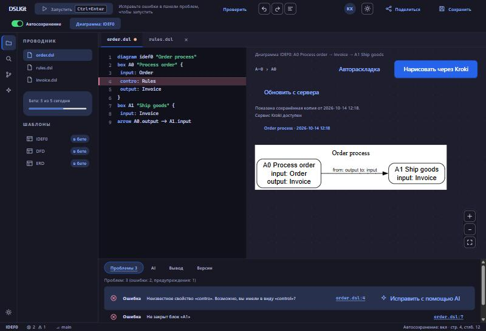
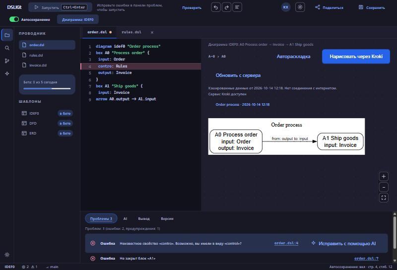

# Лабораторная работа №6. Работа с API браузера и асинхронными операциями

## 1 Цель работы

Освоить асинхронное программирование в JavaScript, работу с Fetch API, форматом JSON и клиентским хранением данных на примере интеграции внешнего API в проект DSLKit, веб-редактор диаграмм как кода, тематика которого соответствует направлению SaaS и будущему курсовому проекту.

## 2 Краткие теоретические сведения

**Асинхронность.** JavaScript выполняется в одном потоке, а долгие операции (сеть, таймеры) передаются браузеру. Когда операция завершается, цикл событий ставит её обработчик в очередь и вызывает его, когда стек вызовов пуст.

**Promise и async/await.** Promise представляет результат, который появится позже, и находится в одном из состояний: ожидание, выполнен или отклонён. Запись `async/await` позволяет писать асинхронный код как последовательный, а ошибки ловить блоком `try/catch`.

**Fetch API.** Функция `fetch` отправляет HTTP-запрос и возвращает Promise с объектом `Response`. Она отклоняется только при сетевой ошибке, поэтому статус ответа нужно проверять через `response.ok`. Тело читается методами `json()` и `text()`, отмена запроса выполняется через `AbortController`.

**JSON и LocalStorage.** Объекты превращаются в строки методом `JSON.stringify` и восстанавливаются методом `JSON.parse`. LocalStorage хранит строки по ключам, работает синхронно и вмещает несколько мегабайт, поэтому для кэша нужны срок жизни и ограничение размера.

**Безопасность.** Ключи в клиентском коде видны всем, поэтому секреты не хранят в репозитории, а чужой ответ считают недоверенным. Браузер разрешает запрос к другому домену только тогда, когда сервер отвечает заголовками CORS.

## 3 Ход работы

### 3.1 Выбор API и структура файлов

Работа выполнена в ветке `feature/async-api-storage`. Для проекта выбрано открытое API Kroki (`https://kroki.io`): оно по тексту рисует диаграммы, то есть решает ту же задачу, что и DSLKit, поэтому его можно использовать и в курсовом проекте. Ключ и регистрация не нужны. Применяются два запроса: `GET /health` проверяет доступность сервиса, а `POST /graphviz/svg` принимает текст Graphviz DOT и возвращает изображение SVG. Структура файлов соответствует условию и показана в таблице 1.

Таблица 1 – Структура кода интеграции с API в проекте DSLKit

| Файл | Назначение |
|---|---|
| `js/api/config.js` | Адрес сервиса, формат ответа, таймаут, число повторов, срок жизни кэша |
| `js/api/apiService.js` | Запросы `fetchData`, `postData`, `checkHealth`, `renderDiagram` и класс ошибок `ApiError` |
| `js/storage/localStorage.js` | Обёртки чтения и записи, кэш с сроком жизни, история запусков |
| `js/utils/dataParser.js` | Разбор DSL, построение DOT, ключ кэша, очистка SVG |
| `js/engines/engines.js`, `js/engines/local-engine.js` | Список движков генерации и собственный движок, который рисует в браузере |
| `js/components/diagram-runner.js` | Выбор движка, кнопки, индикатор загрузки, сообщения об ошибках, офлайн-режим |
| `js/script.js` | Точка входа, подключает компонент вместе с остальными |

### 3.2 Сервис запросов

Функция `createApi` принимает конфигурацию, функцию `fetch` и функцию паузы, поэтому в тестах сеть заменяется подставными ответами. Каждая попытка запроса получает свой `AbortController`: он срабатывает по таймауту в десять секунд или по сигналу вызывающего кода. Ошибки приводятся к классу `ApiError` с видом `network`, `timeout`, `aborted`, `http` или `invalid`, и по виду код выбирает сообщение для пользователя.

Сетевые ошибки, таймауты, код 429 и коды 5xx повторяются до трёх раз с паузой, которая растёт вдвое после каждой попытки, а при коде 429 учитывается заголовок `Retry-After`. Ошибки клиента, например 400 и 404, не повторяются. Одинаковые параллельные запросы без сигнала отмены используют один общий Promise. Функция `renderDiagram` дополнительно проверяет, что в ответе есть разметка `svg`, иначе возвращает ошибку вида `invalid`.

### 3.3 Хранилище

Кэш диаграмм хранит вместе с данными момент сохранения, поэтому срок жизни в 24 часа проверяется при чтении, а при переполнении удаляются самые старые записи. История запусков хранит последние пять результатов без повторов. Оба модуля работают через общий слой `storage.js` из лабораторной работы 5, который оборачивает запись и чтение в `try/catch` и возвращает запасное значение при повреждённых данных. Ключи называются `diagram_cache`, `run_history` и `favorites`.

### 3.4 Преобразование данных

Модуль `dataParser.js` читает код из редактора: заголовок `diagram`, блоки `box` с портами `input`, `control`, `output`, `mechanism` и стрелки `arrow`. Незнакомые строки не останавливают запуск, а попадают в список пропущенных. Из модели строится текст Graphviz DOT с экранированием кавычек, обратных косых черт и переводов строк. Ответ сервера считается недоверенным, поэтому перед показом из SVG удаляются теги `script`, `foreignObject`, `style`, `use`, `image` и анимации, атрибуты `on*`, небезопасные стили и любые ссылки `href`, кроме внутренних и `http(s)`. Перед проверкой ссылки из неё убираются управляющие символы, потому что браузеры их игнорируют.

Генерация не ограничена картинкой от сервера. Список движков показан в таблице 1: три движка работают через Kroki (Graphviz, Mermaid, PlantUML), а собственный движок `local-engine.js` сам размещает блоки по столбцам, рисует стрелки, подписи и всплывающие подсказки и возвращает живой SVG с отдельными элементами `g`, `rect` и `text`. Он не отправляет запросов, поэтому работает без интернета. Для остальных движков из той же модели строятся тексты DOT, Mermaid и PlantUML, а выбор движка сохраняется в LocalStorage.

### 3.5 Интеграция с интерфейсом

На холсте редактора добавлены кнопки «Нарисовать через Kroki» и «Обновить с сервера», строка состояния с `aria-live`, строка о доступности сервиса и список последних запусков. Пока идёт запрос, на холсте стоит `aria-busy`, а в строке состояния показан текст загрузки; кнопки остаются доступными, чтобы фокус клавиатуры не терялся, а новый запуск отменяет предыдущий запрос. Страница сама запускает диаграмму при открытии, а список выбора движка перерисовывает её при смене значения. Успешный результат показан на рисунке 1.



Рисунок 1 – Редактор: диаграмма получена от сервиса Kroki и сохранена, в истории появилась запись

Повторный запуск с тем же кодом берёт сохранённую копию без запроса, а кнопка «Обновить с сервера» игнорирует кэш. Если запрос не удался, а копия есть, холст показывает её с пометкой «Кэшированные данные». Без копии пользователь видит понятное сообщение: сервер недоступен, время ожидания вышло, слишком много запросов или неожиданный ответ. Офлайн-режим показан на рисунке 2.



Рисунок 2 – Офлайн-режим: диаграмма показана из LocalStorage с пометкой «Кэшированные данные»

Новый запуск отменяет предыдущий запрос через `AbortController`, а отменённый запрос не выводит ошибку и не снимает индикатор загрузки нового.

### 3.6 Безопасность и ошибки

Ключ для Kroki не нужен, поэтому в репозитории нет секретов. Для будущих API в `.gitignore` добавлены файлы `.env.local` и `site/js/api/config.local.js`. Все запросы обёрнуты в обработку ошибок, подробности попадают в консоль, а пользователь получает короткое сообщение. Браузерный запрос к Kroki разрешён политикой CORS самого сервиса, на странице работает проверка доступности через `GET /health`.

### 3.7 Тестирование

Для сервиса запросов, хранилища, разбора данных и компонента написаны автоматические тесты. Сеть заменяется подставным `fetch`, поэтому тесты проверяют успех, коды 404, 429 и 503, повторы с паузами, таймаут, отмену, объединение одинаковых запросов, неверный ответ и повреждённое хранилище. Покрытие всех файлов JavaScript равно 100 процентов по строкам, ветвлениям и функциям. Интеграция дополнительно проверена в браузере Chrome с настоящим сервисом Kroki: диаграмма получена, запись попала в LocalStorage, офлайн-режим показал сохранённую копию. Снимки вкладок Network и Application и проверка в Firefox и Edge остаются задачей на этап приёмки.

### 3.8 Фиксация изменений

Коммит с реализацией: https://github.com/KsushaKhadzhinova/DSLKit-Project/commit/2102742. Сообщение коммита: `feat: integrate external API, caching and localStorage for SaaS diagram editor`.

## Заключение

Для проекта DSLKit подключено открытое API Kroki: код диаграммы из редактора превращается в Graphviz DOT, отправляется запросом `POST`, а полученный SVG очищается и рисуется на холсте. Запросы выполняются с таймаутом, повторами и отменой, результаты сохраняются в LocalStorage на 24 часа, а без связи показывается сохранённая копия с пометкой. Автоматические тесты покрывают весь код, а интеграция проверена в браузере с настоящим сервисом. Остаётся приложить снимки инструментов разработчика и проверить страницы в Firefox и Edge.

## Приложение А – Листинг файла config.js

```js
// Kroki renders diagrams from text and needs no API key, so nothing secret lives in the repository.
export const API_CONFIG = {
  baseUrl: 'https://kroki.io',
  diagramType: 'graphviz',
  outputFormat: 'svg',
  timeoutMs: 10000,
  retries: 3,
  retryDelayMs: 300,
  maxRetryDelayMs: 5000,
  cacheTtlMs: 24 * 60 * 60 * 1000,
};
```

## Приложение Б – Листинг файла apiService.js

```js
import { API_CONFIG } from './config.js';

export class ApiError extends Error {
  constructor(message, { kind, status = null } = {}) {
    super(message);
    this.name = 'ApiError';
    this.kind = kind;
    this.status = status;
  }
}

const defaultSleep = (ms) => new Promise((resolve) => setTimeout(resolve, ms));

const isRetryable = (error) => error.kind === 'network' || error.kind === 'timeout' || error.status === 429 || (error.status !== null && error.status >= 500);

const retryAfterMs = (response, fallback, max) => {
  const seconds = Number(response?.headers?.get?.('Retry-After'));
  return Number.isFinite(seconds) && seconds > 0 ? Math.min(seconds * 1000, max) : fallback;
};

export const createApi = ({ config = API_CONFIG, fetchImpl = globalThis.fetch?.bind(globalThis), sleep = defaultSleep } = {}) => {
  const inflight = new Map();

  // One attempt: the caller's signal and the timeout both abort the same fetch.
  const attempt = async (url, { method, body, headers, signal, timeoutMs }) => {
    const controller = new AbortController();
    const onAbort = () => controller.abort();
    let timedOut = false;
    const timer = setTimeout(() => {
      timedOut = true;
      controller.abort();
    }, timeoutMs);
    if (signal?.aborted) controller.abort();
    signal?.addEventListener('abort', onAbort, { once: true });
    const cleanup = () => {
      clearTimeout(timer);
      signal?.removeEventListener('abort', onAbort);
    };
    let response;
    try {
      response = await fetchImpl(url, { method, body, headers, signal: controller.signal });
    } catch {
      cleanup();
      if (timedOut) throw new ApiError('Request timed out', { kind: 'timeout' });
      if (signal?.aborted) throw new ApiError('Request was cancelled', { kind: 'aborted' });
      throw new ApiError('Network error', { kind: 'network' });
    }
    cleanup();
    if (!response.ok) {
      const error = new ApiError(`HTTP ${response.status}`, { kind: 'http', status: response.status });
      error.response = response;
      throw error;
    }
    return response;
  };

  // Retries network failures, timeouts, 429 and 5xx up to `retries` times with exponential backoff.
  const send = async (path, { method = 'GET', body, headers = {}, signal, timeoutMs = config.timeoutMs, retries = config.retries, parse = 'text' } = {}) => {
    const url = `${config.baseUrl}${path}`;
    const tryOnce = async (attemptNumber) => {
      try {
        const response = await attempt(url, { method, body, headers, signal, timeoutMs });
        try {
          return parse === 'json' ? await response.json() : await response.text();
        } catch {
          throw new ApiError('The response could not be read', { kind: 'invalid' });
        }
      } catch (error) {
        if (!isRetryable(error) || attemptNumber >= retries) throw error;
        const backoff = Math.min(config.retryDelayMs * 2 ** attemptNumber, config.maxRetryDelayMs);
        await sleep(retryAfterMs(error.response, backoff, config.maxRetryDelayMs));
        return tryOnce(attemptNumber + 1);
      }
    };
    return tryOnce(0);
  };

  // Identical parallel requests without a signal share one promise; requests with a signal stay separate so cancelling one cannot break another.
  const request = (path, options = {}) => {
    if (options.signal) return send(path, options);
    const key = `${options.method ?? 'GET'} ${options.parse ?? 'text'} ${path} ${options.body ?? ''}`;
    if (!inflight.has(key)) {
      const promise = send(path, options).finally(() => inflight.delete(key));
      inflight.set(key, promise);
    }
    return inflight.get(key);
  };

  const fetchData = (path, { params = {}, ...options } = {}) => {
    const query = new URLSearchParams(params).toString();
    return request(query ? `${path}?${query}` : path, options);
  };

  const postData = (path, body, { headers = {}, ...options } = {}) => request(path, { ...options, method: 'POST', body, headers });

  const checkHealth = (options = {}) => fetchData('/health', { ...options, parse: 'json' });

  // Sends diagram source (Graphviz DOT) and returns the SVG text; anything else is rejected as an unexpected answer.
  const renderDiagram = async (source, { type = config.diagramType, format = config.outputFormat, ...options } = {}) => {
    const svg = await postData(`/${type}/${format}`, source, { ...options, headers: { 'Content-Type': 'text/plain' } });
    if (!/<svg[\s>]/i.test(svg)) throw new ApiError('The service did not return a diagram', { kind: 'invalid' });
    return svg;
  };

  return { fetchData, postData, checkHealth, renderDiagram };
};

export const { fetchData, postData, checkHealth, renderDiagram } = createApi();
```

## Приложение В – Листинг файла localStorage.js

```js
import { createMemoryBackend, createStorage, getStorage } from '../utils/storage.js';

export const STORAGE_KEYS = {
  diagramCache: 'diagram_cache',
  history: 'run_history',
  favorites: 'favorites',
};

const MAX_CACHE_ENTRIES = 20;
const MAX_HISTORY = 5;

const isPlainObject = (value) => typeof value === 'object' && value !== null && !Array.isArray(value);

// Thin wrappers named in the lab assignment; the storage object already handles JSON and write errors.
export const saveToLocalStorage = (key, data, storage = getStorage()) => storage.set(key, data);
export const loadFromLocalStorage = (key, storage = getStorage()) => storage.get(key, null);

// Cache with a time-to-live: every entry keeps the moment it was saved, the oldest entries go first when the cache is full.
export const createCache = ({ storage = createStorage(createMemoryBackend()), ttlMs, now = () => Date.now(), maxEntries = MAX_CACHE_ENTRIES } = {}) => {
  const readAll = () => {
    const saved = storage.get(STORAGE_KEYS.diagramCache, {});
    return isPlainObject(saved) ? saved : {};
  };

  return {
    get(key) {
      const entry = readAll()[key];
      if (!isPlainObject(entry) || typeof entry.savedAt !== 'number') return null;
      return { data: entry.data, savedAt: entry.savedAt, expired: now() - entry.savedAt > ttlMs };
    },
    set(key, data) {
      const entries = { ...readAll(), [key]: { data, savedAt: now() } };
      const keys = Object.keys(entries).sort((a, b) => entries[a].savedAt - entries[b].savedAt);
      keys.slice(0, Math.max(0, keys.length - maxEntries)).forEach((old) => delete entries[old]);
      return storage.set(STORAGE_KEYS.diagramCache, entries);
    },
    clear() {
      return storage.remove(STORAGE_KEYS.diagramCache);
    },
  };
};

// The last runs, newest first, without repeats.
export const createHistory = ({ storage = createStorage(createMemoryBackend()), limit = MAX_HISTORY } = {}) => {
  const read = () => {
    const saved = storage.get(STORAGE_KEYS.history, []);
    return Array.isArray(saved) ? saved.filter(isPlainObject) : [];
  };
  return {
    list: read,
    add(entry) {
      const next = [entry, ...read().filter((item) => item.key !== entry.key)].slice(0, limit);
      storage.set(STORAGE_KEYS.history, next);
      return next;
    },
    clear() {
      storage.remove(STORAGE_KEYS.history);
    },
  };
};
```

## Приложение Г – Листинг файла dataParser.js

```js
const PORTS = ['input', 'control', 'output', 'mechanism'];
const BOX_PATTERN = /^box\s+(\S+)\s+"([^"]*)"\s*\{?\s*$/;
const PORT_PATTERN = /^(input|control|output|mechanism)\s*:\s*(.+)$/;
const ARROW_PATTERN = /^arrow\s+(\S+?)(?:\.(\w+))?\s*->\s*(\S+?)(?:\.(\w+))?$/;
const DIAGRAM_PATTERN = /^diagram\s+(\S+)(?:\s+"([^"]*)")?$/;

// Reads the DSL shown in the editor. Lines it does not understand are reported instead of stopping the run.
export const parseDsl = (source) => {
  const model = { type: 'diagram', title: '', boxes: [], arrows: [], skipped: [] };
  let box = null;
  String(source)
    .split(/\r?\n/)
    .forEach((raw, index) => {
      const line = raw.trim();
      if (line === '') return;
      let match;
      if ((match = DIAGRAM_PATTERN.exec(line))) {
        model.type = match[1];
        model.title = match[2] ?? '';
      } else if ((match = BOX_PATTERN.exec(line))) {
        box = { id: match[1], name: match[2], ports: Object.fromEntries(PORTS.map((port) => [port, []])) };
        model.boxes.push(box);
      } else if ((match = PORT_PATTERN.exec(line)) && box) {
        box.ports[match[1]].push(match[2].trim());
      } else if ((match = ARROW_PATTERN.exec(line))) {
        model.arrows.push({ from: match[1], fromPort: match[2] ?? '', to: match[3], toPort: match[4] ?? '' });
      } else if (line !== '}') {
        model.skipped.push(index + 1);
      }
    });
  return model;
};

const quote = (text) => `"${String(text).replace(/\\/g, '\\\\').replace(/"/g, '\\"').replace(/\r?\n/g, '\\n')}"`;

const portLabel = (port, side) => (port ? `${side}: ${port}` : '');

// Turns the parsed model into Graphviz DOT, the format the Kroki endpoint accepts.
export const toDot = (model) => {
  const lines = [
    'digraph diagram {',
    '  rankdir=LR;',
    '  node [shape=box, style=rounded, fontname="Helvetica"];',
    '  edge [fontname="Helvetica", fontsize=10];',
  ];
  if (model.title) lines.push(`  label=${quote(model.title)};`, '  labelloc=t;');
  model.boxes.forEach((box) => {
    const details = PORTS.filter((port) => box.ports[port].length > 0).map((port) => `${port}: ${box.ports[port].join(', ')}`);
    lines.push(`  ${quote(box.id)} [label=${quote([`${box.id} ${box.name}`, ...details].join('\n'))}];`);
  });
  model.arrows.forEach((arrow) => {
    const label = [portLabel(arrow.fromPort, 'from'), portLabel(arrow.toPort, 'to')].filter(Boolean).join(' ');
    lines.push(`  ${quote(arrow.from)} -> ${quote(arrow.to)}${label ? ` [label=${quote(label)}]` : ''};`);
  });
  lines.push('}');
  return lines.join('\n');
};

const detailLines = (box) => PORTS.filter((port) => box.ports[port].length > 0).map((port) => `${port}: ${box.ports[port].join(', ')}`);

const edgeLabel = (arrow) => [portLabel(arrow.fromPort, 'from'), portLabel(arrow.toPort, 'to')].filter(Boolean).join(' ');

// Arrows that point at boxes missing from the model are left out of formats that need every node declared.
const knownArrows = (model) => model.arrows.filter(({ from, to }) => model.boxes.some((box) => box.id === from) && model.boxes.some((box) => box.id === to));

// Mermaid flowchart text for the Kroki mermaid endpoint. Node names are numbered because Mermaid ids cannot hold arbitrary characters.
export const toMermaid = (model) => {
  const name = (id) => `n${model.boxes.findIndex((box) => box.id === id)}`;
  const text = (value) => String(value).replace(/"/g, '#quot;');
  const lines = ['flowchart LR'];
  model.boxes.forEach((box) => lines.push(`  ${name(box.id)}["${[text(`${box.id} ${box.name}`), ...detailLines(box).map(text)].join('<br/>')}"]`));
  knownArrows(model).forEach((arrow) => {
    const label = edgeLabel(arrow);
    lines.push(`  ${name(arrow.from)} -->${label ? `|"${text(label)}"|` : ''} ${name(arrow.to)}`);
  });
  return lines.join('\n');
};

// PlantUML text for the Kroki plantuml endpoint.
export const toPlantUml = (model) => {
  const name = (id) => `n${model.boxes.findIndex((box) => box.id === id)}`;
  const text = (value) => String(value).replace(/"/g, "'").replace(/\r?\n/g, ' ');
  const lines = ['@startuml', 'left to right direction'];
  if (model.title) lines.push(`title ${text(model.title)}`);
  model.boxes.forEach((box) => lines.push(`rectangle "${[text(`${box.id} ${box.name}`), ...detailLines(box).map(text)].join('\\n')}" as ${name(box.id)}`));
  knownArrows(model).forEach((arrow) => {
    const label = edgeLabel(arrow);
    lines.push(`${name(arrow.from)} --> ${name(arrow.to)}${label ? ` : ${text(label)}` : ''}`);
  });
  lines.push('@enduml');
  return lines.join('\n');
};

// A stable key for the cache: two independent 32-bit hashes make an accidental collision very unlikely.
export const sourceKey = (source) => {
  let first = 5381;
  let second = 2166136261;
  for (const char of String(source)) {
    const code = char.codePointAt(0);
    first = ((first * 33) ^ code) >>> 0;
    second = Math.imul(second ^ code, 16777619) >>> 0;
  }
  return `dot-${first.toString(16)}${second.toString(16)}`;
};

const SVG_NAMESPACE = 'http://www.w3.org/2000/svg';
const BLOCKED_TAGS = [
  'script',
  'foreignObject',
  'iframe',
  'object',
  'embed',
  'style',
  'use',
  'image',
  'feImage',
  'set',
  'animate',
  'animateTransform',
  'animateMotion',
];
const SAFE_LINK = /^(?:#|https?:\/\/)/i;

// The SVG comes from another server, so scripts, animations, external loads, event handlers and unsafe links are removed before it enters the page.
export const sanitizeSvg = (svgText, parser) => {
  const doc = parser.parseFromString(svgText, 'image/svg+xml');
  const svg = doc.documentElement;
  if (!svg || svg.localName !== 'svg' || doc.querySelector('parsererror')) return null;
  BLOCKED_TAGS.forEach((tag) => svg.querySelectorAll(tag).forEach((node) => node.remove()));
  // Elements from other namespaces (for example XHTML meta, base or form) have no place in a drawing.
  [...svg.querySelectorAll('*')].filter((node) => node.namespaceURI !== SVG_NAMESPACE).forEach((node) => node.remove());
  [svg, ...svg.querySelectorAll('*')].forEach((node) => {
    [...node.attributes].forEach(({ name, value }) => {
      // Control characters inside a scheme are ignored by browsers, so they are removed before the link is judged.
      const link = value.replace(new RegExp('[\u0000-\u0020\u007f-\u009f]', 'g'), '');
      const unsafeLink = /(?:^|:)href$/i.test(name) && !SAFE_LINK.test(link);
      // CSS escapes hide a function name from a text check, so a style that contains a backslash is dropped as well.
      const unsafeStyle = name === 'style' && (/url\(|expression\(|javascript:/i.test(value) || value.includes(String.fromCharCode(92)));
      if (/^on/i.test(name) || unsafeLink || unsafeStyle) node.removeAttribute(name);
    });
  });
  return svg;
};
```

## Приложение Д – Листинг файла diagram-runner.js

```js
import { renderDiagram, checkHealth } from '../api/apiService.js';
import { API_CONFIG } from '../api/config.js';
import { createCache, createHistory } from '../storage/localStorage.js';
import { ENGINES, findEngine } from '../engines/engines.js';
import { parseDsl, sanitizeSvg, sourceKey } from '../utils/dataParser.js';

const MESSAGES = {
  empty: 'В редакторе нет кода диаграммы.',
  offline: 'Нет соединения с интернетом.',
  timeout: 'Сервер не ответил вовремя. Попробуйте ещё раз.',
  network: 'Сервер временно недоступен. Проверьте соединение.',
  invalid: 'Сервис вернул неожиданный ответ.',
  rejected: 'Сервис не принял код диаграммы.',
  limit: 'Слишком много запросов. Подождите немного и повторите.',
  server: (status) => `Сервер вернул ошибку (код ${status}).`,
};

const errorMessage = (error) => {
  if (error.kind === 'http') {
    if (error.status === 429) return MESSAGES.limit;
    if (error.status === 400) return MESSAGES.rejected;
    return MESSAGES.server(error.status);
  }
  return MESSAGES[error.kind] ?? MESSAGES.network;
};

const formatTime = (ms) => new Date(ms).toISOString().slice(0, 16).replace('T', ' ');

export const initDiagramRunner = ({
  root = document,
  storage,
  api = { renderDiagram, checkHealth },
  now = () => Date.now(),
  logger = console,
  isOnline = () => root.defaultView.navigator.onLine,
  autoRun = true,
} = {}) => {
  const page = root.querySelector('.app-page--editor');
  const renderButton = page?.querySelector('.canvas__render');
  if (!renderButton) return null;

  const refreshButton = page.querySelector('.canvas__refresh');
  const status = page.querySelector('.canvas__status');
  const remote = page.querySelector('.canvas__remote');
  const local = page.querySelector('.canvas__diagram');
  const service = page.querySelector('.canvas__service');
  const historyList = page.querySelector('.canvas__history');
  const engineSelect = page.querySelector('.canvas__engine');
  const canvas = page.querySelector('.canvas');
  const parser = new root.defaultView.DOMParser();
  const cache = createCache({ storage, ttlMs: API_CONFIG.cacheTtlMs, now });
  const history = createHistory({ storage });
  let controller = null;

  const setStatus = (text) => {
    status.textContent = text;
  };
  const setBusy = (busy) => {
    canvas.setAttribute('aria-busy', String(busy));
  };

  const source = () => [...page.querySelectorAll('.code__line code')].map((line) => line.textContent).join('\n');

  const currentEngine = () => findEngine(engineSelect?.value);

  const show = (svgText, note) => {
    const svg = sanitizeSvg(svgText, parser);
    if (!svg) return false;
    svg.setAttribute('role', 'img');
    svg.setAttribute('aria-label', `Диаграмма: ${currentEngine().label}`);
    remote.replaceChildren(root.importNode(svg, true));
    remote.hidden = false;
    local?.setAttribute('hidden', '');
    setStatus(note);
    return true;
  };

  const renderHistory = () => {
    if (!historyList) return;
    const items = history.list();
    historyList.replaceChildren(
      ...items.map((entry) => {
        const item = root.createElement('li');
        const button = root.createElement('button');
        button.type = 'button';
        button.className = 'button button--quiet canvas__history-item';
        button.dataset.key = entry.key;
        button.textContent = `${entry.title || 'Без названия'} · ${formatTime(entry.at)}`;
        item.append(button);
        return item;
      }),
    );
    historyList.hidden = items.length === 0;
  };

  const run = async ({ refresh = false } = {}) => {
    const model = parseDsl(source());
    if (model.boxes.length === 0) {
      setStatus(MESSAGES.empty);
      return false;
    }
    const engine = currentEngine();
    const input = engine.build(model);
    controller?.abort();
    // The own engine draws in the browser: no request, no cache, and it works offline.
    if (!engine.type) {
      setBusy(false);
      return show(input, 'Диаграмма построена собственным движком в браузере.');
    }
    const key = sourceKey(`${engine.id}
${input}`);
    const cached = cache.get(key);

    if (cached && !cached.expired && !refresh && show(cached.data, `Показана сохранённая копия от ${formatTime(cached.savedAt)}.`)) {
      setBusy(false);
      return true;
    }

    controller = new AbortController();
    const { signal } = controller;
    setBusy(true);
    setStatus('Загрузка диаграммы…');
    let succeeded = false;
    try {
      if (!isOnline()) throw Object.assign(new Error('offline'), { kind: 'offline' });
      const svgText = await api.renderDiagram(input, { signal, type: engine.type });
      if (signal.aborted) throw Object.assign(new Error('cancelled'), { kind: 'aborted' });
      if (!show(svgText, `Диаграмма получена от сервиса Kroki (${engine.type}).`)) throw Object.assign(new Error('invalid'), { kind: 'invalid' });
      cache.set(key, svgText);
      history.add({ key, title: model.title, at: now() });
      renderHistory();
      succeeded = true;
    } catch (error) {
      if (error.kind !== 'aborted') {
        logger.error('DSLKit: не удалось получить диаграмму', error.kind, error.status ?? '');
        const shown = cached && show(cached.data, `Кэшированные данные от ${formatTime(cached.savedAt)}. ${errorMessage(error)}`);
        if (!shown) setStatus(error.kind === 'offline' ? `${errorMessage(error)} Сохранённой копии этой диаграммы нет.` : errorMessage(error));
      }
    }
    // A cancelled run belongs to an older request, so only the newest one may release the buttons.
    if (signal === controller.signal) setBusy(false);
    return succeeded;
  };

  renderButton.addEventListener('click', () => run());
  refreshButton?.addEventListener('click', () => run({ refresh: true }));
  page.addEventListener('dslkit:run', () => run());
  if (engineSelect) {
    const saved = storage.get('diagram_engine', null);
    if (ENGINES.some((engine) => engine.id === saved)) engineSelect.value = saved;
    engineSelect.addEventListener('change', () => {
      storage.set('diagram_engine', engineSelect.value);
      run();
    });
  }
  historyList?.addEventListener('click', (event) => {
    const button = event.target.closest('.canvas__history-item');
    if (!button) return;
    const cached = cache.get(button.dataset.key);
    controller?.abort();
    setBusy(false);
    if (cached) show(cached.data, `Показана сохранённая копия от ${formatTime(cached.savedAt)}.`);
    else setStatus('Сохранённая копия этой диаграммы уже удалена из кэша.');
  });

  if (service) {
    Promise.resolve()
      .then(() => api.checkHealth())
      .then(() => {
        service.textContent = 'Сервис Kroki доступен';
      })
      .catch(() => {
        service.textContent = 'Сервис Kroki недоступен, будут использованы сохранённые копии';
      });
  }

  renderHistory();
  if (autoRun) run();
  return { run, cache, history };
};
```
