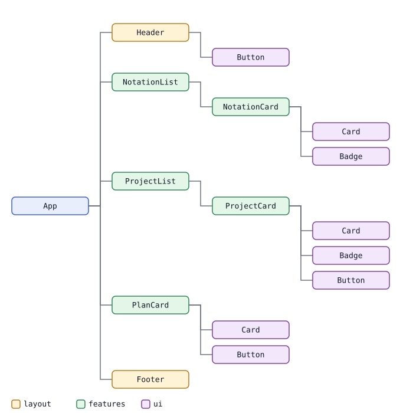
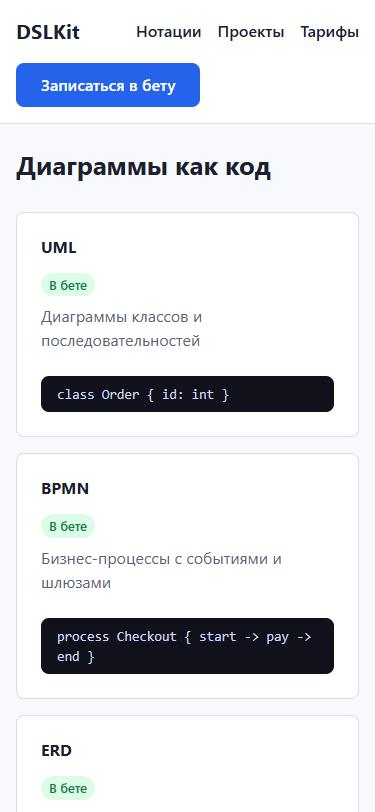
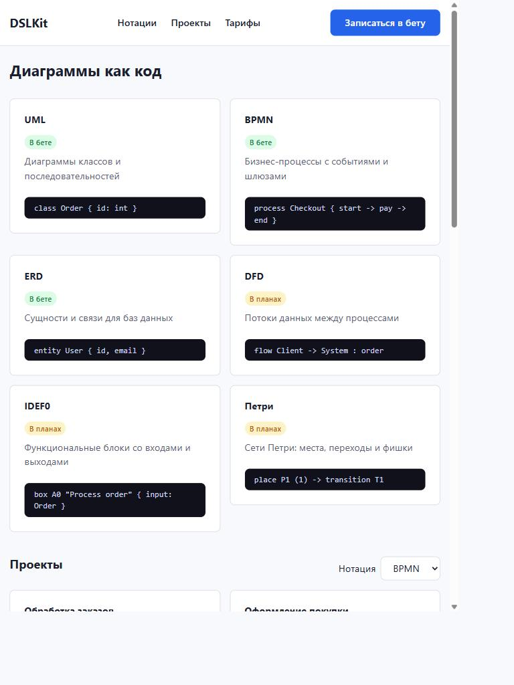
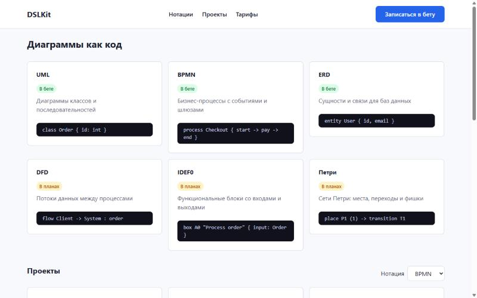
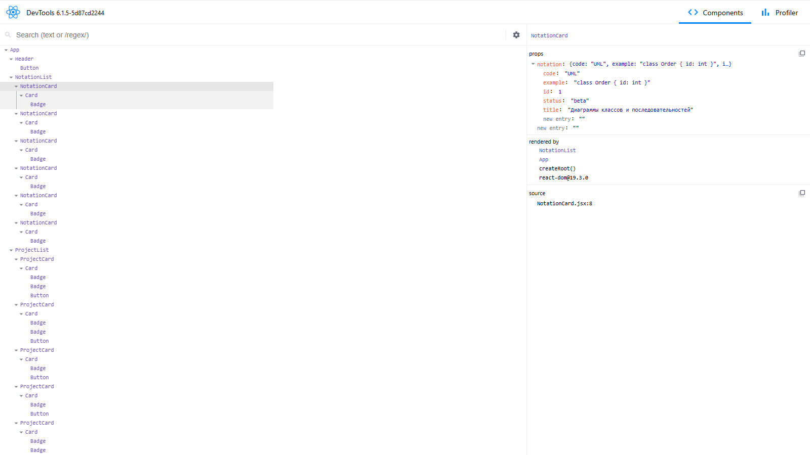
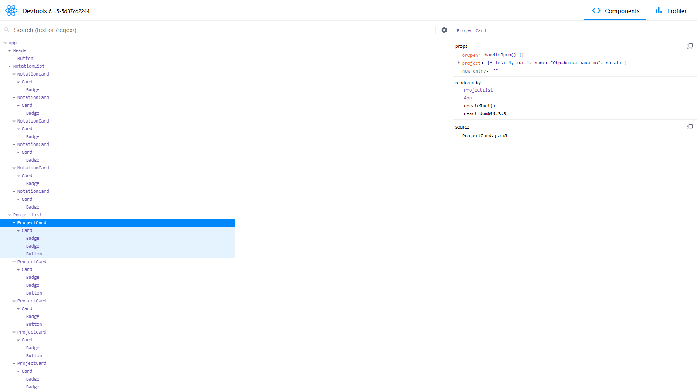

# Laboratory Work No. 7. Building a Component Interface with React

## 1 Purpose of the Work

To master the component approach in React, JSX and data passing through `props` on the example of the DSLKit project, a web editor for diagrams as code that belongs to the SaaS direction and matches the future course project, and to prepare a component base for the following works.

## 2 Brief Theoretical Background

**Component approach.** An interface is assembled from small independent parts, each with its own markup, styles and logic. A component takes data through `props` and returns a description of the interface, so it can be reused and checked on its own.

**JSX.** It is a JavaScript syntax extension that looks like HTML. The differences: `className` is written instead of `class`, `htmlFor` instead of `for`, attributes use camelCase such as `onClick`, any expression is inserted in curly braces, and every tag must be closed.

**SPA and Virtual DOM.** A single-page application loads once and changes its content without reloading the page. React keeps a light copy of the interface tree in memory (the Virtual DOM), compares the old and the new copies on a change, and updates only the differing nodes in the real DOM.

**React, Vue and Angular.** React provides a library for the interface and leaves the choice of other tools to the developer. Vue offers a progressive framework with templates and a gentler learning curve. Angular is a full framework with TypeScript, dependency injection and a strict structure.

## 3 Work Progress

### 3.1 Environment and Project Structure

The work is done in the branch `feature/react-components`, and the application lives in the folder `react-app`. The project is created with Vite, and `react`, `react-dom` and `react-router-dom` are installed, the latter is not used in this work. The folder structure matches the assignment and the components are listed in table 1.

Table 1 – Components of the DSLKit application

| Component | Group | Purpose |
|---|---|---|
| `Button` | ui | Universal button with the variants `primary` and `quiet` |
| `Card` | ui | A container with a title, the content comes through `children` |
| `Badge` | ui | A status label, the colour is set by the prop `tone` |
| `Header` | layout | Title, links to sections, a beta signup button |
| `Footer` | layout | A footer with the year and the owner from props |
| `NotationCard` | features | A notation card built from `Card` and `Badge` with a code example |
| `NotationList` | features | A list of notation cards |
| `ProjectCard` | features | A project card with an "Open" button |
| `ProjectList` | features | A project list with a notation choice |
| `PlanCard` | features | A plan with a price, features and a "Choose" button |

### 3.2 Base Components and Composition

The base components `Button`, `Card` and `Badge` know nothing about the subject area. `Button` takes a variant, a handler and the other attributes through the `...props` operator. `Card` shows an optional title and inserts `children` into the block. Subject components are built from them: `NotationCard` consists of `Card` and `Badge`, and `ProjectCard` adds `Button`. The component hierarchy is shown in figure 1, and the border colour marks the folder group.

Figure 1 – Component hierarchy: the root `App` includes layout and subject components, and they are built from base ones

### 3.3 Props, Lists and Conditional Rendering

Data flows only downward. The root component passes `ProjectList` an array of projects, a list of notations and handlers, and it passes each `ProjectCard` one project. Lists are rendered with `map`, and every item has a `key` with a unique `id`. Conditional rendering is used in `Card` (the title is shown only when passed), in `ProjectCard` (the "Shared" label only for shared projects) and in the lists (a message for an empty array). Computed values are inserted as expressions in curly braces, for example `formatDate(project.updated)`.

### 3.4 Mock Data and Handlers

The folder `data` holds three arrays: six notations, eight projects and three plans. The application has no state, so handlers are stubs: pressing buttons and changing the notation choice write a message to the console through `console.log`. The notation choice in the project list only reports the value to the parent and does not filter the list, because that needs state, which comes in the next work.

### 3.5 Styling and Checking on Different Screens

CSS modules are created for the components, and the shared golden-ratio tokens, sizes and colours live in `index.css`. The card grid changes the number of columns at 576 and 1024 pixels following the mobile-first principle. The result on a 375 pixel screen is shown in figure 2.

Figure 2 – Mobile version: cards go in one column and the header wraps

On a 768 pixel tablet the cards take two columns, as shown in figure 3.

Figure 3 – Tablet: two columns of cards

On a 1280 pixel screen the cards take three columns, as shown in figure 4.

Figure 4 – Desktop: three columns of cards

### 3.6 Testing

An automated test reads the source files and checks the folder structure, the number of components, the function form of components, the size of mock data, the presence of `key` in lists, handler stubs, CSS modules and the absence of `useState` and `useEffect`. The application is additionally checked in Chrome: the console has no errors, and four stubs write messages to the console. A screenshot of the Components tab of React DevTools and testing in Firefox and Edge remain a task for the acceptance stage.

### 3.7 Committing the Changes

The commit with the implementation: https://github.com/KsushaKhadzhinova/DSLKit-Project/commit/f4a22b1. The commit message: `feat(react): add the DSLKit component library with mock data, props and CSS modules on Vite`.

### 3.8 Checking in DevTools

The application was opened in Chrome 155 and the component tree is shown by the React DevTools interface version 6.1.5.

The component tree is shown in Figure 5: App holds Header, NotationList and ProjectList, and the selected notation card shows its props, its parent and the file with the line number.

Figure 5 – React DevTools: the component tree and the props of NotationCard

The props of a project card are shown in Figure 6: the onOpen function and the project object come down from ProjectList.

Figure 6 – React DevTools: the props of ProjectCard

The handler stubs are shown in Figure 7: clicking the buttons prints the project table, the chosen plan and the chosen notation to the console.

Figure 7 – Console: the output of the handler stubs

## Conclusion

An application on Vite and React with ten components is created for the DSLKit project: base, layout and subject ones. Data is passed through `props`, lists are rendered with `key`, conditional rendering and composition are used in several places, and handlers are stubs. The rule about the absence of `useState` and `useEffect` is checked by an automated test, and the layout is confirmed on three screen widths. What remains is to attach a React DevTools screenshot and to check the application in Firefox and Edge.

## Appendix A – Listing of Button.jsx

{{code:react-app/src/components/ui/Button.jsx}}

## Appendix B – Listing of Card.jsx

{{code:react-app/src/components/ui/Card.jsx}}

## Appendix C – Listing of NotationCard.jsx

{{code:react-app/src/components/features/NotationCard.jsx}}

## Appendix D – Listing of ProjectList.jsx

{{code:react-app/src/components/features/ProjectList.jsx}}

## Appendix E – Listing of App.jsx

{{code:react-app/src/App.jsx}}
