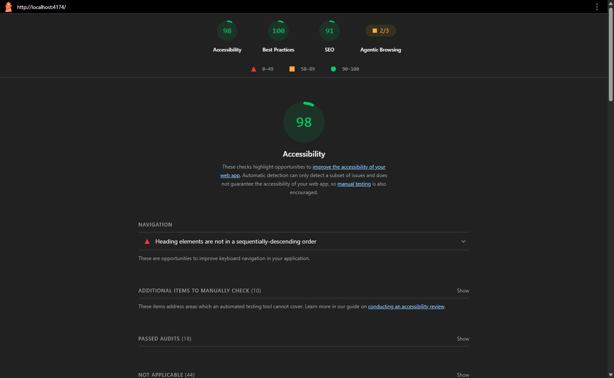
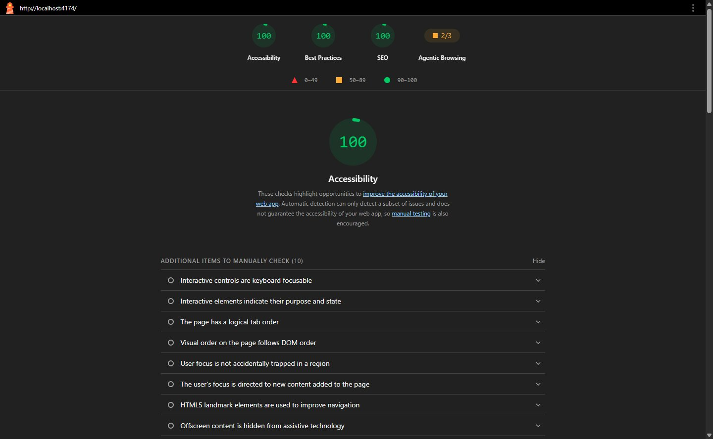
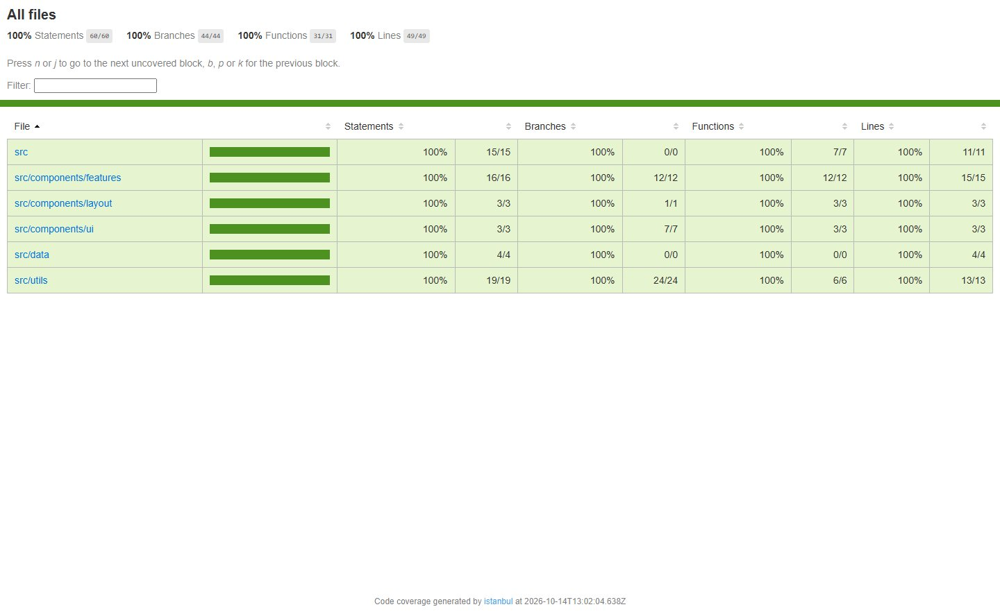
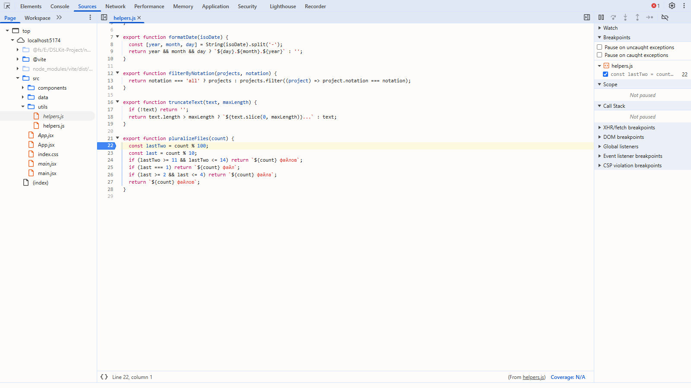
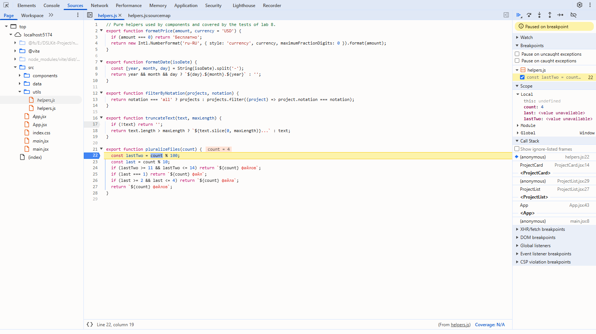
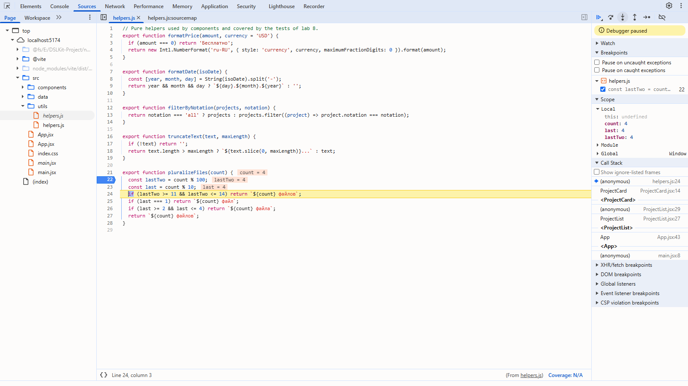
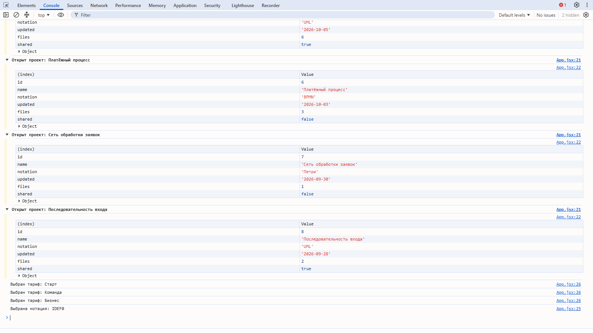

# Лабораторная работа №8. Тестирование фронтенд-приложения

## 1 Цель работы

Освоить основы тестирования JavaScript-кода и инструменты разработчика для отладки и анализа производительности на примере React-приложения проекта DSLKit, веб-редактора диаграмм как кода, тематика которого соответствует направлению SaaS и будущему курсовому проекту.

## 2 Краткие теоретические сведения

**Unit-тестирование.** Проверяет небольшие части кода, например чистые функции, отдельно от остальной системы. Такие тесты быстрые и точно показывают место ошибки.

**Интеграционное тестирование.** Проверяет совместную работу нескольких частей, например корневого компонента вместе с вложенными. Оно ловит ошибки на стыках, которые unit-тесты не видят.

**Jest.** Запускает тесты и предоставляет функции `describe`, `test`, `expect`, подставные функции `jest.fn()` и слежение `jest.spyOn`, и считает покрытие кода.

**React Testing Library.** Рендерит компоненты в jsdom и ищет элементы так, как это делает пользователь: по роли, тексту и подписи. Тест проверяет видимый результат и вызовы обработчиков, а не внутреннее устройство компонента.

**Lighthouse.** Автоматически проверяет страницу по категориям: доступность, лучшие практики, SEO и производительность. Для производительности важны LCP (время появления самого крупного элемента), CLS (стабильность макета) и INP (отклик на действия).

## 3 Ход работы

### 3.1 Настройка окружения

Работа выполнена в ветке `feature/frontend-testing` на проекте из лабораторной работы 7. Установлены `jest`, `jest-environment-jsdom`, `@testing-library/react`, `@testing-library/jest-dom`, `@testing-library/user-event` и `identity-obj-proxy`, а для чтения JSX добавлены `babel-jest`, `@babel/core`, `@babel/preset-env` и `@babel/preset-react`. В `package.json` заданы скрипты `test`, `test:watch` и `test:coverage`, в `jest.config.js` включено окружение `jsdom`, подмена стилей через `identity-obj-proxy`, подмена изображений и пороги покрытия 70, 60, 70 и 70 процентов. Файл `setupTests.js` подключает матчеры `jest-dom`.

### 3.2 Тесты чистых функций

Для пяти функций из `helpers.js` написаны тесты, перечисленные в таблице 1. Они связаны с предметной областью: цена тарифа, дата изменения проекта, фильтр проектов по нотации, обрезка текста и склонение слова «файл». Тесты проверяют основные сценарии и граничные случаи: нулевую цену, неполную дату, пустой результат фильтра, текст ровно максимальной длины и числа 11–14, у которых особое склонение.

Таблица 1 – Чистые функции проекта DSLKit и их проверки

| Функция | Назначение | Граничные случаи в тестах |
|---|---|---|
| `formatPrice` | Цена тарифа, для нуля слово «Бесплатно» | Ноль, другая валюта |
| `formatDate` | Дата в виде день.месяц.год | Неполная, пустая и отсутствующая дата |
| `filterByNotation` | Проекты выбранной нотации | Значение «all», пустой результат, входной массив не меняется |
| `truncateText` | Обрезка текста с многоточием | Пустое значение, текст ровно максимальной длины |
| `pluralizeFiles` | Склонение слова «файл» | 1, 2, 5, 11, 14, 21, 22, 100 |

Тесты и код функций приведены в приложениях А и Б.

### 3.3 Тесты компонентов

Протестированы все десять компонентов, из них три группы по условию. Простой UI-компонент `Button` проверен на текст, тип кнопки, класс варианта, передачу атрибутов и вызов обработчика при клике. Композитные `NotationCard` и `NotationList` проверены на показ данных из моковых массивов, цвет метки статуса и сообщение для пустого списка. Компоненты с обработчиками `ProjectCard`, `ProjectList` и `PlanCard` проверены на вызов функций, переданных через `props`, с нужными аргументами. Корневой `App` проверен как интеграция: в тесте проверяются заглушки, которые пишут в консоль. Для поиска элементов использованы `getByRole`, `getByText`, `getByLabelText`, `queryBy...` для отсутствующих элементов и `data-testid` для контейнеров списков. Моки очищаются после каждого теста.

### 3.4 Отладка с помощью инструментов разработчика

Для отладки в `App.jsx` применены `console.log` для простых событий, `console.group` и `console.table` для открытия проекта: консоль показывает таблицу полей проекта внутри группы с названием. Сеть изучена в таблице 2: приложение загружает три ресурса, документ, один скрипт и один файл стилей, поэтому самых медленных запросов нет.

Таблица 2 – Ресурсы, которые загружает собранное приложение

| Ресурс | Размер | Размер со сжатием |
|---|---|---|
| `index.html` | 0,6 КБ | 0,4 КБ |
| `assets/index.js` | 227 КБ | 72 КБ |
| `assets/index.css` | 4,2 КБ | 1,4 КБ |

Снимки панели Sources с точкой останова приведены в подразделе 3.8.

### 3.5 Анализ производительности с Lighthouse

Аудит запущен на собранном приложении для компьютера. До улучшений Lighthouse нашёл нарушенный порядок заголовков (карточки нотаций шли сразу после заголовка первого уровня), недопустимый файл `robots.txt` и отсутствие `llms.txt`. Результат до улучшений показан на рисунке 1.



Рисунок 1 – Lighthouse до улучшений: доступность 98, SEO 91

Внесены три улучшения. Карточки нотаций получили уровень заголовка `h2` через новый пропс `headingLevel`, в папку `public` добавлены корректный `robots.txt` и файл `llms.txt`. Результат после улучшений показан на рисунке 2, а сравнение метрик приведено в таблице 3.



Рисунок 2 – Lighthouse после улучшений: доступность 100, лучшие практики 100, SEO 100

Таблица 3 – Метрики до и после улучшений

| Метрика | До | После |
|---|---|---|
| Доступность | 98 | 100 |
| Лучшие практики | 100 | 100 |
| SEO | 91 | 100 |
| LCP, мс | 186 | 165 |
| CLS | 0,00 | 0,00 |

Метрики LCP и CLS измерены трассировкой производительности на локальном сервере без ограничения сети, поэтому абсолютные значения малы, а разница в LCP находится в пределах погрешности.

### 3.6 Покрытие кода

Запуск `npm run test:coverage` выполняет 54 теста в семи наборах. Покрытие всех файлов равно 100 процентов по операторам, ветвлениям, функциям и строкам, что выше порогов 70 и 60 процентов. Итоговый отчёт показан на рисунке 3. Непокрытых участков нет: ветки условного рендеринга и значения по умолчанию проверены отдельными тестами.



Рисунок 3 – Отчёт Istanbul: покрытие 100 процентов во всех папках

### 3.7 Фиксация изменений

Коммит с реализацией: https://github.com/KsushaKhadzhinova/DSLKit-Project/commit/d8a95d7. Сообщение коммита: `feat: add unit tests, component tests, and performance audit with Lighthouse`.

### 3.8 Отладка в DevTools

Отладка выполнена в Chrome 155 на сервере разработки.

Точка останова показана на рисунке 4: в файле helpers.js она стоит на первой строке функции pluralizeFiles.



Рисунок 4 – Панель Sources: точка останова в helpers.js

Остановка показана на рисунке 5: в области Scope виден параметр count со значением 4, а в стеке вызовов цепочка от main.jsx до ProjectCard.



Рисунок 5 – Панель Sources: остановка на точке останова, области Scope и Call Stack

Шаг Step Over показан на рисунке 6: выполнена строка 22, в области Scope появилась переменная lastTwo со значением 4.


Рисунок 6 – Панель Sources: шаг Step Over

Шаг Step Into показан на рисунке 7: отладчик переходит к следующей строке функции и показывает новые значения переменных.



Рисунок 7 – Панель Sources: шаг Step Into

Консоль показана на рисунке 8: вывод обработчиков помечен именем файла и строкой, например App.jsx:21.



Рисунок 8 – Консоль приложения

## 4 Ответы на контрольные вопросы

10. **Непокрытые участки.** Отчёт `lcov-report` подсвечивает невыполненные строки и ветки. Для условных веток добавлены тесты на пустой список, отсутствие заголовка, приватный проект и бесплатный тариф.
11. **getBy и queryBy.** `getBy` выбрасывает ошибку, если элемента нет, и подходит для проверки присутствия. `queryBy` возвращает `null`, поэтому им проверяют отсутствие: `expect(screen.queryByRole('heading')).not.toBeInTheDocument()`.
12. **Список через props.** Передают моковый массив, затем проверяют число элементов и их содержимое: `expect(screen.getAllByRole('listitem')).toHaveLength(mockNotations.length)`, а заголовки сравнивают с массивом.

## Заключение

Для React-приложения проекта DSLKit настроены Jest и React Testing Library, написаны unit-тесты пяти чистых функций и тесты всех компонентов. Покрытие равно 100 процентов при пороге 70 и 60. Аудит Lighthouse выявил три замечания, после их исправления доступность выросла до 100, а SEO до 100. Остаётся приложить снимки панелей Sources и React DevTools и проверить приложение в Firefox и Edge.

## Приложение А – Листинг файла helpers.js

```js
// Pure helpers used by components and covered by the tests of lab 8.
export function formatPrice(amount, currency = 'USD') {
  if (amount === 0) return 'Бесплатно';
  return new Intl.NumberFormat('ru-RU', { style: 'currency', currency, maximumFractionDigits: 0 }).format(amount);
}

export function formatDate(isoDate) {
  const [year, month, day] = String(isoDate).split('-');
  return year && month && day ? `${day}.${month}.${year}` : '';
}

export function filterByNotation(projects, notation) {
  return notation === 'all' ? projects : projects.filter((project) => project.notation === notation);
}

export function truncateText(text, maxLength) {
  if (!text) return '';
  return text.length > maxLength ? `${text.slice(0, maxLength)}...` : text;
}

export function pluralizeFiles(count) {
  const lastTwo = count % 100;
  const last = count % 10;
  if (lastTwo >= 11 && lastTwo <= 14) return `${count} файлов`;
  if (last === 1) return `${count} файл`;
  if (last >= 2 && last <= 4) return `${count} файла`;
  return `${count} файлов`;
}
```

## Приложение Б – Листинг файла helpers.test.js

```js
import { filterByNotation, formatDate, formatPrice, pluralizeFiles, truncateText } from './helpers';

const projects = [
  { id: 1, notation: 'BPMN' },
  { id: 2, notation: 'ERD' },
  { id: 3, notation: 'BPMN' },
];

describe('formatPrice', () => {
  test('writes the free plan as a word', () => {
    expect(formatPrice(0)).toBe('Бесплатно');
  });

  test('formats dollars without cents', () => {
    expect(formatPrice(12)).toMatch(/12/);
    expect(formatPrice(12)).toMatch(/\$/);
  });

  test('accepts another currency', () => {
    expect(formatPrice(36, 'EUR')).toMatch(/€/);
  });
});

describe('formatDate', () => {
  test('turns an ISO date into day.month.year', () => {
    expect(formatDate('2026-10-12')).toBe('12.10.2026');
  });

  test('returns an empty string for an incomplete or missing date', () => {
    expect(formatDate('2026-10')).toBe('');
    expect(formatDate('')).toBe('');
    expect(formatDate(undefined)).toBe('');
  });
});

describe('filterByNotation', () => {
  test('returns every project for "all"', () => {
    expect(filterByNotation(projects, 'all')).toHaveLength(3);
  });

  test('keeps only the matching notation', () => {
    expect(filterByNotation(projects, 'BPMN').map((project) => project.id)).toEqual([1, 3]);
  });

  test('returns an empty list when nothing matches and does not change the input', () => {
    expect(filterByNotation(projects, 'UML')).toEqual([]);
    expect(projects).toHaveLength(3);
  });
});

describe('truncateText', () => {
  test('cuts a long text and adds dots', () => {
    expect(truncateText('Очень длинный текст для проверки', 10)).toBe('Очень длин...');
  });

  test('keeps a short text and handles empty values', () => {
    expect(truncateText('Короткий', 20)).toBe('Короткий');
    expect(truncateText('', 5)).toBe('');
    expect(truncateText(null, 5)).toBe('');
  });

  test('does not cut a text of exactly the maximum length', () => {
    expect(truncateText('12345', 5)).toBe('12345');
  });
});

describe('pluralizeFiles', () => {
  test.each([
    [1, '1 файл'],
    [2, '2 файла'],
    [4, '4 файла'],
    [5, '5 файлов'],
    [11, '11 файлов'],
    [14, '14 файлов'],
    [21, '21 файл'],
    [22, '22 файла'],
    [100, '100 файлов'],
  ])('%i gives "%s"', (count, expected) => {
    expect(pluralizeFiles(count)).toBe(expected);
  });
});
```

## Приложение В – Листинг файла ProjectList.test.jsx

```jsx
import { fireEvent, render, screen } from '@testing-library/react';
import { mockProjects } from '../../data/projects';
import PlanCard from './PlanCard';
import ProjectCard from './ProjectCard';
import ProjectList from './ProjectList';

const NOTATIONS = ['IDEF0', 'BPMN', 'ERD'];

describe('ProjectCard (component with an event handler)', () => {
  afterEach(() => jest.clearAllMocks());

  test('shows the project data', () => {
    render(<ProjectCard project={mockProjects[0]} onOpen={jest.fn()} />);
    expect(screen.getByRole('heading', { name: 'Обработка заказов' })).toBeInTheDocument();
    expect(screen.getByText('IDEF0')).toBeInTheDocument();
    expect(screen.getByText('Общий доступ')).toBeInTheDocument();
    expect(screen.getByText(/12\.10\.2026/)).toBeInTheDocument();
    expect(screen.getByText(/4 файла/)).toBeInTheDocument();
  });

  test('hides the shared label for a private project', () => {
    render(<ProjectCard project={mockProjects[2]} onOpen={jest.fn()} />);
    expect(screen.queryByText('Общий доступ')).not.toBeInTheDocument();
  });

  test('calls onOpen with the project when the button is clicked', () => {
    const onOpen = jest.fn();
    render(<ProjectCard project={mockProjects[1]} onOpen={onOpen} />);
    fireEvent.click(screen.getByRole('button', { name: 'Открыть' }));
    expect(onOpen).toHaveBeenCalledTimes(1);
    expect(onOpen).toHaveBeenCalledWith(mockProjects[1]);
  });
});

describe('ProjectList', () => {
  afterEach(() => jest.clearAllMocks());

  test('renders every project from the mock array', () => {
    render(<ProjectList projects={mockProjects} notations={NOTATIONS} onOpen={jest.fn()} onFilterChange={jest.fn()} />);
    expect(screen.getAllByRole('button', { name: 'Открыть' })).toHaveLength(mockProjects.length);
    expect(screen.getByTestId('project-list')).toBeInTheDocument();
  });

  test('keeps only the projects of the notation passed through props', () => {
    render(<ProjectList projects={mockProjects} notation="BPMN" notations={NOTATIONS} onOpen={jest.fn()} onFilterChange={jest.fn()} />);
    expect(screen.getAllByRole('button', { name: 'Открыть' })).toHaveLength(2);
    expect(screen.getByText('Оформление покупки')).toBeInTheDocument();
    expect(screen.queryByText('Обработка заказов')).not.toBeInTheDocument();
  });

  test('shows a message when nothing matches', () => {
    render(<ProjectList projects={mockProjects} notation="UML-unknown" notations={NOTATIONS} onOpen={jest.fn()} onFilterChange={jest.fn()} />);
    expect(screen.getByText('Проектов не найдено.')).toBeInTheDocument();
    expect(screen.queryByTestId('project-list')).not.toBeInTheDocument();
  });

  test('reports the chosen notation through onFilterChange', () => {
    const onFilterChange = jest.fn();
    render(<ProjectList projects={mockProjects} notations={NOTATIONS} onOpen={jest.fn()} onFilterChange={onFilterChange} />);
    fireEvent.change(screen.getByLabelText('Нотация'), { target: { value: 'ERD' } });
    expect(onFilterChange).toHaveBeenCalledWith('ERD');
  });

  test('passes the clicked project to onOpen', () => {
    const onOpen = jest.fn();
    render(<ProjectList projects={mockProjects} notations={NOTATIONS} onOpen={onOpen} onFilterChange={jest.fn()} />);
    fireEvent.click(screen.getAllByRole('button', { name: 'Открыть' })[0]);
    expect(onOpen).toHaveBeenCalledWith(mockProjects[0]);
  });

  test('works without a list of notations', () => {
    render(<ProjectList projects={[]} onOpen={jest.fn()} onFilterChange={jest.fn()} />);
    expect(screen.getAllByRole('option')).toHaveLength(1);
  });
});

describe('PlanCard', () => {
  const plan = { id: 2, name: 'Команда', price: 12, diagramsPerDay: 100, features: ['Все нотации', 'История версий'] };

  test('shows the price, the limit and every feature', () => {
    render(<PlanCard plan={plan} onChoose={jest.fn()} />);
    expect(screen.getByRole('heading', { name: 'Команда' })).toBeInTheDocument();
    expect(screen.getByText(/в месяц/)).toBeInTheDocument();
    expect(screen.getByText('До 100 диаграмм в день')).toBeInTheDocument();
    expect(screen.getAllByRole('listitem')).toHaveLength(2);
  });

  test('shows "Бесплатно" without the monthly suffix for a free plan', () => {
    render(<PlanCard plan={{ ...plan, price: 0 }} onChoose={jest.fn()} />);
    expect(screen.getByText('Бесплатно')).toBeInTheDocument();
    expect(screen.queryByText(/в месяц/)).not.toBeInTheDocument();
  });

  test('calls onChoose with the plan', () => {
    const onChoose = jest.fn();
    render(<PlanCard plan={plan} onChoose={onChoose} />);
    fireEvent.click(screen.getByRole('button', { name: 'Выбрать' }));
    expect(onChoose).toHaveBeenCalledWith(plan);
  });
});
```

## Приложение Г – Листинг файла jest.config.js

```js
export default {
  testEnvironment: 'jsdom',
  setupFilesAfterEnv: ['<rootDir>/src/setupTests.js'],
  moduleNameMapper: {
    '\\.(css|less|scss|sass)$': 'identity-obj-proxy',
    '\\.(jpg|jpeg|png|gif|svg)$': '<rootDir>/__mocks__/fileMock.js',
  },
  collectCoverageFrom: ['src/**/*.{js,jsx}', '!src/**/*.test.{js,jsx}', '!src/main.jsx', '!src/setupTests.js'],
  coverageThreshold: {
    global: { statements: 70, branches: 60, functions: 70, lines: 70 },
  },
};
```
