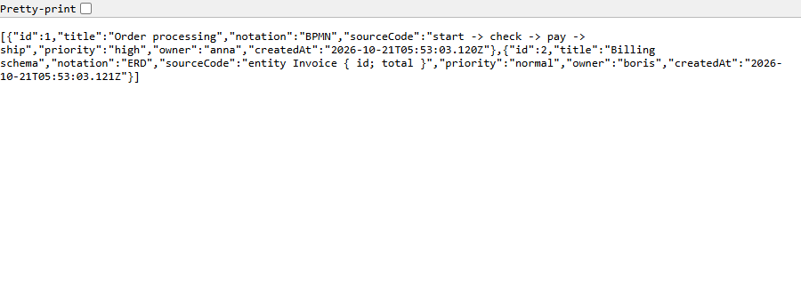
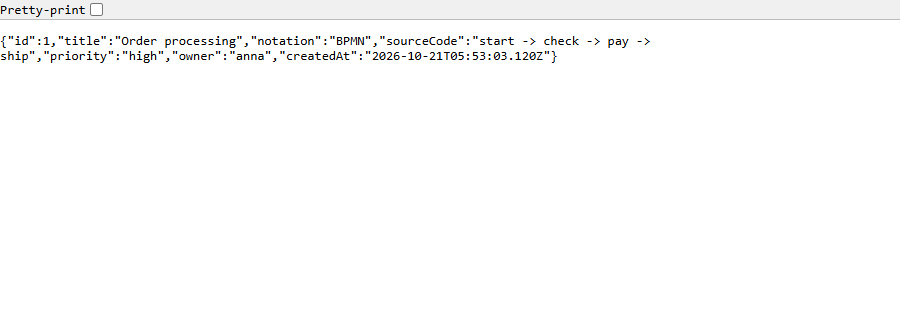
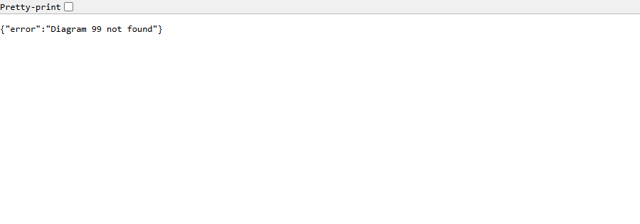
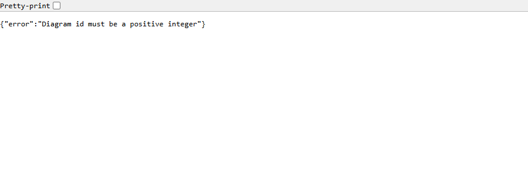
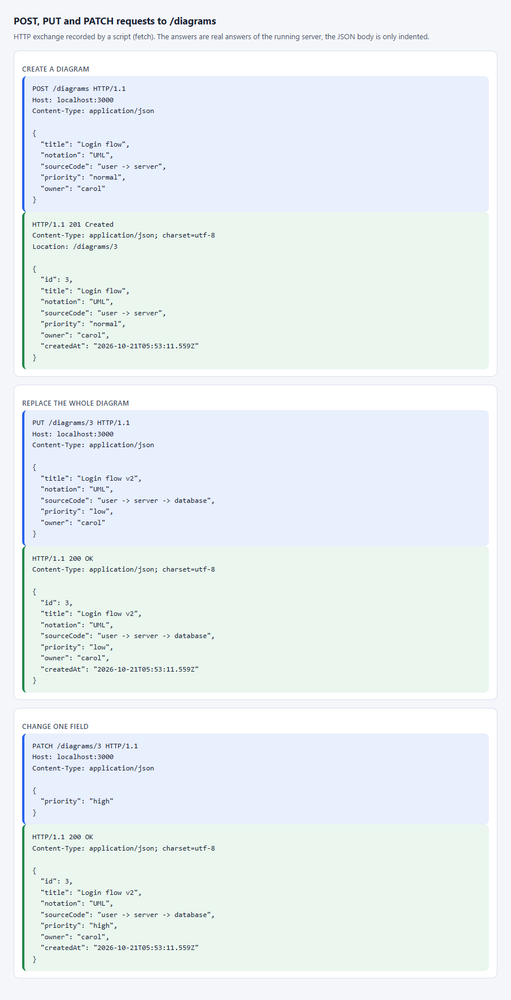
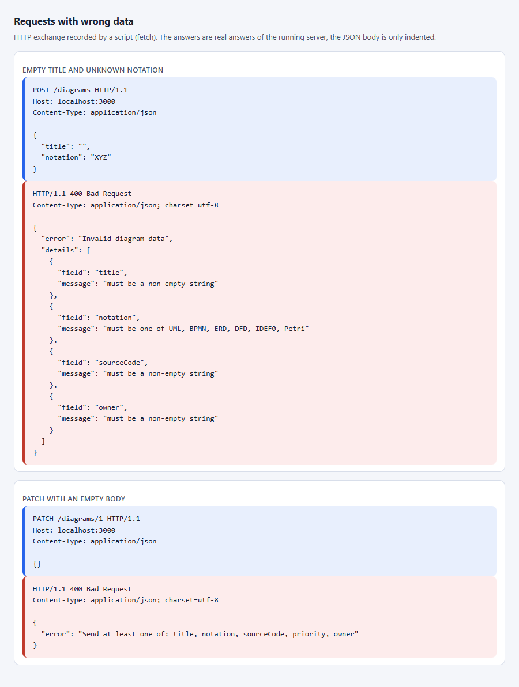
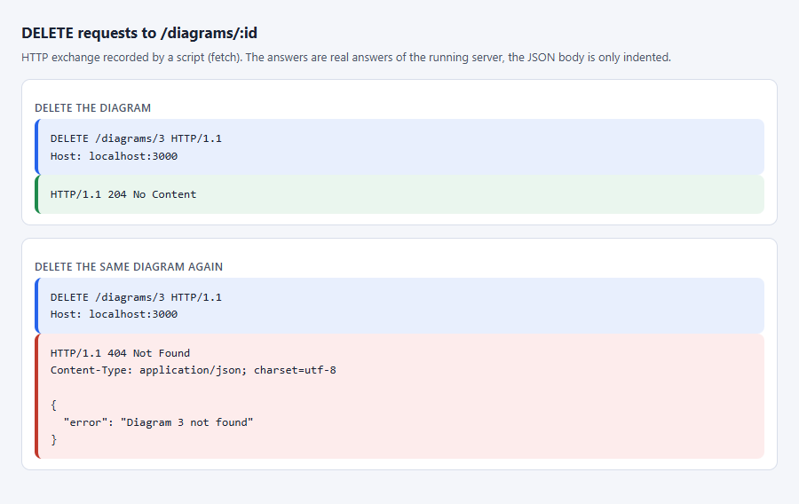
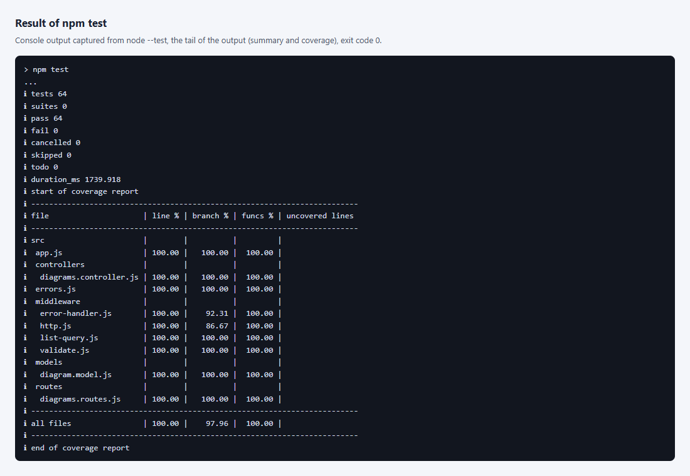

# Lab 1. Building a Server Application on Node.js

## 1 Purpose of the Work

To gain practical skills in building a server application on Node.js with the Express framework: routing, handling GET, POST, PUT and DELETE requests, and forming server responses. The work is done for DSLKit, a web editor for diagrams as code that fits the SaaS direction. The server is the base for the database, authentication and the React client in the next labs.

## 2 Brief Theory

**Express.** The framework sits on top of the Node.js `http` module. An application is a chain of handlers: each receives a request, a response and a `next` function, and either answers the client or passes control on. The order in which handlers are registered is the order in which they run.

**Request parameters.** A path part such as `:id` lands in `req.params`, the query string after the question mark in `req.query`, and the request body in `req.body`. A JSON body is parsed by the `express.json()` middleware, and the client announces it with the `Content-Type: application/json` header.

**REST.** A resource has an address, and the HTTP method sets the action: `GET` reads, `POST` creates, `PUT` replaces as a whole, `DELETE` removes. The status code reports the result: 200 for a successful read or replace, 201 for creation, 204 for removal without a body, 400 for a bad request, 404 for a missing resource, 500 for a server failure.

**Error handling.** A handler with four parameters `(err, req, res, next)` is an error handler. It is registered last and receives everything passed to `next(err)` or thrown inside handlers.

## 3 Work Progress

### 3.1 Domain and routes

For DSLKit the collection is `diagrams`. A diagram has the fields `title`, `notation` (UML, BPMN, ERD, DFD, IDEF0 or Petri), `sourceCode` (the diagram text in the DSL), `priority` (`low`, `normal` or `high`) and `owner`. The server assigns the `id` and the creation time `createdAt`. Routes, status codes and examples are listed in table 1.

Table 1 – Routes of the diagrams API

| Method | Path            | Success                                     | Errors                             | Example request                    |
| ------ | --------------- | ------------------------------------------- | ---------------------------------- | ---------------------------------- |
| GET    | `/diagrams`     | 200, array of diagrams                      | none                               | `GET /diagrams`                    |
| GET    | `/diagrams/:id` | 200, object                                 | 400 bad id, 404 no diagram         | `GET /diagrams/1`                  |
| POST   | `/diagrams`     | 201, created object and a `Location` header | 400 bad data or JSON               | `POST /diagrams` with a JSON body  |
| PUT    | `/diagrams/:id` | 200, updated object                         | 400 bad id or data, 404 no diagram | `PUT /diagrams/1` with a JSON body |
| PATCH  | `/diagrams/:id` | 200, object with the changed fields         | 400 bad id, data or empty body, 404 | `PATCH /diagrams/1` with one field |
| DELETE | `/diagrams/:id` | 204, empty body                             | 400 bad id, 404 no diagram         | `DELETE /diagrams/2`               |
| any    | any other path  | none                                        | 404 as JSON                        | `GET /projects`                    |

### 3.2 Project setup

The project was created with `npm init`, with `express` as a dependency and `nodemon` as a development dependency. The `package.json` file has the scripts `start` (`node server.js`), `dev` (`nodemon server.js`) and `test`. The port comes from the `PORT` variable in the `.env` file, and only the `.env.example` template is committed. The code layout follows the advice of the assignment and is listed in table 2.

Table 2 – Project structure

| File                                     | Purpose                                                                        |
| ---------------------------------------- | ------------------------------------------------------------------------------ |
| `server.js`                              | Reads `.env`, starts the server on `PORT` or 3000                              |
| `src/app.js`                             | The `createApp(store)` function: wires JSON parsing, routes and error handlers |
| `src/routes/diagrams.routes.js`          | Maps methods and paths to handlers                                             |
| `src/controllers/diagrams.controller.js` | Handlers of the five operations                                                |
| `src/models/diagram.model.js`            | Array store, allowed field values, seed data                                   |
| `src/middleware/validate.js`             | Checks the id and the request body                                             |
| `src/middleware/error-handler.js`        | 404 for unknown paths and the global error handler                             |
| `src/errors.js`                          | The `HttpError` class with a status code                                       |

### 3.3 Store and handlers

Data lives in an array inside the `createDiagramStore` function, which returns the methods `findAll`, `findById`, `create`, `replace` and `remove`. The id counter only grows and never reuses the numbers of deleted records. The store is passed to `createApp` as a parameter, so tests get clean data, and when a database arrives only the model changes, not the routes. On start the store holds two sample diagrams.

Handlers do not validate data themselves. Parsing the address and the body is moved to `validate.js`: `parseId` accepts only a positive integer, and `validateDiagram` checks that the body is an object, that `title`, `sourceCode` and `owner` are non-empty strings, and that `notation` and `priority` belong to the allowed lists. The `priority` field is optional and defaults to `normal`. Unknown fields are dropped, so a client cannot store arbitrary keys or set the `id`. The `PUT` method replaces a diagram as a whole and requires the same fields as `POST`. The `PATCH` method changes only the fields that are sent and leaves the rest unchanged. Every sent field goes through the same rules, and a body without a single known field gives 400. The creation time `createdAt` is set by the server when the record is created, as an ISO 8601 string. It is unique for every record: if two records are created in the same millisecond, the second one gets a value one millisecond later. A client cannot set it, and `PUT` and `PATCH` do not change it. The list can be sorted by it.

### 3.4 Error handling

Every error is returned in one shape, `{ "error": "message" }`, and invalid data adds a `details` array with the field name and the reason. Handlers report an error by calling `next(error)` with an `HttpError`, and the global handler in `error-handler.js` turns it into a response. The same handler maps a JSON parse failure to 400 with a clear message, and any unexpected failure to 500 with a generic text: the details go to the server log and never reach the client. A request to an unknown path gets a JSON 404 instead of the default page. A method the route does not have, such as `POST` for `/diagrams/:id`, gets 405 with an `Allow` header. The id is accepted only as plain decimal digits without a leading zero, so values such as `0x1`, `1e0` and `01` give 400. Deleting an already deleted diagram gives 404, because the resource no longer exists.

### 3.5 Verification

I checked the requests with `curl` and the `requests.http` file for the REST Client extension of VS Code, and then locked them in with automated tests. The tests use the built-in `node:test` module and real HTTP requests to a server on a free port. There are 64 tests in total: 35 in `diagrams.test.js` (reading the list and one diagram, the creation time and its uniqueness, the partial update with `PATCH`, creation with the `Location` header check, the default priority, dropping unknown fields, data errors, bad and malformed JSON, replacement, deletion with a repeated deletion, rejecting odd id values, an oversized body with status 413, unsupported methods with status 405, blank and overlong values, the content type with status 415, the idempotence of `PUT`, security headers, an unknown route and a failure with status 500), 5 in `paging.test.js` (pages and sorting of the list), 1 in `health.test.js` (the `/health` check), 21 in `negative.test.js` (wrong user behaviour: deep nesting, repeated keys, `__proto__`, control characters, a huge body, parallel requests) and 2 in `report.test.mjs` (a check of the report text). Results of real requests are in table 3.

Table 3 – Results of requests to the running server

| Request                                                  | Status | Response body                                               |
| -------------------------------------------------------- | ------ | ----------------------------------------------------------- |
| `GET /diagrams`                                          | 200    | an array of two diagrams                                    |
| `GET /diagrams/1`                                        | 200    | `{"id":1,"title":"Order processing","notation":"BPMN",...}` |
| `POST /diagrams` with title, notation, sourceCode, owner | 201    | the created diagram with `id` 3 and priority `normal`       |
| `PUT /diagrams/1`                                        | 200    | the diagram with the new field values                       |
| `POST /diagrams` with an empty title and notation XYZ    | 400    | `{"error":"Invalid diagram data","details":[...]}`          |
| `GET /diagrams/99`                                       | 404    | `{"error":"Diagram 99 not found"}`                          |
| `DELETE /diagrams/2`                                     | 204    | empty                                                       |
| `DELETE /diagrams/2` again                               | 404    | `{"error":"Diagram 2 not found"}`                           |
| `GET /diagrams/abc`                                      | 400    | `{"error":"Diagram id must be a positive integer"}`         |

Listing of server.js is given in appendix A. Listing of app.js is given in appendix B. Listing of diagrams.routes.js is given in appendix C. Listing of diagrams.controller.js is given in appendix D. Listing of diagram.model.js is given in appendix E. Listing of validate.js is given in appendix F. Listing of error-handler.js is given in appendix G.

The server is started with `npm start`, and the console message is shown in figure 1.


Figure 1 – Console message after the server starts on port 3000 (process output captured as text)

The `GET /diagrams` request is opened in the browser at `http://localhost:3000/diagrams`, and the answer with the two initial diagrams is shown in figure 2.



Figure 2 – Answer to GET /diagrams in a browser window: an array of two diagrams with the createdAt field

A single record at `http://localhost:3000/diagrams/1` is shown in figure 3.



Figure 3 – Answer to GET /diagrams/1 in a browser window: the object of one diagram

A request for a missing record at `http://localhost:3000/diagrams/99` gives the error shown in figure 4.



Figure 4 – Answer to GET /diagrams/99 in a browser window: JSON saying that the diagram is not found (code 404)

A wrong number in the address `http://localhost:3000/diagrams/abc` is refused, as in figure 5.



Figure 5 – Answer to GET /diagrams/abc in a browser window: JSON with a message about a wrong id (code 400)

A browser does not send `POST`, `PUT`, `PATCH` and `DELETE` from the address bar, so the script `shots/shots.mjs` sent them, and the real requests and server answers are drawn on a page. Creation, replacement and a partial change are shown in figure 6.



Figure 6 – POST, PUT and PATCH requests and the server answers recorded by a script (not a Postman window)

The answers to wrong data and to an empty `PATCH` body are recorded the same way and shown in figure 7.



Figure 7 – Answers 400 with the list of field problems recorded by a script (not a Postman window)

Deleting a record and deleting the same record again are shown in figure 8.



Figure 8 – DELETE requests: the answer 204 without a body and the answer 404 on a repeat, recorded by a script (not a Postman window)

The result of the `npm test` command with the number of tests and the code coverage is shown in figure 9.



Figure 9 – End of the npm test output: the number of passed tests and the coverage table (process output captured as text)

### 3.6 Paging and sorting

The list accepts the `limit`, `offset`, `sort` and `order` parameters. `limit` sets the page size from 1 to 100, `offset` sets the shift from 0 to 1000000, `sort` picks a field from a whitelist and `order` takes `asc` or `desc`. Without parameters the whole list is returned in ascending `id` order, so the clients of the earlier works keep working. The answer stays an array and the full size of the selection comes in the `X-Total-Count` header. Numbers are read as strings of at most nine digits, so `-1`, `1e9`, `0x10` and huge numbers get a 400 answer with a list of errors by field. The sort field name is checked against the whitelist and never reaches the database query unchecked. Equal values are ordered by `id`, so pages do not overlap. Parsing of the parameters is moved to a separate module, it is given in Appendix H. The `notation` parameter keeps the records of one notation, and the `q` parameter searches a part of the title ignoring case. An invalid value gives 400, and the `X-Total-Count` header counts the filtered list.

### 3.7 Answers to the control questions

9. What advantages does nodemon give during development?

   Nodemon watches the project files and restarts the server by itself after every save, so the process does not need to be stopped and started by hand. A change is visible in the very next request, and the loop of editing and checking gets shorter. The package is a development dependency and runs with `npm run dev`. It is not used in production, where `npm start` runs and a process manager restarts the server after a crash.

10. What is the difference between PUT and PATCH? Which one did you implement and why?

    `PUT` replaces the resource as a whole: the client sends all required fields, and omitted optional ones get their defaults. `PATCH` changes only the fields that are sent, the others keep their values. `PUT` is idempotent, repeating the same request leaves the same state. `PATCH` does not have to be idempotent, for example the command "increase by 1" changes the result when repeated. Both methods are implemented: `PUT` is required by the assignment, and `PATCH` is added for small edits such as changing the priority, when there is no need to resend the whole diagram text. Neither method changes `id` or `createdAt`.

11. How can CORS support be added to your application? (In theory)

    Under the same-origin policy a browser does not hand a page the response of a server on another origin, that is another scheme, domain or port, unless the server allows it explicitly. The permission comes from the `Access-Control-Allow-Origin` header with the client address. For methods such as `PUT` or for the header `Content-Type: application/json`, the browser first sends a preflight `OPTIONS` request, and the server answers 204 with the headers `Access-Control-Allow-Methods` and `Access-Control-Allow-Headers`. In Express the `cors` package does this, or a handler of ten lines mounted before the routes. A wildcard cannot be combined with cookies, and the list of allowed origins is better read from an environment variable. In this lab the client and the server share one address for now, so CORS is not enabled.

## Conclusion

For DSLKit, a REST API for the `diagrams` resource was built on Express: six routes read the list and a single record, create, replace, partially update and delete, every record has a unique creation time, and the data temporarily lives in an in-memory array. Errors are unified into one JSON shape with the codes 400, 404 and 500 through a global handler, development mode runs on `nodemon`, and automated tests confirm the behavior of every route. The split into routes, controllers and a model lets the next lab swap the array for a database without rewriting the rest of the code. The requests are confirmed by browser screenshots and by an exchange recorded with a script.

## Appendix A (mandatory) Listing of server.js

```js
const { createApp } = require('./src/app');

try {
  process.loadEnvFile();
} catch {
  // .env is optional, defaults apply
}

const port = Number(process.env.PORT) || 3000;

const server = createApp().listen(port, () => console.log(`Server running on http://localhost:${port}`));

// Graceful stop: no new connections, requests in flight finish, then the process ends. A hung connection cannot block the exit for long.
const SHUTDOWN_GRACE_MS = 5000;
const stop = (signal) => {
  console.log(`${signal} received, closing the server`);
  server.close(() => process.exit(0));
  server.closeIdleConnections();
  setTimeout(() => process.exit(1), SHUTDOWN_GRACE_MS).unref();
};
process.on('SIGINT', () => stop('SIGINT'));
process.on('SIGTERM', () => stop('SIGTERM'));
```

## Appendix B (mandatory) Listing of app.js

```js
const express = require('express');
const { createDiagramStore } = require('./models/diagram.model');
const { createDiagramsController } = require('./controllers/diagrams.controller');
const { createDiagramsRouter } = require('./routes/diagrams.routes');
const { securityHeaders, requireJson } = require('./middleware/http');
const { LIMITS } = require('./models/diagram.model');
const { routeNotFound, errorHandler } = require('./middleware/error-handler');

const createApp = (store = createDiagramStore()) => {
  const app = express();
  app.disable('x-powered-by');
  app.use(securityHeaders);
  // Liveness probe for Docker and load balancers.
  app.get('/health', (req, res) => res.json({ status: 'ok' }));
  // The limit is set explicitly (limits.json), so it does not change with the library default.
  app.use(express.json({ limit: LIMITS.bodyBytes }));
  app.use(requireJson);
  app.use('/diagrams', createDiagramsRouter(createDiagramsController(store)));
  app.use(routeNotFound);
  app.use(errorHandler);
  return app;
};

module.exports = { createApp };
```

## Appendix C (mandatory) Listing of diagrams.routes.js

```js
const { Router } = require('express');
const { parseId, validateDiagram, validatePartial } = require('../middleware/validate');
const { allowMethods } = require('../middleware/http');

const createDiagramsRouter = (controller) => {
  const router = Router();
  router
    .route('/')
    .get(controller.list)
    .post(validateDiagram, controller.create)
    .all(allowMethods(['GET', 'POST']));
  router
    .route('/:id')
    .get(parseId, controller.get)
    .put(parseId, validateDiagram, controller.replace)
    .patch(parseId, validatePartial, controller.update)
    .delete(parseId, controller.remove)
    .all(allowMethods(['GET', 'PUT', 'PATCH', 'DELETE']));
  return router;
};

module.exports = { createDiagramsRouter };
```

## Appendix D (mandatory) Listing of diagrams.controller.js

```js
const { notFound } = require('../errors');
const { parseListQuery } = require('../middleware/list-query');
const { NOTATIONS, LIMITS } = require('../models/diagram.model');

const missing = (id) => notFound(`Diagram ${id} not found`);

const SORTABLE = ['id', 'title', 'notation', 'priority', 'owner', 'createdAt'];

// Numbers compare as numbers, text with the locale rules, equal values keep the order of ids.
const byField = (sort, order) => (a, b) => {
  const result = typeof a[sort] === 'number' ? a[sort] - b[sort] : String(a[sort]).localeCompare(String(b[sort]));
  return (order === 'desc' ? -result : result) || a.id - b.id;
};

const createDiagramsController = (store) => ({
  // ?limit=&offset=&sort=&order=&notation=&q= (see list-query.js). The answer stays an array, the size of the filtered list comes in X-Total-Count.
  list: (req, res) => {
    const { limit, offset, sort, order, notation, q } = parseListQuery(req.query, SORTABLE, { notations: NOTATIONS, maxQuery: LIMITS.title });
    const all = store
      .findAll()
      .filter((d) => (notation === undefined || d.notation === notation) && (q === undefined || d.title.toLowerCase().includes(q)))
      .sort(byField(sort, order));
    res.set('X-Total-Count', String(all.length));
    res.json(all.slice(offset, limit === undefined ? undefined : offset + limit));
  },

  get: (req, res, next) => {
    const diagram = store.findById(req.diagramId);
    return diagram ? res.json(diagram) : next(missing(req.diagramId));
  },

  create: (req, res) => {
    const diagram = store.create(req.diagramFields);
    res.status(201).location(`/diagrams/${diagram.id}`).json(diagram);
  },

  replace: (req, res, next) => {
    const diagram = store.replace(req.diagramId, req.diagramFields);
    return diagram ? res.json(diagram) : next(missing(req.diagramId));
  },

  update: (req, res, next) => {
    const diagram = store.update(req.diagramId, req.diagramFields);
    return diagram ? res.json(diagram) : next(missing(req.diagramId));
  },

  remove: (req, res, next) => (store.remove(req.diagramId) ? res.status(204).end() : next(missing(req.diagramId))),
});

module.exports = { createDiagramsController };
```

## Appendix E (mandatory) Listing of diagram.model.js

```js
// Length limits live in limits.json, so they are not scattered over the code.
const LIMITS = require('../../limits.json');

const NOTATIONS = ['UML', 'BPMN', 'ERD', 'DFD', 'IDEF0', 'Petri'];
const PRIORITIES = ['low', 'normal', 'high'];
const DEFAULT_PRIORITY = 'normal';

const SEED = [
  { title: 'Order processing', notation: 'BPMN', sourceCode: 'start -> check -> pay -> ship', priority: 'high', owner: 'anna' },
  { title: 'Billing schema', notation: 'ERD', sourceCode: 'entity Invoice { id; total }', priority: 'normal', owner: 'boris' },
];

const createDiagramStore = (initial = SEED) => {
  let nextId = 1;
  let diagrams = [];
  let lastStamp = 0;

  // Creation time as an ISO string. Every record gets a strictly later value than the previous one,
  // even when two records are created in the same millisecond, so no two records look identical.
  const stamp = () => {
    lastStamp = Math.max(Date.now(), lastStamp + 1);
    return new Date(lastStamp).toISOString();
  };

  const create = (fields) => {
    const diagram = { id: nextId, ...fields, createdAt: stamp() };
    nextId += 1;
    diagrams.push(diagram);
    return diagram;
  };

  initial.forEach(create);

  return {
    findAll: () => [...diagrams],
    findById: (id) => diagrams.find((d) => d.id === id),
    create,
    replace: (id, fields) => {
      const index = diagrams.findIndex((d) => d.id === id);
      if (index < 0) return undefined;
      // PUT replaces the fields, the creation time stays the one of the first save.
      diagrams[index] = { id, ...fields, createdAt: diagrams[index].createdAt };
      return diagrams[index];
    },
    // PATCH changes only the sent fields, everything else keeps its value.
    update: (id, fields) => {
      const index = diagrams.findIndex((d) => d.id === id);
      if (index < 0) return undefined;
      diagrams[index] = { ...diagrams[index], ...fields };
      return diagrams[index];
    },
    remove: (id) => {
      const before = diagrams.length;
      diagrams = diagrams.filter((d) => d.id !== id);
      return diagrams.length < before;
    },
  };
};

module.exports = { NOTATIONS, PRIORITIES, DEFAULT_PRIORITY, LIMITS, createDiagramStore };
```

## Appendix F (mandatory) Listing of validate.js

```js
const { badRequest } = require('../errors');
const { NOTATIONS, PRIORITIES, DEFAULT_PRIORITY, LIMITS } = require('../models/diagram.model');

// Spaces of every kind plus zero-width characters (joiners, word joiner, BOM) look empty, so they count as empty.
const INVISIBLE = /[\s​-‍⁠]/g;
// Control characters (NUL, bell, escape) are not text; a single-line field must not carry them.
const CONTROL = /[\u0000-\u001F\u007F]/;

// Text is checked after trimming, so a value of spaces is empty and the stored value is what was measured.
const text =
  (name, singleLine = false) =>
  (v) => {
    if (typeof v !== 'string' || v.replace(INVISIBLE, '') === '') return 'must be a non-empty string';
    if (singleLine && CONTROL.test(v)) return 'must not contain control characters';
    return v.trim().length <= LIMITS[name] || `must be at most ${LIMITS[name]} characters`;
  };
const TRIMMED = ['title', 'owner'];

const checks = {
  title: text('title', true),
  notation: (v) => NOTATIONS.includes(v) || `must be one of ${NOTATIONS.join(', ')}`,
  sourceCode: text('sourceCode'),
  priority: (v) => PRIORITIES.includes(v) || `must be one of ${PRIORITIES.join(', ')}`,
  owner: text('owner', true),
};

const parseId = (req, _res, next) => {
  // Number() would accept '0x1', '1e0' and ' 1', so the raw text is checked first.
  const id = Number(req.params.id);
  if (!/^[1-9]\d*$/.test(req.params.id) || !Number.isSafeInteger(id)) return next(badRequest('Diagram id must be a positive integer'));
  req.diagramId = id;
  return next();
};

const isObject = (body) => body !== null && typeof body === 'object' && !Array.isArray(body);

// POST and PUT both carry the whole diagram, so one validator serves both.
// Priority is optional and falls back to the default; unknown fields are dropped.
const validateDiagram = (req, _res, next) => {
  const body = req.body;
  if (!isObject(body)) {
    return next(badRequest('Request body must be a JSON object'));
  }
  const fields = { ...body, priority: body.priority ?? DEFAULT_PRIORITY };
  const details = Object.entries(checks)
    .map(([name, check]) => ({ field: name, result: check(fields[name]) }))
    .filter(({ result }) => result !== true)
    .map(({ field, result }) => ({ field, message: result }));
  if (details.length > 0) return next(badRequest('Invalid diagram data', details));
  req.diagramFields = Object.fromEntries(Object.keys(checks).map((name) => [name, TRIMMED.includes(name) ? fields[name].trim() : fields[name]]));
  return next();
};

// PATCH carries only the fields to change. Each sent field gets the same check as in POST and PUT,
// missing fields are left alone, and a body without a single known field is refused.
const validatePartial = (req, _res, next) => {
  const body = req.body;
  if (!isObject(body)) return next(badRequest('Request body must be a JSON object'));
  const names = Object.keys(checks).filter((name) => Object.hasOwn(body, name));
  if (names.length === 0) return next(badRequest(`Send at least one of: ${Object.keys(checks).join(', ')}`));
  const details = names
    .map((name) => ({ field: name, result: checks[name](body[name]) }))
    .filter(({ result }) => result !== true)
    .map(({ field, result }) => ({ field, message: result }));
  if (details.length > 0) return next(badRequest('Invalid diagram data', details));
  req.diagramFields = Object.fromEntries(names.map((name) => [name, TRIMMED.includes(name) ? body[name].trim() : body[name]]));
  return next();
};

module.exports = { parseId, validateDiagram, validatePartial };
```

## Appendix G (mandatory) Listing of error-handler.js

```js
const { notFound } = require('../errors');

const routeNotFound = (req, _res, next) => next(notFound(`Route ${req.method} ${req.path} not found`));

// Express treats a function with four parameters as error-handling middleware.
const errorHandler = (err, _req, res, next) => {
  // Once the response has started, only Express can close the connection properly.
  if (res.headersSent) return next(err);
  const malformedJson = err.type === 'entity.parse.failed';
  const status = malformedJson ? 400 : (err.status ?? 500);
  if (status >= 500) console.error(err);
  const body = {
    error: status >= 500 ? 'Internal server error' : malformedJson ? 'Malformed JSON in request body' : err.message,
  };
  if (err.details) body.details = err.details;
  return res.status(status).json(body);
};

module.exports = { routeNotFound, errorHandler };
```

## Appendix H (mandatory) Listing of list-query.js

```js
const { badRequest } = require('../errors');

// Limits of the list query. The page size is capped so one request cannot ask for the whole table,
// and the numbers are read as short digit strings, so 1e9, -1, 0x10 or a huge value are refused with 400.
const MAX_LIMIT = 100;
const MAX_OFFSET = 1000000;
const ORDERS = ['asc', 'desc'];

// Reads ?limit=, ?offset=, ?sort=, ?order=, ?notation= and ?q= from req.query.
// sortable: the field names a client may sort by (a whitelist, so a field name never reaches the database unchecked).
// Without limit the whole list is returned (the clients of the earlier labs expect that), without sort the order is by id.
// A bad value throws the 400 error with the list of problems, Express 5 passes it to the error handler.
// filters: { notations: allowed values of ?notation=, maxQuery: longest ?q= }. ?q= is a case-insensitive part of the title.
const parseListQuery = (query, sortable, filters = {}) => {
  const problems = [];
  const integer = (name, min, max) => {
    const value = query[name];
    if (value === undefined) return undefined;
    if (typeof value !== 'string' || !/^\d{1,9}$/.test(value) || Number(value) < min || Number(value) > max) {
      problems.push({ field: name, message: `${name} must be an integer from ${min} to ${max}` });
      return undefined;
    }
    return Number(value);
  };
  const limit = integer('limit', 1, MAX_LIMIT);
  const offset = integer('offset', 0, MAX_OFFSET) ?? 0;

  const sort = query.sort ?? 'id';
  if (typeof sort !== 'string' || !sortable.includes(sort)) {
    problems.push({ field: 'sort', message: `sort must be one of: ${sortable.join(', ')}` });
  }
  const order = typeof query.order === 'string' ? query.order.toLowerCase() : (query.order ?? 'asc');
  if (!ORDERS.includes(order)) problems.push({ field: 'order', message: 'order must be asc or desc' });

  const { notations = [], maxQuery = 80 } = filters;
  let notation;
  if (query.notation !== undefined) {
    if (typeof query.notation !== 'string' || !notations.includes(query.notation)) problems.push({ field: 'notation', message: `notation must be one of: ${notations.join(', ')}` });
    else notation = query.notation;
  }
  let q;
  if (query.q !== undefined) {
    const text = typeof query.q === 'string' ? query.q.trim() : '';
    if (text === '' || text.length > maxQuery) problems.push({ field: 'q', message: `q must be text of 1 to ${maxQuery} characters` });
    else q = text.toLowerCase();
  }

  if (problems.length) throw badRequest('Invalid list query', problems);
  return { limit, offset, sort, order, notation, q };
};

module.exports = { parseListQuery, MAX_LIMIT, MAX_OFFSET };
```
