# Lab 2. Databases and the Sequelize ORM

## 1 Purpose of the Work

To learn how to connect a relational database to a Node.js application, use the Sequelize ORM to define models and run CRUD operations, and work with migrations and seeds. The work continues lab 1 for DSLKit, a web editor for diagrams as code that fits the SaaS direction: the `diagrams` collection moves from an in-memory array into a database.

## 2 Brief Theory

**ORM.** Object-Relational Mapping links the tables of a relational database to objects of the language. A Sequelize model describes a table and its columns, and the methods `findAll`, `findByPk`, `create`, `update` and `destroy` turn into SQL queries. Advantages: the code does not depend on the SQL dialect, values are bound safely, and validation sits next to the model. Drawbacks: complex queries have to be expressed through the library API, and hidden queries are easy to miss.

**Migrations and seeds.** A migration is a file with two functions: `up` changes the schema and `down` reverts the change. Applied migrations are recorded in a service table, so the schema is reproduced on any machine with one command and evolves step by step. A seed fills tables with initial data and has `up` and `down` too.

**Dialects.** Sequelize talks to PostgreSQL, SQLite, MySQL and other databases through drivers. PostgreSQL needs the packages `pg` and `pg-hstore`, SQLite needs `sqlite3`. A `DATABASE_URL` connection string points the application at a cloud service such as Neon or Supabase without code changes.

## 3 Work Progress

### 3.1 Database

PostgreSQL is the main database of the work. A local server is started with `docker compose up -d db` from the file `docker-compose.yml`, and the connection string lives in the variable `DATABASE_URL` of the `.env` file. The choice is made by the file `config/config.js`. If the variable `DATABASE_URL` is set, PostgreSQL is used (with `DATABASE_SSL=true` TLS is turned on for Neon and Supabase with a check of the server certificate, and the check can only be turned off by the variable `DATABASE_SSL_REJECT_UNAUTHORIZED=false`). If only the variable `SQLITE_STORAGE` is set, a SQLite file is used, which is how the automatic tests work on a temporary database. If nothing is set, the commands say what must be set. Migrations, the model and the controllers do not depend on the dialect. The migrations and the seed ran on a real PostgreSQL 16 in a container: the tables are created with `CHECK` constraints and foreign keys, and the list, the filter and the search answer the same as on SQLite. The sample of variables is in `.env.example`, and `.env` itself is not committed.

### 3.2 Installation and setup

The packages `sequelize`, `pg`, `pg-hstore`, `sqlite3` and, as a development dependency, `sequelize-cli` are installed. The `.sequelizerc` file points the tool at the `migrations` and `seeders` folders and the config file, so `npx sequelize-cli` commands use the same connection settings as the application. The `package.json` file has the scripts `db:migrate`, `db:migrate:undo`, `db:seed`, `db:seed:undo` and `db:reset`.

### 3.3 Model and migrations

The `Diagram` model is defined in `src/models/diagram.js`: the fields `title`, `notation`, `sourceCode`, `priority`, `owner`, the numeric `revision` and the foreign key `projectId`, while Sequelize adds `id`, `createdAt` and `updatedAt` itself. The allowed values of `notation` and `priority` are set with an `isIn` check in the model and `CHECK` constraints in the migrations, so the database refuses a value outside the list even if both request validation and the model are bypassed. Lengths match the column types: `title` up to 80 characters, `owner` up to 60, `sourceCode` up to 10000, and `title` and `owner` are trimmed before saving. An id in the address cannot exceed 2147483647, otherwise PostgreSQL would fail with a 500 response. The request body is limited to 100kb. Sequelize derives the table name from the model name in the plural, which gives `Diagrams`.

The schema is created only by migrations, and `sync()` is not used. The first migration creates the table without the `priority` field, and the second adds it with `addColumn` and the default `normal`. Its `down` function drops the column. This shows a change to the schema of an existing table, as the assignment requires. The third migration creates the request log, the fourth adds the numeric column `revision`, and the fifth creates the `Projects` table and the `projectId` column. The files are listed in table 1.

Table 1 – Database files

| File                                                    | Purpose                                                                                      |
| ------------------------------------------------------- | -------------------------------------------------------------------------------------------- |
| `migrations/20261016000001-create-diagrams.js`          | Creates the Diagrams table with id, title, notation, sourceCode, owner, createdAt, updatedAt |
| `migrations/20261016000002-add-priority-to-diagrams.js` | Adds the priority column, the rollback drops it                                              |
| `migrations/20261016000004-add-revision-to-diagrams.js` | Adds the revision column checked from 0 to 100000, the rollback drops it                     |
| `migrations/20261016000005-create-projects.js`          | Creates the Projects table with a unique name and the projectId column that points to it     |
| `seeders/20261016000001-demo-diagrams.js`               | Inserts three demo diagrams, the rollback deletes them by title                              |
| `src/models/diagram.js`                                 | The Sequelize model                                                                          |
| `src/models/index.js`                                   | Creates the connection and the model from the settings                                       |

### 3.4 CRUD through the ORM

Routes, data validation and the error format stay as in lab 1, and only the controller layer changed. Controllers receive the model as a parameter and call Sequelize methods, as table 2 shows. The `update` method returns the number of changed rows, so zero means a 404 response, and after a successful replacement the record is read again and returned to the client. Express 5 hands a rejected promise to the global error handler, so controllers need no `try/catch`, and a database failure gives a 500 response without internal details.

Table 2 – Routes and the matching Sequelize calls

| Route                  | Sequelize call                                               | Response   |
| ---------------------- | ------------------------------------------------------------ | ---------- |
| `GET /diagrams`        | `Diagram.findAll({ order: [['id', 'ASC']] })`                | 200        |
| `GET /diagrams/:id`    | `Diagram.findByPk(id)`                                       | 200 or 404 |
| `POST /diagrams`       | `Diagram.create(fields)`                                     | 201        |
| `PUT /diagrams/:id`    | `Diagram.update(fields, { where: { id } })`, then `findByPk` | 200 or 404 |
| `DELETE /diagrams/:id` | `Diagram.destroy({ where: { id } })`                         | 204 or 404 |

### 3.5 Running and verification

The run order is: `npm run db:migrate` creates the table and adds the `priority` column, `npm run db:seed` fills the database, and `npm run dev` starts the server. The check on SQLite showed that the list returns three records with `createdAt` and `updatedAt`, a replacement changes `updatedAt`, the first deletion gives 204, and the repeated one gives 404.

There are 98 automated tests. Some check the HTTP routes on a temporary SQLite database with the real migrations applied, including `PATCH`, the numeric field, projects and the uniqueness error. Others check the migrations themselves: the set of columns, rolling back every migration in turn while all `CHECK` constraints stay, running the seed twice and undoing only its own rows, the model and the database refusing values outside the lists, a negative or huge number and a repeated project name. The rest check the connection settings, including certificate verification by default. The tests run the real `sequelize-cli`, so a mistake in a migration file is caught.

Listing of config.js is given in appendix A. Listing of the model index.js is given in appendix B. Listing of diagram.js is given in appendix C. Listing of the table creation migration is given in appendix D. Listing of the priority migration is given in appendix E. Listing of the demo-diagrams.js seed is given in appendix F. Listing of diagrams.controller.js is given in appendix G. Listing of the revision migration is given in appendix I. Listing of the Projects table migration is given in appendix J. Listing of projects.controller.js is given in appendix K.

The migrations and the seed are run with `npm run db:migrate` and `npm run db:seed`, and their output is shown in figure 1.

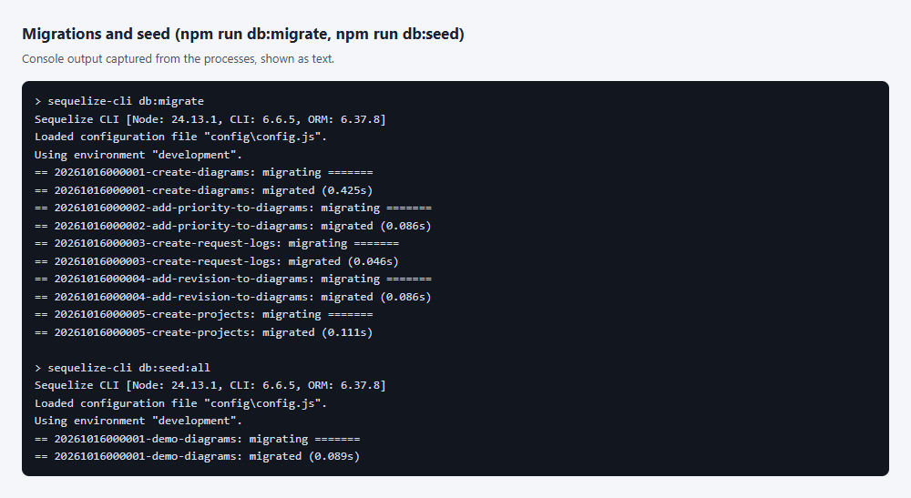

Figure 1 – Console output of the migrations and the seed (process output captured as text)

The structure of the created tables is taken by a query to the system table `sqlite_master` of the database itself and is shown in figure 2.

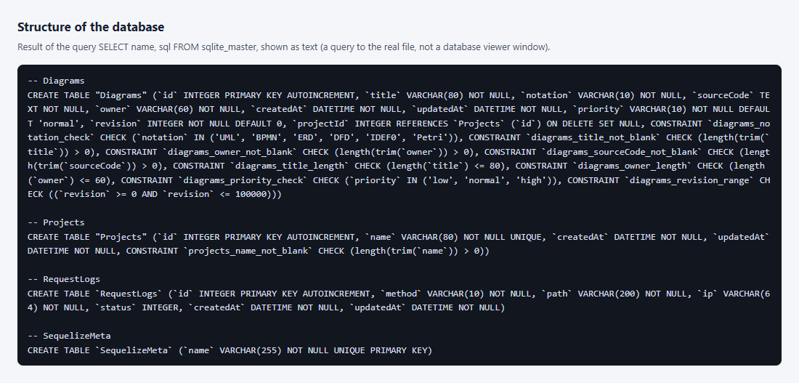

Figure 2 – The tables Diagrams, Projects, RequestLogs and SequelizeMeta with the CHECK constraints (result of a query to the database file captured as text)

The `GET /diagrams` request is opened in the browser at `http://localhost:3000/diagrams`, and the three seeded records are shown in figure 3.

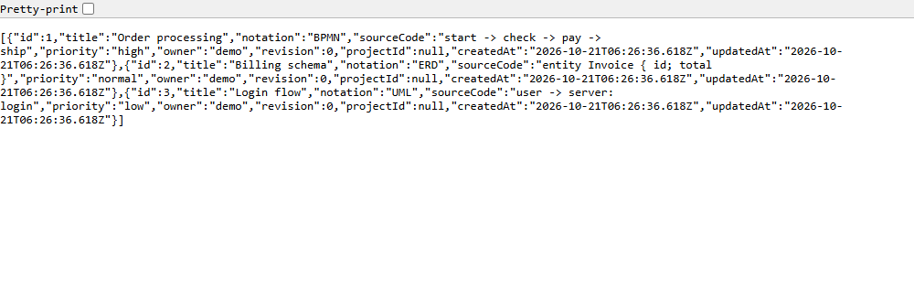

Figure 3 – Answer to GET /diagrams in a browser window: three seeded diagrams with the createdAt and updatedAt fields

A single record at `http://localhost:3000/diagrams/1` is shown in figure 4.

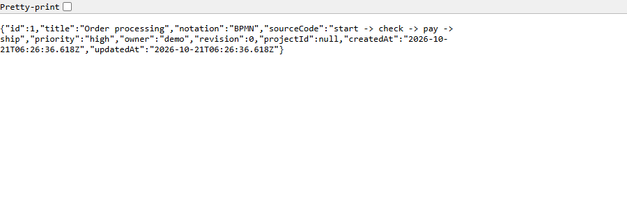

Figure 4 – Answer to GET /diagrams/1 in a browser window: the object of one diagram from the database

A request for a missing record at `http://localhost:3000/diagrams/99` gives the error shown in figure 5.


Figure 5 – Answer to GET /diagrams/99 in a browser window: JSON saying that the diagram is missing (code 404)

Deleting a record and deleting it again are shown in figure 6. A browser does not send `POST`, `PUT`, `PATCH` and `DELETE` from the address bar, so the script `shots/shots.mjs` sent such requests, and the real requests and server answers are drawn on a page.

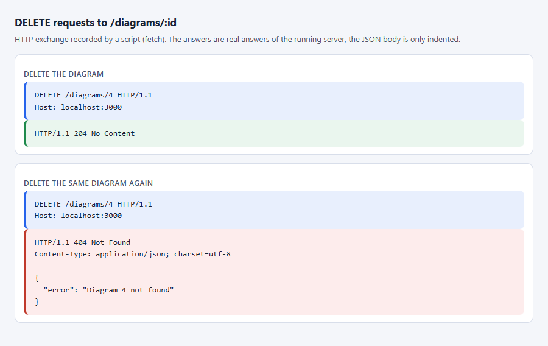

Figure 6 – DELETE requests: the answer 204 without a body and the answer 404 on a repeat, recorded by a script (not a Postman window)

### 3.6 Paging and sorting

The list accepts the `limit`, `offset`, `sort` and `order` parameters. `limit` sets the page size from 1 to 100, `offset` sets the shift from 0 to 1000000, `sort` picks a field from a whitelist and `order` takes `asc` or `desc`. Without parameters the whole list is returned in ascending `id` order, so the clients of the earlier works keep working. The answer stays an array and the full size of the selection comes in the `X-Total-Count` header. Numbers are read as strings of at most nine digits, so `-1`, `1e9`, `0x10` and huge numbers get a 400 answer with a list of errors by field. The sort field name is checked against the whitelist and never reaches the database query unchecked. Equal values are ordered by `id`, so pages do not overlap. Parsing of the parameters is moved to a separate module, it is given in Appendix H. The `notation` parameter keeps the records of one notation, and the `q` parameter searches a part of the title ignoring case with `instr` in SQLite or `strpos` in PostgreSQL, so percent and underscore signs in the search text stay plain characters. An invalid value gives 400.

The request `GET /diagrams?limit=2&offset=0&sort=title&order=desc` gives the first page of two records, as in figure 7.

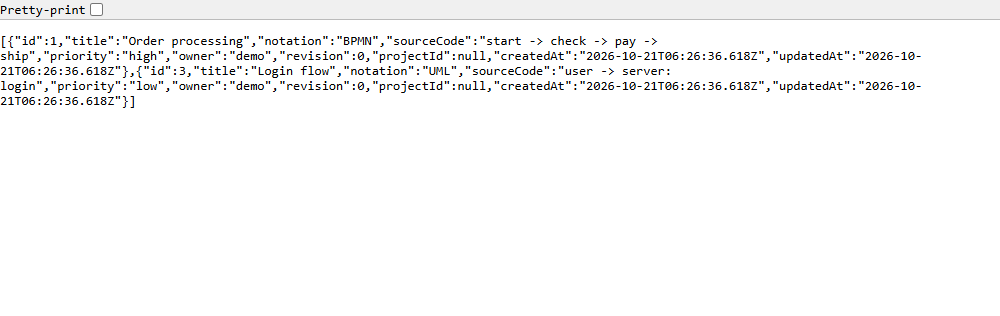

Figure 7 – Answer to GET /diagrams with the limit, offset, sort and order parameters in a browser window

### 3.7 The numeric field revision

The `revision` field holds the revision number of a diagram and shows how a number travels from the database to the response. In the database the column is an `INTEGER` with the default 0 and a `CHECK` from 0 to 100000, in the model the same rule is set with the `isInt`, `min` and `max` validators, and the limit `revisionMax` lives in `limits.json`. A request is checked before the database: only a whole number from 0 to the limit is accepted. The string `"5"`, a fraction, a negative number, `null`, an array and a number above the limit get a 400 response with the `revision` field in the error list. JSON cannot hold `1e999`, it parses to infinity and the same rule rejects it, while values such as `1e20` and `9007199254740993` exceed the limit. Without the field in the body the value is 0. The list can be sorted by `revision`, and numbers compare as numbers, not as strings.

The refusal to store wrong values, including a negative revision, is shown in figure 8.

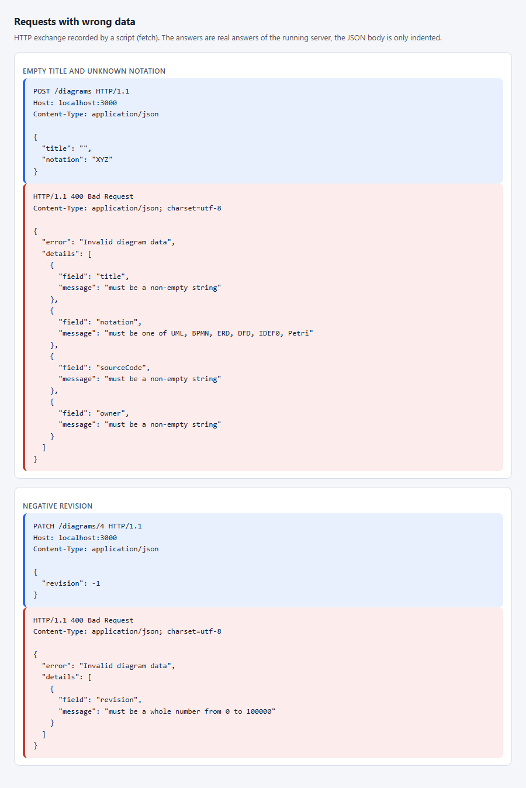

Figure 8 – Answers 400 with the list of field problems and for a negative revision, recorded by a script (not a Postman window)

### 3.8 The PATCH method

The `PATCH /diagrams/:id` route changes only the fields that are sent. The check lives in `validatePartial`: every sent field goes through the same rule as in `POST` and `PUT`, and a body without a single known field gives 400. The controller reads the record with `findByPk`, calls `diagram.update(fields)` and returns the updated record, so the model validators run too. The `PUT` method replaces the record as a whole: omitted optional fields get their defaults, and `projectId` is reset to `null`. The `PATCH` method leaves omitted fields untouched. That is why `PUT` is idempotent, while `PATCH` does not have to be by definition.

Creating, replacing and partially changing a record in the database are shown in figure 9.

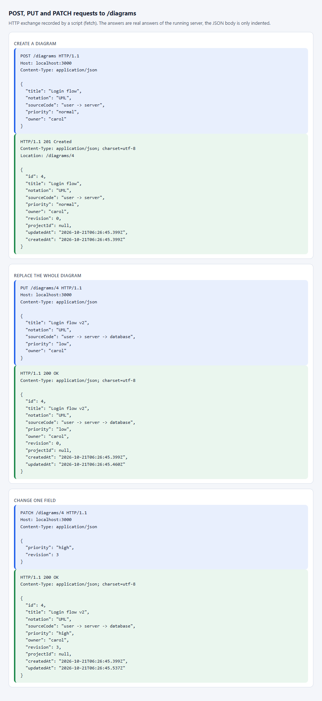

Figure 9 – POST, PUT and PATCH requests and the server answers, recorded by a script (not a Postman window)

### 3.9 One-to-many relation and the uniqueness error

One project holds many diagrams, and a diagram belongs to at most one project. The `Project` model is defined in `src/models/project.js`, and the relation is set in `src/models/index.js` with `Project.hasMany(Diagram)` and `Diagram.belongsTo(Project)` using the foreign key `projectId`. In the migration the `projectId` column references `Projects.id` with the rule `ON DELETE SET NULL`: when a project is deleted, its diagrams stay and their `projectId` is cleared. A diagram can name only an existing project, otherwise the controller answers 400 with the `projectId` field, and the foreign key protects the table from writes that bypass the application. The project routes are shown in table 3.

Table 3 – Routes of the projects resource

| Route                        | Purpose                                                                  | Response         |
| ---------------------------- | ------------------------------------------------------------------------ | ---------------- |
| `GET /projects`              | List of projects with paging and sorting                                 | 200              |
| `POST /projects`             | Create a project with a unique name                                      | 201, 400 or 409  |
| `GET /projects/:id`          | One project                                                              | 200 or 404       |
| `GET /projects/:id/diagrams` | Diagrams of the project with the same `limit`, `offset`, `sort` parameters | 200 or 404       |
| `DELETE /projects/:id`       | Delete a project without deleting its diagrams                           | 204 or 404       |

The project name is unique: the `name` column is created with a `UNIQUE` constraint. A repeated name breaks it, Sequelize throws `SequelizeUniqueConstraintError`, and the global handler turns it into a 409 response with the `name` field in `details`. Checking with a `findOne` query before writing is not enough, because two simultaneous requests would both pass it, so the database constraint has the last word.

Creating a project, the answer 409 for a repeated name, moving a diagram into the project and listing the diagrams of the project are shown in figure 10.

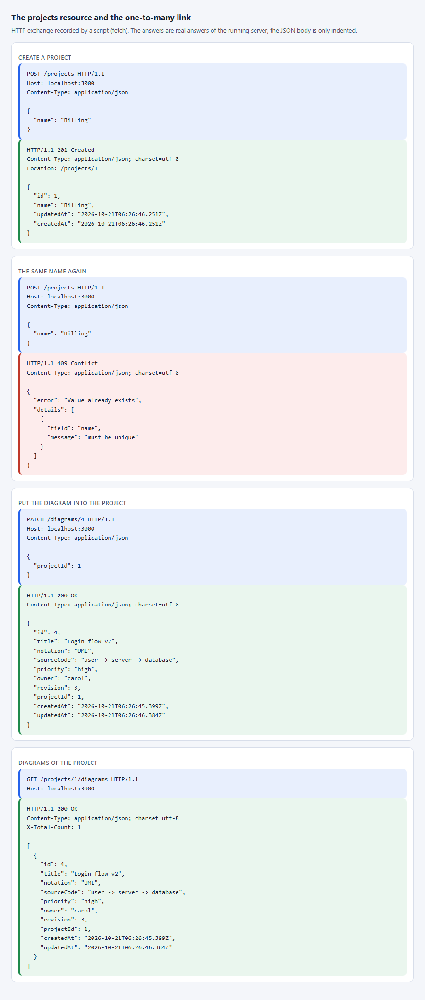

Figure 10 – Requests to the projects resource, including the answer 409 for a repeated name, recorded by a script (not a Postman window)

### 3.10 How to trigger a 500 response with a real failure

A 500 response is caused by a database failure, not by a button. For SQLite, start the server with `npm start`, then run `npx sequelize-cli db:migrate:undo:all` in a second window. The tables vanish under the running server, and the very first request, for example `GET /diagrams`, cannot write a row to the `RequestLogs` log. The client gets 500 with the body `{ "error": "Internal server error" }`, and the details stay only in the server console. For PostgreSQL it is enough to stop the database service or container: requests give 500, and `GET /health` answers 503. The command `npm run db:migrate` or starting the database restores the work. The same failure is reproduced in an automated test by dropping the `RequestLogs` table while the server runs.

The migrations are undone with `npx sequelize-cli db:migrate:undo:all` under the running server, and the very first request to `http://localhost:3000/diagrams` gets the answer 500, as in figure 11.


Figure 11 – Answer to GET /diagrams after a real database failure: JSON with a general message without details (code 500)

The details of the failure stay only in the console of the server and are shown in figure 12.

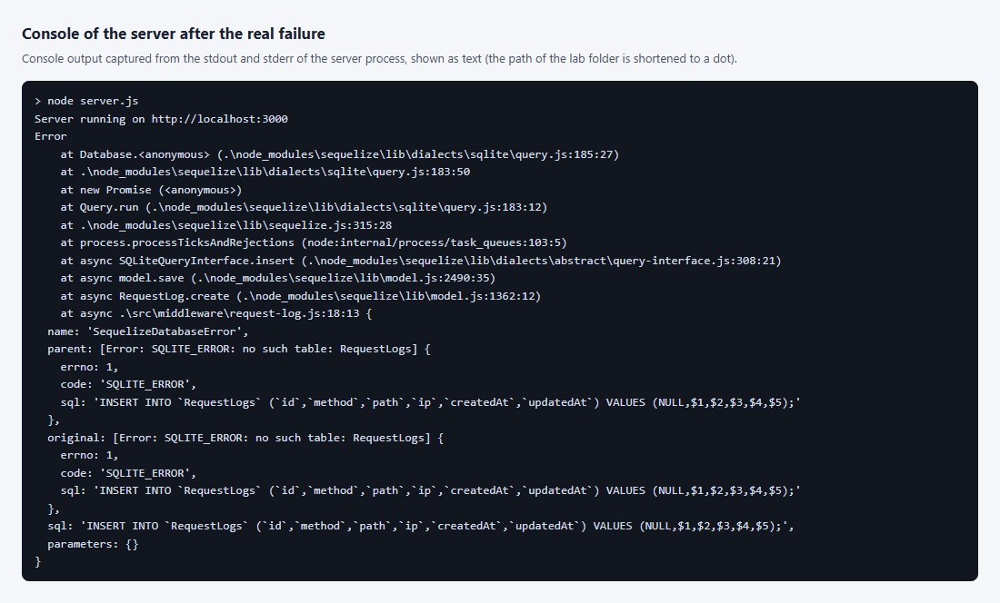

Figure 12 – Console of the server after the failure: the error about the missing table RequestLogs (process output captured as text)

The result of the `npm test` command with the number of tests and the code coverage is shown in figure 13.

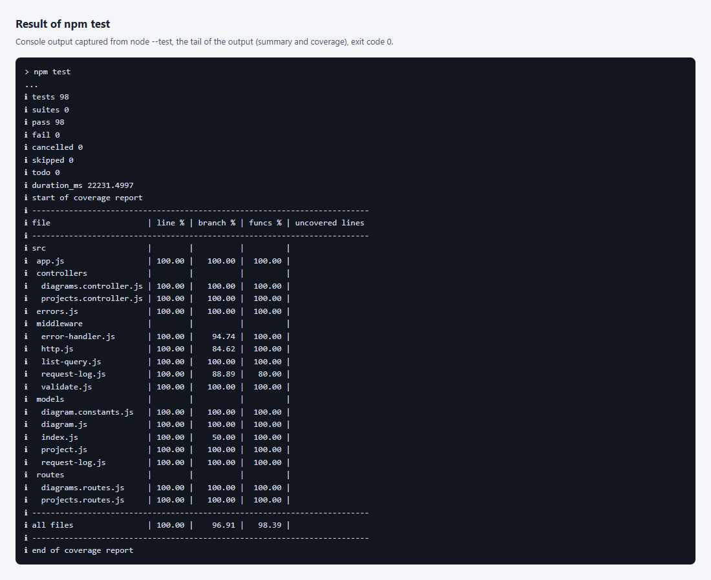

Figure 13 – End of the npm test output: the number of passed tests and the coverage table (process output captured as text)

### 3.11 Answers to the control questions

5. How do you implement a one-to-many relation between models? Give an example from your project.

   The parent model calls `hasMany`, the child model calls `belongsTo`, and both name the same foreign key. In the project one `Project` has many `Diagram` records: `Project.hasMany(Diagram, { foreignKey: 'projectId', onDelete: 'SET NULL' })` and `Diagram.belongsTo(Project, { foreignKey: 'projectId' })`. The migration creates the `projectId` column that references `Projects.id`, and the association only tells Sequelize about it. After that the methods `project.getDiagrams()` and `diagram.getProject()` are available, as well as loading in one query with `include`. In the API this is the route `GET /projects/:id/diagrams`.

6. How do you paginate (limit, offset) in Sequelize?

   The method `findAndCountAll({ limit, offset, order })` returns the page in `rows` and the total number of records in `count`. In the work `count` goes to the client in the `X-Total-Count` header. An order is required, otherwise pages may overlap, so equal values are sorted by `id`. Page number `n` starts at the offset `(n - 1) * limit`. The page size is capped at 100, and `limit` and `offset` are read as short digit strings, so `-1` and huge numbers give 400. On very large tables a big offset is slow, and then paging by the last seen `id` is used.

7. How do you handle a uniqueness error (duplicate entry) when creating a record?

   Uniqueness is set with a `UNIQUE` constraint in the migration and `unique: true` in the model. A violation raises `SequelizeUniqueConstraintError`, whose `errors[0].path` holds the field name. It is caught in the error handler and answered with 409 Conflict rather than 500, because the fault is a repeated value, not the database. In the work `POST /projects` answers this way for a name that is already taken. A preliminary `findOne` does not replace the constraint: another request can slip in between the check and the write.

### 3.12 Architecture and trade-offs

The work repeats the layers of the first lab and adds a data access layer: Sequelize models and migrations. The controller works with models and writes no SQL, and the database schema changes only through migrations. Fowler calls this approach Data Mapper in Patterns of Enterprise Application Architecture: a domain object does not know how it is stored. The dependency rule from Martin's Clean Architecture is not fully kept. The controller depends on Sequelize because it uses its search and count methods. The domain could be fully separated by a repository layer, but for two entities it would double the number of files, so it was not done.

The trade-off is deliberate. Integrity rules live on two levels: the check in code gives a clear 400 answer, while the `CHECK`, `UNIQUE` and foreign key constraints in the database protect the data even when a write bypasses the API. Duplicating the rules is justified here because each level has its own job. The limits live in `limits.json` and are copied into the migrations as a snapshot, so an old migration does not change with the code. The request log is a separate middleware, so it can be turned off without touching the routes.

Sources: Martin R. Clean Architecture: A Craftsman's Guide to Software Structure and Design. Prentice Hall, 2017. Fowler M. Patterns of Enterprise Application Architecture. Addison-Wesley, 2002. Fowler M. Refactoring: Improving the Design of Existing Code, 2nd ed. Addison-Wesley, 2018.

## Conclusion

For DSLKit, the `diagrams` collection from lab 1 is moved from an array to a database through Sequelize: the `Diagram` model, a seed with three diagrams, and controllers built on ORM methods. The `Diagram` and `Project` models have a one-to-many relation, and five migrations build the schema. The `PATCH` method, the 409 response for a repeated project name and the check of a number from 0 to the limit are added. Locally the work uses SQLite, and the `DATABASE_URL` variable switches it to PostgreSQL or cloud Neon without code changes. 98 automated tests confirm the routes, the constraints, the migrations with rollback, and the seed. The work has not been run on a real PostgreSQL, and the database structure and the requests are confirmed by browser screenshots and by an exchange recorded with a script.

## Appendix A (mandatory) Listing of config.js

```js
const { readFileSync } = require('node:fs');

try {
  process.loadEnvFile();
} catch {
  // .env is optional, the settings may come from the environment
}

// PostgreSQL is the database of the work: DATABASE_URL points to it (a local one from docker-compose.yml, Neon, Supabase).
// SQLITE_STORAGE selects a SQLite file instead, the tests use it with a temporary file so that they need no server.
// With DATABASE_SSL=true the server certificate is verified; only DATABASE_SSL_REJECT_UNAUTHORIZED=false turns that off.
// DATABASE_SSL_CA is a path to a PEM file with the certificate authority, the safe way to trust a private or self-signed server.
const fromEnv = () => {
  const { DATABASE_URL, DATABASE_SSL, DATABASE_SSL_REJECT_UNAUTHORIZED, DATABASE_SSL_CA, SQLITE_STORAGE, NODE_ENV } = process.env;
  if (!DATABASE_URL) {
    if (SQLITE_STORAGE) return { dialect: 'sqlite', storage: SQLITE_STORAGE, logging: false };
    throw new Error('DATABASE_URL is not set: copy .env.example to .env and start the database (docker compose up -d db), or set SQLITE_STORAGE to use a SQLite file');
  }
  if (NODE_ENV === 'production' && (DATABASE_SSL !== 'true' || DATABASE_SSL_REJECT_UNAUTHORIZED === 'false')) {
    throw new Error('In production DATABASE_SSL=true is required and certificate checks cannot be turned off, use DATABASE_SSL_CA instead');
  }
  return {
    use_env_variable: 'DATABASE_URL',
    dialect: 'postgres',
    logging: false,
    ...(DATABASE_SSL === 'true' && { dialectOptions: { ssl: { require: true, rejectUnauthorized: DATABASE_SSL_REJECT_UNAUTHORIZED !== 'false', ...(DATABASE_SSL_CA && { ca: readFileSync(DATABASE_SSL_CA, 'utf8') }) } } }),
  };
};

// The settings are read when a block is asked for, so a missing setting is reported where the database is needed
// and not at the moment this file is loaded. The same block serves every environment, the tests set SQLITE_STORAGE.
module.exports = {
  get development() {
    return fromEnv();
  },
  get test() {
    return fromEnv();
  },
  get production() {
    return fromEnv();
  },
};
```

## Appendix B (mandatory) Listing of the model index.js

```js
const { Sequelize } = require('sequelize');
const { defineDiagram } = require('./diagram');
const { defineRequestLog } = require('./request-log');
const { defineProject } = require('./project');
const allConfigs = require('../../config/config');

// Builds the connection from config/config.js; NODE_ENV picks the block.
const createModels = (config = allConfigs[process.env.NODE_ENV || 'development']) => {
  const { use_env_variable: urlVariable, ...options } = config;
  const sequelize = urlVariable ? new Sequelize(process.env[urlVariable], options) : new Sequelize(options);
  const Diagram = defineDiagram(sequelize);
  const Project = defineProject(sequelize);
  // One-to-many: a project has many diagrams, a diagram belongs to one project. Deleting a project clears projectId of its diagrams.
  Project.hasMany(Diagram, { foreignKey: 'projectId', as: 'diagrams', onDelete: 'SET NULL' });
  Diagram.belongsTo(Project, { foreignKey: 'projectId', as: 'project' });
  return { sequelize, Diagram, Project, RequestLog: defineRequestLog(sequelize) };
};

module.exports = { createModels };
```

## Appendix C (mandatory) Listing of diagram.js

```js
const { DataTypes } = require('sequelize');
const { NOTATIONS, PRIORITIES, DEFAULT_PRIORITY, LIMITS } = require('./diagram.constants');

// The table is created by migrations, never by sequelize.sync().
const defineDiagram = (sequelize) =>
  sequelize.define('Diagram', {
    title: { type: DataTypes.STRING(LIMITS.title), allowNull: false, validate: { len: [1, LIMITS.title] } },
    notation: { type: DataTypes.STRING(10), allowNull: false, validate: { isIn: [NOTATIONS] } },
    sourceCode: { type: DataTypes.TEXT, allowNull: false, validate: { len: [1, LIMITS.sourceCode] } },
    priority: { type: DataTypes.STRING(10), allowNull: false, defaultValue: DEFAULT_PRIORITY, validate: { isIn: [PRIORITIES] } },
    owner: { type: DataTypes.STRING(LIMITS.owner), allowNull: false, validate: { len: [1, LIMITS.owner] } },
    // A counter that is never negative, the same range as the CHECK in the migration.
    revision: { type: DataTypes.INTEGER, allowNull: false, defaultValue: 0, validate: { isInt: true, min: 0, max: LIMITS.revisionMax } },
    // Foreign key of the one-to-many link, see the associations in index.js.
    projectId: { type: DataTypes.INTEGER, allowNull: true },
  });

module.exports = { defineDiagram };
```

## Appendix D (mandatory) Listing of the table creation migration

```js
// A migration is a snapshot, so the allowed values and limits are copied here instead of imported.
const NOTATIONS = ['UML', 'BPMN', 'ERD', 'DFD', 'IDEF0', 'Petri'];
const LIMITS = { title: 80, owner: 60 };

module.exports = {
  async up(queryInterface, Sequelize) {
    const { fn, col, where, Op } = Sequelize;
    await queryInterface.createTable('Diagrams', {
      id: { allowNull: false, autoIncrement: true, primaryKey: true, type: Sequelize.INTEGER },
      title: { allowNull: false, type: Sequelize.STRING(LIMITS.title) },
      notation: { allowNull: false, type: Sequelize.STRING(10) },
      sourceCode: { allowNull: false, type: Sequelize.TEXT },
      owner: { allowNull: false, type: Sequelize.STRING(LIMITS.owner) },
      createdAt: { allowNull: false, type: Sequelize.DATE },
      updatedAt: { allowNull: false, type: Sequelize.DATE },
    });
    await queryInterface.addConstraint('Diagrams', {
      type: 'check',
      fields: ['notation'],
      name: 'diagrams_notation_check',
      where: { notation: { [Op.in]: NOTATIONS } },
    });
    // The API trims and checks every text, these checks keep the table clean for any other writer (SQLite does not enforce VARCHAR length).
    for (const column of ['title', 'owner', 'sourceCode']) {
      await queryInterface.addConstraint('Diagrams', {
        type: 'check',
        fields: [column],
        name: `diagrams_${column}_not_blank`,
        where: where(fn('length', fn('trim', col(column))), { [Op.gt]: 0 }),
      });
    }
    for (const column of ['title', 'owner']) {
      await queryInterface.addConstraint('Diagrams', {
        type: 'check',
        fields: [column],
        name: `diagrams_${column}_length`,
        where: where(fn('length', col(column)), { [Op.lte]: LIMITS[column] }),
      });
    }
  },

  async down(queryInterface) {
    await queryInterface.dropTable('Diagrams');
  },
};
```

## Appendix E (mandatory) Listing of the priority migration

```js
const PRIORITIES = ['low', 'normal', 'high'];

module.exports = {
  async up(queryInterface, Sequelize) {
    await queryInterface.addColumn('Diagrams', 'priority', {
      allowNull: false,
      type: Sequelize.STRING(10),
      defaultValue: 'normal',
    });
    await queryInterface.addConstraint('Diagrams', {
      type: 'check',
      fields: ['priority'],
      name: 'diagrams_priority_check',
      where: { priority: { [Sequelize.Op.in]: PRIORITIES } },
    });
  },

  async down(queryInterface) {
    await queryInterface.removeConstraint('Diagrams', 'diagrams_priority_check');
    if (queryInterface.sequelize.getDialect() === 'sqlite') {
      // The generic removeColumn rebuilds a SQLite table from its columns only and loses every CHECK,
      // while the native DROP COLUMN (SQLite 3.35+) leaves the rest of the table as it was.
      await queryInterface.sequelize.query('ALTER TABLE `Diagrams` DROP COLUMN `priority`');
    } else {
      await queryInterface.removeColumn('Diagrams', 'priority');
    }
  },
};
```

## Appendix F (mandatory) Listing of the demo-diagrams.js seed

```js
const { ROWS } = require('../seed-data/diagrams');

// Every seeded row has this owner, so the seed can tell its rows from the ones users created.
const MARKER = 'demo';

// Idempotent per row: a row that is already there is left alone, a deleted one comes back, nothing is duplicated.
module.exports = {
  async up(queryInterface) {
    const now = new Date();
    for (const row of ROWS) {
      const exists = await queryInterface.rawSelect('Diagrams', { where: { owner: MARKER, title: row.title } }, ['id']);
      if (!exists) await queryInterface.bulkInsert('Diagrams', [{ ...row, owner: MARKER, createdAt: now, updatedAt: now }]);
    }
  },

  async down(queryInterface, Sequelize) {
    await queryInterface.bulkDelete('Diagrams', { owner: MARKER, title: { [Sequelize.Op.in]: ROWS.map((row) => row.title) } });
  },
};
```

## Appendix G (mandatory) Listing of diagrams.controller.js

```js
const { notFound, badRequest } = require('../errors');
const { Op, fn, col, where } = require('sequelize');
const { parseListQuery } = require('../middleware/list-query');
const { NOTATIONS, LIMITS } = require('../models/diagram.constants');

const missing = (id) => notFound(`Diagram ${id} not found`);

const SORTABLE = ['id', 'title', 'notation', 'priority', 'owner', 'revision', 'createdAt'];

// A part of the title is searched with instr (SQLite) or strpos (PostgreSQL) on the lowercased title, not with LIKE,
// so the characters % and _ in the search text are plain characters and need no escaping.
const filterFor = (dialect, { notation, q }) => {
  const conditions = [];
  if (notation !== undefined) conditions.push({ notation });
  if (q !== undefined) conditions.push(where(fn(dialect === 'sqlite' ? 'instr' : 'strpos', fn('lower', col('title')), q), { [Op.gt]: 0 }));
  return conditions.length > 0 ? { [Op.and]: conditions } : {};
};

// Express 5 forwards a rejected promise to the error handler, so no try/catch is needed here.
const createDiagramsController = ({ Diagram, Project }) => {
  // The foreign key is also guarded by the database, but a clear 400 beats a database error for a project that does not exist.
  const ensureProject = async (projectId) => {
    if (projectId === undefined || projectId === null || (await Project.findByPk(projectId))) return;
    throw badRequest('Invalid diagram data', [{ field: 'projectId', message: `project ${projectId} does not exist` }]);
  };

  return {
    // ?limit=&offset=&sort=&order= (see list-query.js). The answer stays an array, the full size comes in X-Total-Count.
    list: async (req, res) => {
      const { limit, offset, sort, order, notation, q } = parseListQuery(req.query, SORTABLE, { notations: NOTATIONS, maxQuery: LIMITS.title });
      const { count, rows } = await Diagram.findAndCountAll({
        where: filterFor(Diagram.sequelize.getDialect(), { notation, q }),
        order: [
          [sort, order.toUpperCase()],
          ['id', 'ASC'],
        ],
        limit,
        offset,
      });
      res.set('X-Total-Count', String(count));
      res.json(rows);
    },

    get: async (req, res, next) => {
      const diagram = await Diagram.findByPk(req.diagramId);
      return diagram ? res.json(diagram) : next(missing(req.diagramId));
    },

    create: async (req, res) => {
      await ensureProject(req.diagramFields.projectId);
      const diagram = await Diagram.create(req.diagramFields);
      res.status(201).location(`/diagrams/${diagram.id}`).json(diagram);
    },

    replace: async (req, res, next) => {
      await ensureProject(req.diagramFields.projectId);
      const [updated] = await Diagram.update(req.diagramFields, { where: { id: req.diagramId } });
      return updated ? res.json(await Diagram.findByPk(req.diagramId)) : next(missing(req.diagramId));
    },

    // PATCH: only the sent fields change, the model validators still run on them.
    update: async (req, res, next) => {
      const diagram = await Diagram.findByPk(req.diagramId);
      if (!diagram) return next(missing(req.diagramId));
      await ensureProject(req.diagramFields.projectId);
      await diagram.update(req.diagramFields);
      return res.json(diagram);
    },

    remove: async (req, res, next) => {
      const removed = await Diagram.destroy({ where: { id: req.diagramId } });
      return removed ? res.status(204).end() : next(missing(req.diagramId));
    },
  };
};

module.exports = { createDiagramsController };
```

## Appendix H (mandatory) Listing of list-query.js

```js
const { badRequest } = require('../errors');

// Limits of the list query. The page size is capped so one request cannot ask for the whole table,
// and the numbers are read as short digit strings, so 1e9, -1, 0x10 or a huge value are refused with 400.
const MAX_LIMIT = 100;
const MAX_OFFSET = 1000000;
const ORDERS = ['asc', 'desc'];

// Reads ?limit=, ?offset=, ?sort=, ?order=, ?notation= and ?q= from req.query.
// sortable: the field names a client may sort by (a whitelist, so a field name never reaches the database unchecked).
// Without limit the whole list is returned (the clients of the earlier labs expect that), without sort the order is by id.
// A bad value throws the 400 error with the list of problems, Express 5 passes it to the error handler.
// filters: { notations: allowed values of ?notation=, maxQuery: longest ?q= }. ?q= is a case-insensitive part of the title.
const parseListQuery = (query, sortable, filters = {}) => {
  const problems = [];
  const integer = (name, min, max) => {
    const value = query[name];
    if (value === undefined) return undefined;
    if (typeof value !== 'string' || !/^\d{1,9}$/.test(value) || Number(value) < min || Number(value) > max) {
      problems.push({ field: name, message: `${name} must be an integer from ${min} to ${max}` });
      return undefined;
    }
    return Number(value);
  };
  const limit = integer('limit', 1, MAX_LIMIT);
  const offset = integer('offset', 0, MAX_OFFSET) ?? 0;

  const sort = query.sort ?? 'id';
  if (typeof sort !== 'string' || !sortable.includes(sort)) {
    problems.push({ field: 'sort', message: `sort must be one of: ${sortable.join(', ')}` });
  }
  const order = typeof query.order === 'string' ? query.order.toLowerCase() : (query.order ?? 'asc');
  if (!ORDERS.includes(order)) problems.push({ field: 'order', message: 'order must be asc or desc' });

  const { notations = [], maxQuery = 80 } = filters;
  let notation;
  if (query.notation !== undefined) {
    if (typeof query.notation !== 'string' || !notations.includes(query.notation)) problems.push({ field: 'notation', message: `notation must be one of: ${notations.join(', ')}` });
    else notation = query.notation;
  }
  let q;
  if (query.q !== undefined) {
    const text = typeof query.q === 'string' ? query.q.trim() : '';
    if (text === '' || text.length > maxQuery) problems.push({ field: 'q', message: `q must be text of 1 to ${maxQuery} characters` });
    else q = text.toLowerCase();
  }

  if (problems.length) throw badRequest('Invalid list query', problems);
  return { limit, offset, sort, order, notation, q };
};

module.exports = { parseListQuery, MAX_LIMIT, MAX_OFFSET };
```

## Appendix I (mandatory) Listing of the revision migration

```js
// A migration is a snapshot, so the limit is copied here instead of imported.
const REVISION_MAX = 100000;

// A numeric column that is never negative: the CHECK keeps it clean for any writer, not only for the API.
module.exports = {
  async up(queryInterface, Sequelize) {
    await queryInterface.addColumn('Diagrams', 'revision', {
      allowNull: false,
      type: Sequelize.INTEGER,
      defaultValue: 0,
    });
    await queryInterface.addConstraint('Diagrams', {
      type: 'check',
      fields: ['revision'],
      name: 'diagrams_revision_range',
      where: { revision: { [Sequelize.Op.gte]: 0, [Sequelize.Op.lte]: REVISION_MAX } },
    });
  },

  async down(queryInterface) {
    await queryInterface.removeConstraint('Diagrams', 'diagrams_revision_range');
    if (queryInterface.sequelize.getDialect() === 'sqlite') {
      // The generic removeColumn rebuilds a SQLite table from its columns only and loses every CHECK,
      // while the native DROP COLUMN (SQLite 3.35+) leaves the rest of the table as it was.
      await queryInterface.sequelize.query('ALTER TABLE `Diagrams` DROP COLUMN `revision`');
    } else {
      await queryInterface.removeColumn('Diagrams', 'revision');
    }
  },
};
```

## Appendix J (mandatory) Listing of the Projects table migration

```js
// A migration is a snapshot, so the limit is copied here instead of imported.
const NAME_MAX = 80;

// One project has many diagrams (one-to-many). The name is unique, a second project with the same name is a database error
// that the API turns into 409. Deleting a project keeps its diagrams and clears their projectId.
module.exports = {
  async up(queryInterface, Sequelize) {
    const { fn, col, where, Op } = Sequelize;
    await queryInterface.createTable('Projects', {
      id: { allowNull: false, autoIncrement: true, primaryKey: true, type: Sequelize.INTEGER },
      name: { allowNull: false, unique: true, type: Sequelize.STRING(NAME_MAX) },
      createdAt: { allowNull: false, type: Sequelize.DATE },
      updatedAt: { allowNull: false, type: Sequelize.DATE },
    });
    await queryInterface.addConstraint('Projects', {
      type: 'check',
      fields: ['name'],
      name: 'projects_name_not_blank',
      where: where(fn('length', fn('trim', col('name'))), { [Op.gt]: 0 }),
    });
    await queryInterface.addColumn('Diagrams', 'projectId', {
      allowNull: true,
      type: Sequelize.INTEGER,
      references: { model: 'Projects', key: 'id' },
      onDelete: 'SET NULL',
    });
    await queryInterface.addIndex('Diagrams', ['projectId'], { name: 'diagrams_project_id' });
  },

  async down(queryInterface) {
    await queryInterface.removeIndex('Diagrams', 'diagrams_project_id');
    if (queryInterface.sequelize.getDialect() === 'sqlite') {
      // The generic removeColumn would rebuild the table and lose every CHECK, see the priority migration.
      await queryInterface.sequelize.query('ALTER TABLE `Diagrams` DROP COLUMN `projectId`');
    } else {
      await queryInterface.removeColumn('Diagrams', 'projectId');
    }
    await queryInterface.dropTable('Projects');
  },
};
```

## Appendix K (mandatory) Listing of projects.controller.js

```js
const { notFound } = require('../errors');
const { parseListQuery } = require('../middleware/list-query');

const PROJECT_SORTABLE = ['id', 'name', 'createdAt'];
const DIAGRAM_SORTABLE = ['id', 'title', 'notation', 'priority', 'owner', 'revision', 'createdAt'];

const missing = (id) => notFound(`Project ${id} not found`);

// A project groups diagrams. Creating a project with a name that already exists breaks the UNIQUE constraint,
// Sequelize throws SequelizeUniqueConstraintError and the error handler answers 409.
const createProjectsController = ({ Project, Diagram }) => ({
  list: async (req, res) => {
    const { limit, offset, sort, order } = parseListQuery(req.query, PROJECT_SORTABLE);
    const { count, rows } = await Project.findAndCountAll({
      order: [
        [sort, order.toUpperCase()],
        ['id', 'ASC'],
      ],
      limit,
      offset,
    });
    res.set('X-Total-Count', String(count));
    res.json(rows);
  },

  get: async (req, res, next) => {
    const project = await Project.findByPk(req.projectId);
    return project ? res.json(project) : next(missing(req.projectId));
  },

  // The many side of the one-to-many link: all diagrams of one project, with the same paging as /diagrams.
  listDiagrams: async (req, res, next) => {
    const project = await Project.findByPk(req.projectId);
    if (!project) return next(missing(req.projectId));
    const { limit, offset, sort, order } = parseListQuery(req.query, DIAGRAM_SORTABLE);
    const { count, rows } = await Diagram.findAndCountAll({
      where: { projectId: project.id },
      order: [
        [sort, order.toUpperCase()],
        ['id', 'ASC'],
      ],
      limit,
      offset,
    });
    res.set('X-Total-Count', String(count));
    return res.json(rows);
  },

  create: async (req, res) => {
    const project = await Project.create(req.projectFields);
    res.status(201).location(`/projects/${project.id}`).json(project);
  },

  // The diagrams of the project stay, the database clears their projectId (ON DELETE SET NULL).
  remove: async (req, res, next) => {
    const removed = await Project.destroy({ where: { id: req.projectId } });
    return removed ? res.status(204).end() : next(missing(req.projectId));
  },
});

module.exports = { createProjectsController };
```
