# Lab 3. Authentication and Authorization

## 1 Purpose of the Work

To learn the mechanisms of authentication and authorization in web applications: user registration and login with JWT tokens, password hashing with bcrypt, and route protection with middleware. The work continues labs 1 and 2 for DSLKit, a web editor for diagrams as code that fits the SaaS direction. Role-based access control (RBAC) is chosen as the additional security mechanism.

## 2 Brief Theory

**Authentication and authorization.** Authentication answers who is making a request, and authorization answers what that user may do. Wrong credentials give a 401 response, and missing rights of a known user give 403.

**JWT.** A token has three parts separated by dots: a header with the algorithm, a payload with claims, and a signature. The signature is computed with the server secret, so the payload cannot be changed unnoticed, and only the holder of the key can verify authenticity. The payload is not encrypted, so passwords and other secrets never go into it. The lifetime is set by the `exp` claim, and an expired token is rejected.

**Password hashing.** A password is stored only as a hash. The bcrypt algorithm adds a random salt to every password and is deliberately slow, which makes guessing from a stolen database expensive. The cost parameter 10 means 2 to the power of 10 iterations. The algorithm only uses the first 72 bytes of a password.

**Bearer token.** The client sends the token in the `Authorization: Bearer <token>` header. The server checks the signature and the expiry, and then decides whether the request may reach the route.

## 3 Work Progress

### 3.1 User model and migration

The `Users` table is created by the third migration: `id`, `email` with a unique index, `passwordHash`, `role` with the default `user`, and the Sequelize service fields. The `User` model restricts the role to `user` and `admin` and has a `toPublic` method that returns the user without the hash. Every response is built through this method, so the hash cannot slip into a response by accident. The packages `bcrypt` and `jsonwebtoken` are installed with `npm install`.

### 3.2 Registration and login

The `POST /auth/register` route lowercases the email, checks its format and the password, hashes the password with `bcrypt.hash` and stores the user. The 201 response holds `id`, `email`, `role` and the creation date. Uniqueness is guaranteed by the database index: a violation turns into a 409 response, including for simultaneous requests with the same email. The role at registration is always `user`, and a `role` field in the body is ignored. A password must have at least 8 characters and at most 72 bytes, otherwise bcrypt would silently truncate it.

The `POST /auth/login` route finds the user, compares the password with the hash and issues a token signed with HS256 and a lifetime from the `JWT_EXPIRES_IN` variable, one hour by default. The payload holds `id`, `email` and `role`. A wrong password and an unknown email get the same 401 response, and when the user does not exist the server compares the password with a spare hash, so the response time does not reveal whether an account exists. The `JWT_SECRET` secret is required and must have at least 32 characters, otherwise the server does not start. Only the `.env.example` template is committed.

The migrations and the seed are run with `npm run db:migrate` and `npm run db:seed`, and the first administrator comes from environment variables made at start. The output is shown in figure 1.

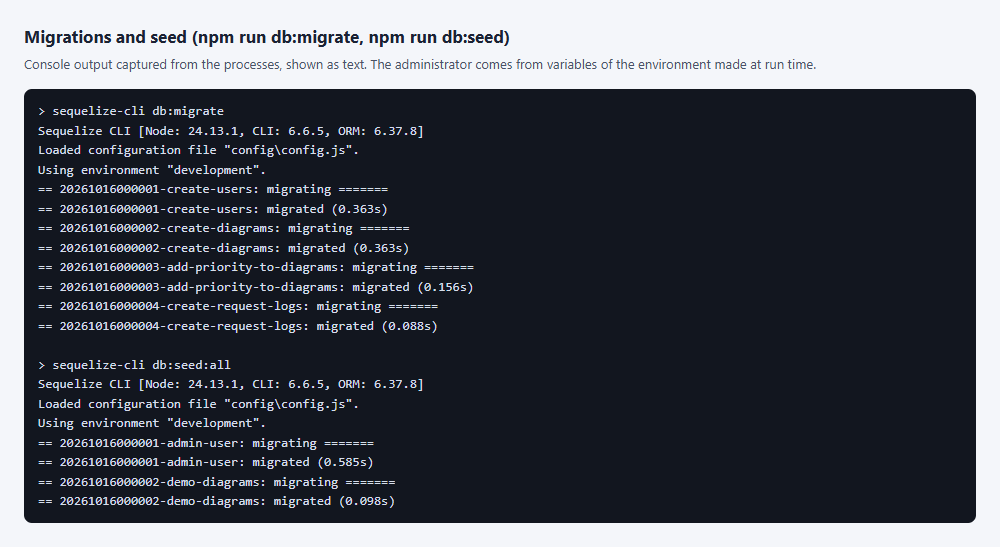

Figure 1 – Console output of the migrations and the seed (process output captured as text)

The server is started with `npm start`, and the console message is shown in figure 2.

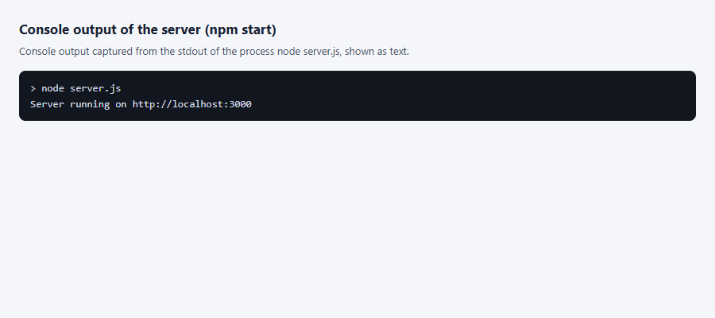

Figure 2 – Console message after the server starts on port 3000 (process output captured as text)

A browser does not send `POST`, `PUT`, `PATCH` and `DELETE` from the address bar, so the script `shots/shots.mjs` sent such requests, and the real requests and server answers are drawn on a page. Registration, the refusal for a repeated address and the refusal for a weak password are shown in figure 3.

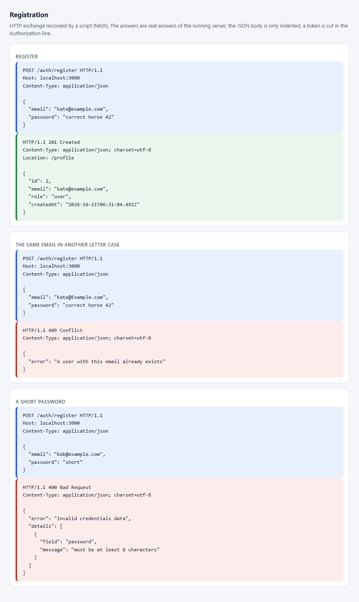

Figure 3 – Registration requests and the answers 201, 409 and 400, recorded by a script (not a Postman window)

Login with a correct and with a wrong password is shown in figure 4.

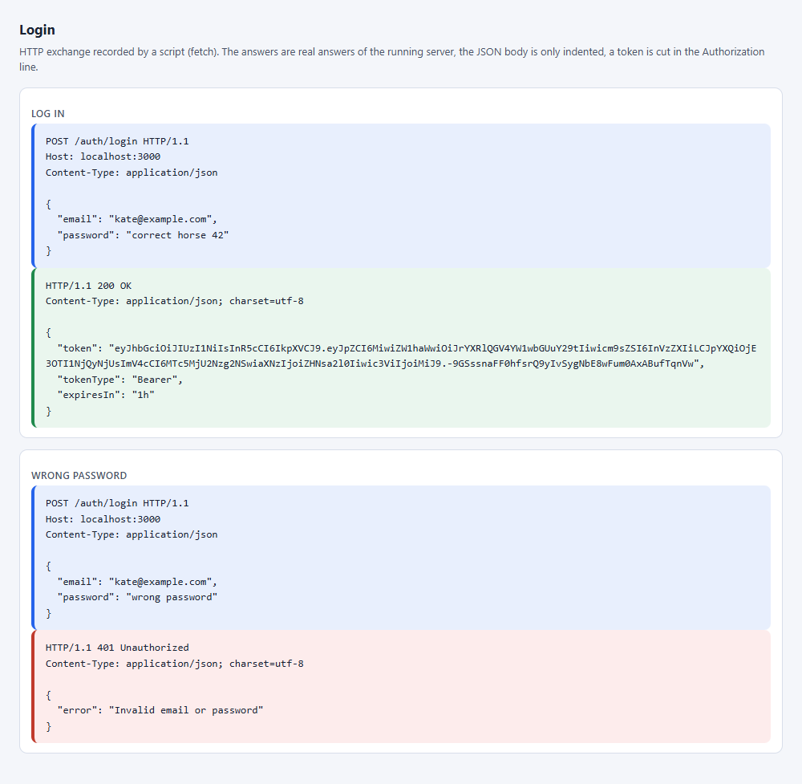

Figure 4 – Login requests: the answer 200 with a token and the answer 401 for a wrong password, recorded by a script (not a Postman window)

### 3.3 Middleware and protected routes

The `authenticate` middleware reads the `Authorization` header, checks the `Bearer` scheme, verifies the signature and the expiry, and accepts only the HS256 algorithm, so tokens with the `none` algorithm or HS512 are rejected. Then it reads the user from the database and puts `id`, `email` and `role` into `req.user`. Reading from the database is deliberate: a deleted account and a changed role take effect at once instead of after the old token expires. The price is one extra query per protected call.

The `GET /profile` route, which returns the current user, and all `/diagrams` routes are protected. The results for a missing and a bad token are listed in table 1.

Table 1 – Responses of protected routes for different tokens

| Token                                                       | Status | Message               |
| ----------------------------------------------------------- | ------ | --------------------- |
| No header, another scheme, extra words                      | 401    | Missing Bearer token  |
| Changed payload, foreign signature, algorithm none or HS512 | 401    | Invalid token         |
| Lifetime ended                                              | 401    | Token expired         |
| User deleted                                                | 401    | User no longer exists |
| Valid token                                                 | 200    | requested data        |

Access to the profile with a valid token, without a token and with a changed token is shown in figure 5.

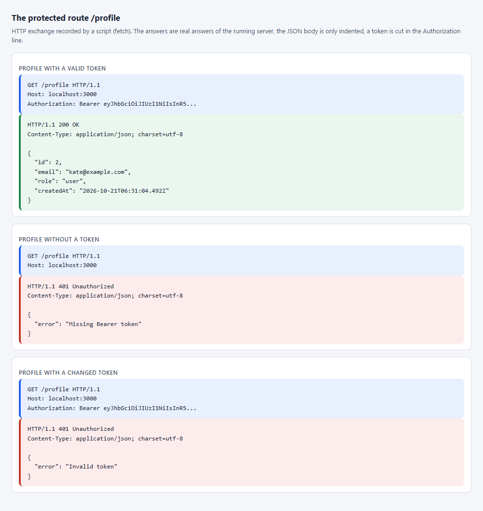

Figure 5 – GET /profile requests: the answer 200 for a valid token and the answers 401 without a token and with a changed token, recorded by a script (not a Postman window)

The address `http://localhost:3000/profile` opened in the browser without the `Authorization` header gives the answer shown in figure 6.

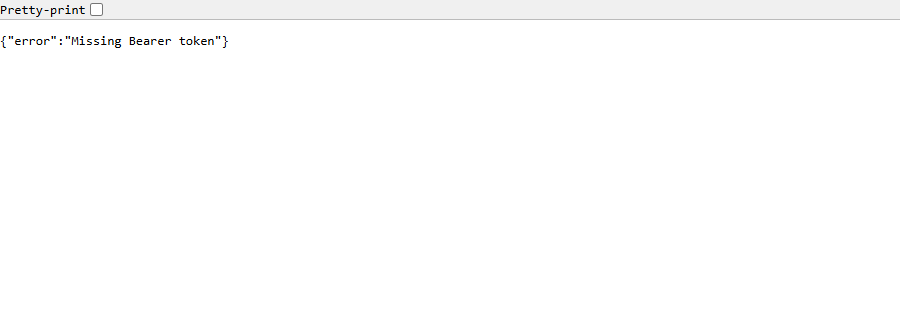

Figure 6 – Answer to GET /profile in a browser window without a token: JSON saying that the token is missing (code 401)

### 3.4 Additional mechanism: roles

Role-based access control is chosen because a SaaS editor needs an administrator and an ordinary user. The `requireRole('admin')` middleware returns 403 to everyone except administrators. Administrators get the three routes listed in table 2. In addition, a diagram can be changed and deleted only by its owner or an administrator: the owner becomes the calling user, and an `ownerId` field in the request body is ignored. Any logged-in user can read diagrams.

Table 2 – Routes and access rights

| Route                                                  | Who may call it | Responses                 |
| ------------------------------------------------------ | --------------- | ------------------------- |
| `POST /auth/register`, `POST /auth/login`              | everyone        | 201 or 200, 400, 401, 409 |
| `GET /profile`                                         | logged-in user  | 200, 401                  |
| `GET /diagrams`, `GET /diagrams/:id`, `POST /diagrams` | logged-in user  | 200 or 201, 400, 401, 404 |
| `PUT /diagrams/:id`, `DELETE /diagrams/:id`            | owner or admin  | 200 or 204, 403, 404      |
| `GET /users`                                           | admin           | 200, 401, 403             |
| `PATCH /users/:id/role`                                | admin           | 200, 400, 404             |
| `DELETE /users/:id`                                    | admin           | 204, 400, 404             |

An administrator cannot change their own role or delete themselves, so the system never ends up without administrators. The first administrator is created by a seed from the `ADMIN_EMAIL` and `ADMIN_PASSWORD` variables, so no password is stored in the repository. If the variables are not set, the seed is skipped.

Creating a diagram by a signed-in user, a partial change and the refusal for an empty body are shown in figure 7.

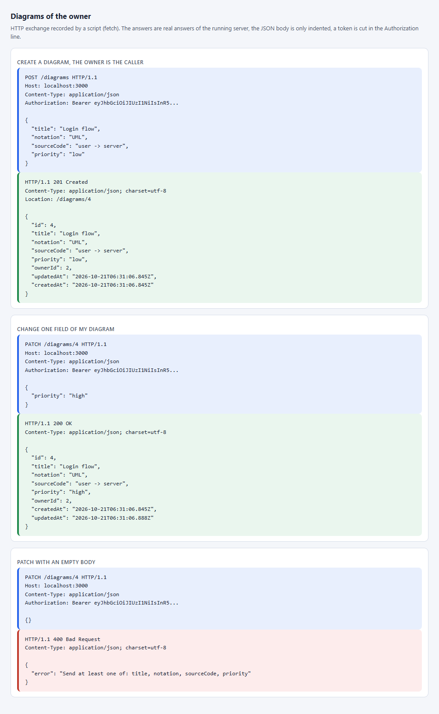

Figure 7 – POST and PATCH requests with the owner token and the answers 201, 200 and 400, recorded by a script (not a Postman window)

The rights of the owner, of an outsider and of the administrator are shown in figure 8.

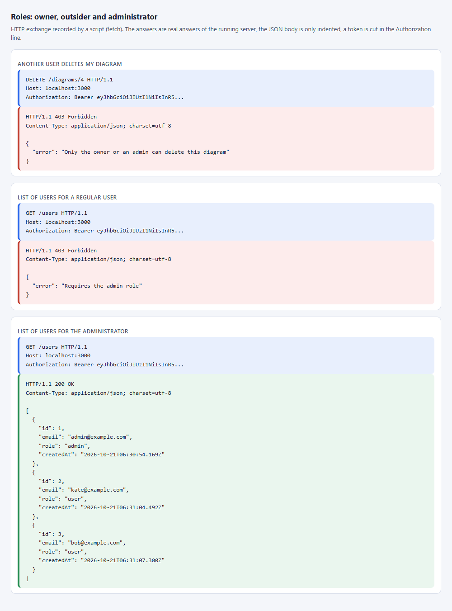

Figure 8 – Answers 403 for an outsider and the answer 200 for the administrator, recorded by a script (not a Postman window)

### 3.5 Verification

The default database of the work is PostgreSQL, and SQLite is used only by the tests. The work is verified by automated tests on a temporary SQLite database (a file in a temporary folder, so the tests need no database server) with the real migrations and real HTTP requests. The tests start the server on a free port, and bcrypt uses four rounds for speed. They cover: registration with email normalization, no hash in the response and a check that the database holds a bcrypt hash rather than the password, duplicate emails in any letter case, data validation errors, login and the token contents, the same response for a wrong password and an unknown email, tampered, unsigned, expired and foreign-signed tokens, user deletion and a role change with an old token, the rights of an administrator, an owner and an outsider, migrations with rollback and the admin seed. There are 137 application tests, including the partial update with `PATCH` and a database failure. A run on a real PostgreSQL has not been done yet.

The result of the `npm test` command with the number of tests and the code coverage is shown in figure 9.

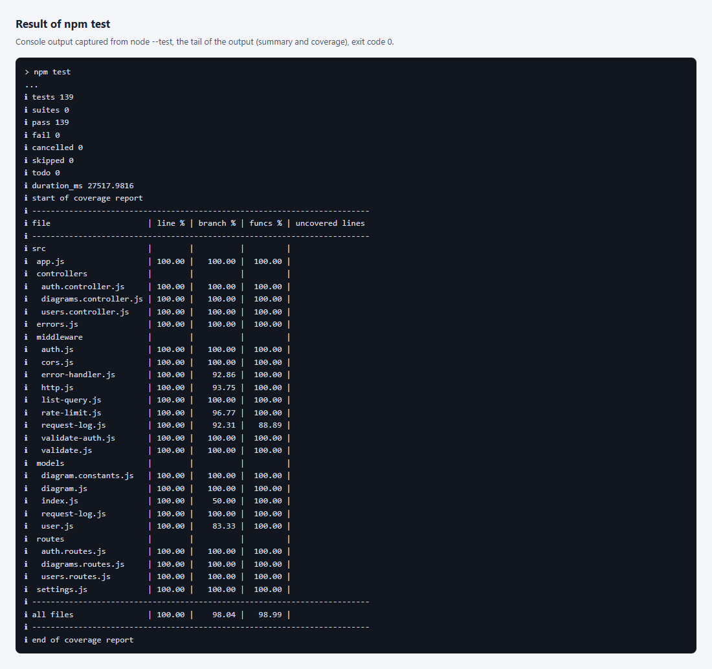

Figure 9 – End of the npm test output: the number of passed tests and the coverage table (process output captured as text)

### 3.6 Limitations

Logout does not revoke a token: it stays valid until it expires, which is why the lifetime is short. Login attempts are limited: at most 20 login requests per address in 15 minutes, and after 5 failed attempts the email is locked for 15 minutes. The counters are kept in process memory. The token is kept on the client side, and the choice between localStorage and an httpOnly cookie is made in the client lab.

Listing of user.js is given in appendix A. Listing of the Users table migration is given in appendix B. Listing of auth.js is given in appendix C. Listing of auth.controller.js is given in appendix D. Listing of validate-auth.js is given in appendix E. Listing of users.routes.js is given in appendix F. Listing of diagrams.controller.js is given in appendix G. Listing of validate.js is given in appendix I.

### 3.7 Paging and sorting

The list accepts the `limit`, `offset`, `sort` and `order` parameters. `limit` sets the page size from 1 to 100, `offset` sets the shift from 0 to 1000000, `sort` picks a field from a whitelist and `order` takes `asc` or `desc`. Without parameters the whole list is returned in ascending `id` order, so the clients of the earlier works keep working. The answer stays an array and the full size of the selection comes in the `X-Total-Count` header. Numbers are read as strings of at most nine digits, so `-1`, `1e9`, `0x10` and huge numbers get a 400 answer with a list of errors by field. The sort field name is checked against the whitelist and never reaches the database query unchecked. Equal values are ordered by `id`, so pages do not overlap. Parsing of the parameters is moved to a separate module, it is given in Appendix H. The `notation` parameter keeps the records of one notation, and the `q` parameter searches a part of the title ignoring case with `instr` in SQLite or `strpos` in PostgreSQL. An invalid value gives 400. The number of failed logins before the lock, the lock time and the request limits for login and registration live in `limits.json`, not in the code.

The request `GET /diagrams?limit=2&offset=0&sort=title&order=desc` with a token returns a page of two records, as in figure 10.

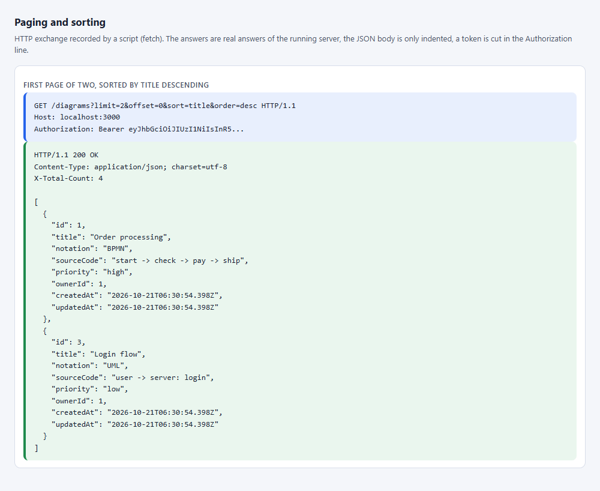

Figure 10 – A list request with the limit, offset, sort and order parameters, recorded by a script (not a Postman window)

### 3.8 The PATCH method

The `PATCH /diagrams/:id` route changes only the fields that are sent. The check lives in `validatePartial`, which is given in appendix I. Every sent field goes through the same rule as in `POST` and `PUT`, a body without a single known field gives 400, and the owner field cannot be sent. The rights are the same as for `PUT`: the owner or an administrator may change a diagram, everyone else gets 403. The `PUT` method replaces the record as a whole and requires all required fields, while `PATCH` leaves omitted fields untouched. That is why `PUT` is idempotent, while `PATCH` does not have to be by definition.

### 3.9 How to trigger a 500 response with a real failure

A 500 response is caused by a database failure, not by a button. The shortest way is a temporary SQLite database: set `SQLITE_STORAGE` instead of `DATABASE_URL`, start the server with `npm start`, then run `npx sequelize-cli db:migrate:undo:all` in a second window. The tables vanish under the running server, and the very first request cannot write a row to the `RequestLogs` log. The client gets 500 with the body `{ "error": "Internal server error" }`, and the details stay only in the server console. On the main PostgreSQL database it is enough to stop the service or container (`docker compose stop db`): requests give 500, and `GET /health` answers 503. The commands `npm run db:migrate` and `npm run db:seed` restore the work. The same failure is reproduced in an automated test by dropping the `Diagrams` table while the server runs.

The migrations are undone with `npx sequelize-cli db:migrate:undo:all` under the running server, and the very first request to `http://localhost:3000/diagrams` gets the answer 500, as in figure 11.

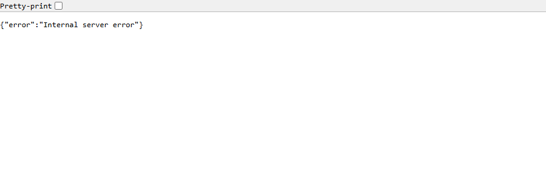

Figure 11 – Answer to GET /diagrams after a real database failure: JSON with a general message without details (code 500)

The details of the failure stay only in the console of the server and are shown in figure 12.


Figure 12 – Console of the server after the failure: the error about the missing table RequestLogs (process output captured as text)

### 3.10 Answers to the control questions

9. How do you limit the number of simultaneously active sessions of one user?

   A JWT is stateless and the server does not remember it, so a session table is needed. At login a row is written with the user id and a unique token number `jti`, and the number is put into the token. If the user already has three active sessions, the oldest one is deleted or the login is refused. The token-checking middleware additionally looks the `jti` up in the table, and logout and a password change delete rows. A simpler variant is a `tokenVersion` counter on the user: it goes into the token, and increasing it revokes all tokens at once. In this work the session limit is not implemented, a token stays valid until it expires, which is why the lifetime is short.

10. How do you protect against password guessing (brute force) at the API level?

    The protection works in layers. A rate limiter lets through at most 20 login requests per address in 15 minutes and at most 10 registrations per hour, and answers 429 with a `Retry-After` header when the limit is exceeded. After 5 failed attempts for one email the login is blocked for a set time, the `loginLockMs` setting. The answer for a wrong password and for an unknown email is the same, so nobody can find out which addresses are registered. Passwords are stored as bcrypt hashes, which are slow to compute, and the password length requirement narrows the search space. The counters live in process memory, and with several server instances they move to a shared store such as Redis. Captcha and two-factor login are added on top.

11. What happens if the JWT secret key is compromised?

    Whoever knows the key can sign a token for any user and any role, an administrator included, and the server accepts it as genuine. Tokens cannot be told apart by signature, so the only remedy is to change the key: every issued token stops passing the check at once, and users log in again. In the work the key comes from an environment variable, is not stored in the repository, and a key that is too short is refused at startup. The damage is limited by the short token lifetime of one hour. Keys with a `kid` identifier for a smooth change and the RS256 algorithm add protection: the private key signs and the public key verifies, so a service that only verifies cannot forge a token.

### 3.11 Architecture and trade-offs

A security layer is added to the layers of the second lab: the token check, the role check and the rate limiters stand as separate middleware before the controllers. Controllers do not know how a token is checked, they receive a ready user in `req.user`. This follows the dependency rule from Martin's Clean Architecture: details such as the JWT library sit in the outer layer, while the business rule "a record can be changed by its owner or an admin" is written as one function `mayChange` and is checked by a simple test.

The main trade-off concerns state. A JWT is not stored on the server, which makes scaling simpler, but a token cannot be revoked before it expires. So the lifetime is short and the role is read from the database on every request, and a deleted user loses access at once. The login attempt counters live in process memory. This is fast and simple, but with several server instances the counters are not shared. The decision is recorded in the report, and a production system would move the counters to a shared store. In Fowler's Patterns of Enterprise Application Architecture this is the usual price of choosing between simplicity and distributed state.

Sources: Martin R. Clean Architecture: A Craftsman's Guide to Software Structure and Design. Prentice Hall, 2017. Fowler M. Patterns of Enterprise Application Architecture. Addison-Wesley, 2002. Fowler M. Refactoring: Improving the Design of Existing Code, 2nd ed. Addison-Wesley, 2018.

## Conclusion

DSLKit now has users with bcrypt password hashes, registration, login with a JWT token, a token-checking middleware and protected routes, including the profile of the current user. The additional role-based mechanism separates the rights of an administrator, a diagram owner and an outsider. The tests confirm both the successful scenarios and the rejections of tampered, expired and foreign tokens. A run on a real PostgreSQL is still to be done. The requests are confirmed by browser screenshots and by an exchange recorded with a script. The methods now include a partial `PATCH` with the same rights as `PUT`.

## Appendix A (mandatory) Listing of user.js

```js
const { DataTypes } = require('sequelize');

const ROLES = ['user', 'admin'];

const defineUser = (sequelize) => {
  const User = sequelize.define('User', {
    // Lowercased on the way in, the database also checks it, so one address is one account.
    email: {
      type: DataTypes.STRING(254),
      allowNull: false,
      unique: true,
      set(value) {
        this.setDataValue('email', typeof value === 'string' ? value.trim().toLowerCase() : value);
      },
    },
    passwordHash: { type: DataTypes.STRING(100), allowNull: false },
    role: { type: DataTypes.STRING(10), allowNull: false, defaultValue: 'user', validate: { isIn: [ROLES] } },
  });

  // The hash must never leave the server, so the public view is built in one place.
  User.prototype.toPublic = function toPublic() {
    return { id: this.id, email: this.email, role: this.role, createdAt: this.createdAt };
  };
  // Whatever serializes a User by accident (res.json(user), logs, JSON.stringify) still cannot show the hash.
  User.prototype.toJSON = function toJSON() {
    return this.toPublic();
  };
  return User;
};

module.exports = { defineUser, ROLES };
```

## Appendix B (mandatory) Listing of the Users table migration

```js
// A migration is a snapshot, so the allowed values are copied here instead of imported.
const ROLES = ['user', 'admin'];

module.exports = {
  async up(queryInterface, Sequelize) {
    const { fn, col, where, Op } = Sequelize;
    await queryInterface.createTable('Users', {
      id: { allowNull: false, autoIncrement: true, primaryKey: true, type: Sequelize.INTEGER },
      email: { allowNull: false, unique: true, type: Sequelize.STRING(254) },
      // A bcrypt hash is 60 characters; 100 leaves room for a stronger variant.
      passwordHash: { allowNull: false, type: Sequelize.STRING(100) },
      role: { allowNull: false, type: Sequelize.STRING(10), defaultValue: 'user' },
      createdAt: { allowNull: false, type: Sequelize.DATE },
      updatedAt: { allowNull: false, type: Sequelize.DATE },
    });
    await queryInterface.addConstraint('Users', {
      type: 'check',
      fields: ['role'],
      name: 'users_role_check',
      where: { role: { [Op.in]: ROLES } },
    });
    // Emails are stored lowercased, so the unique index cannot be dodged with another letter case.
    await queryInterface.addConstraint('Users', {
      type: 'check',
      fields: ['email'],
      name: 'users_email_lowercase_check',
      where: where(fn('lower', col('email')), col('email')),
    });
    // SQLite does not enforce VARCHAR length, so the length and the empty value are checked explicitly.
    await queryInterface.addConstraint('Users', {
      type: 'check',
      fields: ['email'],
      name: 'users_email_length',
      where: where(fn('length', col('email')), { [Op.between]: [3, 254] }),
    });
    await queryInterface.addConstraint('Users', {
      type: 'check',
      fields: ['passwordHash'],
      name: 'users_password_hash_not_empty',
      where: where(fn('length', col('passwordHash')), { [Op.gt]: 0 }),
    });
  },

  async down(queryInterface) {
    await queryInterface.dropTable('Users');
  },
};
```

## Appendix C (mandatory) Listing of auth.js

```js
const jwt = require('jsonwebtoken');
const { unauthorized, forbidden } = require('../errors');
const { ISSUER } = require('../settings');

const bearerToken = (req) => {
  const [scheme, token, ...rest] = (req.get('Authorization') || '').split(' ');
  return scheme === 'Bearer' && token && rest.length === 0 ? token : undefined;
};

// Verifies the Bearer token, then loads the user so a deleted account or a changed role takes effect at once.
// req.user holds { id, email, role } taken from the database, not from the token.
const createAuthenticate =
  ({ User }, { jwtSecret }) =>
  async (req, _res, next) => {
    const token = bearerToken(req);
    if (!token) return next(unauthorized('Missing Bearer token'));
    let payload;
    try {
      payload = jwt.verify(token, jwtSecret, { algorithms: ['HS256'], issuer: ISSUER });
    } catch (error) {
      return next(unauthorized(error.name === 'TokenExpiredError' ? 'Token expired' : 'Invalid token'));
    }
    // A signed token without a usable integer id cannot name a user; it is refused like any other bad token.
    if (!Number.isSafeInteger(payload.id)) return next(unauthorized('Invalid token'));
    const user = await User.findByPk(payload.id);
    if (!user) return next(unauthorized('User no longer exists'));
    req.user = { id: user.id, email: user.email, role: user.role };
    return next();
  };

const requireRole = (role) => (req, _res, next) => (req.user.role === role ? next() : next(forbidden(`Requires the ${role} role`)));

module.exports = { createAuthenticate, requireRole };
```

## Appendix D (mandatory) Listing of auth.controller.js

```js
const bcrypt = require('bcrypt');
const jwt = require('jsonwebtoken');
const { unauthorized, conflict, tooManyRequests } = require('../errors');
const { ISSUER } = require('../settings');

const createAuthController = ({ User }, { jwtSecret, jwtExpiresIn, bcryptRounds }, loginGuard) => {
  // Compared when the email is unknown, so a missing account costs the same time as a wrong password.
  const dummyHash = bcrypt.hashSync('not-a-real-password', bcryptRounds);

  return {
    register: async (req, res, next) => {
      const { email, password } = req.credentials;
      const passwordHash = await bcrypt.hash(password, bcryptRounds);
      try {
        const user = await User.create({ email, passwordHash });
        res.status(201).location('/profile').json(user.toPublic());
      } catch (error) {
        if (error.name !== 'SequelizeUniqueConstraintError') throw error;
        next(conflict('A user with this email already exists'));
      }
    },

    login: async (req, res, next) => {
      const { email, password } = req.credentials;
      // A locked email is refused before the password is looked at, so guessing cannot continue and the answer does not depend on the account.
      // The counter is kept per address and email: someone elsewhere cannot lock the account of the real owner.
      const guardKey = `${req.ip}|${email}`;
      const wait = loginGuard.retryAfter(guardKey);
      if (wait > 0) return next(tooManyRequests('Too many failed logins, try again later', wait));
      const user = await User.findOne({ where: { email } });
      const matches = await bcrypt.compare(password, user ? user.passwordHash : dummyHash);
      if (!user || !matches) {
        loginGuard.fail(guardKey);
        return next(unauthorized('Invalid email or password'));
      }
      loginGuard.succeed(guardKey);
      // The role in the token is only a hint for the client: the server asks the database on every request.
      const token = jwt.sign({ id: user.id, email: user.email, role: user.role }, jwtSecret, {
        algorithm: 'HS256',
        expiresIn: jwtExpiresIn,
        issuer: ISSUER,
        subject: String(user.id),
      });
      return res.json({ token, tokenType: 'Bearer', expiresIn: jwtExpiresIn });
    },
  };
};

module.exports = { createAuthController };
```

## Appendix E (mandatory) Listing of validate-auth.js

```js
const { badRequest, unauthorized } = require('../errors');
const { ROLES } = require('../models/user');
const LIMITS = require('../../limits.json');

const EMAIL = /^[^\s@]+@[^\s@]+\.[^\s@]+$/;
const MIN_PASSWORD = LIMITS.passwordMin;
// bcrypt ignores everything after the 72nd byte, so longer passwords would silently weaken.
const MAX_PASSWORD_BYTES = LIMITS.passwordMaxBytes;

const objectBody = (body) => body !== null && typeof body === 'object' && !Array.isArray(body);
const normalizeEmail = (email) => (typeof email === 'string' ? email.trim().toLowerCase() : email);

// Control characters (NUL, tab, escape) are not part of an address; NUL also breaks the SQL text of a query.
const CONTROL = /[\u0000-\u001F\u007F]/;

const validEmail = (email) => typeof email === 'string' && email.length <= LIMITS.email && EMAIL.test(email) && !CONTROL.test(email);

const passwordProblem = (password) => {
  if (typeof password !== 'string') return 'must be a string';
  if (password.trim() === '') return 'must not be empty or only spaces';
  if (password.length < MIN_PASSWORD) return `must be at least ${MIN_PASSWORD} characters`;
  if (Buffer.byteLength(password) > MAX_PASSWORD_BYTES) return `must be at most ${MAX_PASSWORD_BYTES} bytes`;
  return undefined;
};

const reject = (next, details) => next(badRequest('Invalid credentials data', details));

const validateRegistration = (req, _res, next) => {
  if (!objectBody(req.body)) return next(badRequest('Request body must be a JSON object'));
  const email = normalizeEmail(req.body.email);
  const details = [];
  if (!validEmail(email)) details.push({ field: 'email', message: 'must be a valid email address' });
  const problem = passwordProblem(req.body.password);
  if (problem) details.push({ field: 'password', message: problem });
  if (details.length > 0) return reject(next, details);
  req.credentials = { email, password: req.body.password };
  return next();
};

// Login only needs the two values to exist; the rules above would leak which part of a wrong password is fine.
const validateLogin = (req, _res, next) => {
  if (!objectBody(req.body)) return next(badRequest('Request body must be a JSON object'));
  const { email, password } = req.body;
  if (typeof email !== 'string' || typeof password !== 'string' || !email.trim() || !password.trim()) {
    return reject(next, [{ field: 'email, password', message: 'both are required strings' }]);
  }
  // A value longer than any stored one cannot match an account, so it gets the usual answer without hashing it.
  if (email.length > LIMITS.email || CONTROL.test(email) || Buffer.byteLength(password) > MAX_PASSWORD_BYTES) {
    return next(unauthorized('Invalid email or password'));
  }
  req.credentials = { email: normalizeEmail(email), password };
  return next();
};

const validateRole = (req, _res, next) => {
  const role = objectBody(req.body) ? req.body.role : undefined;
  if (!ROLES.includes(role)) return next(badRequest('Invalid role data', [{ field: 'role', message: `must be one of ${ROLES.join(', ')}` }]));
  req.newRole = role;
  return next();
};

module.exports = { validateRegistration, validateLogin, validateRole };
```

## Appendix F (mandatory) Listing of users.routes.js

```js
const { Router } = require('express');
const { requireRole } = require('../middleware/auth');
const { parseId } = require('../middleware/validate');
const { validateRole } = require('../middleware/validate-auth');
const { allowMethods } = require('../middleware/http');

// Every route here needs a valid token; the /users routes also need the admin role.
// The 405 and OPTIONS answers come without a token, because they say nothing about the data.
const createUsersRouter = (controller, authenticate) => {
  const router = Router();
  const admin = [authenticate, requireRole('admin')];
  router
    .route('/profile')
    .get(authenticate, controller.profile)
    .all(allowMethods(['GET']));
  router
    .route('/users')
    .get(...admin, controller.list)
    .all(allowMethods(['GET']));
  router
    .route('/users/:id/role')
    .patch(...admin, parseId('userId', 'User'), validateRole, controller.setRole)
    .all(allowMethods(['PATCH']));
  router
    .route('/users/:id')
    .delete(...admin, parseId('userId', 'User'), controller.remove)
    .all(allowMethods(['DELETE']));
  return router;
};

module.exports = { createUsersRouter };
```

## Appendix G (mandatory) Listing of diagrams.controller.js

```js
const { notFound, forbidden, badRequest } = require('../errors');
const { Op, fn, col, where } = require('sequelize');
const { parseListQuery } = require('../middleware/list-query');
const { NOTATIONS, LIMITS } = require('../models/diagram.constants');

const missing = (id) => notFound(`Diagram ${id} not found`);

const SORTABLE = ['id', 'title', 'notation', 'priority', 'ownerId', 'createdAt'];

// A part of the title is searched with instr (SQLite) or strpos (PostgreSQL) on the lowercased title, not with LIKE,
// so the characters % and _ in the search text are plain characters and need no escaping.
const filterFor = (dialect, { notation, q }) => {
  const conditions = [];
  if (notation !== undefined) conditions.push({ notation });
  if (q !== undefined) conditions.push(where(fn(dialect === 'sqlite' ? 'instr' : 'strpos', fn('lower', col('title')), q), { [Op.gt]: 0 }));
  return conditions.length > 0 ? { [Op.and]: conditions } : {};
};

// Only the owner or an admin may change or delete a diagram.
const mayChange = (user, diagram) => user.role === 'admin' || diagram.ownerId === user.id;

// Express 5 forwards a rejected promise to the error handler, so no try/catch is needed here.
const createDiagramsController = ({ Diagram }) => ({
  // ?limit=&offset=&sort=&order= (see list-query.js) page and sort the result, the answer stays an array and X-Total-Count holds the full size.
  list: async (req, res, next) => {
    // The client of lab 5 sends the search text as ?search=. It means the same as ?q=, but a blank text keeps every diagram.
    const { search, ...rest } = req.query;
    if (search !== undefined && (typeof search !== 'string' || search.trim().length > LIMITS.title)) {
      return next(badRequest(`search must be a string of at most ${LIMITS.title} characters`));
    }
    const term = (search ?? '').trim();
    const query = term && rest.q === undefined ? { ...rest, q: term } : rest;
    const { limit, offset, sort, order, notation, q } = parseListQuery(query, SORTABLE, { notations: NOTATIONS, maxQuery: LIMITS.title });
    const { count, rows } = await Diagram.findAndCountAll({
      where: filterFor(Diagram.sequelize.getDialect(), { notation, q }),
      order: [
        [sort, order.toUpperCase()],
        ['id', 'ASC'],
      ],
      limit,
      offset,
    });
    res.set('X-Total-Count', String(count));
    return res.json(rows);
  },

  get: async (req, res, next) => {
    const diagram = await Diagram.findByPk(req.diagramId);
    return diagram ? res.json(diagram) : next(missing(req.diagramId));
  },

  create: async (req, res) => {
    const diagram = await Diagram.create({ ...req.diagramFields, ownerId: req.user.id });
    res.status(201).location(`/diagrams/${diagram.id}`).json(diagram);
  },

  replace: async (req, res, next) => {
    const diagram = await Diagram.findByPk(req.diagramId);
    if (!diagram) return next(missing(req.diagramId));
    if (!mayChange(req.user, diagram)) return next(forbidden('Only the owner or an admin can change this diagram'));
    return res.json(await diagram.update(req.diagramFields));
  },

  // PATCH: only the sent fields change, the same owner-or-admin rule as PUT applies.
  update: async (req, res, next) => {
    const diagram = await Diagram.findByPk(req.diagramId);
    if (!diagram) return next(missing(req.diagramId));
    if (!mayChange(req.user, diagram)) return next(forbidden('Only the owner or an admin can change this diagram'));
    return res.json(await diagram.update(req.diagramFields));
  },

  remove: async (req, res, next) => {
    const diagram = await Diagram.findByPk(req.diagramId);
    if (!diagram) return next(missing(req.diagramId));
    if (!mayChange(req.user, diagram)) return next(forbidden('Only the owner or an admin can delete this diagram'));
    await diagram.destroy();
    return res.status(204).end();
  },
});

module.exports = { createDiagramsController };
```

## Appendix H (mandatory) Listing of list-query.js

```js
const { badRequest } = require('../errors');

// Limits of the list query. The page size is capped so one request cannot ask for the whole table,
// and the numbers are read as short digit strings, so 1e9, -1, 0x10 or a huge value are refused with 400.
const MAX_LIMIT = 100;
const MAX_OFFSET = 1000000;
const ORDERS = ['asc', 'desc'];
// A control character such as NUL cannot be in a title, and some databases fail on it inside a query text, so the search refuses it.
const CONTROL = /[\u0000-\u001f\u007f-\u009f]/;

// Reads ?limit=, ?offset=, ?sort=, ?order=, ?notation= and ?q= from req.query.
// sortable: the field names a client may sort by (a whitelist, so a field name never reaches the database unchecked).
// Without limit the whole list is returned (the clients of the earlier labs expect that), without sort the order is by id.
// A bad value throws the 400 error with the list of problems, Express 5 passes it to the error handler.
// filters: { notations: allowed values of ?notation=, maxQuery: longest ?q= }. ?q= is a case-insensitive part of the title.
const parseListQuery = (query, sortable, filters = {}) => {
  const problems = [];
  const integer = (name, min, max) => {
    const value = query[name];
    if (value === undefined) return undefined;
    if (typeof value !== 'string' || !/^\d{1,9}$/.test(value) || Number(value) < min || Number(value) > max) {
      problems.push({ field: name, message: `${name} must be an integer from ${min} to ${max}` });
      return undefined;
    }
    return Number(value);
  };
  const limit = integer('limit', 1, MAX_LIMIT);
  const offset = integer('offset', 0, MAX_OFFSET) ?? 0;

  const sort = query.sort ?? 'id';
  if (typeof sort !== 'string' || !sortable.includes(sort)) {
    problems.push({ field: 'sort', message: `sort must be one of: ${sortable.join(', ')}` });
  }
  const order = typeof query.order === 'string' ? query.order.toLowerCase() : (query.order ?? 'asc');
  if (!ORDERS.includes(order)) problems.push({ field: 'order', message: 'order must be asc or desc' });

  const { notations = [], maxQuery = 80 } = filters;
  let notation;
  if (query.notation !== undefined) {
    if (typeof query.notation !== 'string' || !notations.includes(query.notation)) problems.push({ field: 'notation', message: `notation must be one of: ${notations.join(', ')}` });
    else notation = query.notation;
  }
  let q;
  if (query.q !== undefined) {
    const text = typeof query.q === 'string' ? query.q.trim() : '';
    if (text === '' || text.length > maxQuery || CONTROL.test(text)) problems.push({ field: 'q', message: `q must be text of 1 to ${maxQuery} characters without control characters` });
    else q = text.toLowerCase();
  }

  if (problems.length) throw badRequest('Invalid list query', problems);
  return { limit, offset, sort, order, notation, q };
};

module.exports = { parseListQuery, MAX_LIMIT, MAX_OFFSET };
```

## Appendix I (mandatory) Listing of validate.js

```js
const { badRequest } = require('../errors');
const { NOTATIONS, PRIORITIES, DEFAULT_PRIORITY, LIMITS, MAX_ID } = require('../models/diagram.constants');

// Spaces of every kind plus zero-width characters (joiners, word joiner, BOM) look empty, so they count as empty.
const INVISIBLE = /[\s​-‍⁠]/g;
// Control characters (NUL, bell, escape) are not text; a single-line field must not carry them.
const CONTROL = /[\u0000-\u001F\u007F]/;

// Text is checked after trimming, so the stored value is what was measured.
const text =
  (name, singleLine = false) =>
  (v) => {
    if (typeof v !== 'string' || v.replace(INVISIBLE, '') === '') return 'must be a non-empty string';
    if (singleLine && CONTROL.test(v)) return 'must not contain control characters';
    return v.trim().length <= LIMITS[name] || `must be at most ${LIMITS[name]} characters`;
  };

const checks = {
  title: text('title', true),
  notation: (v) => NOTATIONS.includes(v) || `must be one of ${NOTATIONS.join(', ')}`,
  sourceCode: text('sourceCode'),
  priority: (v) => PRIORITIES.includes(v) || `must be one of ${PRIORITIES.join(', ')}`,
};

// Builds the id check for a route param. The raw text is checked first because Number() would accept '0x1', '1e0' and ' 1'.
const parseId =
  (key = 'diagramId', label = 'Diagram') =>
  (req, _res, next) => {
    const id = Number(req.params.id);
    // Ids above the INTEGER column range would make PostgreSQL fail with a 500, so they are rejected here.
    if (!/^[1-9]\d*$/.test(req.params.id) || id > MAX_ID) return next(badRequest(`${label} id must be a positive integer up to ${MAX_ID}`));
    req[key] = id;
    return next();
  };

// POST and PUT both carry the whole diagram, so one validator serves both.
// The owner is never taken from the body: the controller sets it from the token. The title is trimmed before saving.
// Priority is optional and falls back to the default; unknown fields are dropped.
const isObject = (body) => body !== null && typeof body === 'object' && !Array.isArray(body);

const validateDiagram = (req, _res, next) => {
  const body = req.body;
  if (!isObject(body)) {
    return next(badRequest('Request body must be a JSON object'));
  }
  const fields = { ...body, priority: body.priority ?? DEFAULT_PRIORITY };
  const details = Object.entries(checks)
    .map(([name, check]) => ({ field: name, result: check(fields[name]) }))
    .filter(({ result }) => result !== true)
    .map(({ field, result }) => ({ field, message: result }));
  if (details.length > 0) return next(badRequest('Invalid diagram data', details));
  req.diagramFields = Object.fromEntries(Object.keys(checks).map((name) => [name, name === 'title' ? fields[name].trim() : fields[name]]));
  return next();
};

// PATCH carries only the fields to change. Each sent field gets the same check as in POST and PUT,
// missing fields are left alone, and a body without a single known field is refused. The owner cannot be sent at all.
const validatePartial = (req, _res, next) => {
  const body = req.body;
  if (!isObject(body)) return next(badRequest('Request body must be a JSON object'));
  const names = Object.keys(checks).filter((name) => Object.hasOwn(body, name));
  if (names.length === 0) return next(badRequest(`Send at least one of: ${Object.keys(checks).join(', ')}`));
  const details = names
    .map((name) => ({ field: name, result: checks[name](body[name]) }))
    .filter(({ result }) => result !== true)
    .map(({ field, result }) => ({ field, message: result }));
  if (details.length > 0) return next(badRequest('Invalid diagram data', details));
  req.diagramFields = Object.fromEntries(names.map((name) => [name, name === 'title' ? body[name].trim() : body[name]]));
  return next();
};

module.exports = { parseId, validateDiagram, validatePartial };
```
