# Laboratory Work No. 4. State Management in a React Application

## 1 Purpose of the Work

To master local state management in React with the `useState` and `useEffect` hooks, side effect handling and dynamic interface updates on the example of a diagram list of the DSLKit project, a web editor for diagrams as code (SaaS direction).

## 2 Brief Description of the Application

The application shows the list of a user's diagrams. A diagram has a title, a notation (UML, BPMN, ERD, DFD, IDEF0, Petri nets), a status, "Draft" or "Published", and a modification date. The user adds a diagram with a form, renames it, changes its status, deletes it, searches by title, filters by status and sorts by date or title. The list survives a page reload because it is stored in `localStorage`.

The project is created on Vite with `npm create vite@latest` and the React template, tests use Vitest and React Testing Library. Running instructions are in the `README.md` of the work.

## 3 Work Progress

### 3.1 Component State

The array of diagrams, the title input, the selected notation, the search string, the status filter and the sort mode are kept with `useState`. Array changes use functional updates such as `setDiagrams((prev) => ...)`, so quick consecutive actions do not overwrite each other. The input is controlled, and the form is submitted by the button and by the Enter key. Key parts of the code are given in Appendix A.

### 3.2 Storage in localStorage

The storage logic is extracted into the `useLocalStorage` hook. The initial value is read from `localStorage` by the `useState` initializer function, so saved data is visible on the first render. A `useEffect` that depends on the value writes the array with `JSON.stringify` on every change. If the key is missing or the JSON is broken, the initial set of three diagrams is used.

### 3.3 Filtering, Sorting and Statistics

The functions `filterDiagrams`, `sortDiagrams` and `getStats` are pure and live in `utils/diagrams.js`, so they are tested without rendering. Sorting works on a copy of the array and does not change the state.

### 3.4 Additional Effects

The tab title is updated by an effect and shows the number of diagrams. The `useAutosaveStatus` hook shows "Saving…" after a change and "Saved" after 500 ms of quiet. This is a debounce: every new change clears the previous timer with the effect cleanup function.

### 3.5 Input Validation

The form and the edit mode check the diagram title before saving. A value made of spaces only counts as empty and is rejected with the message "Введите название диаграммы". A title longer than the limit is rejected with a message that names the allowed number of characters. The title length limit and the maximum number of records live in a separate file, `src/limits.json`, not in the component code. The list is capped at 200 records, so endless additions cannot fill `localStorage`. The "Создана" field of every record shows the creation time with seconds. If a record is created in the same second as the previous one, its time is moved one second forward, so no two records share a time.

### 3.6 Resistance to Foreign Data

The content of `localStorage` can be edited by hand or left over from an older version. The `isDiagramList` function accepts only a list in which every record has a valid title, a known notation, a boolean status and correct dates, and the identifiers are unique. If the whole list does not fit, the `repairDiagramList` function keeps only the good records, drops damaged and repeated ones and cuts the list to the cap. If no record is usable, the initial set is used. Titles are rendered as text, so markup inside a title is never executed. The title field is limited by the `maxLength` attribute and by the same check in code. The list can be filtered by notation. The card is wrapped in `memo` and the handlers in `useCallback`, so a card is redrawn only when its record changes. The identifier is created with `crypto.randomUUID`, and a fallback is used on an address without a secure context. The `ErrorBoundary` component shows the 500 page in the site style instead of a blank screen when rendering fails.

### 3.7 Appearance

The application uses the same styles and markup as the site of the first part: a sticky header with the logo, a menu with a phone button, a moon and sun theme switch with a tooltip, cards, form fields and a footer. The light theme comes first, the dark theme follows the system setting or the switch. The single main button on the screen is "Добавить".

### 3.8 Demonstration

The top of the page with the header and the add form is shown in the upper part of figure 1.

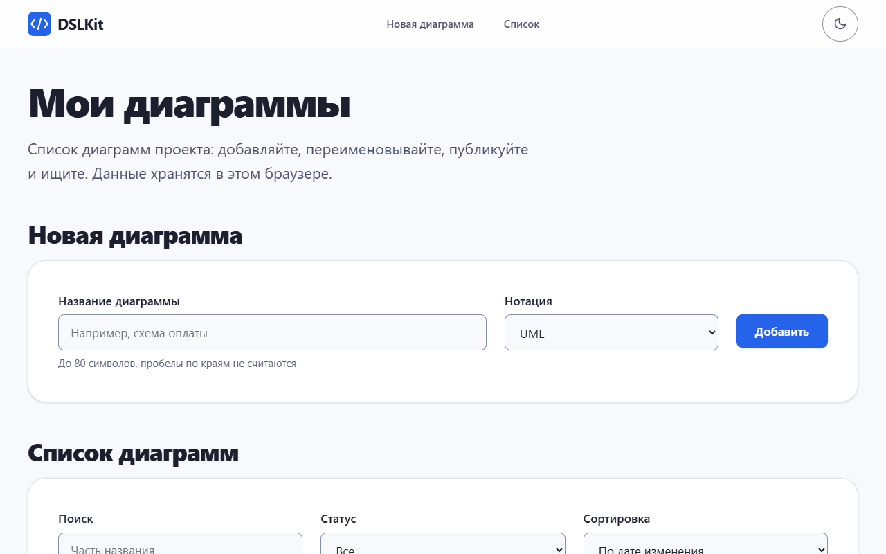

Figure 1 – Header, title and the add diagram form in the light theme

The reaction to an input made of spaces is visible under the field in figure 2.

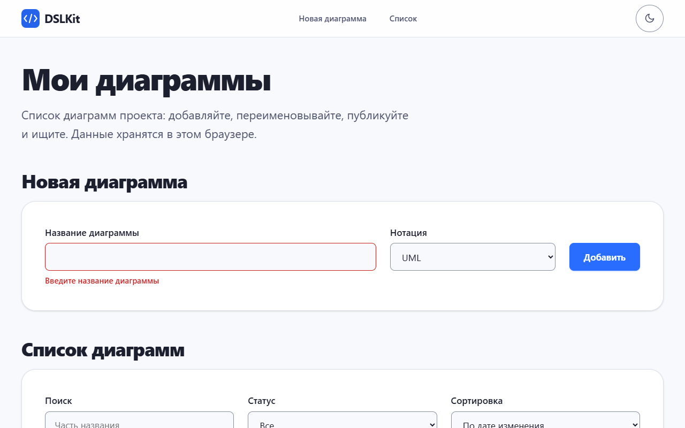

Figure 2 – The message "Введите название диаграммы" under the field with a red border

The new diagram appears first in the list, and the statistics line shows the record count in figure 3.

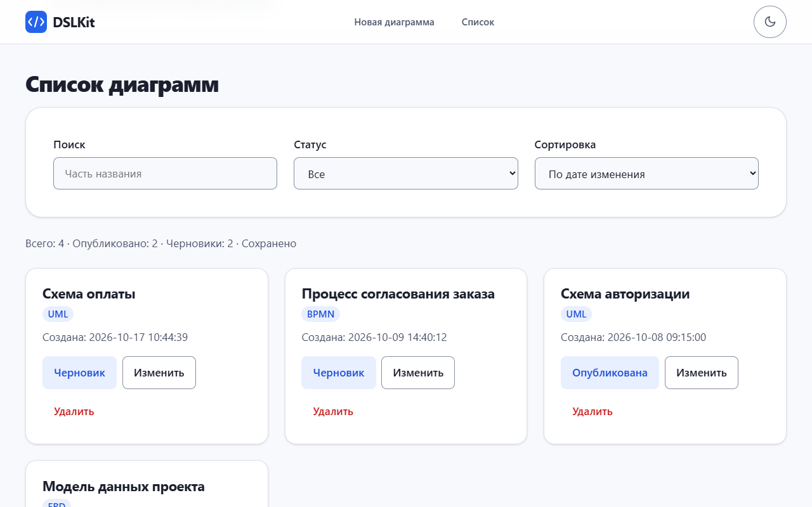

Figure 3 – Diagram list with the new record and the statistics line

Right after a record is added, the statistics line shows "Сохранение…", as in figure 4. After 500 ms of quiet the text changes to "Сохранено".

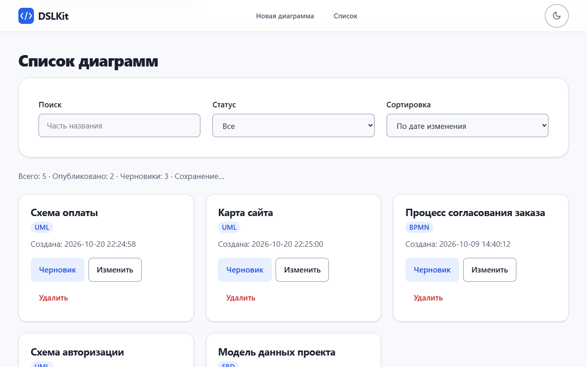

Figure 4 – Statistics line with the saving mark right after a change

The status filter keeps only published diagrams in the list, as figure 5 shows.

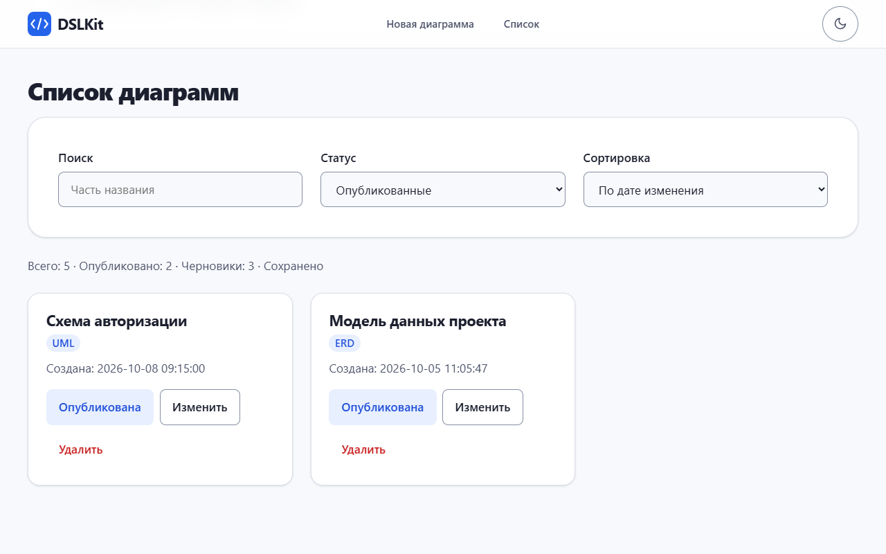

Figure 5 – List after choosing the status "Опубликованные"

Choosing the sort by title puts the cards in alphabetical order, as in figure 6.

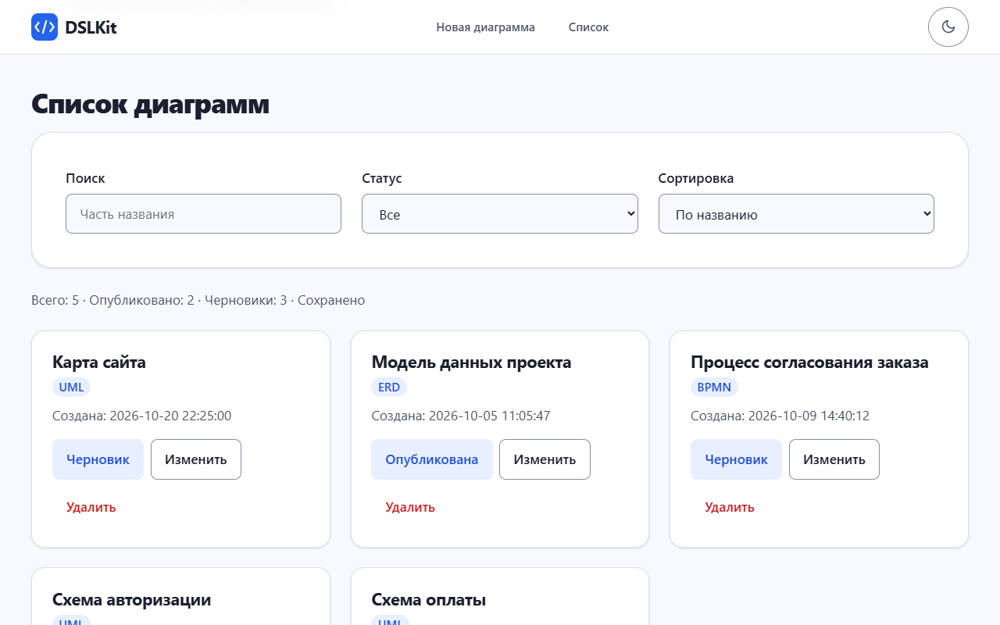

Figure 6 – Diagram list with the sort "По названию"

The search by a part of the title keeps the matching records, and the result is visible in figure 7.

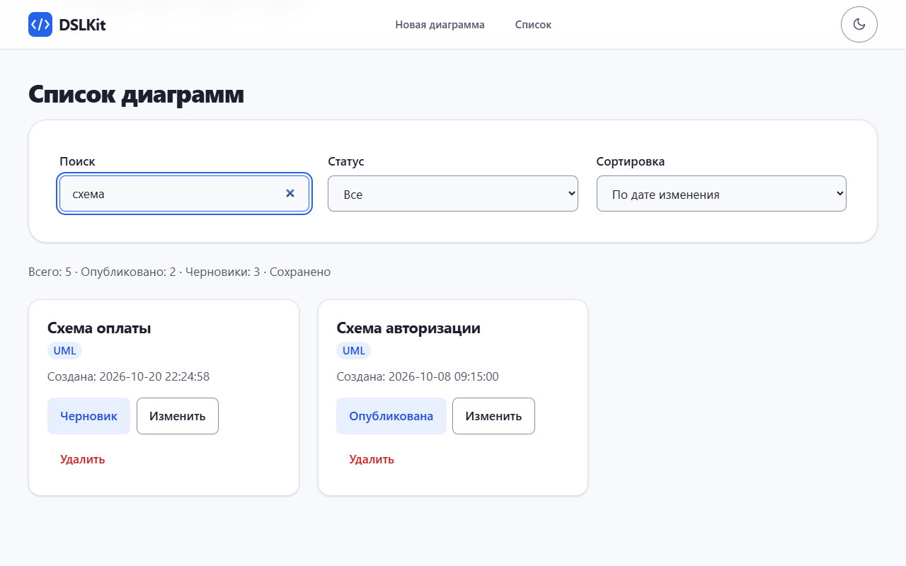

Figure 7 – Diagram list after the word "схема" is typed into the search field

The "Изменить" button turns the title into an input and the "Сохранить" button replaces it, as in figure 8.

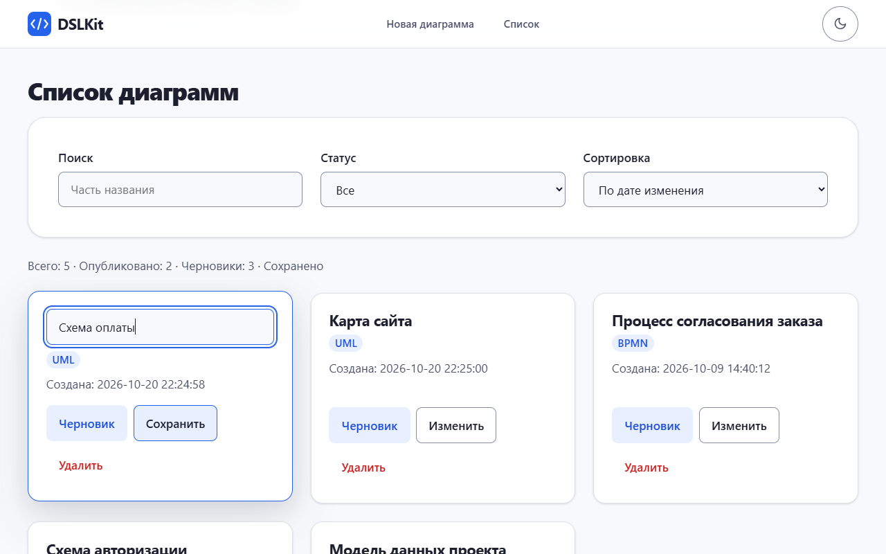

Figure 8 – Diagram card in the title edit mode

If the title is erased and Enter is pressed, a message appears under the field and the record stays unchanged, as figure 9 shows. The Esc key cancels the edit.

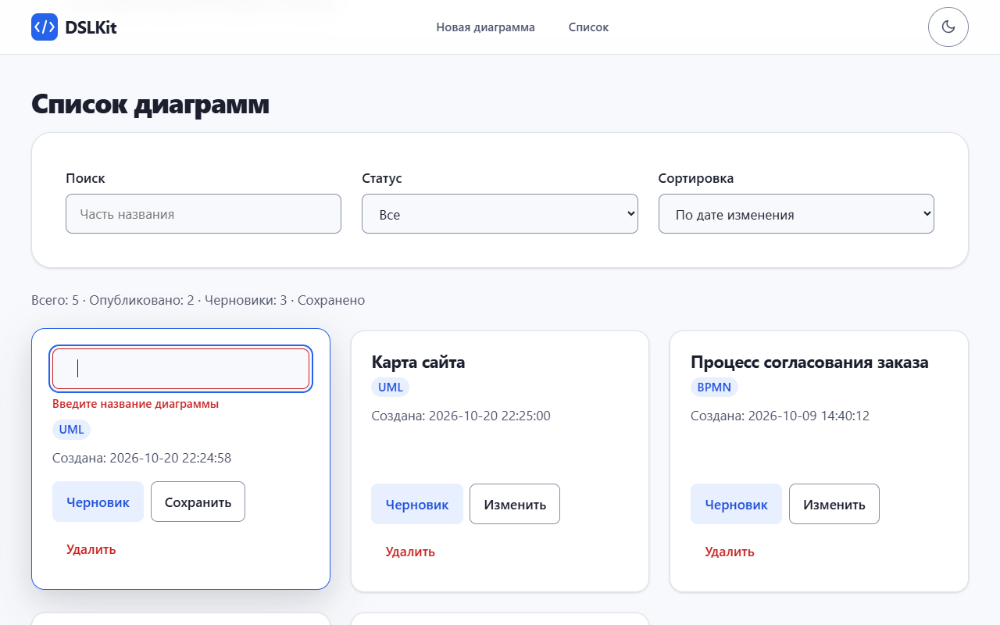

Figure 9 – Error message under the edit field for an empty title

After "Удалить" is pressed, the record disappears from the list and from the statistics, and figure 10 shows the result.

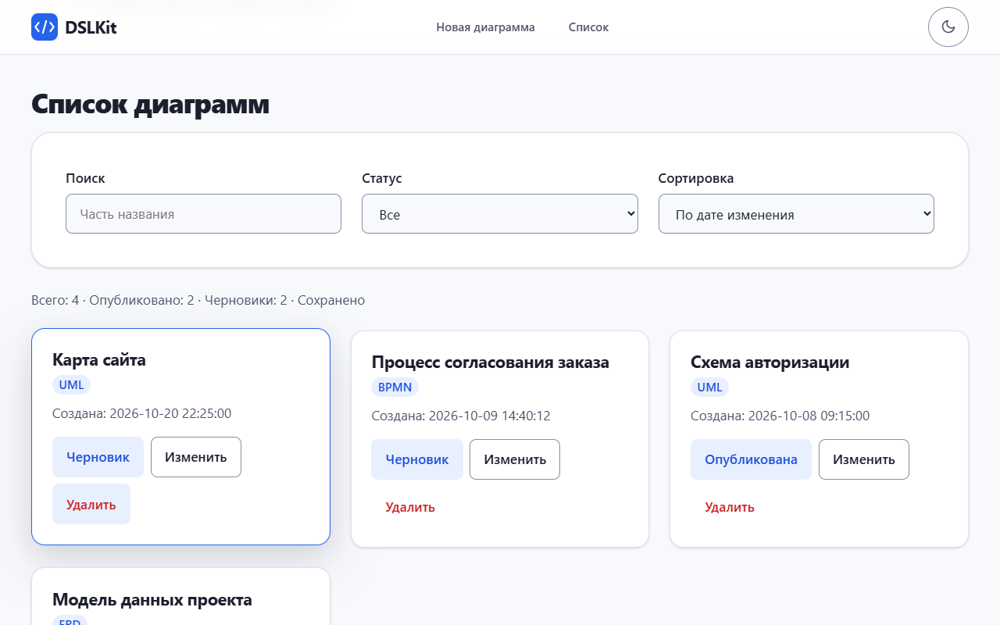

Figure 10 – Diagram list after one record is deleted

After the page is reloaded the list stays the same, as figure 11 shows.

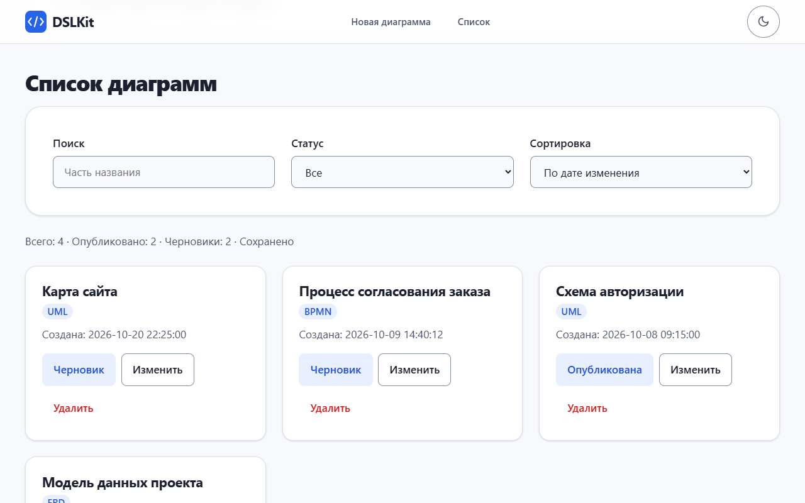

Figure 11 – Diagram list after a page reload

If the list has no records, a message is shown instead of cards, as in figure 12.

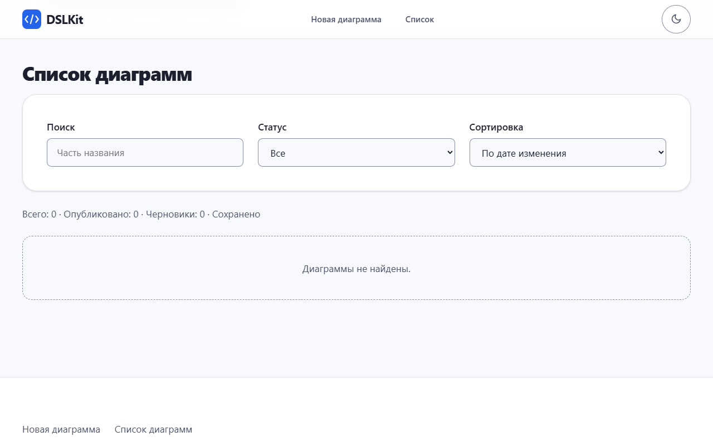

Figure 12 – The message "Диаграммы не найдены" for an empty list

On a phone width of 375 pixels the layout turns into one column, as in figure 13.

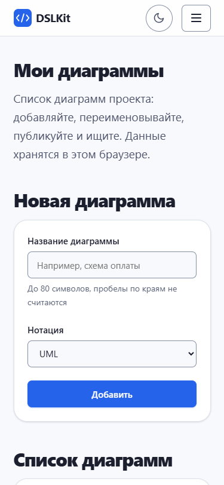

Figure 13 – Application page on a screen 375 pixels wide

The phone menu opens with the three bar button and is shown in figure 14.

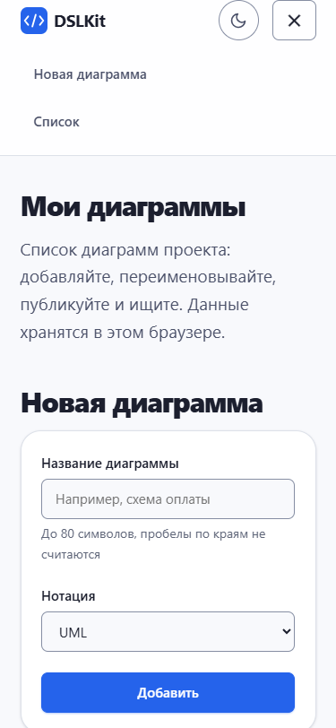

Figure 14 – Opened menu on a screen 375 pixels wide

The dark theme is switched on with the moon icon in the header and is shown in figure 15.

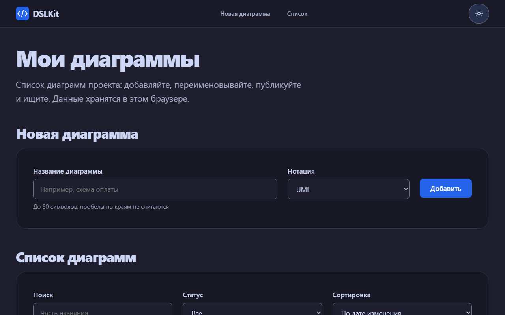

Figure 15 – Application page in the dark theme

### 3.9 Testing

Fifty-five automated tests check the pure functions, both hooks and the application behaviour: adding, deleting, editing with Enter and Esc, status switching, filters, sorting, list restoring, whitespace and huge values, unique creation time, broken storage data, markup rendered as text, the theme switch and the 500 page. The manual check is described in `README.md`, the content of `localStorage` is viewed in the Application tab of the developer tools.

## Conclusion

The Vite application implements adding, deleting and editing diagrams, filtering and sorting, saving to `localStorage` and two additional effects, the page title and autosave with debounce. The storage logic is extracted into a custom hook, which will simplify replacing `localStorage` with a REST API in laboratory work No. 5.

## Answers to Control Questions

{{answers}}
1. **What is the `useState` hook for?** It keeps a value between renders. To update from the previous value, pass a function: `setCount((prev) => prev + 1)`.
2. **What is a side effect?** An action outside rendering: writing to `localStorage`, a timer, changing `document.title`. In the project `useLocalStorage` and `useAutosaveStatus` work this way.
3. **How does the dependency array work?** The effect runs after rendering if any value in the array has changed. An empty array means one run after mounting.
4. **How to load data from `localStorage` on mount?** Read the value with the initializer function of `useState` or in an effect with an empty dependency array.
5. **Why can hooks not be called in conditions?** React matches hooks by the order of calls, and a different order on the next render breaks the state.
6. **How does `localStorage` differ from `sessionStorage`?** The first lives between sessions, the second is cleared when the tab is closed.
7. **How to make a lazy state initialization?** Pass a function to `useState`: `useState(() => readStorage(key))`. It is called once at the first render.
8. **How to debug an infinite render loop?** Check the dependency array for objects created anew on every render, and check whether the effect changes its own value without a condition.
9. **How to save an object or an array to `localStorage`?** Serialize it with `JSON.stringify` and read it with `JSON.parse` inside `try/catch` with a check of the data shape.
10. **What happens if the state is changed right after `setState`?** The value in the current call does not change, because updates are batched and applied at the next render. For a chain, the functional form is used.
11. **How to imitate loading from a server?** Start a `setTimeout` in `useEffect` that writes the data to the state after a second, and call `clearTimeout` in the cleanup.
12. **Which cleanup function can an effect return?** The one that removes a subscription or a timer. In the project it is `return () => clearTimeout(timer)` in `useAutosaveStatus`.
13. **How to work with forms?** A controlled component keeps the value in the state and sets it through `value` and `onChange`, an uncontrolled one reads the value from the DOM through a `ref`. The forms of the project are controlled.
14. **How to implement the Enter hotkey?** Wrap the fields in `<form onSubmit>`, then Enter submits the form, or handle `onKeyDown` and check `event.key`.
15. **How to optimize a large list?** Virtualize the list, memoize calculations with `useMemo` and wrap the row components in `React.memo`.
16. **How to implement debounce for autosave?** Set a `setTimeout` of 500 ms in the effect and clear it at the next change: `const t = setTimeout(save, 500); return () => clearTimeout(t);`.
{{/answers}}

## Appendix A (mandatory) Key Code Fragments

```jsx
// hooks/useLocalStorage.js: load through an initializer, save with an effect
export function useLocalStorage(key, initialValue) {
  const [value, setValue] = useState(() => readStorage(key, initialValue));
  useEffect(() => {
    localStorage.setItem(key, JSON.stringify(value));
  }, [key, value]);
  return [value, setValue];
}
```

```jsx
// hooks/useAutosaveStatus.js: 500 ms debounce with timer cleanup
useEffect(() => {
  setStatus('saving');
  const timer = setTimeout(() => setStatus('saved'), AUTOSAVE_DELAY);
  return () => clearTimeout(timer);
}, [value]);
```

```jsx
// App.jsx: functional state updates and the page title
const deleteDiagram = (id) => setDiagrams((prev) => prev.filter((d) => d.id !== id));

useEffect(() => {
  document.title = `DSLKit: диаграмм ${diagrams.length}`;
}, [diagrams.length]);
```
