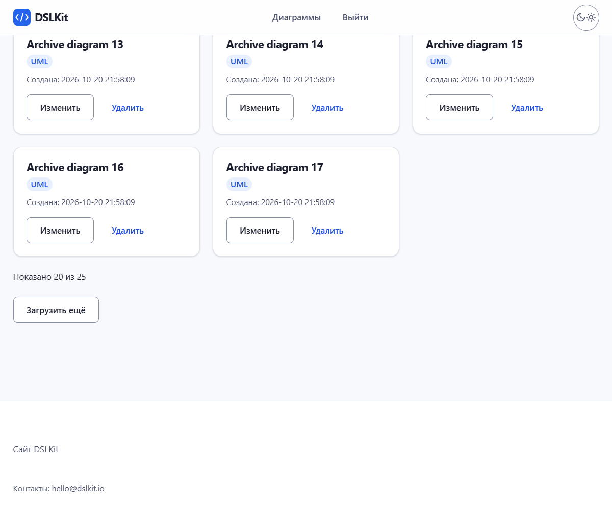

# Laboratory Work No. 5. Interaction of a React Application with a Server

## 1 Purpose of the Work

To master sending HTTP requests from a React application to a REST API, handling the loading, error and success states, optimistic interface updates and rolling a change back on failure. The client part of DSLKit, a web editor for diagrams as code (SaaS direction), is connected to the server from laboratory works 1–3 with JWT authentication and becomes the base of the future course project.

## 2 Brief Theoretical Background

**Client and server.** The browser requests data from the server over HTTP, and the server answers with JSON and a status code. A browser allows a request to another origin only when the server sends CORS headers.

**Fetch and axios.** `fetch` is built into the browser and returns a promise that is rejected only on a network failure. The axios library rejects the promise for 4xx and 5xx codes too, parses JSON itself and supports interceptors. That is why axios is used in this work.

**Request states.** Every request goes through three states: loading, success and error. The interface shows an indicator in the first one, the data in the second one and a message with a retry button in the third one.

**Optimistic update.** The interface changes at once without waiting for the server. If the server refuses, the change is rolled back and the user sees a message.

**Request cancellation.** An `AbortController` aborts a request when the component is gone or the search text has changed, so an outdated answer cannot overwrite a fresh one.

## 3 Work Progress

### 3.1 Interaction Scheme

The application has two parts. The server from laboratory work 3 listens on port 3000, stores the diagrams in a database and checks the token. The Vite client runs on port 5178 and talks to the server through the `api.js` module. The server address is set by the `VITE_API_URL` variable in the `.env` file. For the browser to allow the requests, the server got a small CORS middleware. It compares the `Origin` header of a request with the single allowed client address and names this address in the answer, while another address gets no allowing headers. The `Vary: Origin` header is always sent, so a shared cache does not give the answer for one origin to another. Preflight requests get a 204 answer without a token check. The module is given in Appendix F.

The sequence is as follows. The user signs in, the server returns a token, the client saves it in `localStorage`, and an axios interceptor puts it into the `Authorization` header of every request. If the server answers with code 401, the token is removed and the login form is shown with a message that the session has expired.

The look of the application comes from Part 1 of the project: the header with the logo and the theme switch, the footer, the buttons, the record cards and the form fields are taken from the site stylesheet. There is one main button on a screen, controls are at least 44 pixels high, text is at least 14 pixels, fields have visible labels, and the skip link leads to the main content.

The login and registration form is shown in figure 1.


Figure 1 – Login form of the application with a check of the email address and the password length

### 3.2 API Service

All calls to the server are collected in the `api.js` module, which is shown in Appendix A. It creates an axios instance with the address from the environment and an eight-second timeout, adds a request interceptor with the token and a response interceptor for code 401. The functions `fetchDiagrams`, `addDiagram`, `updateDiagram` and `deleteDiagram` correspond to the GET, POST, PUT and DELETE requests. The `errorMessage` function turns an error into a clear text: the server message with the list of fields, a note about a timeout or a message about an unreachable server.

### 3.3 Loading the List

The `useDiagrams` hook keeps the list, the loading flag and the error, and requests the data in `useEffect` on mount. The hook is given in Appendix B. While the request is running, an indicator is shown, as in figure 2.


Figure 2 – Loading indicator while the server answers slowly

The first request asks not for the whole list but for one page: `limit=20&offset=0`. The server gives the size of the whole list in the `X-Total-Count` header, and the hook keeps it together with the number of loaded records. The loaded list is shown in figure 3. Every record has a "Создана" field with the exact time, so the records differ visually.


Figure 3 – List of diagrams received from the server

If the server is unreachable, a message and a "Повторить" button that starts the request again are shown instead of the list. This state is shown in figure 4.


Figure 4 – Error message for an unreachable server and the retry button

### 3.4 Adding, Editing and Deleting

When a diagram is added, the record appears in the list at once with a temporary identifier and the "Сохраняется…" mark. The form and the list before sending are shown in figure 5.


Figure 5 – Filled-in form before the diagram is sent

Right after the click the record is already in the list, although the server has not answered yet. This is visible in figure 6.


Figure 6 – New record marked "Сохраняется…" before the server answer

When the server has answered, the temporary record is replaced by the real one with the identifier from the answer, as in figure 7. If the server refuses, the record disappears and a notice with the reason appears.


Figure 7 – New record after the server answer

Deleting works the same way. The record is removed at once and returns to its place if the request fails. The result is shown in figure 8.


Figure 8 – List after a record is deleted

The title is edited with the Enter key or the "Сохранить" button, and Escape cancels the edit. The client sends a PUT request with all fields of the record, because the server replaces the record as a whole. If the request fails, the previous title comes back.

Fast repeated actions do not break the list. While a request for a record is not finished, a second delete or edit of the same record is ignored, so a double click on the "Удалить" button sends one DELETE request. A record with a temporary identifier cannot be deleted or edited until the server returns the real identifier. Answer 404 to a delete means that the record is already gone, so no rollback is needed.

### 3.5 Server Search with Debounce

Server search is chosen as the additional improvement. The server accepts the `search` parameter in the `GET /diagrams` request and returns the records whose title contains this string. The value is passed as a database query parameter, so a foreign fragment cannot be injected into the query, and a value that is not a string or is too long gets answer 400.

The client does not send a request on every letter. The `useDebouncedValue` hook waits for 400 milliseconds of silence, and the previous request is cancelled through `AbortController`. The search result is shown in figure 9.


Figure 9 – List after a search for the word "order"

### 3.6 Loading in Parts

The server can give the list in pages through the `limit` and `offset` parameters, so the client shows the first 20 records, the line "Показано N из M" and the "Загрузить ещё" button, as in figure 10. A click requests the next page with an offset equal to the number of records already loaded and appends it to the end of the list without a reset. While a page is loading, the button is disabled and shows "Загрузка…", so a double click sends one request. A record added in this session does not move the offset of the next page, and the deletion of a loaded record lowers it, so records are neither skipped nor doubled. If the server did not send the size of the list, the button is not shown. A change of the search text cancels the page loading for the old search, and a late answer does not overwrite the new list. A page loading error is shown as a notice, the list stays in place and the button works again.



Figure 10 – The first page of the list with the counter and the "Загрузить ещё" button

While an edit or a delete is running, the card gets the "Сохраняется…" mark and `aria-busy`, its buttons are disabled, and a line "Сохранение на сервере…" with an indicator is shown above the list and disappears after the answer.

### 3.7 Input Validation

The form checks the values before sending. The title and the source code cannot be empty or made of spaces, the title is at most 80 characters, the source code is at most 10000, the password is from 8 to 72 bytes. The title and source code fields have the `maxLength` attribute, the source code is typed into a multi-line field with a character counter, and the check stays in case the attribute is bypassed. The password length is counted in bytes, because the bcrypt hash on the server uses only the first 72 bytes, and a Russian letter takes two bytes. The limits are in the `limits.json` file and match the server limits. The file is shown in Appendix E, and the check functions in Appendix D. The server repeats the same check, so the client cannot be bypassed.

### 3.8 Testing

The main component and its states are shown in Appendix C. The work is covered by 69 automated Vitest tests with a mocked server. The tests cover the loading and error states, retry, optimistic add, delete and edit with rollback, search with cancellation of the previous request, login and logout, the token header and the handling of code 401, a double click on delete, loading in parts (a double click, a page error, a late answer of the old search, duplicates, the offset shift), the progress indicator of edit and delete, the limit and the counter of the multi-line field, records with a temporary identifier, and server markup shown as plain text. The server part with CORS and search is covered by ten tests in laboratory work 3. For a manual check, start the server with `npm run dev` in the `part-2/lab-03-auth` folder and the client with the same command in the `part-2/lab-05-react-api` folder. The screenshots for figures 1–10 are taken by the `shots/shots.mjs` script.

Repository branch: 25.

## Conclusion

The React client works with the server API: it receives the list with a loading indicator and a retry button, adds, edits and deletes records with optimistic updates and rollback, puts the token into every request and searches on the server with a delayed request and cancellation, and loads the list in parts with the "Загрузить ещё" button. All calls are collected in one module, and the value limits are moved to a separate file. The work gives a ready base for integrating the client into the course project.

## Answers to Control Questions

9. **How to add the Authorization header in axios?** Through an interceptor: `api.interceptors.request.use((config) => { config.headers.Authorization = 'Bearer ' + token; return config; })`. In the project the token is taken from `localStorage`.
10. **What is debounce?** A delay of the call until a pause in events. For search the request is sent 400 milliseconds after the last letter, not on every one. In the project it is the `useDebouncedValue` hook.
11. **How to cancel a request on unmount?** Create an `AbortController` in `useEffect`, pass the `signal` to the request and call `controller.abort()` in the cleanup function of the effect. The `useDiagrams` hook is made this way.

## Appendix A (mandatory) Listing of api.js

```js
import axios from 'axios';

export const TOKEN_KEY = 'token';

// The token lives in localStorage so that it survives a reload. Storage can be blocked by the browser, then the user simply has to sign in again.
export const getToken = () => {
  try {
    return localStorage.getItem(TOKEN_KEY);
  } catch {
    return null;
  }
};
export const saveToken = (token) => {
  try {
    localStorage.setItem(TOKEN_KEY, token);
  } catch {
    /* the session lasts until the page is closed */
  }
};
export const clearToken = () => {
  try {
    localStorage.removeItem(TOKEN_KEY);
  } catch {
    /* nothing to remove */
  }
};

const api = axios.create({ baseURL: import.meta.env.VITE_API_URL || 'http://localhost:3000', timeout: 8000 });

// Every request carries the JWT saved after login.
api.interceptors.request.use((config) => {
  const token = getToken();
  if (token) config.headers.Authorization = `Bearer ${token}`;
  return config;
});

// An expired or rejected token ends the session: the token is removed and the app is told to show the login form.
api.interceptors.response.use(
  (response) => response,
  (error) => {
    if (error.response?.status === 401 && getToken()) {
      clearToken();
      window.dispatchEvent(new Event('auth:logout'));
    }
    return Promise.reject(error);
  },
);

export const register = (email, password) => api.post('/auth/register', { email, password });
export const login = (email, password) => api.post('/auth/login', { email, password });

// The search text, the page size and the offset are query parameters (the server reads ?search=, ?limit= and ?offset=);
// the signal lets the caller cancel the request. The size of the whole list comes back in the X-Total-Count header.
export const fetchDiagrams = (search = '', signal, { limit, offset } = {}) => {
  const params = {};
  if (search) params.search = search;
  if (limit !== undefined) params.limit = limit;
  if (offset) params.offset = offset;
  return api.get('/diagrams', { params: Object.keys(params).length > 0 ? params : undefined, signal });
};
export const addDiagram = (diagram) => api.post('/diagrams', diagram);
export const updateDiagram = (id, diagram) => api.put(`/diagrams/${id}`, diagram);
export const deleteDiagram = (id) => api.delete(`/diagrams/${id}`);

export const isCanceled = (error) => axios.isCancel(error);

// A text for the user: the server message when there is one, a clear text when the server is unreachable.
// The text is shown by React as plain text, so markup in a server message cannot run.
export const errorMessage = (error) => {
  if (error.response) {
    const data = error.response.data;
    const { error: message, details } = data && typeof data === 'object' ? data : {};
    const extra = Array.isArray(details) ? details.map((d) => `${d.field}: ${d.message}`).join(', ') : '';
    return [typeof message === 'string' && message ? message : `Ошибка сервера (${error.response.status})`, extra].filter(Boolean).join(' – ');
  }
  if (error.code === 'ECONNABORTED') return 'Сервер не ответил вовремя';
  return 'Сервер недоступен. Проверьте, что он запущен';
};

export default api;
```

## Appendix B (mandatory) Listing of useDiagrams.js

```js
import { useCallback, useEffect, useRef, useState } from 'react';
import { addDiagram, deleteDiagram, errorMessage, fetchDiagrams, isCanceled, updateDiagram } from '../api';
import limits from '../limits.json';

const isTemporary = (id) => typeof id === 'string' && id.startsWith('temp-');

// The server sends the size of the whole list in X-Total-Count. A missing or broken value means "unknown", then there is no next page.
const readTotal = (response) => {
  const value = Number(response.headers?.['x-total-count']);
  return Number.isInteger(value) && value >= 0 ? value : null;
};

// Owns the server state of the list: loading, error, the items, the pages and the optimistic changes.
export function useDiagrams(search) {
  const [items, setItems] = useState([]);
  const [loading, setLoading] = useState(true);
  const [loadingMore, setLoadingMore] = useState(false);
  const [error, setError] = useState(null);
  const [notice, setNotice] = useState(null);
  const [attempt, setAttempt] = useState(0);
  // fetched: how many records of the server list are loaded (the offset of the next page), total: the size of the whole list.
  const [paging, setPaging] = useState({ fetched: 0, total: null });
  // Ids of records with a PUT or DELETE in flight, shown as a progress indicator.
  const [busy, setBusy] = useState(() => new Set());
  const tempCounter = useRef(0);
  // The latest values for the handlers, so a fast second click never works with an old copy.
  const itemsRef = useRef(items);
  itemsRef.current = items;
  const pagingRef = useRef(paging);
  pagingRef.current = paging;
  // Ids with a request in flight: a second delete or edit of the same record is ignored until the first one ends.
  const busyIds = useRef(new Set());
  // Records added in this session: they are not part of the loaded pages, so they do not move the offset of the next page.
  const localIds = useRef(new Set());
  const moreController = useRef(null);
  const loadingMoreRef = useRef(false);

  const markBusy = (id) => {
    busyIds.current.add(id);
    setBusy(new Set(busyIds.current));
  };
  const unmarkBusy = (id) => {
    busyIds.current.delete(id);
    setBusy(new Set(busyIds.current));
  };
  const changeTotal = (delta) => setPaging((current) => (current.total === null ? current : { ...current, total: Math.max(0, current.total + delta) }));

  // The request is cancelled when the search text changes, on retry and when the component unmounts.
  // A page that is being loaded for the old search is cancelled too, so its answer never reaches the new list.
  useEffect(() => {
    const controller = new AbortController();
    setLoading(true);
    setLoadingMore(false);
    loadingMoreRef.current = false;
    setError(null);
    fetchDiagrams(search, controller.signal, { limit: limits.pageSize, offset: 0 })
      .then((response) => {
        if (controller.signal.aborted) return;
        localIds.current.clear();
        setItems(response.data);
        setPaging({ fetched: response.data.length, total: readTotal(response) });
      })
      .catch((failure) => {
        if (!isCanceled(failure) && !controller.signal.aborted) setError(errorMessage(failure));
      })
      .finally(() => {
        if (!controller.signal.aborted) setLoading(false);
      });
    return () => {
      controller.abort();
      moreController.current?.abort();
    };
  }, [search, attempt]);

  const retry = useCallback(() => setAttempt((n) => n + 1), []);
  const dismissNotice = useCallback(() => setNotice(null), []);

  // "Load more": the next page is appended, the records already on the screen are never doubled.
  // A second click while a page is loading is ignored.
  const loadMore = useCallback(async () => {
    const { fetched, total } = pagingRef.current;
    if (loadingMoreRef.current || total === null || fetched >= total) return;
    loadingMoreRef.current = true;
    setLoadingMore(true);
    const controller = new AbortController();
    moreController.current = controller;
    try {
      const response = await fetchDiagrams(search, controller.signal, { limit: limits.pageSize, offset: fetched });
      if (controller.signal.aborted) return;
      const loaded = response.data;
      loaded.forEach((record) => localIds.current.delete(record.id));
      setItems((current) => {
        const known = new Set(current.map((item) => item.id));
        return [...current, ...loaded.filter((record) => !known.has(record.id))];
      });
      setPaging({ fetched: fetched + loaded.length, total: readTotal(response) ?? total });
    } catch (failure) {
      if (!isCanceled(failure) && !controller.signal.aborted) setNotice(`Не удалось загрузить ещё. ${errorMessage(failure)}`);
    } finally {
      if (!controller.signal.aborted) {
        loadingMoreRef.current = false;
        setLoadingMore(false);
      }
    }
  }, [search]);

  // Optimistic add: the item appears at once with a temporary id, the real record replaces it on success.
  const add = useCallback(async (fields) => {
    tempCounter.current += 1;
    const tempId = `temp-${tempCounter.current}`;
    setItems((current) => [...current, { ...fields, id: tempId, createdAt: new Date().toISOString(), pending: true }]);
    changeTotal(1);
    try {
      const { data } = await addDiagram(fields);
      localIds.current.add(data.id);
      setItems((current) => current.map((item) => (item.id === tempId ? data : item)));
      return true;
    } catch (failure) {
      setItems((current) => current.filter((item) => item.id !== tempId));
      changeTotal(-1);
      setNotice(`Не удалось добавить диаграмму. ${errorMessage(failure)}`);
      return false;
    }
  }, []);

  // Optimistic delete: the item disappears at once and returns to its place when the server refuses.
  // A record that is still being created (temporary id) or already being changed is skipped.
  const remove = useCallback(async (id) => {
    const index = itemsRef.current.findIndex((item) => item.id === id);
    if (index < 0 || isTemporary(id) || busyIds.current.has(id)) return;
    const removed = itemsRef.current[index];
    const wasLocal = localIds.current.delete(id);
    markBusy(id);
    setItems((current) => current.filter((item) => item.id !== id));
    changeTotal(-1);
    if (!wasLocal) setPaging((current) => ({ ...current, fetched: Math.max(0, current.fetched - 1) }));
    try {
      await deleteDiagram(id);
    } catch (failure) {
      // 404 means the record is already gone, so the list is right and nothing is restored.
      if (failure.response?.status !== 404) {
        setItems((current) => (current.some((item) => item.id === id) ? current : [...current.slice(0, index), removed, ...current.slice(index)]));
        changeTotal(1);
        if (wasLocal) localIds.current.add(id);
        else setPaging((current) => ({ ...current, fetched: current.fetched + 1 }));
        setNotice(`Не удалось удалить диаграмму. ${errorMessage(failure)}`);
      }
    } finally {
      unmarkBusy(id);
    }
  }, []);

  // Optimistic edit: PUT replaces the whole record, so the server gets all fields; the old record comes back on failure.
  const update = useCallback(async (id, changes) => {
    const previous = itemsRef.current.find((item) => item.id === id);
    if (!previous || isTemporary(id) || busyIds.current.has(id)) return false;
    const { title, notation, sourceCode, priority } = { ...previous, ...changes };
    markBusy(id);
    setItems((current) => current.map((item) => (item.id === id ? { ...item, ...changes } : item)));
    try {
      const { data } = await updateDiagram(id, { title, notation, sourceCode, priority });
      setItems((current) => current.map((item) => (item.id === id ? data : item)));
      return true;
    } catch (failure) {
      setItems((current) => current.map((item) => (item.id === id ? previous : item)));
      setNotice(`Не удалось сохранить изменения. ${errorMessage(failure)}`);
      return false;
    } finally {
      unmarkBusy(id);
    }
  }, []);

  const hasMore = paging.total !== null && paging.fetched < paging.total;
  // Requests that are still running in the background: shown as one progress line for edits, deletes and adds.
  const syncing = busy.size + items.filter((item) => item.pending).length;

  return { items, loading, loadingMore, error, notice, busy, syncing, hasMore, total: paging.total, retry, dismissNotice, loadMore, add, remove, update };
}
```

## Appendix C (mandatory) Listing of App.jsx

```jsx
import { useEffect, useState } from 'react';
import { clearToken, getToken } from './api';
import AuthForm from './components/AuthForm';
import DiagramForm from './components/DiagramForm';
import DiagramItem from './components/DiagramItem';
import Footer from './components/Footer';
import Header from './components/Header';
import limits from './limits.json';
import { useDebouncedValue } from './hooks/useDebouncedValue';
import { useDiagrams } from './hooks/useDiagrams';

// The list screen is separate so the hook runs only for a signed-in user.
function Diagrams() {
  const [search, setSearch] = useState('');
  const debouncedSearch = useDebouncedValue(search.trim(), limits.searchDebounceMs);
  const { items, loading, loadingMore, error, notice, busy, syncing, hasMore, total, retry, dismissNotice, loadMore, add, remove, update } =
    useDiagrams(debouncedSearch);

  return (
    <>
      <DiagramForm onAdd={add} />
      <div className="form__field toolbar">
        <label className="form__label" htmlFor="search">
          Поиск по названию
        </label>
        <input
          id="search"
          className="form__input"
          type="search"
          autoComplete="off"
          value={search}
          maxLength={limits.title.maxLength}
          onChange={(e) => setSearch(e.target.value)}
        />
      </div>
      {notice && (
        <div className="alert" role="alert">
          <p className="alert__text">{notice}</p>
          <button type="button" className="button button--quiet" onClick={dismissNotice}>
            Закрыть
          </button>
        </div>
      )}
      {loading && (
        <p role="status" className="status">
          <span className="spinner" aria-hidden="true"></span>
          Загрузка…
        </p>
      )}
      {error && !loading && (
        <div role="alert" className="alert">
          <p className="alert__text">{error}</p>
          <button type="button" className="button" onClick={retry}>
            Повторить
          </button>
        </div>
      )}
      {!loading && !error && items.length === 0 && (
        <p className="note">
          <span className="note__text">Диаграмм не найдено.</span>
        </p>
      )}
      {syncing > 0 && (
        <p role="status" className="status">
          <span className="spinner" aria-hidden="true"></span>
          Сохранение на сервере…
        </p>
      )}
      {!error && (
        <ul className="cards">
          {items.map((diagram) => (
            <DiagramItem key={diagram.id} diagram={diagram} busy={busy.has(diagram.id)} onUpdate={update} onRemove={remove} />
          ))}
        </ul>
      )}
      {!error && !loading && total !== null && total > 0 && (
        <p className="stats">
          Показано {items.length} из {total}
        </p>
      )}
      {!error && !loading && hasMore && (
        <div className="actions">
          <button type="button" className="button" disabled={loadingMore} aria-busy={loadingMore ? 'true' : undefined} onClick={loadMore}>
            {loadingMore ? 'Загрузка…' : 'Загрузить ещё'}
          </button>
        </div>
      )}
    </>
  );
}

export default function App() {
  const [signedIn, setSignedIn] = useState(() => Boolean(getToken()));
  const [expired, setExpired] = useState(false);

  // api.js sends this event when the server answers 401 for the saved token.
  useEffect(() => {
    const handleLogout = () => {
      setSignedIn(false);
      setExpired(true);
    };
    window.addEventListener('auth:logout', handleLogout);
    return () => window.removeEventListener('auth:logout', handleLogout);
  }, []);

  const logout = () => {
    clearToken();
    setExpired(false);
    setSignedIn(false);
  };

  return (
    <div className="page">
      <a className="skip-link" href="#main">
        Перейти к основному содержимому
      </a>
      <Header signedIn={signedIn} onLogout={logout} />
      <main className="main" id="main">
        <div>
          <h1 className="page-title">{signedIn ? 'Диаграммы проекта' : 'Вход в DSLKit'}</h1>
          <p className="page-lead">
            {signedIn
              ? 'Список хранится на сервере: запись появляется сразу, а при отказе сервера возвращается как было.'
              : 'Диаграммы хранятся на сервере и доступны после входа.'}
          </p>
        </div>
        {signedIn ? (
          <Diagrams />
        ) : (
          <AuthForm
            notice={expired ? 'Сессия истекла. Войдите снова.' : undefined}
            onLoggedIn={() => {
              setExpired(false);
              setSignedIn(true);
            }}
          />
        )}
      </main>
      <Footer />
    </div>
  );
}
```

## Appendix D (mandatory) Listing of validation.js

```js
import limits from '../limits.json';

export const NOTATIONS = ['UML', 'BPMN', 'ERD', 'DFD', 'IDEF0', 'Petri'];
export const PRIORITIES = ['low', 'normal', 'high'];

const checkText = (value, { minLength, maxLength }, label) => {
  const length = value.trim().length;
  if (length < minLength) return `Введите ${label}`;
  if (length > maxLength) return `${label[0].toUpperCase()}${label.slice(1)} не длиннее ${maxLength} символов`;
  return null;
};

// Returns an object with a message per invalid field, empty when everything is valid.
// A whitespace-only text counts as empty. The limits live in limits.json and match the server.
export function validateDiagram({ title, sourceCode, notation }) {
  const errors = {};
  const titleError = checkText(title, limits.title, 'название');
  const codeError = checkText(sourceCode, limits.sourceCode, 'исходный код');
  if (titleError) errors.title = titleError;
  if (codeError) errors.sourceCode = codeError;
  if (!NOTATIONS.includes(notation)) errors.notation = 'Выберите нотацию';
  return errors;
}

// The server hashes the password with bcrypt, which reads only the first 72 bytes, so the limit counts bytes (a Cyrillic letter is two bytes).
export function validateCredentials({ email, password }) {
  const errors = {};
  const address = email.trim();
  if (!/^\S+@\S+\.\S+$/.test(address) || address.length > limits.email.maxLength) errors.email = 'Введите адрес электронной почты';
  if (password.length < limits.password.minLength) errors.password = `Пароль не короче ${limits.password.minLength} символов`;
  else if (new TextEncoder().encode(password).length > limits.password.maxBytes) errors.password = `Пароль не длиннее ${limits.password.maxBytes} байт`;
  return errors;
}

// "2026-10-16 12:30:05" in local time, the same look in every locale; every record shows its own creation time.
export const formatTime = (iso) => new Date(iso).toLocaleString('sv-SE');
```

## Appendix E (mandatory) The limits.json Limits File

```json
{
  "title": { "minLength": 1, "maxLength": 80 },
  "sourceCode": { "minLength": 1, "maxLength": 10000 },
  "email": { "maxLength": 254 },
  "password": { "minLength": 8, "maxBytes": 72 },
  "searchDebounceMs": 400,
  "pageSize": 20
}
```

## Appendix F (mandatory) Listing of cors.js

```js
// A browser app on another origin (the React client) may call the API only when the server allows that origin.
// origin: the single allowed origin such as http://localhost:5178. It is compared with the Origin header of the request:
// only an equal value gets the Access-Control-Allow-* headers, every other origin gets none and the browser blocks the answer.
// Vary: Origin is always sent so a shared cache never gives the answer for one origin to another.
// A browser preflight (OPTIONS with Access-Control-Request-Method) is answered with 204 here and never reaches the token check.
// A plain OPTIONS request without that header goes on to the routes, which answer it with the Allow header.
const createCors = (origin) => {
  if (!origin || origin === '*') throw new Error('corsOrigin must be one exact origin, not * (see .env.example)');
  return (req, res, next) => {
    res.vary('Origin');
    const allowed = req.get('Origin') === origin;
    if (allowed) {
      res.set('Access-Control-Allow-Origin', origin);
      // Lets the browser app read the total size of a paged list.
      res.set('Access-Control-Expose-Headers', 'X-Total-Count');
    }
    if (req.method !== 'OPTIONS' || !req.get('Access-Control-Request-Method')) return next();
    if (allowed) {
      res.set('Access-Control-Allow-Methods', 'GET, POST, PUT, DELETE, OPTIONS');
      res.set('Access-Control-Allow-Headers', 'Content-Type, Authorization');
      res.set('Access-Control-Max-Age', '600');
    }
    return res.status(204).end();
  };
};

module.exports = { createCors };
```