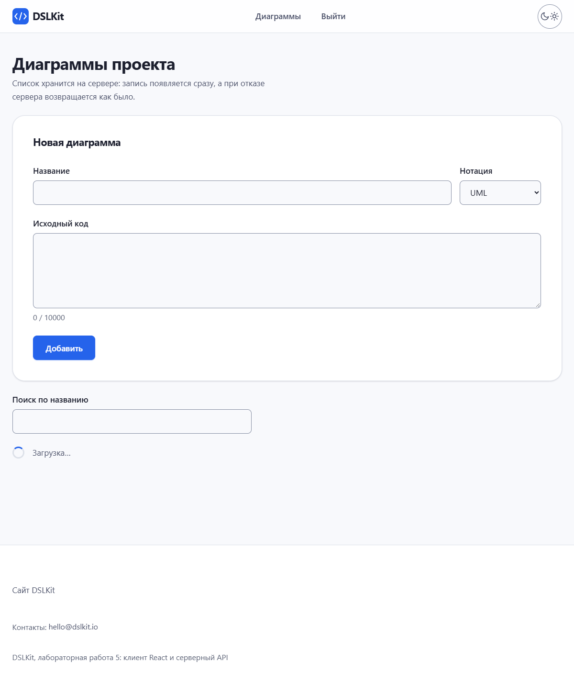
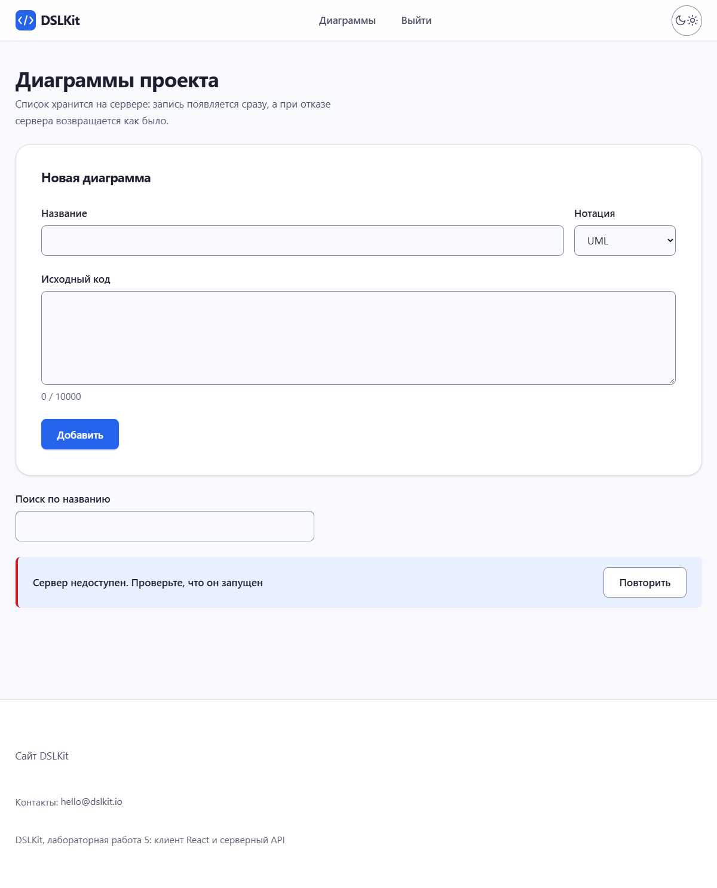
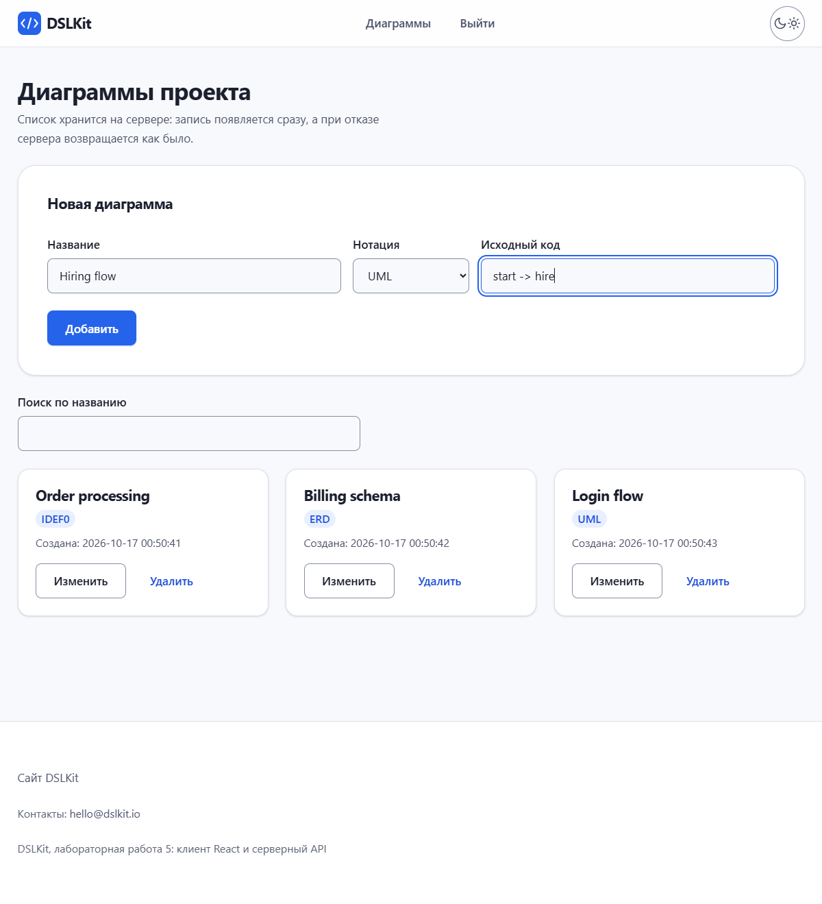
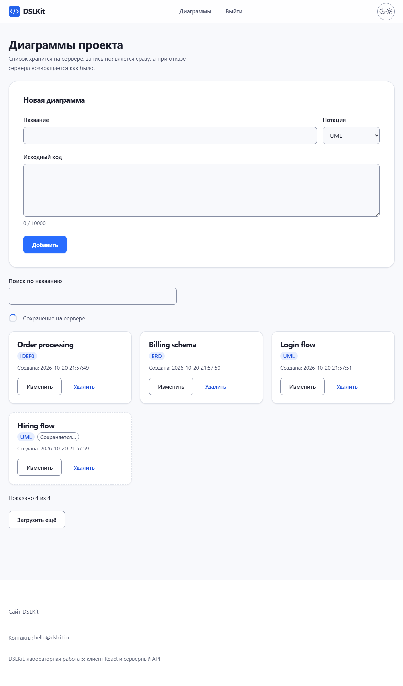
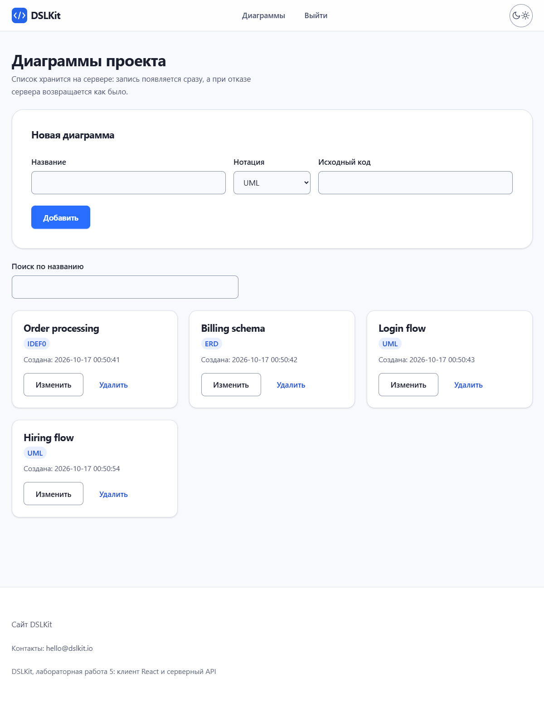
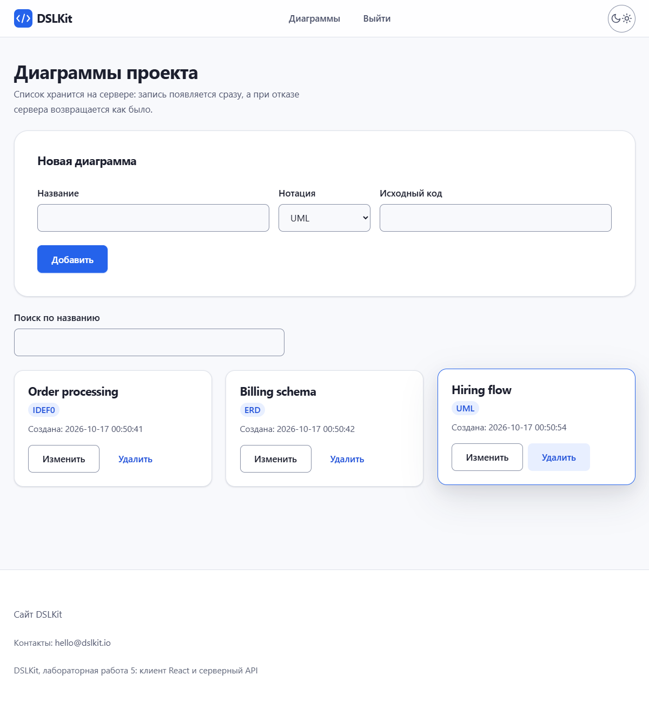
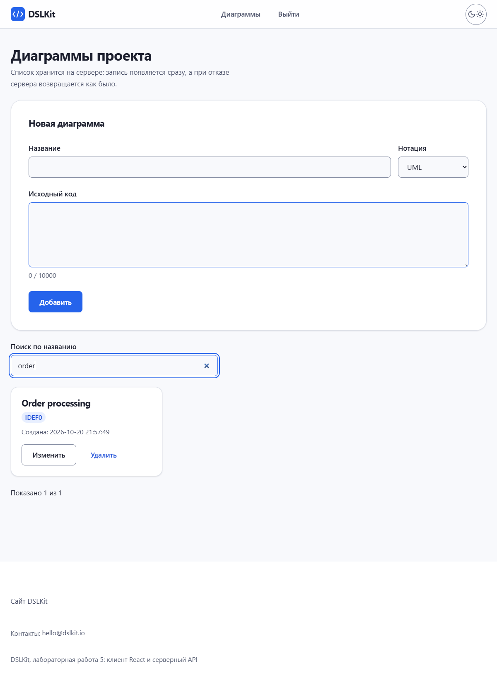

# Лабораторная работа №5. Взаимодействие React-приложения с сервером

## 1 Цель работы

Освоить отправку HTTP-запросов из React-приложения к REST API, обработку состояний загрузки, ошибки и успеха, оптимистичное обновление интерфейса и откат при сбое. Клиентская часть проекта DSLKit, веб-редактора диаграмм как кода из направления SaaS, подключается к серверу из лабораторных работ 1–3 с аутентификацией по токену JWT и становится основой будущего курсового проекта.

## 2 Краткие теоретические сведения

**Клиент и сервер.** Браузер запрашивает данные у сервера по протоколу HTTP, а сервер отвечает JSON и кодом состояния. Запрос с другого адреса браузер разрешает только тогда, когда сервер передал заголовки CORS.

**Fetch и axios.** `fetch` встроен в браузер и возвращает промис, который отклоняется только при сбое сети. Библиотека axios отклоняет промис и при кодах 4xx и 5xx, разбирает JSON сама и поддерживает перехватчики. Поэтому в работе выбран axios.

**Состояния запроса.** Каждый запрос проходит три состояния: загрузка, успех и ошибка. Интерфейс показывает индикатор в первом, данные во втором и сообщение с кнопкой повтора в третьем.

**Оптимистичное обновление.** Интерфейс меняется сразу, не дожидаясь ответа сервера. Если сервер отказал, изменение откатывается и пользователь видит сообщение.

**Отмена запроса.** Объект `AbortController` прерывает запрос, когда компонент исчез или текст поиска изменился, поэтому устаревший ответ не перезапишет свежий.

## 3 Ход работы

### 3.1 Схема взаимодействия

Приложение состоит из двух частей. Сервер из лабораторной работы 3 слушает порт 3000, хранит диаграммы в базе и проверяет токен. Клиент на Vite работает на порту 5178 и обращается к серверу через модуль `api.js`. Адрес сервера задаётся переменной `VITE_API_URL` в файле `.env`. Чтобы браузер разрешил запросы, сервер получил небольшое middleware CORS. Оно сравнивает заголовок `Origin` запроса с одним разрешённым адресом клиента и называет этот адрес в ответе, а для чужого адреса не добавляет разрешающих заголовков. Заголовок `Vary: Origin` отправляется всегда, поэтому общий кэш не отдаст ответ одного адреса другому. Предварительные запросы получают ответ 204 без проверки токена. Модуль приведён в приложении Е.

Последовательность такая. Пользователь входит, сервер возвращает токен, клиент сохраняет его в `localStorage`, и перехватчик axios подставляет его в заголовок `Authorization` каждого запроса. Если сервер отвечает кодом 401, токен удаляется и показывается форма входа с сообщением о том, что сессия истекла.

Внешний вид приложения взят из Части 1 проекта: шапка с логотипом и переключателем темы, подвал, кнопки, карточки записей и поля форм подключены из таблицы стилей сайта. Одна главная кнопка на экране, элементы управления не ниже 44 пикселей, текст не мельче 14 пикселей, у полей есть видимые подписи, а ссылка пропуска навигации ведёт к основному содержимому.

Вход и регистрация показаны на рисунке 1.


Рисунок 1 – Форма входа в приложение с проверкой адреса почты и длины пароля

### 3.2 Сервис API

Все обращения к серверу собраны в модуле `api.js`, который показан в приложении А. Он создаёт экземпляр axios с адресом из окружения и тайм-аутом восемь секунд, добавляет перехватчик запроса с токеном и перехватчик ответа для кода 401. Функции `fetchDiagrams`, `addDiagram`, `updateDiagram` и `deleteDiagram` соответствуют запросам GET, POST, PUT и DELETE. Функция `errorMessage` превращает ошибку в понятный текст: сообщение сервера с перечнем полей, пояснение о тайм-ауте или сообщение о недоступном сервере.

### 3.3 Загрузка списка

Хук `useDiagrams` хранит список, признак загрузки и ошибку, а при монтировании запрашивает данные в `useEffect`. Хук приведён в приложении Б. Пока запрос выполняется, показывается индикатор, как на рисунке 2.



Рисунок 2 – Индикатор загрузки на медленном ответе сервера

Загруженный список показан на рисунке 3. У каждой записи есть поле «Создана» с точным временем, поэтому записи визуально различаются.


Рисунок 3 – Список диаграмм, полученный с сервера

Если сервер недоступен, вместо списка выводится сообщение и кнопка «Повторить», которая запускает запрос заново. Это состояние показано на рисунке 4.



Рисунок 4 – Сообщение об ошибке при недоступном сервере и кнопка повтора

### 3.4 Добавление, редактирование и удаление

При добавлении запись сразу появляется в списке с временным идентификатором и пометкой «Сохраняется…». Форма и список до отправки показаны на рисунке 5.



Рисунок 5 – Заполненная форма добавления перед отправкой

Сразу после нажатия запись уже в списке, хотя сервер ещё не ответил. Это видно на рисунке 6.



Рисунок 6 – Новая запись с пометкой «Сохраняется…» до ответа сервера

Когда сервер ответил, временная запись заменяется настоящей с идентификатором из ответа, как на рисунке 7. Если сервер отказал, запись исчезает и появляется уведомление с причиной.



Рисунок 7 – Новая запись после ответа сервера

Удаление работает так же. Запись убирается сразу и возвращается на прежнее место, если запрос не удался. Результат показан на рисунке 8.



Рисунок 8 – Список после удаления записи

Редактирование названия идёт по клавише Enter или кнопке «Сохранить», а Escape отменяет правку. Клиент отправляет запрос PUT со всеми полями записи, потому что сервер заменяет запись целиком. Если запрос не удался, прежнее название возвращается.

Быстрые повторные действия не ломают список. Пока запрос по записи не завершён, второе удаление или правка этой же записи игнорируются, поэтому двойной щелчок по кнопке «Удалить» отправляет один запрос DELETE. Запись с временным идентификатором нельзя удалить или изменить, пока сервер не вернул настоящий идентификатор. Ответ 404 при удалении означает, что записи уже нет, и откат не нужен.

### 3.5 Поиск на сервере с debounce

В качестве дополнительного улучшения выбран поиск на сервере. Сервер принимает параметр `search` в запросе `GET /diagrams` и возвращает записи, в названии которых есть эта строка. Значение передаётся как параметр запроса к базе, поэтому внедрить в запрос чужой фрагмент нельзя, а не строка или слишком длинное значение получают ответ 400.

Клиент не отправляет запрос на каждую букву. Хук `useDebouncedValue` ждёт 400 миллисекунд тишины, а предыдущий запрос отменяется через `AbortController`. Результат поиска показан на рисунке 9.



Рисунок 9 – Список после поиска по слову «order»

### 3.6 Проверка вводимых значений

Форма проверяет значения до отправки. Название и исходный код не могут быть пустыми или состоять из пробелов, название не длиннее 80 символов, исходный код не длиннее 10000, пароль от 8 до 72 байт. Длина пароля считается в байтах, потому что хеш bcrypt на сервере учитывает только первые 72 байта, а русская буква занимает два байта. Пределы лежат в файле `limits.json` и совпадают с пределами сервера. Файл показан в приложении Д, а функции проверки в приложении Г. Сервер повторяет ту же проверку, поэтому обойти клиент не получится.

### 3.7 Проверка работы

Основной компонент и его состояния показаны в приложении В. Работа проверена 42 автоматическими тестами Vitest с имитацией сервера. Тесты покрывают состояния загрузки и ошибки, повтор, оптимистичное добавление, удаление и правку с откатом, поиск с отменой предыдущего запроса, вход и выход, заголовок с токеном и обработку кода 401, двойной щелчок по удалению, записи с временным идентификатором и вывод разметки из ответа сервера как обычного текста. Серверная часть с CORS и поиском проверена десятью тестами в лабораторной работе 3. Для ручной проверки нужно запустить сервер командой `npm run dev` в папке `part-2/lab-03-auth` и клиент той же командой в папке `part-2/lab-05-react-api`. Скриншоты рисунков 1–9 снимает скрипт `shots/shots.mjs`.

Ветка репозитория: 25.

## Заключение

Клиент на React работает с серверным API: получает список с индикатором загрузки и кнопкой повтора, добавляет, правит и удаляет записи с оптимистичным обновлением и откатом, подставляет токен в каждый запрос и ищет на сервере с отложенным запросом и отменой. Все обращения собраны в одном модуле, а пределы значений вынесены в отдельный файл. Работа даёт готовую основу для интеграции клиента в курсовой проект.

## Ответы на контрольные вопросы

9. **Как добавить заголовок Authorization в axios?** Через перехватчик: `api.interceptors.request.use((config) => { config.headers.Authorization = 'Bearer ' + token; return config; })`. В проекте токен берётся из `localStorage`.
10. **Что такое debounce?** Это задержка вызова до паузы в событиях. Для поиска запрос уходит через 400 миллисекунд после последней буквы, а не на каждую. В проекте это хук `useDebouncedValue`.
11. **Как отменить запрос при размонтировании?** Создать `AbortController` в `useEffect`, передать `signal` в запрос и вызвать `controller.abort()` в функции очистки эффекта. Так сделан хук `useDiagrams`.

## Приложение А (обязательное) Листинг файла api.js

```js
import axios from 'axios';

export const TOKEN_KEY = 'token';

// The token lives in localStorage so that it survives a reload. Storage can be blocked by the browser, then the user simply has to sign in again.
export const getToken = () => {
  try {
    return localStorage.getItem(TOKEN_KEY);
  } catch {
    return null;
  }
};
export const saveToken = (token) => {
  try {
    localStorage.setItem(TOKEN_KEY, token);
  } catch {
    /* the session lasts until the page is closed */
  }
};
export const clearToken = () => {
  try {
    localStorage.removeItem(TOKEN_KEY);
  } catch {
    /* nothing to remove */
  }
};

const api = axios.create({ baseURL: import.meta.env.VITE_API_URL || 'http://localhost:3000', timeout: 8000 });

// Every request carries the JWT saved after login.
api.interceptors.request.use((config) => {
  const token = getToken();
  if (token) config.headers.Authorization = `Bearer ${token}`;
  return config;
});

// An expired or rejected token ends the session: the token is removed and the app is told to show the login form.
api.interceptors.response.use(
  (response) => response,
  (error) => {
    if (error.response?.status === 401 && getToken()) {
      clearToken();
      window.dispatchEvent(new Event('auth:logout'));
    }
    return Promise.reject(error);
  },
);

export const register = (email, password) => api.post('/auth/register', { email, password });
export const login = (email, password) => api.post('/auth/login', { email, password });

// The search text is a query parameter; the signal lets the caller cancel the request.
export const fetchDiagrams = (search = '', signal) => api.get('/diagrams', { params: search ? { search } : undefined, signal });
export const addDiagram = (diagram) => api.post('/diagrams', diagram);
export const updateDiagram = (id, diagram) => api.put(`/diagrams/${id}`, diagram);
export const deleteDiagram = (id) => api.delete(`/diagrams/${id}`);

export const isCanceled = (error) => axios.isCancel(error);

// A text for the user: the server message when there is one, a clear text when the server is unreachable.
// The text is shown by React as plain text, so markup in a server message cannot run.
export const errorMessage = (error) => {
  if (error.response) {
    const data = error.response.data;
    const { error: message, details } = data && typeof data === 'object' ? data : {};
    const extra = Array.isArray(details) ? details.map((d) => `${d.field}: ${d.message}`).join(', ') : '';
    return [typeof message === 'string' && message ? message : `Ошибка сервера (${error.response.status})`, extra].filter(Boolean).join(' – ');
  }
  if (error.code === 'ECONNABORTED') return 'Сервер не ответил вовремя';
  return 'Сервер недоступен. Проверьте, что он запущен';
};

export default api;
```

## Приложение Б (обязательное) Листинг файла useDiagrams.js

```js
import { useCallback, useEffect, useRef, useState } from 'react';
import { addDiagram, deleteDiagram, errorMessage, fetchDiagrams, isCanceled, updateDiagram } from '../api';

const isTemporary = (id) => typeof id === 'string' && id.startsWith('temp-');

// Owns the server state of the list: loading, error, the items and the optimistic changes.
export function useDiagrams(search) {
  const [items, setItems] = useState([]);
  const [loading, setLoading] = useState(true);
  const [error, setError] = useState(null);
  const [notice, setNotice] = useState(null);
  const [attempt, setAttempt] = useState(0);
  const tempCounter = useRef(0);
  // The latest list for the handlers, so a fast second click never works with an old copy.
  const itemsRef = useRef(items);
  itemsRef.current = items;
  // Ids with a request in flight: a second delete or edit of the same record is ignored until the first one ends.
  const busyIds = useRef(new Set());

  // The request is cancelled when the search text changes, on retry and when the component unmounts.
  useEffect(() => {
    const controller = new AbortController();
    setLoading(true);
    setError(null);
    fetchDiagrams(search, controller.signal)
      .then((response) => {
        if (!controller.signal.aborted) setItems(response.data);
      })
      .catch((failure) => {
        if (!isCanceled(failure) && !controller.signal.aborted) setError(errorMessage(failure));
      })
      .finally(() => {
        if (!controller.signal.aborted) setLoading(false);
      });
    return () => controller.abort();
  }, [search, attempt]);

  const retry = useCallback(() => setAttempt((n) => n + 1), []);
  const dismissNotice = useCallback(() => setNotice(null), []);

  // Optimistic add: the item appears at once with a temporary id, the real record replaces it on success.
  const add = useCallback(async (fields) => {
    tempCounter.current += 1;
    const tempId = `temp-${tempCounter.current}`;
    setItems((current) => [...current, { ...fields, id: tempId, createdAt: new Date().toISOString(), pending: true }]);
    try {
      const { data } = await addDiagram(fields);
      setItems((current) => current.map((item) => (item.id === tempId ? data : item)));
      return true;
    } catch (failure) {
      setItems((current) => current.filter((item) => item.id !== tempId));
      setNotice(`Не удалось добавить диаграмму. ${errorMessage(failure)}`);
      return false;
    }
  }, []);

  // Optimistic delete: the item disappears at once and returns to its place when the server refuses.
  // A record that is still being created (temporary id) or already being changed is skipped.
  const remove = useCallback(async (id) => {
    const index = itemsRef.current.findIndex((item) => item.id === id);
    if (index < 0 || isTemporary(id) || busyIds.current.has(id)) return;
    const removed = itemsRef.current[index];
    busyIds.current.add(id);
    setItems((current) => current.filter((item) => item.id !== id));
    try {
      await deleteDiagram(id);
    } catch (failure) {
      // 404 means the record is already gone, so the list is right and nothing is restored.
      if (failure.response?.status !== 404) {
        setItems((current) => (current.some((item) => item.id === id) ? current : [...current.slice(0, index), removed, ...current.slice(index)]));
        setNotice(`Не удалось удалить диаграмму. ${errorMessage(failure)}`);
      }
    } finally {
      busyIds.current.delete(id);
    }
  }, []);

  // Optimistic edit: PUT replaces the whole record, so the server gets all fields; the old record comes back on failure.
  const update = useCallback(async (id, changes) => {
    const previous = itemsRef.current.find((item) => item.id === id);
    if (!previous || isTemporary(id) || busyIds.current.has(id)) return false;
    const { title, notation, sourceCode, priority } = { ...previous, ...changes };
    busyIds.current.add(id);
    setItems((current) => current.map((item) => (item.id === id ? { ...item, ...changes } : item)));
    try {
      const { data } = await updateDiagram(id, { title, notation, sourceCode, priority });
      setItems((current) => current.map((item) => (item.id === id ? data : item)));
      return true;
    } catch (failure) {
      setItems((current) => current.map((item) => (item.id === id ? previous : item)));
      setNotice(`Не удалось сохранить изменения. ${errorMessage(failure)}`);
      return false;
    } finally {
      busyIds.current.delete(id);
    }
  }, []);

  return { items, loading, error, notice, retry, dismissNotice, add, remove, update };
}
```

## Приложение В (обязательное) Листинг файла App.jsx

```jsx
import { useEffect, useState } from 'react';
import { clearToken, getToken } from './api';
import AuthForm from './components/AuthForm';
import DiagramForm from './components/DiagramForm';
import DiagramItem from './components/DiagramItem';
import Footer from './components/Footer';
import Header from './components/Header';
import limits from './limits.json';
import { useDebouncedValue } from './hooks/useDebouncedValue';
import { useDiagrams } from './hooks/useDiagrams';

// The list screen is separate so the hook runs only for a signed-in user.
function Diagrams() {
  const [search, setSearch] = useState('');
  const debouncedSearch = useDebouncedValue(search.trim(), limits.searchDebounceMs);
  const { items, loading, error, notice, retry, dismissNotice, add, remove, update } = useDiagrams(debouncedSearch);

  return (
    <>
      <DiagramForm onAdd={add} />
      <div className="form__field toolbar">
        <label className="form__label" htmlFor="search">
          Поиск по названию
        </label>
        <input id="search" className="form__input" type="search" autoComplete="off" value={search} maxLength={limits.title.maxLength} onChange={(e) => setSearch(e.target.value)} />
      </div>
      {notice && (
        <div className="alert" role="alert">
          <p className="alert__text">{notice}</p>
          <button type="button" className="button button--quiet" onClick={dismissNotice}>
            Закрыть
          </button>
        </div>
      )}
      {loading && (
        <p role="status" className="status">
          <span className="spinner" aria-hidden="true"></span>
          Загрузка…
        </p>
      )}
      {error && !loading && (
        <div role="alert" className="alert">
          <p className="alert__text">{error}</p>
          <button type="button" className="button" onClick={retry}>
            Повторить
          </button>
        </div>
      )}
      {!loading && !error && items.length === 0 && (
        <p className="note">
          <span className="note__text">Диаграмм не найдено.</span>
        </p>
      )}
      {!error && (
        <ul className="cards">
          {items.map((diagram) => (
            <DiagramItem key={diagram.id} diagram={diagram} onUpdate={update} onRemove={remove} />
          ))}
        </ul>
      )}
    </>
  );
}

export default function App() {
  const [signedIn, setSignedIn] = useState(() => Boolean(getToken()));
  const [expired, setExpired] = useState(false);

  // api.js sends this event when the server answers 401 for the saved token.
  useEffect(() => {
    const handleLogout = () => {
      setSignedIn(false);
      setExpired(true);
    };
    window.addEventListener('auth:logout', handleLogout);
    return () => window.removeEventListener('auth:logout', handleLogout);
  }, []);

  const logout = () => {
    clearToken();
    setExpired(false);
    setSignedIn(false);
  };

  return (
    <div className="page">
      <a className="skip-link" href="#main">
        Перейти к основному содержимому
      </a>
      <Header signedIn={signedIn} onLogout={logout} />
      <main className="main" id="main">
        <div>
          <h1 className="page-title">{signedIn ? 'Диаграммы проекта' : 'Вход в DSLKit'}</h1>
          <p className="page-lead">
            {signedIn ? 'Список хранится на сервере: запись появляется сразу, а при отказе сервера возвращается как было.' : 'Диаграммы хранятся на сервере и доступны после входа.'}
          </p>
        </div>
        {signedIn ? (
          <Diagrams />
        ) : (
          <AuthForm
            notice={expired ? 'Сессия истекла. Войдите снова.' : undefined}
            onLoggedIn={() => {
              setExpired(false);
              setSignedIn(true);
            }}
          />
        )}
      </main>
      <Footer />
    </div>
  );
}
```

## Приложение Г (обязательное) Листинг файла validation.js

```js
import limits from '../limits.json';

export const NOTATIONS = ['UML', 'BPMN', 'ERD', 'DFD', 'IDEF0', 'Petri'];
export const PRIORITIES = ['low', 'normal', 'high'];

const checkText = (value, { minLength, maxLength }, label) => {
  const length = value.trim().length;
  if (length < minLength) return `Введите ${label}`;
  if (length > maxLength) return `${label[0].toUpperCase()}${label.slice(1)} не длиннее ${maxLength} символов`;
  return null;
};

// Returns an object with a message per invalid field, empty when everything is valid.
// A whitespace-only text counts as empty. The limits live in limits.json and match the server.
export function validateDiagram({ title, sourceCode, notation }) {
  const errors = {};
  const titleError = checkText(title, limits.title, 'название');
  const codeError = checkText(sourceCode, limits.sourceCode, 'исходный код');
  if (titleError) errors.title = titleError;
  if (codeError) errors.sourceCode = codeError;
  if (!NOTATIONS.includes(notation)) errors.notation = 'Выберите нотацию';
  return errors;
}

// The server hashes the password with bcrypt, which reads only the first 72 bytes, so the limit counts bytes (a Cyrillic letter is two bytes).
export function validateCredentials({ email, password }) {
  const errors = {};
  const address = email.trim();
  if (!/^\S+@\S+\.\S+$/.test(address) || address.length > limits.email.maxLength) errors.email = 'Введите адрес электронной почты';
  if (password.length < limits.password.minLength) errors.password = `Пароль не короче ${limits.password.minLength} символов`;
  else if (new TextEncoder().encode(password).length > limits.password.maxBytes) errors.password = `Пароль не длиннее ${limits.password.maxBytes} байт`;
  return errors;
}

// "2026-10-16 12:30:05" in local time, the same look in every locale; every record shows its own creation time.
export const formatTime = (iso) => new Date(iso).toLocaleString('sv-SE');
```

## Приложение Д (обязательное) Файл пределов limits.json

```json
{
  "title": { "minLength": 1, "maxLength": 80 },
  "sourceCode": { "minLength": 1, "maxLength": 10000 },
  "email": { "maxLength": 254 },
  "password": { "minLength": 8, "maxBytes": 72 },
  "searchDebounceMs": 400
}
```

## Приложение Е (обязательное) Листинг файла cors.js

```js
// A browser app on another origin (the React client) may call the API only when the server allows that origin.
// origin: the single allowed origin such as http://localhost:5178. It is compared with the Origin header of the request:
// only an equal value gets the Access-Control-Allow-* headers, every other origin gets none and the browser blocks the answer.
// Vary: Origin is always sent so a shared cache never gives the answer for one origin to another.
// A browser preflight (OPTIONS with Access-Control-Request-Method) is answered with 204 here and never reaches the token check.
// A plain OPTIONS request without that header goes on to the routes, which answer it with the Allow header.
const createCors = (origin) => {
  if (!origin || origin === '*') throw new Error('corsOrigin must be one exact origin, not * (see .env.example)');
  return (req, res, next) => {
    res.vary('Origin');
    const allowed = req.get('Origin') === origin;
    if (allowed) {
      res.set('Access-Control-Allow-Origin', origin);
      // Lets the browser app read the total size of a paged list.
      res.set('Access-Control-Expose-Headers', 'X-Total-Count');
    }
    if (req.method !== 'OPTIONS' || !req.get('Access-Control-Request-Method')) return next();
    if (allowed) {
      res.set('Access-Control-Allow-Methods', 'GET, POST, PUT, DELETE, OPTIONS');
      res.set('Access-Control-Allow-Headers', 'Content-Type, Authorization');
      res.set('Access-Control-Max-Age', '600');
    }
    return res.status(204).end();
  };
};

module.exports = { createCors };
```
