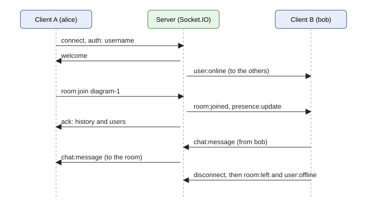

# Lab 7. Real-Time Communication with WebSocket

## 1 Purpose of the Work

To master the WebSocket technology for two-way real-time communication and the Socket.IO library. The work is done for DSLKit, a web editor for diagrams as code: the server gives each diagram its own room where users exchange messages, get notified when someone joins or leaves, and see who has the diagram open and who is editing it.

## 2 Brief Theory

**Limits of HTTP.** In the request-response model the server cannot send data to the client on its own. To learn about a new message the client has to poll the server, which adds load and delay.

**WebSocket.** A connection starts as an ordinary HTTP request with the `Upgrade: websocket` header. The server answers with status 101, and the same TCP connection stays open: both sides send messages at any moment without new headers.

**Socket.IO.** The library sits on top of WebSocket and adds named events with data, delivery acknowledgements, rooms, automatic reconnection and a long polling fallback when WebSocket is unavailable.

**Broadcasting.** There are three ways to send: `socket.emit` to this client only, `socket.broadcast.emit` to everyone except it, and `io.emit` to everyone connected. The `to(room)` method limits recipients to a room.

## 3 Work Progress

### 3.1 How it works

The client and server interact in these steps.

1. The client opens the page, enters a name and calls `io({ auth: { username } })`. The server checks the name in the `io.use` middleware and either rejects or accepts the connection.
2. After the connection the server sends `welcome` to the client and `user:online` to everyone else.
3. The client sends `room:join` with the diagram room name. The server adds the socket to the room, notifies the others with `room:joined`, broadcasts `presence:update` and confirms the join with the history of the latest messages.
4. The client sends `chat:message`, the server saves it to the history and delivers it to everyone in the room. The `typing` event goes to the other members, and `editing` updates the list.
5. When the tab is closed the server receives `disconnect`, removes the user from the rooms and sends `room:left` and `user:offline`.

The exchange sequence is shown in figure 1: the three participants are at the top, and the arrows below show the events in the order they happen, with client A sending to the right and the server answering to the left.



Figure 1 – Event exchange on connect, room join, message and disconnect

### 3.2 Client choice and project structure

The client is plain HTML and JavaScript. The chat page is small and needs no bundler. Express serves it from the `public` folder at the same address as the server, so no CORS headers are needed and the server sends none, and checking the app takes one address opened in two windows. The event protocol does not depend on the client, so a React component for the main project can reuse it unchanged. The project structure is shown in table 1.

Table 1 – Project structure

| File                | Purpose                                                       |
| ------------------- | ------------------------------------------------------------- |
| `server.js`         | Reads `.env`, starts the server on `PORT` or 3000             |
| `src/app.js`        | The `createServer` function: Express, static files, Socket.IO |
| `src/socket.js`     | Handlers of all events                                        |
| `src/validate.js`   | Checks the name, the room name and the message text           |
| `src/history.js`    | Message history: in memory or in MongoDB (swappable store)    |
| `src/token.js`      | Signed login token (HMAC-SHA256, expiry time)                 |
| `src/rate-limit.js` | Message rate limit                                            |
| `public/`           | Client: page, script and styles                               |
| `tests/`            | Tests built on `socket.io-client`                             |

### 3.3 Events

Events and their recipients are listed in table 2.

Table 2 – Protocol events

| Event             | Direction       | Recipients                                 |
| ----------------- | --------------- | ------------------------------------------ |
| `welcome`         | server → client | the connecting user only                   |
| `user:online`     | server → client | everyone except the connecting user        |
| `user:offline`    | server → client | everyone else                              |
| `room:join`       | client → server | answer through an acknowledgement          |
| `room:joined`     | server → client | the other members of the room              |
| `room:leave`      | client → server | answer through an acknowledgement          |
| `room:left`       | server → client | everyone in the room                       |
| `presence:update` | server → client | everyone in the room, with users and flags |
| `chat:message`    | both ways       | everyone in the room, including the author |
| `private:message` | both ways       | the target chosen by `socket.id` only      |
| `typing`          | both ways       | the other members, never stored            |
| `editing`         | client → server | refreshes the list via `presence:update`   |

### 3.4 Extra features

The work includes extras from the assignment and a few of its own.

**Rooms.** A room name matches a diagram, for example `diagram-1`. Messages, notifications and the user list stay inside the room. The name is checked with a regular expression, so a client cannot create a room with a service-like name.

**Who is editing.** For each room the server keeps the list of users with an `editing` flag. Any change of the members or of the flag is sent as `presence:update`, and the client shows an editing mark next to the name.

**History.** The last 50 messages of a room reach a newcomer in the answer to `room:join`. The handlers use only the `add` and `list` methods of the store and wait for them with `await`, so the store is swappable. By default the history lives in memory. When `MONGODB_URI` is set, `server.js` connects the `mongodb` driver, and `createMongoHistory` writes messages to the `messages` collection and reads the last 50 per room, so the history survives a restart. If the database is unavailable the server answers with an acknowledgement error and keeps running. The tests use a small fake collection, and a real database was not started in the tests or while preparing this report.

**Token login.** `POST /login` with the body `{ "username": "..." }` returns a signed token (HMAC-SHA256, valid for one hour). The socket connects with `auth: { token }` and the name is taken from the token. The secret is read from the `TOKEN_SECRET` variable, with a default for local runs and tests. With `REQUIRE_TOKEN=1` sockets without a token are refused. Forged, foreign-secret and expired tokens are refused.

**Private messages.** The `private:message` event takes the recipient `socket.id`, delivers the text to that user only and returns an acknowledgement with a copy to the sender.

**Typing notifications.** The `typing` event goes to the other members of the room and is not stored. The client sends `true` on input and `false` one second after the last key.

**Acknowledgements and limits.** Every event with a reply returns `{ ok, error }`. Text length, message rate and packet size are set in `limits.json`, described in section 3.6. The client renders text with `textContent`, so a message cannot inject markup.

### 3.5 Verification

The work is checked by automated tests: 90 tests start a real server on a free port and connect several `socket.io-client` clients over WebSocket. The scenarios are summarized in table 3. Manual checking uses two browser windows and the steps from the README file.

Table 3 – Automated test scenarios

| Scenario                                        | Expected result                                          |
| ----------------------------------------------- | -------------------------------------------------------- |
| Connect with a valid name                       | `welcome` arrives with the list of connected users       |
| Empty, invalid or taken name                    | the connection is rejected with a clear message          |
| A second client connects and disconnects        | the first one gets `user:online` and `user:offline`      |
| Join a room                                     | history, user list, `room:joined` for the others         |
| Message in a room                               | everyone in the room gets it, other rooms get nothing    |
| Message outside a room, empty, long or too fast | refusal with an error text in the acknowledgement        |
| Fourth message in a row with a limit of three   | refusal `Too many messages, slow down`                   |
| Newcomer after four messages                    | gets only the last three (the history limit in the test) |
| Leave and disconnect                            | `room:left` and an updated user list                     |
| Typing                                          | other members get the event, the sender does not         |
| Editing flag                                    | the list shows the author with `editing`                 |
| Private message                                 | only the target gets it, an unknown target is refused    |
| Client files and `/health`                      | the page and an `ok` answer are served                   |

### 3.6 Input validation and limits

All limits live in a separate `limits.json` file: user name length (24), room name (40), message length (500), history size (50), message rate (5 per 2 seconds) and packet size. The server reads the file at start and serves it to the client at `/limits.json`, so the client and the server use the same numbers.

Three cases are checked. An empty message is rejected. A message of only spaces becomes empty after trimming and is rejected the same way. A message over the limit is rejected, and one of exactly the maximum length is accepted. The client checks whitespace-only text before sending and caps the field with the `maxLength` attribute, and the server repeats the check because a client cannot be trusted. The error comes back in the acknowledgement and shows under the form.

The same rules protect the server from overload. The rate of all events is limited per socket (40 per 2 seconds), a user can join at most 5 rooms, a room holds at most 50 people, and the server accepts at most 200 connections. The number of rooms with history is capped too, so room names invented by a client cannot use memory without end. Control characters and text-direction overrides are removed from message text, and a username counts as taken regardless of letter case. A packet larger than 10,000 bytes closes only the sender's connection.

The handshake is checked against the `Origin` header. A page from another site cannot open a socket on behalf of a visitor, because the server accepts only its own address and the addresses listed in the `ALLOWED_ORIGINS` variable. The value `*` is not used for CORS. Server responses carry the `Content-Security-Policy`, `X-Content-Type-Options`, `X-Frame-Options` and `Referrer-Policy` headers, and an unknown address or a server failure opens styled 404 and 500 pages without the error text.

Each message gets an `at` timestamp when the server receives it. The client shows the date and time with seconds next to the author, so two messages never look the same, and a newcomer sees the time on messages from the history too.

#### 3.7 Answers to the control questions

9. How do you send a private message to a specific user by socket.id?

   Every connection has a unique `socket.id`. The server finds the socket with `io.sockets.sockets.get(id)` and calls `emit` on it, so only the recipient gets the text. The short form `io.to(id).emit(...)` works because each socket automatically joins a room named after its id. In this work the `private:message` event takes `to` and the text and returns an acknowledgement with a copy to the sender. If no socket has that id, the sender gets the error "User not found".

10. How do you implement a message acknowledgement in Socket.IO?

    The last argument of `emit` is a function: `socket.emit('chat:message', data, (reply) => {...})`. On the other side the event handler receives this function as its last parameter and calls it with the answer. The client learns that the server accepted or refused the message and can receive data, for example the history on joining a room. In this work every event with a reply returns an object `{ ok, error }`.

11. How do you scale a Socket.IO application to several servers, for example with Redis? (theoretically)

    Each process knows only its own connections, so a room broadcast does not reach clients on another server. The Redis adapter (`@socket.io/redis-adapter`) forwards events between processes through Redis Pub/Sub, and `io.to(room).emit` reaches everyone. A sticky load balancer is needed too to keep a client on one server during the long polling handshake. Data such as the history and the user list must move from process memory to a shared store.


Listing of server.js is given in appendix A. Listing of app.js is given in appendix B. Listing of socket.js is given in appendix C. Listing of validate.js is given in appendix D. Listing of history.js is given in appendix E. Listing of rate-limit.js is given in appendix F. Listing of client.js is given in appendix G. Listing of index.html is given in appendix H.

## Conclusion

For DSLKit, a server on Express and Socket.IO with an HTML and JavaScript client was built. Users exchange messages in real time, get notifications about connecting, disconnecting, joining a room and leaving it, and for each diagram see the list of people and those who are editing it. On top of that the work adds a history with a MongoDB or in-memory store, login by a signed token, private messages, a typing indicator, acknowledgements and a rate limit. 90 automated tests confirm the behavior of every event. Limits are kept in `limits.json`, and every message carries a timestamp. A run against a real MongoDB and screenshots of two windows are not included.

## Appendix A (mandatory) Listing of server.js

```js
const { createServer } = require('./src/app');

try {
  process.loadEnvFile();
} catch {
  // .env is optional, defaults apply
}

const port = Number(process.env.PORT) || 3000;
// With MONGODB_URI the chat history is kept in MongoDB and survives a restart; without it, in memory.
const start = async () => {
  let history;
  let client;
  if (process.env.MONGODB_URI) {
    const { MongoClient } = require('mongodb');
    const { createMongoHistory } = require('./src/history');
    client = await MongoClient.connect(process.env.MONGODB_URI, { serverSelectionTimeoutMS: 5000 });
    history = createMongoHistory(client.db().collection('messages'));
  }
  if (!process.env.TOKEN_SECRET) console.warn('TOKEN_SECRET is not set, the local development secret is used');
  const { httpServer, io } = createServer({ history });
  httpServer.listen(port, () => console.log(`Server running on http://localhost:${port}`));
  return { io, client };
};

// Ctrl+C and service stops close the sockets first, so clients see a clean disconnect and reconnect later.
start()
  .then(({ io, client }) => {
    const stop = () => io.close(() => (client ? client.close() : Promise.resolve()).finally(() => process.exit(0)));
    process.on('SIGINT', stop);
    process.on('SIGTERM', stop);
  })
  .catch((error) => {
    console.error('Cannot start the server:', error.message);
    process.exit(1);
  });
```

## Appendix B (mandatory) Listing of app.js

```js
const http = require('node:http');
const path = require('node:path');
const express = require('express');
const { Server } = require('socket.io');
const { attachSocket } = require('./socket');
const { limits, cleanName } = require('./validate');
const { parseAllowed, isOriginAllowed } = require('./origin');
const { issueToken } = require('./token');

const publicDir = path.join(__dirname, '..', 'public');

// Headers for every HTTP answer. The script and style policy forbids inline code, so an
// injected tag cannot run even if some text ever reached the page unescaped.
const securityHeaders = (req, res, next) => {
  res.set({
    'Content-Security-Policy':
      "default-src 'self'; script-src 'self'; style-src 'self'; img-src 'self' data:; connect-src 'self' ws: wss:; object-src 'none'; base-uri 'none'; frame-ancestors 'none'; form-action 'self'",
    'X-Content-Type-Options': 'nosniff',
    'X-Frame-Options': 'DENY',
    'Referrer-Policy': 'no-referrer',
  });
  next();
};

// Builds the HTTP server with the static client and Socket.IO on top of it.
// The server is returned unstarted so tests can listen on a free port.
// `allowedOrigins` lists extra sites (besides the server's own address) that may open a socket.
// The token secret comes from TOKEN_SECRET; the default below is for local runs and tests only.
// `requireToken` (REQUIRE_TOKEN=1) refuses sockets that come without a login token.
const DEFAULT_SECRET = 'local-development-secret-do-not-use-in-production';

const createServer = ({
  allowedOrigins = parseAllowed(process.env.ALLOWED_ORIGINS),
  tokenSecret = process.env.TOKEN_SECRET || DEFAULT_SECRET,
  requireToken = process.env.REQUIRE_TOKEN === '1',
  setup,
  ...options
} = {}) => {
  // The built-in secret is public, so a production server must get its own.
  if (process.env.NODE_ENV === 'production' && tokenSecret === DEFAULT_SECRET) throw new Error('TOKEN_SECRET is required when NODE_ENV is production');
  const app = express();
  app.disable('x-powered-by');
  app.use(securityHeaders);
  app.use(express.static(publicDir));
  app.get('/limits.json', (req, res) => res.json(limits));
  app.get('/health', (req, res) => res.json({ status: 'ok' }));
  // Login: a valid name gets a signed token that the socket handshake accepts instead of a plain name.
  app.post('/login', express.json({ limit: '1kb' }), (req, res) => {
    const username = cleanName(req.body?.username);
    if (!username) return res.status(400).json({ error: `A username of 1-${limits.nameMaxLength} letters, digits, dots, dashes or underscores is required` });
    res.json({ username, token: issueToken(username, tokenSecret) });
  });
  // Known paths with another method answer 405 and say which methods they accept.
  app.all('/login', (req, res) => res.set('Allow', 'POST').status(405).type('text').send('Method not allowed'));
  app.all('/health', (req, res) => res.set('Allow', 'GET').status(405).type('text').send('Method not allowed'));
  setup?.(app);

  // 404 and 500 pages use the same styles as the rest of the site; the error text never reaches the browser.
  app.use((req, res) => res.status(404).sendFile('404.html', { root: publicDir }));
  // eslint-disable-next-line no-unused-vars
  app.use((err, req, res, next) => {
    const status = err.status >= 400 && err.status < 500 ? err.status : 500;
    if (status === 500) return res.status(500).sendFile('500.html', { root: publicDir });
    res.status(status).type('text').send('Bad request');
  });

  const httpServer = http.createServer(app);
  const io = new Server(httpServer, {
    // Without extra origins no CORS headers are sent at all: only the page served by this server can talk to it.
    cors: allowedOrigins.length ? { origin: allowedOrigins } : false,
    allowRequest: (req, callback) => callback(null, isOriginAllowed(req.headers.origin, req.headers.host, allowedOrigins)),
    maxHttpBufferSize: limits.maxPacketBytes,
  });
  attachSocket(io, { ...options, tokenSecret, requireToken });
  return { app, httpServer, io };
};

module.exports = { createServer };
```

## Appendix C (mandatory) Listing of socket.js

```js
const { cleanName, cleanRoom, cleanText, limits } = require('./validate');
const { createHistory } = require('./history');
const { createLimiter } = require('./rate-limit');
const { verifyToken } = require('./token');

const fail = (ack, error) => {
  if (typeof ack === 'function') ack({ ok: false, error });
};
const succeed = (ack, data = {}) => {
  if (typeof ack === 'function') ack({ ok: true, ...data });
};

// The state shared by every connection. `rooms` maps a diagram room to the users inside it,
// so the "who is editing" list needs no extra queries.
const createHub = (io, opts) => {
  // `history` can be injected (for example the MongoDB one); the default keeps messages in memory.
  const history = opts.history ?? createHistory(opts.historyLimit, opts.historyMaxRooms);
  const rooms = new Map();
  const online = new Map(); // socket id -> { id, username }
  const perAddress = new Map(); // client address -> number of open sockets
  let messageSeq = 0;
  const usersOf = (room) => [...(rooms.get(room)?.values() ?? [])];
  const onlineList = () => [...online.values()];
  return {
    io,
    opts,
    history,
    rooms,
    online,
    usersOf,
    onlineList,
    publishPresence: (room) => io.to(room).emit('presence:update', { room, users: usersOf(room) }),
    makeMessage: (user, text, extra) => ({ id: ++messageSeq, from: user.username, fromId: user.id, text, at: Date.now(), ...extra }),
    perAddress,
    isTaken: (username) => onlineList().some((u) => u.username.toLowerCase() === username.toLowerCase()),
  };
};

// Handshake: the name comes from a signed login token (`auth.token`, issued by POST /login) or, when
// tokens are not required, from `auth.username`. Every later event knows who sent it.
const createHandshake = (hub) => (socket, next) => {
  const { opts } = hub;
  const { token, username: plain } = socket.handshake.auth ?? {};
  let given = plain;
  if (token !== undefined) {
    given = verifyToken(token, opts.tokenSecret);
    if (!given) return next(new Error('Invalid or expired token, log in again'));
  } else if (opts.requireToken) {
    return next(new Error('A login token is required'));
  }
  const username = cleanName(given);
  if (!username) return next(new Error(`A username of 1-${limits.nameMaxLength} letters, digits, dots, dashes or underscores is required`));
  if (hub.isTaken(username)) return next(new Error('This username is already taken'));
  if (hub.online.size >= opts.maxUsers) return next(new Error('The server is full, try again later'));
  // One client cannot take all the places of the server.
  if ((hub.perAddress.get(socket.handshake.address) ?? 0) >= opts.maxPerAddress) return next(new Error('Too many connections from your address'));
  socket.data.username = username;
  next();
};

// Room membership and presence of one connected socket. `conn` holds what belongs to this socket only.
const createRoomActions = (hub, conn) => {
  const { io, opts, history, rooms } = hub;
  const { socket, user, joined } = conn;

  const leave = (room) => {
    joined.delete(room);
    socket.leave(room);
    rooms.get(room)?.delete(socket.id);
    if (rooms.get(room)?.size === 0) rooms.delete(room);
    io.to(room).emit('room:left', { room, username: user.username, at: Date.now() });
    io.to(room).emit('typing', { room, username: user.username, typing: false });
    hub.publishPresence(room);
  };

  const join = async (payload, ack) => {
    const room = cleanRoom(payload?.room);
    if (!room) return fail(ack, 'Invalid room name');
    if (joined.has(room)) return fail(ack, 'Already in this room');
    if (joined.size >= opts.maxRoomsPerUser) return fail(ack, `You can be in at most ${opts.maxRoomsPerUser} rooms`);
    if ((rooms.get(room)?.size ?? 0) >= opts.maxRoomMembers) return fail(ack, 'This room is full');
    let past;
    try {
      past = await history.list(room);
    } catch (error) {
      console.error('history unavailable:', error.message);
      return fail(ack, 'History is unavailable, try again later');
    }
    if (joined.has(room) || !socket.connected) return fail(ack, 'Already in this room');
    joined.add(room);
    socket.join(room);
    if (!rooms.has(room)) rooms.set(room, new Map());
    rooms.get(room).set(socket.id, user);
    socket.to(room).emit('room:joined', { room, username: user.username, at: Date.now() });
    hub.publishPresence(room);
    succeed(ack, { room, history: past, users: hub.usersOf(room) });
  };

  const leaveRoom = (payload, ack) => {
    const room = cleanRoom(payload?.room);
    if (!room || !joined.has(room)) return fail(ack, 'Not in this room');
    leave(room);
    succeed(ack, { room });
  };

  // "Who is editing": a user marks the diagram of a room as being edited right now.
  const editing = (payload, ack) => {
    const room = cleanRoom(payload?.room);
    if (!room || !joined.has(room)) return fail(ack, 'Join the room first');
    user.editing = Boolean(payload.editing);
    hub.publishPresence(room);
    succeed(ack, { editing: user.editing });
  };

  const typing = (payload) => {
    const room = cleanRoom(payload?.room);
    if (room && joined.has(room)) socket.to(room).emit('typing', { room, username: user.username, typing: Boolean(payload.typing) });
  };

  return { leave, join, leaveRoom, editing, typing };
};

// Chat messages: to a room and private.
const createMessageActions = (hub, conn) => {
  const { io, history } = hub;
  const { socket, user, joined, allowed } = conn;

  const toRoom = async (payload, ack) => {
    const room = cleanRoom(payload?.room);
    const text = cleanText(payload?.text);
    if (!room || !joined.has(room)) return fail(ack, 'Join the room first');
    if (!text) return fail(ack, `Message must be 1-${limits.textMaxLength} characters`);
    if (!allowed()) return fail(ack, 'Too many messages, slow down');
    const message = hub.makeMessage(user, text, { room });
    try {
      await history.add(room, message);
    } catch (error) {
      console.error('message was not saved:', error.message);
      return fail(ack, 'The message could not be saved, try again later');
    }
    io.to(room).emit('chat:message', message);
    succeed(ack, { id: message.id });
  };

  // Private message by socket id, delivered only to the target and echoed to the sender.
  // The sender is always taken from the connection, never from the payload.
  const toUser = (payload, ack) => {
    const text = cleanText(payload?.text);
    const target = typeof payload?.to === 'string' ? io.sockets.sockets.get(payload.to) : undefined;
    if (!target) return fail(ack, 'User not found');
    if (target.id === socket.id) return fail(ack, 'You cannot send a private message to yourself');
    if (!text) return fail(ack, `Message must be 1-${limits.textMaxLength} characters`);
    if (!allowed()) return fail(ack, 'Too many messages, slow down');
    const message = hub.makeMessage(user, text, { to: target.id, toName: target.data.username });
    target.emit('private:message', message);
    succeed(ack, { message });
  };

  return { toRoom, toUser };
};

const handleConnection = (hub, socket) => {
  const { opts } = hub;
  const user = { id: socket.id, username: socket.data.username, editing: false };
  const conn = { socket, user, joined: new Set(), allowed: createLimiter(opts.rateMax, opts.rateWindowMs) };
  const eventAllowed = createLimiter(opts.eventRateMax, opts.eventRateWindowMs);
  hub.online.set(socket.id, { id: user.id, username: user.username });
  const address = socket.handshake.address;
  hub.perAddress.set(address, (hub.perAddress.get(address) ?? 0) + 1);

  // Flood guard for every event (join, typing, editing...); chat messages have their own, stricter limit.
  socket.use((packet, next) => {
    if (eventAllowed()) return next();
    fail(packet.at(-1), 'Too many requests, slow down');
  });

  // Handlers of one socket run one after another, so a leave sent right after a join waits for the history.
  let tail = Promise.resolve();
  const on = (event, handler) =>
    socket.on(event, (...args) => {
      tail = tail.then(() => handler(...args)).catch((error) => console.error(event, error.message));
    });

  socket.emit('welcome', { id: user.id, username: user.username, online: hub.onlineList() });
  socket.broadcast.emit('user:online', { id: user.id, username: user.username, at: Date.now() });

  const roomActions = createRoomActions(hub, conn);
  const messageActions = createMessageActions(hub, conn);
  on('room:join', roomActions.join);
  on('room:leave', roomActions.leaveRoom);
  on('chat:message', messageActions.toRoom);
  on('private:message', messageActions.toUser);
  on('typing', roomActions.typing);
  on('editing', roomActions.editing);

  // Cleanup: leave every room, forget the user and tell the others. Nothing is kept per socket afterwards.
  socket.on('disconnect', () => {
    [...conn.joined].forEach(roomActions.leave);
    hub.online.delete(socket.id);
    const left = (hub.perAddress.get(address) ?? 1) - 1;
    if (left > 0) hub.perAddress.set(address, left);
    else hub.perAddress.delete(address);
    socket.broadcast.emit('user:offline', { id: user.id, username: user.username, at: Date.now() });
  });
};

// Wires all Socket.IO events.
const attachSocket = (io, overrides = {}) => {
  const hub = createHub(io, { ...limits, ...overrides });
  io.use(createHandshake(hub));
  io.on('connection', (socket) => handleConnection(hub, socket));
};

module.exports = { attachSocket };
```

## Appendix D (mandatory) Listing of validate.js

```js
const limits = require('../limits.json');

const NAME_RE = new RegExp(String.raw`^[\p{L}\p{N}_.-]{1,${limits.nameMaxLength}}$`, 'u');
const ROOM_RE = new RegExp(`^[a-z0-9][a-z0-9_-]{0,${limits.roomMaxLength - 1}}$`, 'i');
// C0/C1 control characters except new line and tab, plus the bidirectional overrides that can flip the text around a name.
const HIDDEN_RE = /[\u0000-\u0008\u000b-\u001f\u007f-\u009f\u202a-\u202e\u2066-\u2069]/g;

const cleanName = (value) => (typeof value === 'string' && NAME_RE.test(value.trim()) ? value.trim() : null);

// Room names are case-insensitive: "Diagram-1" and "diagram-1" are the same room.
const cleanRoom = (value) => (typeof value === 'string' && ROOM_RE.test(value) ? value.toLowerCase() : null);

// A whitespace-only text trims to an empty string and is rejected like an empty one.
const cleanText = (value) => {
  if (typeof value !== 'string' || value.length > limits.textMaxLength * 2) return null;
  const text = value.replace(HIDDEN_RE, '').trim();
  return text.length > 0 && text.length <= limits.textMaxLength ? text : null;
};

module.exports = { cleanName, cleanRoom, cleanText, limits };
```

## Appendix E (mandatory) Listing of history.js

```js
// Message history, one capped list per room. The socket handlers only use `add` and `list` and
// wait for both with `await`, so any store with these two methods can be plugged in: the in-memory
// one below, or the MongoDB one. The number of rooms is capped in memory, otherwise a client
// inventing room names could grow the memory without limit.
const createHistory = (limit = 50, maxRooms = 200) => {
  const rooms = new Map();
  return {
    add(room, message) {
      const list = rooms.get(room) ?? [];
      list.push(message);
      if (list.length > limit) list.shift();
      rooms.delete(room); // re-insert so the most recently used room is the last one
      rooms.set(room, list);
      if (rooms.size > maxRooms) rooms.delete(rooms.keys().next().value);
    },
    list(room) {
      return [...(rooms.get(room) ?? [])];
    },
  };
};

// History in a MongoDB collection (the object returned by `db.collection('messages')` of the
// official driver). Only insertOne and find(...).sort(...).limit(...).toArray() are used, so tests
// can pass a small fake collection and need no database.
const createMongoHistory = (collection, limit = 50) => ({
  async add(room, message) {
    await collection.insertOne({ ...message, room });
  },
  async list(room) {
    const newest = await collection.find({ room }).sort({ _id: -1 }).limit(limit).toArray();
    // Newest first in the query, oldest first for the client; the database id stays inside.
    return newest.reverse().map(({ _id, ...message }) => message);
  },
});

module.exports = { createHistory, createMongoHistory };
```

## Appendix F (mandatory) Listing of rate-limit.js

```js
// Sliding window: at most `max` events per `windowMs` for one socket.
const createLimiter = (max, windowMs, now = Date.now) => {
  let stamps = [];
  return () => {
    const t = now();
    stamps = stamps.filter((s) => t - s < windowMs);
    if (stamps.length >= max) return false;
    stamps.push(t);
    return true;
  };
};

module.exports = { createLimiter };
```

## Appendix G (mandatory) Listing of client.js

```js
/* global io */
const $ = (id) => document.getElementById(id);

let socket = null;
let me = null;
let currentRoom = null;
let privateTo = null; // { id, name } while a private message is being written
let online = []; // [{ id, username }]
let members = []; // [{ id, username, editing }]
let limits = { nameMaxLength: 24, roomMaxLength: 40, textMaxLength: 500 };
let lastTypingSent = 0;
let typingStopTimer;
const typingUsers = new Map(); // username -> timer that hides the "is typing" note

// Every piece of text from the network goes through textContent, never parsed as markup,
// so a name or a message can not inject HTML. A test scans this file for the HTML-parsing APIs.
const el = (tag, className, text) => {
  const node = document.createElement(tag);
  if (className) node.className = className;
  if (text !== undefined) node.textContent = text;
  return node;
};

// Full date and time, so two messages never look the same.
const time = (at) => new Date(at).toLocaleString();

const nameRe = () => new RegExp(String.raw`^[\p{L}\p{N}_.-]{1,${limits.nameMaxLength}}$`, 'u');
const roomRe = () => new RegExp(`^[a-z0-9][a-z0-9_-]{0,${limits.roomMaxLength - 1}}$`, 'i');

const setText = (id, message = '') => ($(id).textContent = message);
const check = (id) => (reply) => setText(id, reply?.ok ? '' : (reply?.error ?? 'No answer from the server'));

const addLine = ({ className = '', author, at, text, room }) => {
  const li = el('li', `message ${className}`.trim());
  if (room) li.dataset.room = room;
  if (author) li.append(el('strong', '', `${author}: `));
  li.append(el('span', '', text));
  if (at) {
    const stamp = el('time', '', ` ${time(at)}`);
    stamp.dateTime = new Date(at).toISOString();
    li.append(stamp);
  }
  const log = $('log');
  const stick = log.scrollTop + log.clientHeight >= log.scrollHeight - 8;
  log.append(li);
  while (log.children.length > 300) log.firstChild.remove(); // the page keeps a bounded number of lines
  if (stick) log.scrollTop = log.scrollHeight;
};
const system = (text) => addLine({ className: 'message--system', text });
const addChat = (m) => addLine({ author: m.from, at: m.at, text: m.text, room: m.room });

const renderPeople = (list, users, withActions) => {
  list.replaceChildren();
  if (!users.length) list.append(el('li', 'people__item people__empty', 'Nobody'));
  users.forEach((u) => {
    const li = el('li', 'people__item');
    li.append(el('span', '', u.editing ? `${u.username} (editing)` : u.username));
    if (withActions && u.id !== me?.id) {
      const button = el('button', 'button button--quiet button--icon live__icon');
      button.type = 'button';
      button.dataset.tip = 'Private message';
      button.setAttribute('aria-label', `Write a private message to ${u.username}`);
      button.append(envelope());
      button.addEventListener('click', () => setTarget({ id: u.id, name: u.username }));
      li.append(button);
    }
    list.append(li);
  });
};

// A small envelope drawn with DOM calls, so no markup string is parsed.
const envelope = () => {
  const ns = 'http://www.w3.org/2000/svg';
  const svg = document.createElementNS(ns, 'svg');
  svg.setAttribute('class', 'icon');
  svg.setAttribute('viewBox', '0 0 20 20');
  svg.setAttribute('fill', 'none');
  svg.setAttribute('stroke', 'currentColor');
  svg.setAttribute('stroke-width', '1.5');
  svg.setAttribute('aria-hidden', 'true');
  svg.setAttribute('focusable', 'false');
  const path = document.createElementNS(ns, 'path');
  path.setAttribute('d', 'M3 5h14v10H3zM3 6l7 5 7-5');
  svg.append(path);
  return svg;
};

const renderOnline = () => renderPeople($('online'), online, true);
const renderMembers = () => renderPeople($('members'), members, false);

const setTarget = (target) => {
  privateTo = target;
  $('target').hidden = !target;
  $('target-name').textContent = target ? target.name : '';
  $('text').focus();
};

const setConnection = (text) => ($('conn').textContent = text);

const showTyping = () => {
  const names = [...typingUsers.keys()];
  $('typing').textContent = names.length ? `${names.join(', ')} ${names.length > 1 ? 'are' : 'is'} typing...` : '';
};

const joinRoom = (room, { rejoin = false } = {}) =>
  socket.emit('room:join', { room }, (reply) => {
    check('room-error')(reply);
    if (!reply?.ok) {
      if (rejoin) currentRoom = null;
      return;
    }
    currentRoom = reply.room;
    $('room').value = reply.room;
    members = reply.users;
    renderMembers();
    // Re-render the room history instead of appending it, so a rejoin after a lost connection never shows a message twice.
    $('log')
      .querySelectorAll('[data-room]')
      .forEach((node) => node.remove());
    reply.history.forEach(addChat);
    system(rejoin ? `Back in ${reply.room}` : `You joined ${reply.room}`);
  });

const bind = (s) => {
  s.on('welcome', ({ id, username, online: list }) => {
    me = { id, username };
    online = list;
    $('me').textContent = username;
    $('login').hidden = true;
    $('workspace').hidden = false;
    renderOnline();
    setConnection('Connected');
  });
  s.on('user:online', (u) => {
    online = [...online.filter((x) => x.id !== u.id), { id: u.id, username: u.username }];
    renderOnline();
    system(`${u.username} connected`);
  });
  s.on('user:offline', (u) => {
    online = online.filter((x) => x.id !== u.id);
    if (privateTo?.id === u.id) setTarget(null);
    renderOnline();
    system(`${u.username} disconnected`);
  });
  s.on('room:joined', ({ username, room }) => system(`${username} joined ${room}`));
  s.on('room:left', ({ username, room }) => system(`${username} left ${room}`));
  s.on('presence:update', ({ room, users }) => {
    if (room !== currentRoom) return;
    members = users;
    renderMembers();
  });
  s.on('chat:message', (m) => m.room === currentRoom && addChat(m));
  s.on('private:message', (m) => addLine({ className: 'message--private', author: `${m.from} (private)`, at: m.at, text: m.text }));
  s.on('typing', ({ room, username, typing }) => {
    if (room !== currentRoom) return;
    clearTimeout(typingUsers.get(username));
    typingUsers.delete(username);
    // If the "stopped" event is lost, the note disappears by itself after three seconds.
    if (typing)
      typingUsers.set(
        username,
        setTimeout(() => (typingUsers.delete(username), showTyping()), 3000),
      );
    showTyping();
  });
  s.on('disconnect', (reason) => {
    setConnection('Reconnecting...');
    setText('status', reason === 'io server disconnect' ? 'The server closed the connection.' : 'Connection lost, trying to reconnect...');
    typingUsers.forEach(clearTimeout);
    typingUsers.clear();
    showTyping();
  });
  // Fires after the first connection and after every automatic reconnection: the room is joined again.
  s.on('connect', () => {
    setText('status');
    if (currentRoom) joinRoom(currentRoom, { rejoin: true });
  });
  s.on('connect_error', (error) => {
    if (!me) {
      setText('login-error', error.message);
      s.close();
      return;
    }
    // After a restart the old connection may still be registered for a moment: try again instead of giving up.
    setText('status', error.message);
    if (!s.active) setTimeout(() => s.connect(), 2000);
  });
};

$('login').addEventListener('submit', async (event) => {
  event.preventDefault();
  const username = $('username').value.trim();
  if (!username) return setText('login-error', 'Enter a name, spaces alone are not a name');
  if (!nameRe().test(username)) return setText('login-error', `Use 1-${limits.nameMaxLength} letters, digits, dots, dashes or underscores`);
  setText('login-error');
  socket?.close(); // a second submit never leaves a second connection behind
  try {
    // The server signs the name into a token; the socket then proves who it is with the token.
    const reply = await fetch('/login', { method: 'POST', headers: { 'Content-Type': 'application/json' }, body: JSON.stringify({ username }) });
    const data = await reply.json();
    if (!reply.ok) return setText('login-error', data.error ?? 'Login failed');
    socket = io({ auth: { token: data.token } });
    bind(socket);
  } catch {
    setText('login-error', 'The server is not reachable');
  }
});

$('room-form').addEventListener('submit', (event) => {
  event.preventDefault();
  const room = $('room').value.trim();
  if (!roomRe().test(room)) return setText('room-error', `Room name: 1-${limits.roomMaxLength} letters, digits, dashes or underscores`);
  setText('room-error');
  joinRoom(room.toLowerCase());
});

$('leave').addEventListener('click', () => {
  socket.emit('room:leave', { room: currentRoom }, (reply) => {
    check('room-error')(reply);
    if (!reply?.ok) return;
    system(`You left ${currentRoom}`);
    currentRoom = null;
    members = [];
    renderMembers();
    $('editing').checked = false;
    typingUsers.clear();
    showTyping();
  });
});

$('editing').addEventListener('change', (event) => socket.emit('editing', { room: currentRoom, editing: event.target.checked }, check('status')));
$('target-clear').addEventListener('click', () => setTarget(null));

$('text').addEventListener('input', () => {
  if (!currentRoom) return;
  const now = Date.now();
  if (now - lastTypingSent > 1500) {
    lastTypingSent = now;
    socket.emit('typing', { room: currentRoom, typing: true });
  }
  clearTimeout(typingStopTimer);
  typingStopTimer = setTimeout(() => {
    lastTypingSent = 0;
    socket.emit('typing', { room: currentRoom, typing: false });
  }, 1000);
});

$('chat-form').addEventListener('submit', (event) => {
  event.preventDefault();
  const text = $('text').value;
  if (!text.trim()) return setText('status', 'Message must not be empty or only spaces');
  if (text.trim().length > limits.textMaxLength) return setText('status', `Message must be at most ${limits.textMaxLength} characters`);
  if (!privateTo && !currentRoom) return setText('status', 'Join a room first');
  const done = (reply) => {
    check('status')(reply);
    if (!reply?.ok) return;
    $('text').value = '';
    if (reply.message)
      addLine({ className: 'message--private', author: `You to ${reply.message.toName} (private)`, at: reply.message.at, text: reply.message.text });
  };
  if (privateTo) socket.emit('private:message', { to: privateTo.id, text }, done);
  else socket.emit('chat:message', { room: currentRoom, text }, done);
});

// The same limits as on the server: limits.json is served at /limits.json.
fetch('/limits.json')
  .then((r) => r.json())
  .then((loaded) => {
    limits = { ...limits, ...loaded };
    $('text').maxLength = limits.textMaxLength;
    $('username').maxLength = limits.nameMaxLength;
    $('room').maxLength = limits.roomMaxLength;
  })
  .catch(() => {}); // the defaults above stay in place when the file can not be loaded
```

## Appendix H (mandatory) Listing of index.html

```html
<!doctype html>
<html lang="en">
  <head>
    <meta charset="utf-8" />
    <meta name="viewport" content="width=device-width, initial-scale=1" />
    <meta name="description" content="DSLKit live rooms: chat, who is online and who is editing a diagram." />
    <meta name="theme-color" content="#2563eb" />
    <title>Live rooms — DSLKit</title>
    <link rel="icon" href="favicon.svg" type="image/svg+xml" />
    <link rel="stylesheet" href="dslkit.css" />
    <link rel="stylesheet" href="style.css" />
    <script src="theme.js"></script>
  </head>
  <body class="page">
    <a class="skip-link" href="#main">Skip to the main content</a>
    <header class="header">
      <div class="header__inner">
        <a class="header__logo" href="/">
          
          <span class="header__logo-text">DSLKit</span>
        </a>
        <input class="burger__input" type="checkbox" id="burger-toggle" />
        <label class="burger__button" for="burger-toggle">
          <span class="burger__label">Menu</span>
          <span class="burger__icon" aria-hidden="true"></span>
        </label>
        <nav class="nav" aria-label="Main navigation">
          <ul class="nav__list">
            <li class="nav__item"><a class="nav__link" href="#chat-title">Chat</a></li>
            <li class="nav__item"><a class="nav__link" href="#people-title">People</a></li>
          </ul>
        </nav>
        <div class="header__tools">
          <input class="theme__input" type="checkbox" id="theme-toggle" />
          <label class="theme__button" for="theme-toggle" title="Dark theme"
            ><svg class="theme__icon theme__icon--moon" viewBox="0 0 24 24" width="20" height="20" aria-hidden="true" focusable="false">
              <path fill="none" stroke="currentColor" stroke-width="2" stroke-linecap="round" stroke-linejoin="round" d="M21 12.8A9 9 0 1 1 11.2 3a7 7 0 0 0 9.8 9.8Z" /></svg
            ><svg class="theme__icon theme__icon--sun" viewBox="0 0 24 24" width="20" height="20" aria-hidden="true" focusable="false">
              <circle cx="12" cy="12" r="4" fill="none" stroke="currentColor" stroke-width="2" />
              <path
                fill="none"
                stroke="currentColor"
                stroke-width="2"
                stroke-linecap="round"
                d="M12 2v2M12 20v2M4.9 4.9l1.4 1.4M17.7 17.7l1.4 1.4M2 12h2M20 12h2M4.9 19.1l1.4-1.4M17.7 6.3l1.4-1.4"
              /></svg
            ><span class="theme__label">Dark theme</span></label
          >
        </div>
      </div>
    </header>

    <main class="main" id="main">
      <h1 class="live__title">Live rooms</h1>
      <p class="live__lead">Every diagram has its own room. Talk to the people who have it open and see who is editing it right now.</p>

      <form id="login" class="form" novalidate>
        <div class="form__field">
          <label class="form__label" for="username">Username</label>
          <input class="form__input" id="username" name="username" maxlength="24" autocomplete="off" aria-describedby="username-hint login-error" required />
          <p class="form__hint" id="username-hint">Up to 24 letters, digits, dots, dashes or underscores.</p>
          <p class="form__error" id="login-error" role="alert"></p>
        </div>
        <div class="actions">
          <button class="button button--primary" type="submit">Connect</button>
        </div>
      </form>

      <div id="workspace" class="live" hidden>
        <section class="live__people form" aria-labelledby="people-title">
          <h2 class="live__heading" id="people-title">People</h2>
          <p class="live__me">You are <strong id="me"></strong></p>
          <h3 class="live__subheading">Online</h3>
          <ul id="online" class="people"></ul>
          <h3 class="live__subheading">In this room</h3>
          <ul id="members" class="people"></ul>
          <div class="form__field form__field--checkbox">
            <input class="form__checkbox" type="checkbox" id="editing" />
            <label class="form__label" for="editing">I am editing this diagram</label>
          </div>
        </section>

        <section class="live__chat form" aria-labelledby="chat-title">
          <div class="live__bar">
            <h2 class="live__heading" id="chat-title">Chat</h2>
            <span class="badge" id="conn" role="status">Connected</span>
          </div>
          <form id="room-form" class="live__row" novalidate>
            <label class="visually-hidden" for="room">Diagram room</label>
            <input class="form__input" id="room" value="diagram-1" maxlength="40" autocomplete="off" />
            <button class="button" type="submit">Join</button>
            <button class="button button--quiet button--icon live__icon" type="button" id="leave" data-tip="Leave the room" aria-label="Leave the room">
              <svg class="icon" aria-hidden="true" focusable="false" viewBox="0 0 20 20" fill="none" stroke="currentColor" stroke-width="1.5">
                <path d="M8 4H4v12h4M12 6l4 4-4 4M16 10H8" />
              </svg>
            </button>
          </form>
          <p class="form__error" id="room-error" role="alert"></p>

          <ul id="log" class="log" aria-live="polite" aria-label="Messages"></ul>
          <p class="form__hint" id="typing" aria-live="polite"></p>

          <form id="chat-form" class="live__send" novalidate>
            <p class="live__target" id="target" hidden>
              <span>Private to <strong id="target-name"></strong></span>
              <button class="button button--quiet button--icon live__icon" type="button" id="target-clear" data-tip="Write to the room" aria-label="Write to the room instead">
                <svg class="icon" aria-hidden="true" focusable="false" viewBox="0 0 20 20" fill="none" stroke="currentColor" stroke-width="1.5">
                  <path d="M5 5l10 10M15 5L5 15" />
                </svg>
              </button>
            </p>
            <div class="live__row">
              <label class="visually-hidden" for="text">Message</label>
              <input class="form__input" id="text" maxlength="500" autocomplete="off" placeholder="Message" />
              <button class="button button--primary" type="submit">Send</button>
            </div>
            <p class="form__error" id="status" role="alert"></p>
          </form>
        </section>
      </div>
    </main>

    <footer class="footer">
      <div class="footer__inner">
        <p class="footer__copy"><small>© 2026 DSLKit. Lab 7: real time with WebSocket.</small></p>
      </div>
    </footer>
    <script src="/socket.io/socket.io.js"></script>
    <script src="client.js"></script>
  </body>
</html>
```
