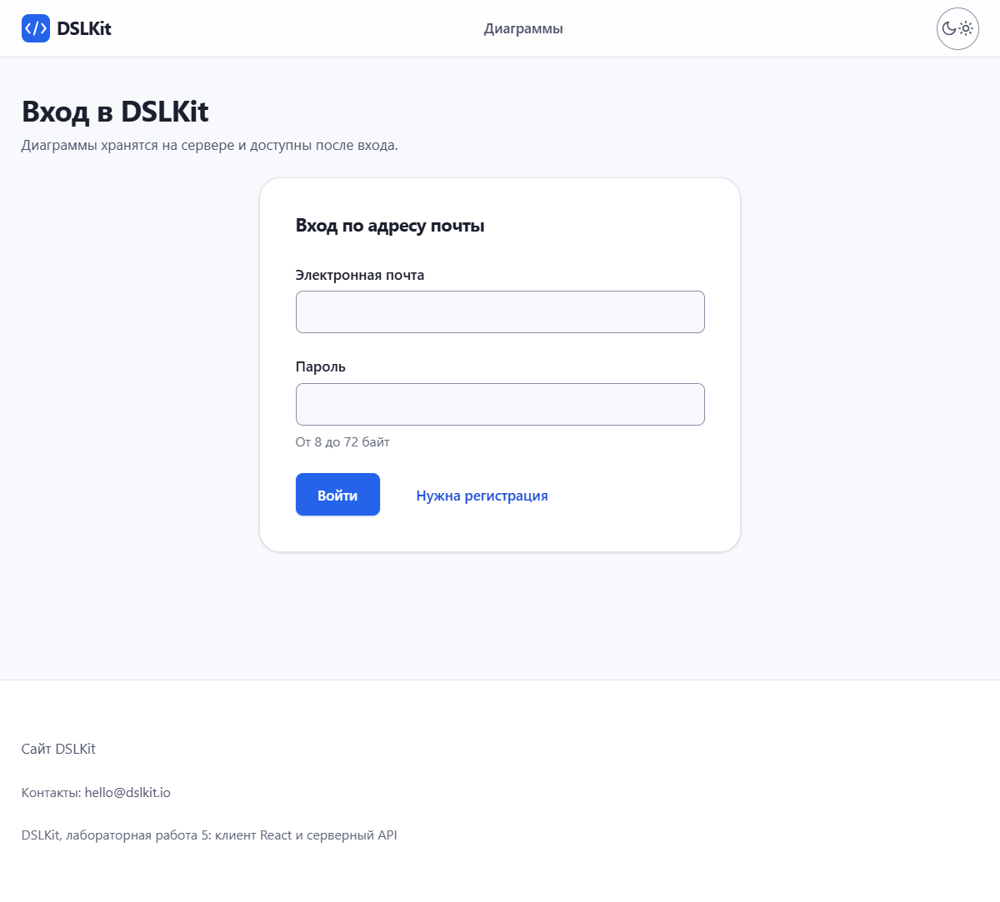
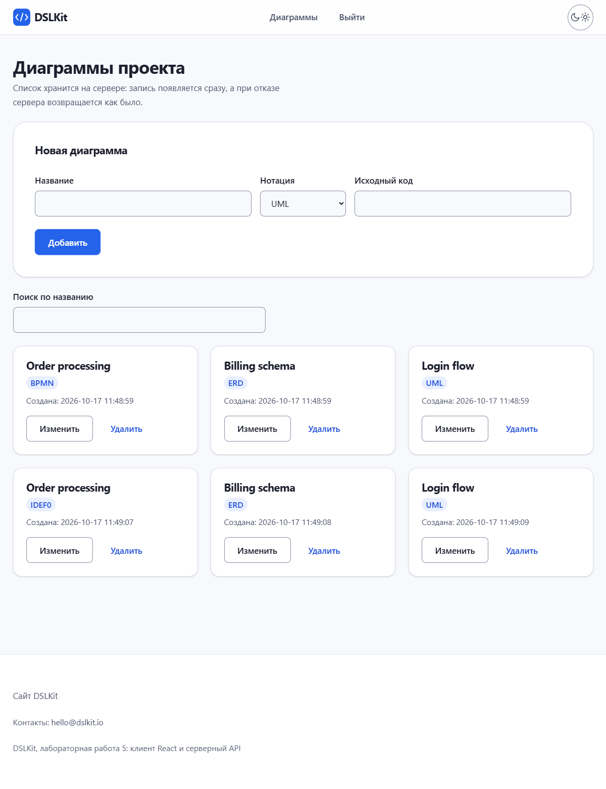
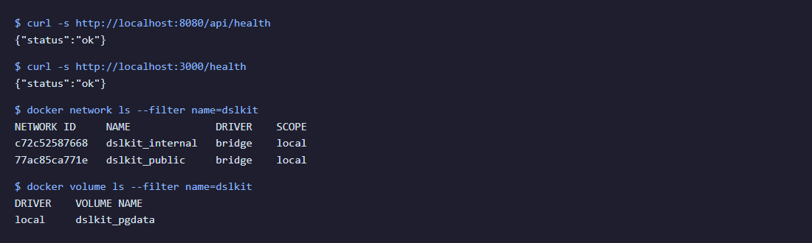

# Laboratory Work No. 8. Containerization of an Application with Docker

## 1 Purpose of the Work

To master containerization: describe the server and client images in Dockerfiles, build them and run them together with a database by one Docker Compose command. The packaged application is DSLKit, a web editor for diagrams as code (SaaS direction): the server with authentication from laboratory work 3, the React client from laboratory work 5 and a PostgreSQL database. This is the deployment base of the future course project.

## 2 Brief Theoretical Background

**Image and container.** An image consists of immutable file system layers and a start description. A container is a running instance of an image with a thin writable layer, so everything written inside a container is lost when the container is removed.

**Dockerfile.** The file lists build instructions: `FROM` picks the base image, `WORKDIR` sets the folder, `COPY` moves files, `RUN` runs a command at build time, `EXPOSE` documents a port and `CMD` sets the start command. Each instruction creates a layer and unchanged layers come from the cache, so dependency files are copied before the source code.

**Multi-stage build.** One Dockerfile has several `FROM` instructions. The first stage builds the project with all tools, and `COPY --from=builder` moves only the result into the final image. Node.js and the client sources do not reach the final image.

**Networks and volumes.** Containers in one Compose network find each other by service name. A volume lives outside the container and keeps the database data when the container is recreated.

**Docker Compose.** The `docker-compose.yml` file describes services, networks, volumes and the start order. The `docker compose up --build` command builds the images and starts the whole application.

## 3 Work Progress

### 3.1 Application structure

The application has three services. The `db` service runs PostgreSQL 16, the `backend` service is built from the server of laboratory work 3 and the `frontend` service is built from the client of laboratory work 5. The application code was not copied: Compose points to their folders as the build context and the Docker files live in the `part-2/lab-08-docker` folder. The application starts with `docker compose up --build`, after `.env.example` is copied to `.env` and filled in. The images build without errors and the containers run, as figure 1 shows.


Figure 1 – Three running containers with the healthy status, the docker ps command

### 3.2 Server Dockerfile

The server image is built in two stages, the listing is given in Appendix A. The first stage runs `npm ci --omit=dev` and installs only production dependencies. The native modules bcrypt and sqlite3 come prebuilt for Alpine, so no compiler is needed. The second stage copies the `node_modules` folder and the source code into a clean image without the npm cache. The `Dockerfile.dockerignore` file excludes tests, reports, `.env` and local databases, so secrets and extra files do not get into the image.

The process runs as the `node` user, not as root. On start the Sequelize migrations run, then the idempotent administrator seed, which is skipped without the `ADMIN_EMAIL` and `ADMIN_PASSWORD` variables, and then the server starts. The tables appear in an empty database by themselves.

### 3.3 Client Dockerfile

The client image is built in two stages too, the listing is given in Appendix B. The `builder` stage installs dependencies and runs `npm run build`. The server address is set to `/api` at build time, so the browser calls the same address the page was opened from and CORS is not needed. The final image is based on `nginx-unprivileged`: it holds only Nginx and the `dist` folder, and the process runs as an ordinary user on port 8080. The client image is about 74 MB and the server image about 313 MB.

### 3.4 The docker-compose.yml file

The listing is given in Appendix C. Containers talk by service name: the server connects to the database at `db:5432` and Nginx forwards requests to `backend:3000`. The database keeps its data in the named volume `pgdata`, so recreating the container does not erase it. This was checked: after `docker compose restart db` the users stayed in the table. The start order is set with `service_healthy` conditions: the server waits for the database and the client waits for the server.

The application opens at `http://localhost:8080`. Port 80 is not used because it is often taken on work machines, and the value is changed with the `FRONTEND_PORT` variable. The task text names ports 80 and 5000, they are obtained with `FRONTEND_PORT=80` and `BACKEND_PORT=5000` in `.env`. The stack is stopped with `docker compose down`, the containers stay listed by `docker ps` until then, and `docker compose down -v` removes the `pgdata` volume with the database data. The result is shown in figure 2.



Figure 2 – The client from the Nginx container at localhost:8080

To check the whole chain, a user and three diagrams are created through the API, and the list is shown in figure 3. The requests go through the Nginx proxy into the server container and from there into the PostgreSQL database.



Figure 3 – List of diagrams received from PostgreSQL through Nginx and the server

### 3.5 Additional requirements

Eight additional requirements from the task list and several security measures are done.

1. **Environment variables.** The connection string, the database password and the JWT secret come from the `.env` file. The file is not committed and the `.env.example` sample has no values. Without `POSTGRES_PASSWORD` and `JWT_SECRET` Compose refuses to start and names the missing variable (Appendix E).
2. **Server healthcheck.** The server got a `GET /health` route that checks the database connection and answers 200 or 503. The route stands before the request log, so the probes do not fill the log table. The code is shown in Appendix F and two tests check it.
3. **Database healthcheck and `service_healthy`.** The `pg_isready` command checks that PostgreSQL is ready, and the server starts only after that.
4. **Network isolation.** The `internal` network is declared with `internal: true`: it has no way out and holds only the database and the server. The `public` network joins the server and the client. The database port is not published to the host.
5. **Nginx reverse proxy.** Nginx serves the static files, returns `index.html` for the routes of the single-page application and forwards `/api/` to the server (Appendix D). The `X-Forwarded-For` header is passed and the server has `TRUST_PROXY=1`, so the rate limiter sees the real client address.
6. **Running without root.** The server runs as `node` and Nginx as `nginx`. The server container is started with a read-only file system and without privileges (`cap_drop: ALL`, `no-new-privileges`).
7. **The `.dockerignore` file.** It excludes `node_modules`, tests, reports and `.env` from the build context.
8. **Registry mirror.** For the Republic of Belarus the `REGISTRY` variable is provided: the value `mirror.gcr.io/` is put before the base image names in both Dockerfiles and in Compose. The build and the pull of the PostgreSQL image through this mirror succeeded, and in the main run the images came from Docker Hub directly. Instead of the variable, a mirror can be set for the whole Docker daemon in `daemon.json` with the key `"registry-mirrors": ["https://mirror.gcr.io", "https://dockerhub.timeweb.cloud"]`. At the last edit of the report the Docker daemon was not running on the author machine, so the stack was not started again and the figures come from the earlier run.
9. **Resource limits and log rotation.** Every service has a memory limit (`mem_limit`), a process limit (`pids_limit`) and container log rotation (`max-size: 10m`, three files). One failing service cannot take all the memory and disk of the computer.

The state of the stack is confirmed by figure 4: the `/health` answers through the proxy and directly, the networks and the volume of the project.



Figure 4 – The /health answers, the internal and public networks and the pgdata volume

### 3.6 Verification

The structure of the Docker files is checked by six automated tests that run without a Docker daemon. They check the two-stage client build, installing production dependencies only, the `node` user, the `service_healthy` conditions, the database volume, the closed network, the absence of secret values in the sample file and the Nginx proxy. The server is covered by 92 tests, including two tests of the `/health` route. The launch is described in `README.md`. Repository branch: 28.

## Conclusion

The server, the client and the database are packed into containers and start with one command. The client is built in two stages and served by Nginx, and the same Nginx works as a proxy for the server. The database data is kept in a volume and health checks decide the start order. Secrets are moved to `.env`, the networks are separated and the processes run without root rights. This base is suitable for deploying the course project.

## Answers to Control Questions

9. **How do you set the start dependency of containers in Docker Compose (so the database starts before the backend)?** With the `depends_on` key. For the server to wait for the database being ready and not just started, add `condition: service_healthy` and a healthcheck for the database.
10. **How do you run a command inside a running container (for example open a shell)?** With `docker exec -it <container> sh`, and in Compose with `docker compose exec backend sh`.
11. **How do you publish a port from the host to a container in Docker Compose?** With the `ports` key in the `"host:container"` format, for example `"8080:8080"`. It can be bound to an address like `127.0.0.1:3000:3000`.

## Appendix A (mandatory) Listing of the server Dockerfile

```part-2/lab-08-docker/backend/Dockerfile
# Build context: ../lab-03-auth (set in docker-compose.yml).
# REGISTRY is an optional prefix of a mirror, for example mirror.gcr.io/ (note the trailing slash).
ARG REGISTRY=

# Stage 1: production dependencies only, native modules (bcrypt, sqlite3) come as prebuilt binaries for Alpine.
FROM ${REGISTRY}library/node:22-alpine AS deps
WORKDIR /app
COPY package.json package-lock.json ./
RUN npm ci --omit=dev && npm cache clean --force

# Stage 2: small runtime image without npm cache, tests and reports (see Dockerfile.dockerignore).
FROM ${REGISTRY}library/node:22-alpine
WORKDIR /app
ENV PORT=3000
COPY --from=deps --chown=node:node /app/node_modules ./node_modules
COPY --chown=node:node . .
# The official image ships a non-root user "node": the server never runs as root.
USER node
EXPOSE 3000
HEALTHCHECK --interval=15s --timeout=3s --start-period=20s --retries=3 \
  CMD node -e "fetch('http://127.0.0.1:'+process.env.PORT+'/health').then(r=>process.exit(r.ok?0:1),()=>process.exit(1))"
# Tables are created by the migrations, the admin seed is idempotent and skipped without ADMIN_EMAIL.
CMD ["sh", "-c", "npx sequelize-cli db:migrate && npx sequelize-cli db:seed:all && exec node server.js"]
```

## Appendix B (mandatory) Listing of the client Dockerfile

```part-2/lab-08-docker/frontend/Dockerfile
# Build context: ../lab-05-react-api, extra context "deploy" is this folder (set in docker-compose.yml).
ARG REGISTRY=

# Stage 1: build the static files with Vite.
FROM ${REGISTRY}library/node:22-alpine AS builder
WORKDIR /app
COPY package.json package-lock.json ./
RUN npm ci
COPY . .
# The browser calls /api, Nginx forwards it to the backend, so no CORS and no host name is baked into the bundle.
ARG VITE_API_URL=/api
ENV VITE_API_URL=$VITE_API_URL
RUN npm run build

# Stage 2: only Nginx and the built files reach the final image, Node.js and sources stay in the builder.
FROM ${REGISTRY}nginxinc/nginx-unprivileged:1.27-alpine
COPY --from=deploy nginx.conf /etc/nginx/conf.d/default.conf
COPY --from=builder /app/dist /usr/share/nginx/html
# The unprivileged image runs as a non-root user and listens on 8080.
EXPOSE 8080
HEALTHCHECK --interval=15s --timeout=3s --start-period=5s --retries=3 \
  CMD wget -q -O /dev/null http://127.0.0.1:8080/ || exit 1
CMD ["nginx", "-g", "daemon off;"]
```

## Appendix C (mandatory) Listing of the docker-compose.yml file

```yml
# DSLKit: React client (Nginx) + Express API + PostgreSQL. Start: docker compose up --build
name: dslkit

# Container logs rotate, so a long run cannot fill the disk of the host.
x-logging: &logging
  driver: json-file
  options:
    max-size: 10m
    max-file: '3'

services:
  db:
    image: ${REGISTRY:-}library/postgres:16-alpine
    restart: unless-stopped
    environment:
      POSTGRES_USER: ${POSTGRES_USER:-dslkit}
      POSTGRES_PASSWORD: ${POSTGRES_PASSWORD:?set POSTGRES_PASSWORD in .env}
      POSTGRES_DB: ${POSTGRES_DB:-dslkit}
    volumes:
      - pgdata:/var/lib/postgresql/data
    networks: [internal]
    logging: *logging
    mem_limit: 512m
    pids_limit: 200
    healthcheck:
      test: ['CMD-SHELL', 'pg_isready -U $${POSTGRES_USER} -d $${POSTGRES_DB}']
      interval: 5s
      timeout: 3s
      retries: 10

  backend:
    build:
      context: ../lab-03-auth
      dockerfile: ../lab-08-docker/backend/Dockerfile
      args:
        REGISTRY: ${REGISTRY:-}
    restart: unless-stopped
    environment:
      PORT: 3000
      DATABASE_URL: postgres://${POSTGRES_USER:-dslkit}:${POSTGRES_PASSWORD}@db:5432/${POSTGRES_DB:-dslkit}
      JWT_SECRET: ${JWT_SECRET:?set JWT_SECRET in .env, at least 32 random characters}
      JWT_EXPIRES_IN: ${JWT_EXPIRES_IN:-1h}
      ADMIN_EMAIL: ${ADMIN_EMAIL:-}
      ADMIN_PASSWORD: ${ADMIN_PASSWORD:-}
      # Exactly one reverse proxy (Nginx) stands in front, so the rate limit sees the real client address.
      TRUST_PROXY: '1'
    depends_on:
      db:
        condition: service_healthy
    ports:
      # Published for checks from the host only, the browser uses the proxy /api of the frontend.
      - '127.0.0.1:${BACKEND_PORT:-3000}:3000'
    read_only: true
    tmpfs: [/tmp]
    cap_drop: [ALL]
    security_opt: ['no-new-privileges:true']
    networks: [internal, public]
    logging: *logging
    mem_limit: 512m
    pids_limit: 200

  frontend:
    build:
      context: ../lab-05-react-api
      dockerfile: ../lab-08-docker/frontend/Dockerfile
      additional_contexts:
        deploy: ./frontend
      args:
        REGISTRY: ${REGISTRY:-}
    restart: unless-stopped
    depends_on:
      backend:
        condition: service_healthy
    ports:
      - '${FRONTEND_PORT:-8080}:8080'
    networks: [public]
    logging: *logging
    mem_limit: 128m
    pids_limit: 100

networks:
  # No access from outside: only the backend reaches the database.
  internal:
    internal: true
  public:

volumes:
  pgdata:
```

## Appendix D (mandatory) Listing of the nginx.conf file

```conf
limit_req_zone $binary_remote_addr zone=api:10m rate=10r/s;

server {
  listen 8080;
  server_name _;
  server_tokens off;
  # The API only takes small JSON bodies, and one address cannot flood it.
  client_max_body_size 100k;
  root /usr/share/nginx/html;
  index index.html;

  add_header X-Content-Type-Options "nosniff" always;
  add_header X-Frame-Options "DENY" always;
  add_header Referrer-Policy "no-referrer" always;
  add_header Content-Security-Policy "default-src 'self'; script-src 'self'; style-src 'self'; img-src 'self' data:; connect-src 'self'; object-src 'none'; base-uri 'none'; frame-ancestors 'none'; form-action 'self'" always;

  # Reverse proxy: /api/health becomes /health on the backend service, found by its name in the compose network.
  location /api/ {
    proxy_pass http://backend:3000/;
    limit_req zone=api burst=20 nodelay;
    proxy_set_header Host $host;
    proxy_set_header X-Forwarded-For $proxy_add_x_forwarded_for;
    proxy_set_header X-Forwarded-Proto $scheme;
    proxy_read_timeout 15s;
  }

  # Hashed build files can be cached for a long time.
  location /assets/ {
    expires 1y;
    add_header Cache-Control "public, immutable";
    add_header X-Content-Type-Options "nosniff" always;
  }

  # Single-page application: unknown paths return index.html.
  location / {
    try_files $uri /index.html;
  }
}
```

## Appendix E (mandatory) Sample of the .env.example file

```example
# Copy to .env and fill in. The real .env is never committed.
# Ready-made values are NOT provided on purpose.

# Optional mirror prefix for images when Docker Hub is blocked, with a trailing slash. Empty: Docker Hub.
# REGISTRY=mirror.gcr.io/
REGISTRY=

POSTGRES_USER=dslkit
POSTGRES_DB=dslkit
# Letters and digits only (the value goes into a connection URL).
POSTGRES_PASSWORD=

# At least 32 random characters.
# Generate: node -e "console.log(require('crypto').randomBytes(48).toString('hex'))"
JWT_SECRET=
JWT_EXPIRES_IN=1h

# First administrator (optional): both values or none, the password needs 10 characters or more.
ADMIN_EMAIL=
ADMIN_PASSWORD=

# Ports on the host.
FRONTEND_PORT=8080
BACKEND_PORT=3000
```

## Appendix F (mandatory) Listing of the server app.js file with the /health route

```js
const express = require('express');
const { createAuthenticate } = require('./middleware/auth');
const { createAuthController } = require('./controllers/auth.controller');
const { createUsersController } = require('./controllers/users.controller');
const { createDiagramsController } = require('./controllers/diagrams.controller');
const { createAuthRouter } = require('./routes/auth.routes');
const { createUsersRouter } = require('./routes/users.routes');
const { createDiagramsRouter } = require('./routes/diagrams.routes');
const { securityHeaders, requireJson } = require('./middleware/http');
const { createRequestLogger } = require('./middleware/request-log');
const { createRateLimiter, createLoginGuard } = require('./middleware/rate-limit');
const { routeNotFound, errorHandler } = require('./middleware/error-handler');
const { createCors } = require('./middleware/cors');
const { checkJwtSettings } = require('./settings');
const LIMITS = require('../limits.json');

const MINUTE = 60 * 1000;
const DEFAULTS = {
  jwtExpiresIn: '1h',
  bcryptRounds: 10,
  // Origin of the React client of lab 5 that may call the API.
  corsOrigin: 'http://localhost:5178',
  // Failed logins per email before it is locked, and for how long.
  loginMaxAttempts: LIMITS.loginMaxAttempts,
  loginLockMs: LIMITS.loginLockMinutes * MINUTE,
  // Requests per client address in a window: login and registration are limited separately.
  loginRateMax: LIMITS.loginRateMax,
  loginRateWindowMs: LIMITS.loginRateWindowMinutes * MINUTE,
  registerRateMax: LIMITS.registerRateMax,
  registerRateWindowMs: LIMITS.registerRateWindowMinutes * MINUTE,
};

// settings: { jwtSecret, jwtExpiresIn?, bcryptRounds?, login*/register* limits?, trustProxy?, corsOrigin? }
const createApp = (models, settings) => {
  const config = { ...DEFAULTS, ...settings };
  checkJwtSettings(config);
  const authenticate = createAuthenticate(models, config);
  const loginGuard = createLoginGuard({ maxAttempts: config.loginMaxAttempts, lockMs: config.loginLockMs });
  const limiters = {
    loginLimiter: createRateLimiter({ windowMs: config.loginRateWindowMs, max: config.loginRateMax }),
    registerLimiter: createRateLimiter({ windowMs: config.registerRateWindowMs, max: config.registerRateMax }),
  };
  const app = express();
  app.disable('x-powered-by');
  app.use(createCors(config.corsOrigin));
  // Behind a reverse proxy req.ip is the proxy unless this is set (TRUST_PROXY), and the limits would count everyone as one client.
  if (config.trustProxy !== undefined) app.set('trust proxy', config.trustProxy);
  app.use(securityHeaders);
  // Liveness and database check for the Docker healthcheck, placed before the request log so probes do not fill it.
  app.get('/health', async (req, res) => {
    try {
      await models.sequelize.authenticate();
      res.json({ status: 'ok' });
    } catch {
      res.status(503).json({ status: 'unavailable' });
    }
  });
  app.use(createRequestLogger(models));
  // The limit is set explicitly (limits.json), so it does not change with the library default.
  app.use(express.json({ limit: LIMITS.bodyBytes }));
  app.use(requireJson);
  app.use('/auth', createAuthRouter(createAuthController(models, config, loginGuard), limiters));
  app.use('/diagrams', createDiagramsRouter(createDiagramsController(models), authenticate));
  app.use(createUsersRouter(createUsersController(models), authenticate));
  app.use(routeNotFound);
  app.use(errorHandler);
  return app;
};

module.exports = { createApp };
```
