# Практическое занятие №1. Middleware и шаблонизаторы

## 1 Цель работы

Освоить концепцию middleware в Express.js, разработать собственные middleware для журнала запросов, имитации авторизации и обработки ошибок и изучить шаблонизатор EJS для генерации динамических страниц на сервере на примере проекта DSLKit, веб-редактора диаграмм как кода, тематика которого соответствует направлению SaaS и будущему курсовому проекту. Вариант 26 чётный, поэтому журнал запросов ведётся не в файле, а в таблице базы данных.

## 2 Краткие теоретические сведения

**Middleware.** Это функция с параметрами `req`, `res` и `next`, которая видит запрос и ответ и либо завершает ответ, либо передаёт управление дальше вызовом `next()`. Функции выполняются в том порядке, в котором подключены, поэтому порядок подключения определяет поведение приложения. Обработчик ошибок отличается четырьмя параметрами и подключается последним.

**Шаблонизатор EJS.** Шаблон содержит HTML и вставки на JavaScript. Запись `<%= value %>` выводит значение с экранированием, запись `<% code %>` выполняет код, запись `<%- include() %>` подключает частичный шаблон. Данные передаются вторым аргументом `res.render()`.

**Хранение данных.** Записи каталога лежат в массиве в памяти процесса и пропадают при перезапуске сервера. Журнал запросов хранится в таблице базы данных SQLite, которую даёт встроенный модуль `node:sqlite`, поэтому установка отдельных пакетов для него не нужна.

## 3 Ход работы

### 3.1 Структура проекта

Проект лежит в каталоге `part-2/pz-01-middleware-ejs` и работает на Express 5 с шаблонизатором EJS. Структура показана в таблице 1.

Таблица 1 – Структура проекта практического занятия 1

| Файл | Назначение |
|---|---|
| `src/app.js` | Сборка приложения, порядок middleware и маршруты |
| `src/server.js` | Запуск сервера на порту |
| `src/middleware/requestLogger.js` | Запись каждого запроса в таблицу журнала |
| `src/middleware/fakeAuth.js` | Имитация авторизации |
| `src/middleware/errorHandlers.js` | Обработчики ошибок 404 и 500 |
| `src/middleware/security.js` | Заголовки безопасности, токен CSRF, ограничение частоты запросов, экранирование журнала |
| `src/data/requestLog.js` | Таблица `request_log` в SQLite |
| `src/data/diagrams.js` | Хранилище записей в памяти и проверка полей формы |
| `limits.json` | Все пределы длины и чисел |
| `views/` | Шаблоны EJS и частичные шаблоны |
| `public/` | Стили и логотип из Части 1 проекта, переключатель темы |

Настройка EJS выполнена в `src/app.js`, где заданы `view engine` и каталог `views`. Общий каркас страниц вынесен в частичные шаблоны `header` и `footer`, которые подключаются в начале и в конце каждой страницы. Шаблон списка приведён в приложении Ж. Сборка приложения и порядок подключения middleware показаны в приложении З.

### 3.2 Журнал запросов в таблице базы данных

Middleware журнала подключается после статических файлов и имитации авторизации. До выполнения маршрута оно вставляет в таблицу `request_log` строку с временем, методом и адресом запроса, а когда ответ завершён, дописывает в эту строку код статуса и длительность. Тот же результат выводится в консоль. Такой порядок выбран намеренно: запись выполняется до маршрута, поэтому её сбой можно показать пользователю страницей 500, а после отправки ответа это уже невозможно. Таблица создаётся при первом обращении, если её нет, а подключение к базе открывается лениво, так что недоступная база не мешает запуску сервера и проявляется как ошибка запроса. Страница `/log` показывает последние строки таблицы, их число задаёт `limits.json`. Листинг приведён в приложении А, а описание таблицы в приложении Б.

### 3.3 Имитация авторизации

Middleware `fakeAuth` проверяет параметр `?auth=1`. Если он есть, в `req.user` попадает владелец, иначе гость, а в шаблоны передаются имя пользователя и хвост адреса для ссылок. Маршруты `/add` защищены функцией `requireAuth`: гость перенаправляется на страницу `/login`, где объяснено, как «войти». Листинг приведён в приложении В.

### 3.4 Маршруты и страницы

Реализованы четыре маршрута из условия и служебные маршруты, они сведены в таблице 2.

Таблица 2 – Маршруты приложения

| Маршрут | Результат |
|---|---|
| `GET /` | Список диаграмм из массива с временем создания каждой записи |
| `GET /item/:id` | Детальная страница, неизвестный номер ведёт на страницу 404 |
| `GET /add` | Форма добавления, доступна с `?auth=1` |
| `POST /add` | Проверка полей, добавление в массив и переход на главную, при ошибке код 400 и форма с сохранёнными значениями |
| `GET /item/:id/edit` | Форма изменения записи с текущими значениями, доступна с `?auth=1` |
| `POST /item/:id/edit` | Проверка полей и изменение записи, номер и время создания не меняются, при ошибке код 400 |
| `POST /item/:id/delete` | Удаление записи и переход на главную, повторное удаление даёт 404 |
| `GET /login` | Страница-подсказка |
| `GET /log` | Таблица журнала запросов, доступна с `?auth=1` |

Шаблоны выводят все значения с экранированием, поэтому введённая в форме разметка показывается как текст. У каждой записи есть поле «время создания». Оно задаётся при добавлении и всегда позже предыдущего, даже если две записи созданы в одну миллисекунду, поэтому записи не совпадают визуально.

На детальной странице вошедший пользователь видит кнопки «Edit» и «Delete». Изменение открывает ту же форму, что и добавление, но уже заполненную текущими значениями, и проверяет поля теми же правилами. Удаление сделано не ссылкой, а формой с методом `POST`, потому что ссылка по адресу `GET` не должна менять данные. В обеих формах стоит скрытое поле `_csrf`, без него сервер отвечает 403, а гость переходит на страницу входа. Номер записи после удаления не используется повторно. Листинг шаблона item.ejs приведён в приложении К.

Страница журнала запросов содержит кнопку «Очистить журнал». Это форма с методом POST и скрытым полем CSRF, а не ссылка. Гость при такой попытке перенаправляется на страницу входа, запрос без токена получает ответ 403, а у вошедшего пользователя таблица `request_log` очищается.

### 3.5 Страница 500 и порядок обработчиков

Страница 500 показывается, когда запрос завершился ошибкой сервера. Обработчик ошибок имеет четыре параметра и подключён после всех маршрутов и всех middleware, поэтому любое исключение, будь то сбой записи в журнал, ошибка маршрута или сломанное тело запроса, попадает именно в него. Обработчик записывает ошибку в журнал ошибок, выбирает код ответа и рендерит шаблон `500.ejs` в общем оформлении сайта: с шапкой, подвалом и таблицей стилей. Если у ошибки есть собственный код, например 413 для слишком большой формы, он сохраняется, а страница получает собственный заголовок, например «Request too large». Если ошибку вызвала недоступная база журнала, на странице появляется понятное пояснение. Для сбоя до имитации авторизации обработчик сам подставляет гостя, чтобы шапка отрисовалась. Если даже шаблон 500 не удалось отрисовать, отправляется запасная страница с тем же оформлением, поэтому пользователь никогда не видит голый текст на чёрном фоне. Страницу 500 вызывает настоящий сбой, а не кнопка. Чтобы показать её на защите, запустите сервер командой `DB_FILE=package.json/blocked/log.db npm start`: файл базы нельзя создать, поэтому любой запрос заканчивается страницей 500. Второй способ состоит в остановке базы во время работы сервера. Страница 404 устроена так же и подключена перед обработчиком 500. Листинг приведён в приложении Г.

### 3.6 Проверка полей формы

Форма добавления проверяется на сервере, а те же пределы передаются в разметку как атрибуты `maxlength`, `min` и `max`. Сначала значения обрезаются по краям, поэтому поле из одних пробелов считается пустым. Правила сведены в таблице 3.

Таблица 3 – Проверки полей формы добавления

| Поле | Правило |
|---|---|
| Название | Обязательно, непустое после обрезки, не длиннее предела из `limits.json` |
| Описание | Обязательно, непустое после обрезки, не длиннее предела из `limits.json` |
| Нотация | Одно значение из списка |
| Код диаграммы | Необязательно, не длиннее предела из `limits.json` |
| Ревизия | Обязательна, целое число от 0 до предела из `limits.json`, отрицательные и дробные значения отвергаются |

При ошибке сервер отвечает кодом 400, снова показывает форму, оставляет введённые значения и пишет сообщение под каждым неверным полем. Пропавшее тело запроса и повторяющиеся ключи формы тоже дают код 400, а не 500. Все пределы лежат в файле `limits.json`, а не в коде. Листинг проверки приведён в приложении Д, а файл пределов в приложении Е.

### 3.7 Защита формы и сервера

Форма и сервер защищены от типовых атак, и всё сделано вручную, без новых пакетов. Для защиты от подделки межсайтового запроса сервер кладёт случайный токен в cookie `dslkit_csrf` с признаками `HttpOnly` и `SameSite=Strict` и в скрытое поле формы. Запрос на изменение данных принимается только если оба значения совпадают, а заголовок `Origin`, когда он есть, указывает на этот же сайт. Иначе показывается страница с кодом 403. Каждый ответ получает заголовки `Content-Security-Policy`, `X-Content-Type-Options`, `X-Frame-Options` и `Referrer-Policy`, а имя фреймворка в заголовках скрыто. Политика не разрешает встроенные скрипты и стили, поэтому в шаблонах их нет. Ограничение частоты запросов отвечает кодом 429 со страницей в общем оформлении и заголовком `Retry-After`: общий предел и более строгий предел для отправки формы лежат в `limits.json`. Размер тела формы и число её полей тоже ограничены этим файлом, поэтому огромные значения дают страницу с кодом 400 или 413, а не сбой. Адрес запроса в журнале проходит через экранирование: переводы строк и управляющие символы заменяются записью `\uXXXX`, а длина обрезается, поэтому злоумышленник не может подделать строки журнала. Страница `/log` открыта только с `?auth=1`, потому что в ней видны адреса чужих запросов. Листинг приведён в приложении И.

### 3.8 Внешний вид страниц

Оформление страниц взято из Части 1 проекта: шапка с логотипом и навигацией, подвал, кнопки, карточки и поля формы используют те же стили и разметку, что сайт и приложение DSLKit. Переключатель светлой и тёмной темы работает так же, как в Части 1, а шапка закреплена при прокрутке. На каждой странице одна главная кнопка. Список диаграмм с временем создания каждой записи показан на рисунке 1.

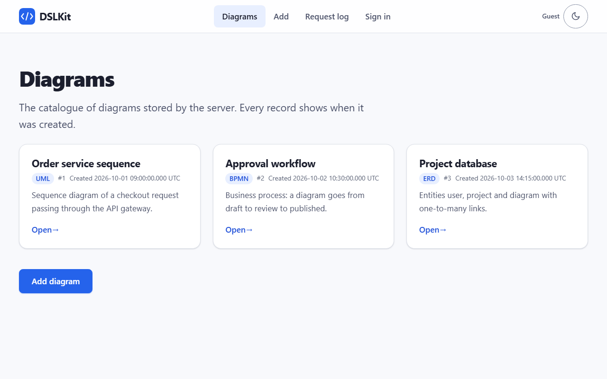

Рисунок 1 – Главная страница с карточками диаграмм и временем создания

Детальная страница одной записи с её ревизией и кодом показана на рисунке 2.

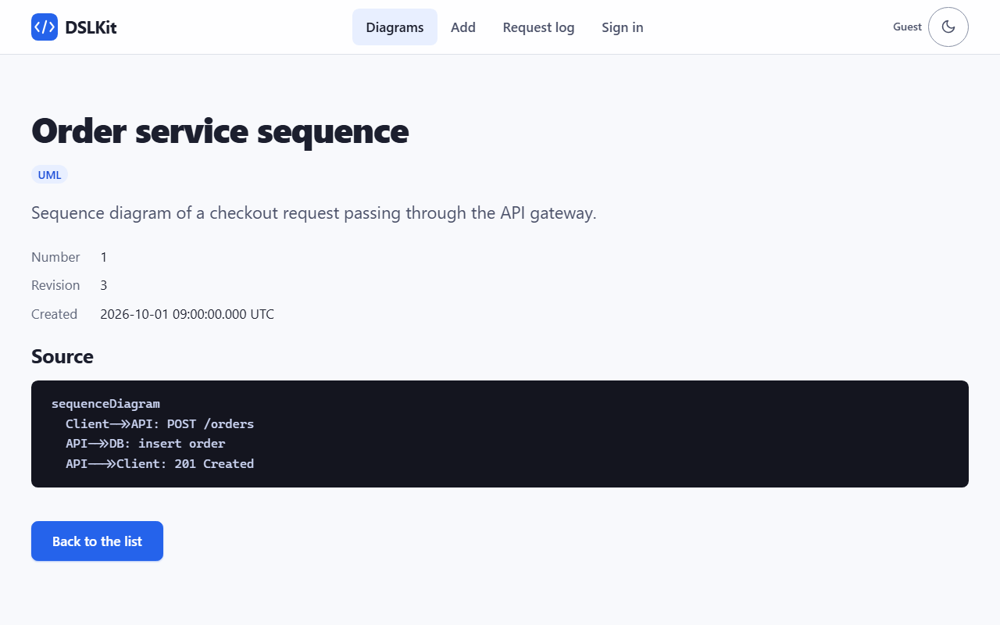

Рисунок 2 – Страница диаграммы с описанием, ревизией и исходным кодом

Форма после отправки пробельного названия и отрицательной ревизии показана на рисунке 3. Под каждым неверным полем стоит сообщение, а введённые значения сохранены.

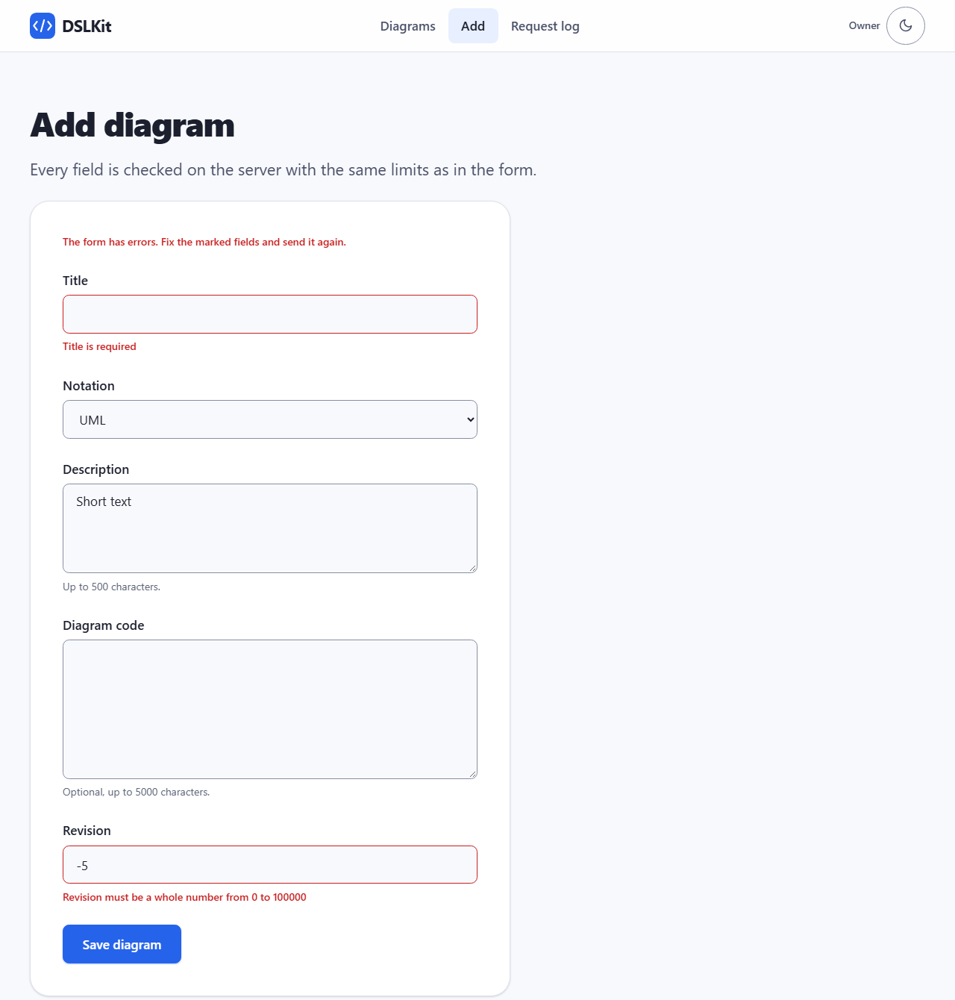

Рисунок 3 – Форма добавления с сообщениями о пустом названии и отрицательной ревизии

Таблица журнала запросов из базы данных показана на рисунке 4.

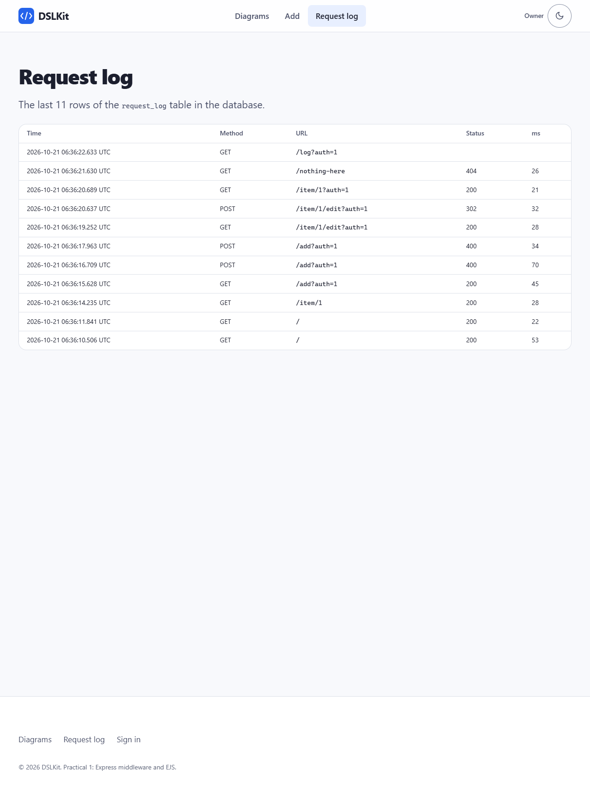

Рисунок 4 – Страница журнала с последними строками таблицы request_log

Страница 404 для неизвестного адреса показана на рисунке 5.

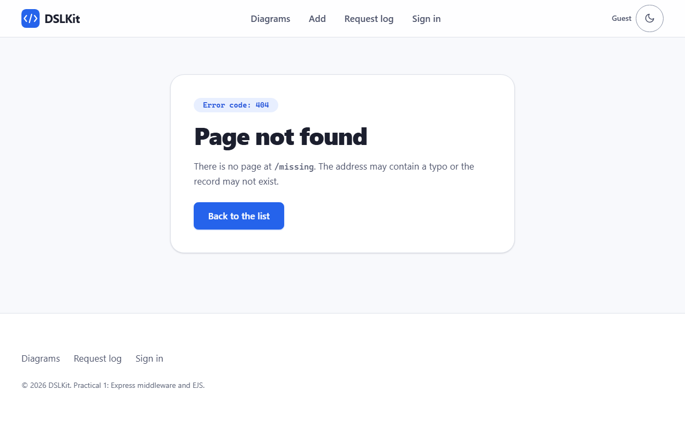

Рисунок 5 – Страница ошибки 404 в оформлении сайта

Страница 500 при настоящем сбое показана на рисунке 6. Сервер запущен с файлом базы, который нельзя создать, поэтому запись журнала не удалась.

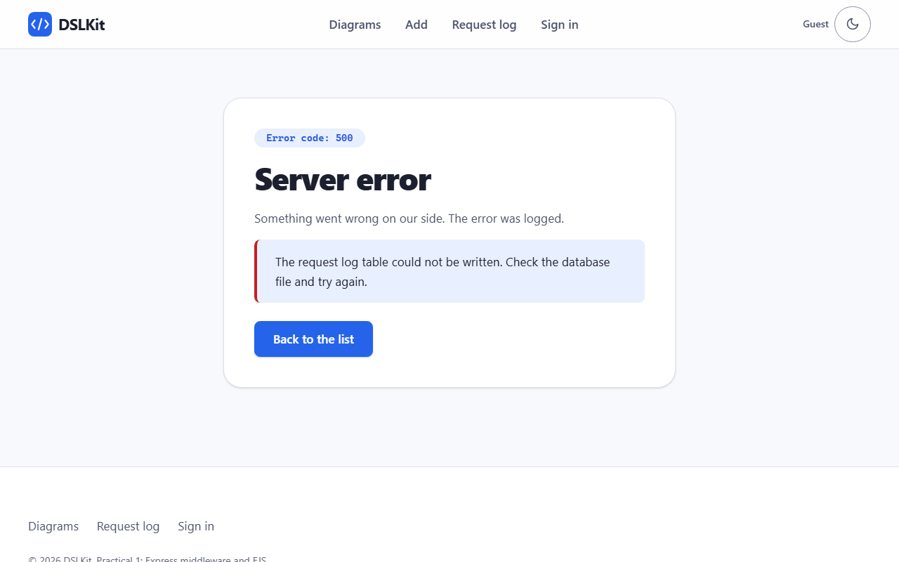

Рисунок 6 – Страница ошибки 500 с пояснением о недоступной таблице журнала

Та же форма с верными значениями сохраняет запись, и главная страница показывает новую карточку с собственным временем создания, как на рисунке 7.

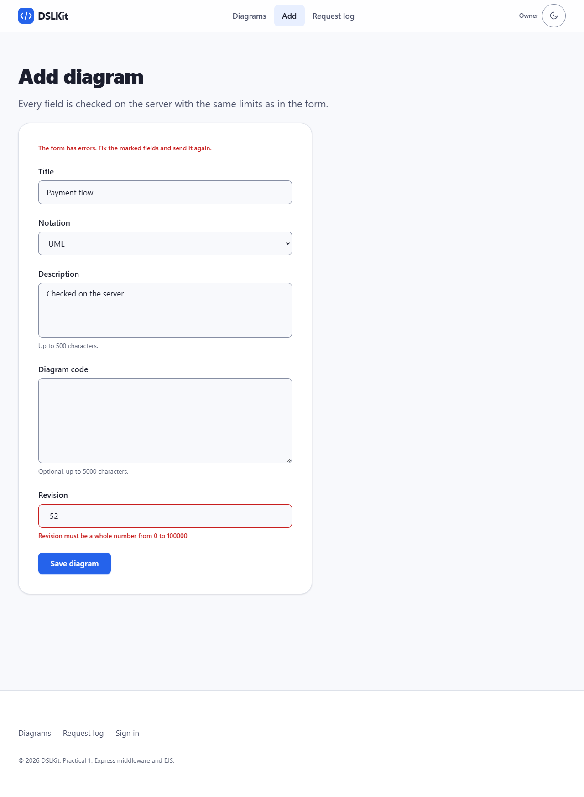

Рисунок 7 – Главная страница после добавления диаграммы через форму

Кнопка «Edit» на детальной странице открывает форму изменения с текущими значениями полей, она показана на рисунке 8.

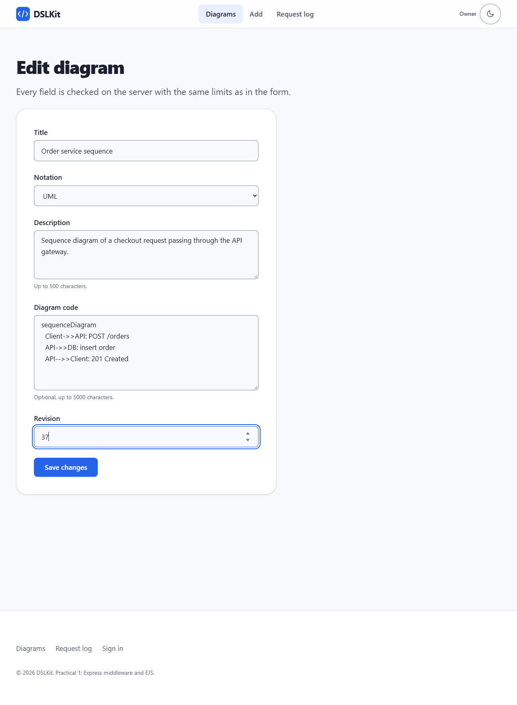

Рисунок 8 – Форма изменения первой диаграммы с текущими значениями и новой ревизией

После сохранения изменений открывается детальная страница с новой ревизией, а время создания остаётся прежним, как на рисунке 9.

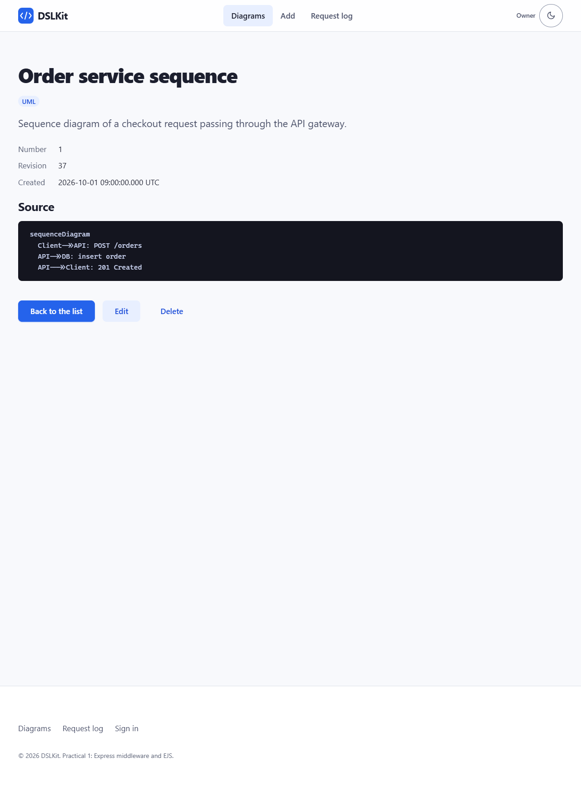

Рисунок 9 – Детальная страница первой диаграммы после изменения

### 3.9 Автоматическая проверка

Автоматические тесты на встроенном `node:test` запускают сервер на свободном порту и проверяют страницы, перенаправление гостя, добавление записи, проверку полей, экранирование, таблицу журнала, недоступную базу, уникальное время создания, изменение и удаление записи с токеном CSRF, обе страницы ошибок, токен CSRF, заголовки безопасности, ограничение частоты, экранирование журнала и огромные значения. Команда запуска: `npm test` в каталоге проекта.

Консоль сервера при запуске командой `npm start` и после запросов показана на рисунке 10.

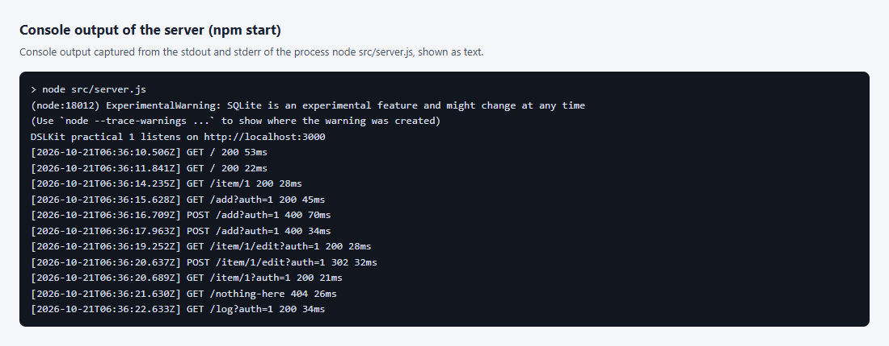

Рисунок 10 – Вывод консоли сервера со строками журнала запросов (вывод процесса, снятый как текст)

Результат команды `npm test` с числом тестов и покрытием кода показан на рисунке 11.

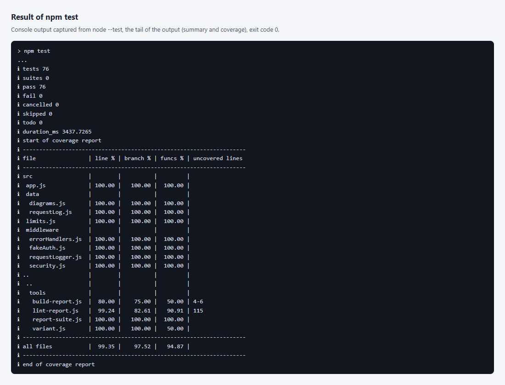

Рисунок 11 – Конец вывода команды npm test: число пройденных тестов и таблица покрытия (вывод процесса, снятый как текст)

## 4 Ответы на контрольные вопросы

25. Как в Express реализовать защиту от CSRF с помощью middleware (теоретически)?

    Браузер сам прикладывает cookie к запросу на наш сайт, даже если форму отправила страница чужого сайта, поэтому одной cookie для защиты мало. Middleware выдаёт случайный токен, кладёт его в cookie с флагами `HttpOnly` и `SameSite=Strict` и в скрытое поле каждой формы. Запрос, меняющий данные (`POST`, `PUT`, `PATCH`, `DELETE`), принимается, только если значение поля совпадает с cookie, а заголовок `Origin`, когда он есть, указывает на этот же сайт. Страница чужого сайта не может ни прочитать cookie, ни угадать токен. Сравнение делается функцией `timingSafeEqual`. Порядок важен: middleware подключается после разбора формы, потому что токен лежит в теле, и до маршрутов. В работе это функция `csrf` из `security.js`, а формы добавления, изменения и удаления несут скрытое поле.

26. Как в EJS использовать функцию helper (например, для форматирования даты) в шаблоне?

    Функцию кладут в `app.locals`, и она становится доступна во всех шаблонах, либо в `res.locals` для одного запроса, либо передают вторым аргументом `res.render()`. В работе `app.locals.formatTime` превращает строку ISO вида `2026-10-01T09:00:00.000Z` в читаемое «2026-10-01 09:00:00.000 UTC». В шаблоне вызов выглядит так: `<%= formatTime(item.createdAt) %>`. Запись `<%=` экранирует результат, а точное машинное значение остаётся в атрибуте `datetime` элемента `time`.

27. Почему middleware для статики обычно подключается до всех маршрутов?

    Запрос файла стилей или логотипа должен получить ответ сразу, не проходя авторизацию, журнал, разбор формы и поиск среди маршрутов. Так страница быстрее, а в журнал не попадает по строке на каждый файл. Если поставить статику после маршрутов, шаблонный маршрут или обработчик 404 могут перехватить адрес файла раньше. В работе `express.static` стоит после заголовков безопасности, чтобы заголовки получали и файлы, и до всего остального. Платой за такой порядок служит то, что статические файлы доступны без входа, поэтому в `public` нельзя класть ничего закрытого.

## Заключение

Для проекта DSLKit собрано приложение на Express с шаблонами EJS: список диаграмм, детальная страница и форма добавления получают данные из массива в памяти. Журнал запросов по правилам чётного варианта пишется в таблицу SQLite, а его сбой показывается оформленной страницей 500. Форма отвергает пустые и пробельные значения, слишком длинный текст и отрицательные числа по пределам из отдельного файла, а у каждой записи есть уникальное время создания. Записи можно изменять и удалять кнопками на детальной странице. Форма защищена токеном CSRF, а сервер заголовками безопасности и ограничением частоты запросов. Оформление взято из Части 1 проекта. Автоматические тесты покрывают весь код, снимки страниц приведены в тексте.

## Приложение А (обязательное) Листинг файла requestLogger.js

```js
import { safeLogText } from './security.js';

// Writes the request into the request_log table BEFORE the route runs, so a database failure
// reaches the error handler and the user sees the styled 500 page. Status and duration are added
// to the same row when the response finishes.
// The sign-in flag of the imitation must not be copied into the log, so a reader of the log cannot reuse it.
export const hideAuth = (url) => String(url).replace(/([?&]auth=)[^&#]*/gi, '$1***');

export const requestLogger =
  (log, write = console.log, urlMax = 500) =>
  (req, res, next) => {
    const startedAt = Date.now();
    // The address is user input: line breaks and control characters are escaped and the length is cut (log injection).
    const url = safeLogText(hideAuth(req.originalUrl), urlMax);
    let id;
    try {
      id = log.start({ time: new Date(startedAt).toISOString(), method: req.method, url });
    } catch (cause) {
      const error = new Error('Request log write failed', { cause });
      error.publicMessage = 'The request log table could not be written. Check the database file and try again.';
      return next(error);
    }
    res.on('finish', () => {
      const ms = Date.now() - startedAt;
      try {
        log.finish(id, res.statusCode, ms);
      } catch (error) {
        write(`[log] could not finish row ${id}: ${error.message}`);
      }
      write(`[${new Date(startedAt).toISOString()}] ${req.method} ${url} ${res.statusCode} ${ms}ms`);
    });
    return next();
  };
```

## Приложение Б (обязательное) Листинг файла requestLog.js с таблицей журнала

```js
import { DatabaseSync } from 'node:sqlite';
import { mkdirSync } from 'node:fs';
import { dirname } from 'node:path';

const CREATE_TABLE = `
  CREATE TABLE IF NOT EXISTS request_log (
    id INTEGER PRIMARY KEY AUTOINCREMENT,
    created_at TEXT NOT NULL,
    method TEXT NOT NULL,
    url TEXT NOT NULL,
    status INTEGER,
    duration_ms INTEGER
  )`;

// The request log is a table in a SQLite database. The connection opens lazily on first use,
// so a database that cannot be opened fails the request (and shows the 500 page), not the whole server.
export const openRequestLog = (file = ':memory:') => {
  let db = null;
  let statements = null;
  const connect = () => {
    if (statements) return statements;
    if (file !== ':memory:') mkdirSync(dirname(file), { recursive: true });
    const opened = new DatabaseSync(file);
    try {
      opened.exec(CREATE_TABLE);
      statements = {
        insert: opened.prepare('INSERT INTO request_log (created_at, method, url) VALUES (?, ?, ?)'),
        finish: opened.prepare('UPDATE request_log SET status = ?, duration_ms = ? WHERE id = ?'),
        clear: opened.prepare('DELETE FROM request_log'),
        recent: opened.prepare('SELECT id, created_at AS time, method, url, status, duration_ms AS ms FROM request_log ORDER BY id DESC LIMIT ?'),
      };
    } catch (error) {
      opened.close();
      throw error;
    }
    db = opened;
    return statements;
  };
  return {
    start: ({ time, method, url }) => Number(connect().insert.run(time, method, url).lastInsertRowid),
    finish: (id, status, ms) => connect().finish.run(status, ms, id),
    // Removes every row and returns how many were removed.
    clear: () => Number(connect().clear.run().changes),
    recent: (limit) =>
      connect()
        .recent.all(limit)
        .map((row) => ({ ...row })),
    close: () => {
      // A second close must not throw: the connection is closed once and then forgotten.
      if (db) db.close();
      db = null;
    },
  };
};
```

## Приложение В (обязательное) Листинг файла fakeAuth.js

```js
// Simulated authorization: ?auth=1 means "signed in as the owner", anything else is a guest.
export const fakeAuth = (req, res, next) => {
  const signedIn = req.query.auth === '1';
  req.user = signedIn ? { name: 'Owner', guest: false } : { name: 'Guest', guest: true };
  res.locals.user = req.user;
  res.locals.authQuery = signedIn ? '?auth=1' : '';
  next();
};

// Guards a single route: guests are redirected to /login.
export const requireAuth = (req, res, next) => (req.user.guest ? res.redirect('/login') : next());
```

## Приложение Г (обязательное) Листинг файла errorHandlers.js

```js
import { safeLogText } from './security.js';

export const notFound = (req, res) => {
  res.status(404).render('404', { title: 'Not found', url: req.originalUrl });
};

const HEADINGS = { 403: 'Request refused', 405: 'Method not allowed', 413: 'Request too large', 429: 'Too many requests' };

// Last resort when even the 500 template fails: still a styled page, never a bare text screen.
const fallbackPage = (status) =>
  `<!DOCTYPE html><html lang="en"><head><meta charset="utf-8"><title>${status} – DSLKit</title><link rel="stylesheet" href="/dslkit.css"><link rel="stylesheet" href="/pz.css"></head>` +
  `<body class="page"><main class="main"><section class="error"><p class="error__code">Error code: ${status}</p><h1 class="error__title">${status} – server error</h1><p class="error__text">The error page could not be drawn. The error was logged.</p><a class="button button--primary" href="/">Back to the list</a></section></main></body></html>`;

// Four parameters mark this as the error-handling middleware. It is mounted after every route and
// middleware, so any failure ends on the 500 page (or the 4xx variant for client errors).
export const serverError =
  (write = console.error) =>
  (err, req, res, _next) => {
    write(`[error] ${safeLogText(req.method)} ${safeLogText(req.originalUrl)}`, err);
    if (res.headersSent) return res.end();
    if (err.retryAfter) res.set('Retry-After', String(err.retryAfter));
    // Errors from body-parser and others carry their own 4xx/5xx status.
    const status = err.status >= 400 && err.status < 600 ? err.status : 500;
    const heading = HEADINGS[status] ?? (status >= 500 ? 'Server error' : 'Bad request');
    const locals = {
      title: heading,
      heading,
      status,
      message: err.publicMessage ?? '',
      // The failure may happen before fakeAuth ran, so the page needs its own defaults.
      user: res.locals.user ?? { name: 'Guest', guest: true },
      authQuery: res.locals.authQuery ?? '',
      path: '',
    };
    return res.status(status).render('500', locals, (renderError, html) => {
      if (renderError) {
        write('[error] the 500 page failed to render', renderError);
        return res.type('html').send(fallbackPage(status));
      }
      return res.send(html);
    });
  };
```

## Приложение Д (обязательное) Листинг файла diagrams.js с проверкой формы

```js
export const NOTATIONS = ['UML', 'BPMN', 'ERD', 'DFD', 'IDEF0', 'Petri'];

const seed = () => [
  {
    id: 1,
    title: 'Order service sequence',
    notation: 'UML',
    description: 'Sequence diagram of a checkout request passing through the API gateway.',
    code: 'sequenceDiagram\n  Client->>API: POST /orders\n  API->>DB: insert order\n  API-->>Client: 201 Created',
    revision: 3,
    createdAt: '2026-10-01T09:00:00.000Z',
  },
  {
    id: 2,
    title: 'Approval workflow',
    notation: 'BPMN',
    description: 'Business process: a diagram goes from draft to review to published.',
    code: 'start -> draft -> review -> published',
    revision: 1,
    createdAt: '2026-10-02T10:30:00.000Z',
  },
  {
    id: 3,
    title: 'Project database',
    notation: 'ERD',
    description: 'Entities user, project and diagram with one-to-many links.',
    code: 'user 1--* project\nproject 1--* diagram',
    revision: 0,
    createdAt: '2026-10-03T14:15:00.000Z',
  },
];

// Data lives in memory only, as the practical requires: no database for the diagrams.
// Every record gets its own creation time: it is always later than the previous one, even within one millisecond.
export const createDiagramStore = (now = Date.now) => {
  const items = seed();
  let nextId = items.length + 1;
  let last = Math.max(...items.map((item) => Date.parse(item.createdAt)));
  return {
    all: () => [...items],
    find: (id) => items.find((item) => item.id === id),
    add: ({ title, notation, description, code, revision }) => {
      last = Math.max(now(), last + 1);
      const item = { id: nextId, title, notation, description, code, revision, createdAt: new Date(last).toISOString() };
      nextId += 1;
      items.push(item);
      return item;
    },
    // Edit keeps the id and the creation time, only the form fields change.
    update: (id, { title, notation, description, code, revision }) => {
      const item = items.find((one) => one.id === id);
      if (!item) return undefined;
      Object.assign(item, { title, notation, description, code, revision });
      return item;
    },
    remove: (id) => {
      const index = items.findIndex((one) => one.id === id);
      if (index < 0) return false;
      items.splice(index, 1);
      return true;
    },
  };
};

const CONTROL = /[-‪-‮⁦-⁩]/;

const required = (label, value, max) => {
  if (value === '') return `${label} is required`;
  if (value.length > max) return `${label} must be at most ${max} characters`;
  return null;
};

// Values arrive already trimmed, so a whitespace-only value is an empty one.
// Returns an object of field errors, empty when the input is valid. Limits come from limits.json.
export const validateDiagram = (input, limits) => {
  const errors = {};
  const set = (field, message) => message && (errors[field] = message);
  set('title', required('Title', input.title, limits.title.maxLength));
  // Control characters (NUL, escape) and text-direction overrides are not part of a title: they break lists and can flip the text around it.
  if (!errors.title && CONTROL.test(input.title)) errors.title = 'Title must not contain control characters';
  set('description', required('Description', input.description, limits.description.maxLength));
  if (input.code.length > limits.code.maxLength) errors.code = `Code must be at most ${limits.code.maxLength} characters`;
  if (!NOTATIONS.includes(input.notation)) errors.notation = 'Choose a notation from the list';
  const { min, max } = limits.revision;
  if (input.revision === '') errors.revision = 'Revision is required';
  else if (!/^\d+$/.test(input.revision) || Number(input.revision) < min || Number(input.revision) > max) {
    errors.revision = `Revision must be a whole number from ${min} to ${max}`;
  }
  return errors;
};
```

## Приложение Е (обязательное) Файл пределов limits.json

```json
{
  "title": { "maxLength": 80 },
  "description": { "maxLength": 500 },
  "code": { "maxLength": 5000 },
  "revision": { "min": 0, "max": 100000 },
  "bodyLimit": "20kb",
  "parameterLimit": 20,
  "logRows": 100,
  "logUrlMax": 500,
  "rateLimit": {
    "all": { "windowMs": 60000, "max": 300 },
    "write": { "windowMs": 60000, "max": 20 }
  }
}
```

## Приложение Ж (обязательное) Листинг шаблона index.ejs

```ejs
<%- include('partials/header') %>
<section class="section" aria-labelledby="page-title">
  <h1 class="section__title" id="page-title">Diagrams</h1>
  <p class="section__lead">The catalogue of diagrams stored by the server. Every record shows when it was created.</p>
  <% if (items.length === 0) { %>
    <p class="note">No diagrams yet.</p>
  <% } else { %>
    <ul class="cards">
      <% items.forEach((item) => { %>
        <li class="cards__item">
          <article class="card">
            <h2 class="card__title"><%= item.title %></h2>
            <p class="card__meta">
              <span class="badge"><%= item.notation %></span>
              <span>#<%= item.id %></span>
              <span>Created <time datetime="<%= item.createdAt %>"><%= formatTime(item.createdAt) %></time></span>
            </p>
            <p class="card__text"><%= item.description %></p>
            <a class="card__link" href="/item/<%= item.id %><%= authQuery %>">Open<span class="visually-hidden"> <%= item.title %></span></a>
          </article>
        </li>
      <% }) %>
    </ul>
  <% } %>
  <div class="page-actions">
    <a class="button button--primary" href="/add<%= authQuery %>">Add diagram</a>
  </div>
</section>
<%- include('partials/footer') %>
```

## Приложение З (обязательное) Листинг файла app.js

```js
import express from 'express';
import { fileURLToPath } from 'node:url';
import { createDiagramStore, validateDiagram, NOTATIONS } from './data/diagrams.js';
import { openRequestLog } from './data/requestLog.js';
import { requestLogger } from './middleware/requestLogger.js';
import { loadLimits } from './limits.js';
import { fakeAuth, requireAuth } from './middleware/fakeAuth.js';
import { notFound, serverError } from './middleware/errorHandlers.js';
import { csrf, rateLimit, securityHeaders } from './middleware/security.js';

const dir = (path) => fileURLToPath(new URL(path, import.meta.url));

const DEFAULT_DB_FILE = dir('../data/requests.db');

export const createApp = ({
  store = createDiagramStore(),
  limits = loadLimits(),
  log = openRequestLog(DEFAULT_DB_FILE),
  write = console.log,
  writeError = console.error,
  now = Date.now,
} = {}) => {
  const app = express();
  app.set('view engine', 'ejs');
  app.set('views', dir('../views'));

  app.disable('x-powered-by');
  app.locals.limits = limits;
  // Records keep the exact ISO time for the machine; people read "2026-10-01 09:00:00.000 UTC".
  app.locals.formatTime = (iso) => String(iso).replace('T', ' ').replace('Z', ' UTC');

  // Order matters: headers first so every answer has them, then static files and the pure checks,
  // then the rate limits (a flood is refused before it reaches the database), then the logger (which can fail
  // and hand over to the error handler), the body parser and the CSRF check (the token is a form field), then the routes.
  // The two error handlers are the very last, so every failure ends on a styled page.
  app.use(securityHeaders);
  // Liveness probe for Docker and monitoring: placed before the rate limit and the log, so probes neither use up the quota nor fill the table.
  app.get('/health', (req, res) => res.json({ status: 'ok' }));
  app.use(express.static(dir('../public')));
  app.use((req, res, next) => {
    res.locals.path = req.path;
    next();
  });
  app.use(fakeAuth);
  app.use(rateLimit({ ...limits.rateLimit.all, now }));
  app.use(rateLimit({ ...limits.rateLimit.write, only: ['POST'], now }));
  app.use(requestLogger(log, write, limits.logUrlMax));
  app.use(express.urlencoded({ extended: false, limit: limits.bodyLimit, parameterLimit: limits.parameterLimit }));
  app.use(csrf);

  app.get('/', (req, res) => res.render('index', { title: 'Diagrams', items: store.all() }));

  // Only plain digits are a number: Number() would also accept "0x1" or "1e0".
  const findItem = (req) => (/^\d{1,9}$/.test(req.params.id) ? store.find(Number(req.params.id)) : undefined);

  // Adding and editing share one template, only the texts and the address differ.
  const formView = { notations: NOTATIONS, heading: 'Add diagram', action: '/add', submit: 'Save diagram' };
  const editView = (item) => ({ ...formView, heading: 'Edit diagram', action: `/item/${item.id}/edit`, submit: 'Save changes' });

  // Repeated keys (arrays) must not crash: only plain strings count.
  const readForm = (body) => {
    const text = (value) => (typeof value === 'string' ? value.trim() : '');
    return {
      title: text(body.title),
      notation: text(body.notation),
      description: text(body.description),
      code: text(body.code),
      revision: text(body.revision),
    };
  };

  app.get('/item/:id', (req, res, next) => {
    const item = findItem(req);
    return item ? res.render('item', { title: item.title, item }) : next();
  });

  // The address of one record answers only to GET: another method is a mistake of the client, not a missing page.
  app.all('/item/:id', (req, res, next) => {
    if (req.method === 'GET' || req.method === 'HEAD') return next();
    res.set('Allow', 'GET, HEAD');
    return next(Object.assign(new Error('Method not allowed'), { status: 405, publicMessage: 'This address only answers GET. To change the record use its edit form.' }));
  });

  app.get('/add', requireAuth, (req, res) => res.render('add', { ...formView, title: 'Add diagram', errors: {}, values: { revision: '1' } }));

  app.post('/add', requireAuth, (req, res) => {
    const values = readForm(req.body); // the CSRF check has already proved that the form body exists
    const errors = validateDiagram(values, limits);
    if (Object.keys(errors).length) {
      return res.status(400).render('add', { ...formView, title: 'Add diagram', errors, values });
    }
    store.add({ ...values, revision: Number(values.revision) });
    return res.redirect(`/${res.locals.authQuery}`);
  });

  // Edit and delete change data, so both need the simulated sign-in and the CSRF token (the delete button is a form, not a link).
  app.get('/item/:id/edit', requireAuth, (req, res, next) => {
    const item = findItem(req);
    if (!item) return next();
    return res.render('add', { ...editView(item), title: 'Edit diagram', errors: {}, values: { ...item, revision: String(item.revision) } });
  });

  app.post('/item/:id/edit', requireAuth, (req, res, next) => {
    const item = findItem(req);
    if (!item) return next();
    const values = readForm(req.body);
    const errors = validateDiagram(values, limits);
    if (Object.keys(errors).length) {
      return res.status(400).render('add', { ...editView(item), title: 'Edit diagram', errors, values });
    }
    store.update(item.id, { ...values, revision: Number(values.revision) });
    return res.redirect(`/item/${item.id}${res.locals.authQuery}`);
  });

  app.post('/item/:id/delete', requireAuth, (req, res, next) => {
    const item = findItem(req);
    if (!item) return next();
    store.remove(item.id);
    return res.redirect(`/${res.locals.authQuery}`);
  });

  app.get('/login', (req, res) => res.render('login', { title: 'Sign in' }));
  app.get('/log', requireAuth, (req, res) => res.render('log', { title: 'Request log', rows: log.recent(limits.logRows) }));

  // Clearing the log changes data, so it needs the simulated sign-in and the CSRF token, and it is a form, not a link.
  app.post('/log/clear', requireAuth, (req, res) => {
    log.clear();
    return res.redirect(`/log${res.locals.authQuery}`);
  });

  app.use(notFound);
  app.use(serverError(writeError));
  return app;
};
```

## Приложение И (обязательное) Листинг файла security.js

```js
import { randomBytes, timingSafeEqual } from 'node:crypto';

// Security headers set by hand, no extra package. The pages use only files from the same origin,
// so the policy can be strict: no inline script or style, no framing, forms post only to this site.
const CSP = [
  "default-src 'self'",
  "script-src 'self'",
  "style-src 'self'",
  "img-src 'self' data:",
  "object-src 'none'",
  "base-uri 'none'",
  "form-action 'self'",
  "frame-ancestors 'none'",
].join('; ');

export const securityHeaders = (req, res, next) => {
  res.set({
    'Content-Security-Policy': CSP,
    'X-Content-Type-Options': 'nosniff',
    'X-Frame-Options': 'DENY',
    // same-origin, not no-referrer: with no-referrer browsers send "Origin: null" with every form, and the Origin check below would refuse the site's own forms.
    'Referrer-Policy': 'same-origin',
    'Cross-Origin-Opener-Policy': 'same-origin',
    'Permissions-Policy': 'camera=(), microphone=(), geolocation=()',
  });
  next();
};

const COOKIE = 'dslkit_csrf';
const TOKEN = /^[0-9a-f]{48}$/;
const UNSAFE = new Set(['POST', 'PUT', 'PATCH', 'DELETE']);

const readCookie = (header = '', name) => {
  for (const part of header.split(';')) {
    const [key, ...rest] = part.trim().split('=');
    if (key === name) return rest.join('=');
  }
  return undefined;
};

const sameToken = (a, b) => typeof a === 'string' && typeof b === 'string' && a.length === b.length && timingSafeEqual(Buffer.from(a), Buffer.from(b));

const refused = (message) => Object.assign(new Error(message), { status: 403, publicMessage: message });

// CSRF protection with a double-submit token: the server puts a random token into a SameSite=Strict cookie
// and into a hidden field of every form. A state-changing request must send both and they must match.
// A page of another site can neither read the cookie nor guess the token. The Origin header is checked as well when it is present.
// It runs after the form parser, because the token is a field of the form body.
export const csrf = (req, res, next) => {
  let token = readCookie(req.headers.cookie, COOKIE);
  const known = TOKEN.test(token ?? '');
  if (UNSAFE.has(req.method)) {
    const origin = req.headers.origin;
    if (origin && origin !== `${req.protocol}://${req.headers.host}`) return next(refused('The request comes from another site and was refused.'));
    if (!known || !sameToken(token, req.body?._csrf)) return next(refused('The form token is missing or wrong. Open the form again and resend it.'));
  }
  if (!known) {
    token = randomBytes(24).toString('hex');
    res.append('Set-Cookie', `${COOKIE}=${token}; Path=/; HttpOnly; SameSite=Strict${req.secure ? '; Secure' : ''}`);
  }
  res.locals.csrfToken = token;
  next();
};

const tooMany = (retryAfter) => Object.assign(new Error('Too many requests'), { status: 429, retryAfter, publicMessage: `Too many requests. Try again in ${retryAfter} s.` });

// Fixed-window rate limit per client address, kept in memory. `only` limits it to some methods.
export const rateLimit = ({ windowMs, max, only, now = Date.now }) => {
  const hits = new Map();
  return (req, res, next) => {
    if (only && !only.includes(req.method)) return next();
    const time = now();
    if (hits.size > 10000) for (const [key, entry] of hits) if (entry.reset <= time) hits.delete(key);
    const key = req.ip ?? 'unknown';
    let entry = hits.get(key);
    if (!entry || entry.reset <= time) {
      entry = { count: 0, reset: time + windowMs };
      hits.set(key, entry);
    }
    entry.count += 1;
    if (entry.count <= max) return next();
    const retryAfter = Math.max(1, Math.ceil((entry.reset - time) / 1000));
    res.set('Retry-After', String(retryAfter));
    return next(tooMany(retryAfter));
  };
};

// Control characters (line breaks, tabs, escape codes) in user input could forge extra lines in a log, so they are escaped.
// The text is also cut, so one huge address cannot fill the log.
export const safeLogText = (text, max = 500) => {
  let escaped = '';
  for (const char of String(text)) {
    const code = char.codePointAt(0);
    const control = code < 32 || (code >= 127 && code <= 159) || code === 0x2028 || code === 0x2029;
    escaped += control ? `\\u${code.toString(16).padStart(4, '0')}` : char;
  }
  return escaped.length > max ? `${escaped.slice(0, max)}…` : escaped;
};
```

## Приложение К (обязательное) Листинг шаблона item.ejs

```ejs
<%- include('partials/header') %>
<section class="section" aria-labelledby="page-title">
  <h1 class="section__title" id="page-title"><%= item.title %></h1>
  <p><span class="badge"><%= item.notation %></span></p>
  <p class="section__lead"><%= item.description %></p>
  <dl class="facts">
    <dt>Number</dt>
    <dd><%= item.id %></dd>
    <dt>Revision</dt>
    <dd><%= item.revision %></dd>
    <dt>Created</dt>
    <dd><time datetime="<%= item.createdAt %>"><%= formatTime(item.createdAt) %></time></dd>
  </dl>
  <% if (item.code) { %>
    <h2>Source</h2>
    <pre class="code"><%= item.code %></pre>
  <% } %>
  <div class="page-actions">
    <a class="button button--primary" href="/<%= authQuery %>">Back to the list</a>
    <% if (!user.guest) { %>
      <a class="button button--tonal" href="/item/<%= item.id %>/edit<%= authQuery %>">Edit<span class="visually-hidden"> <%= item.title %></span></a>
      <form class="inline-form" method="post" action="/item/<%= item.id %>/delete<%= authQuery %>">
        <input type="hidden" name="_csrf" value="<%= csrfToken %>" />
        <button class="button button--quiet" type="submit">Delete<span class="visually-hidden"> <%= item.title %></span></button>
      </form>
    <% } %>
  </div>
</section>
<%- include('partials/footer') %>
```
