# Практическое занятие №1. Middleware и шаблонизаторы

## 1 Цель работы

Цель работы состоит в том, чтобы освоить концепцию middleware в Express.js и шаблонизатор EJS на примере проекта DSLKit, веб-редактора диаграмм как кода, тематика которого соответствует направлению SaaS и будущему курсовому проекту. Для достижения цели нужно разработать собственные middleware для журнала запросов, имитации авторизации и обработки ошибок, подключить шаблоны EJS для четырёх маршрутов и страниц ошибок, добавить на сервере проверку введённых значений и вынести все пределы длины и чисел в отдельный файл. Вариант 100 (номер в списке группы 26) чётный, поэтому и журнал запросов, и данные каталога хранятся в таблицах базы данных, а не в файле. У каждой записи должно быть уникальное время создания, чтобы записи не совпадали визуально. Страница 500 должна открываться при настоящем сбое журнала, а не по кнопке, поэтому в отчёте описано, как такой сбой воспроизвести. Исходный код приложения лежит в репозитории https://github.com/KsushaKhadzhinova/DSLKit-Project в ветке pz21.

## 2 Краткие теоретические сведения

**Middleware.** Это функция с параметрами `req`, `res` и `next`, которая видит запрос и ответ и либо завершает ответ, либо передаёт управление дальше вызовом `next()`. Функции выполняются в том порядке, в котором подключены, поэтому порядок подключения определяет поведение приложения. Обработчик ошибок отличается четырьмя параметрами и подключается последним.

**Шаблонизатор EJS.** Шаблон содержит HTML и вставки на JavaScript. Запись `<%= value %>` выводит значение с экранированием, запись `<% code %>` выполняет код, запись `<%- include() %>` подключает частичный шаблон. Данные передаются 2-м аргументом `res.render()`.

**Хранение данных.** Вариант 100 (номер в списке группы 26) чётный, поэтому и записи каталога, и журнал запросов лежат в базе данных SQLite, которую даёт встроенный модуль `node:sqlite`. Записи хранятся в таблице `diagrams`, журнал в таблице `request_log`, и установка отдельных пакетов для них не нужна. Таблицы создаются при обращении к базе в 1-й раз, а пустая таблица заполняется тремя начальными записями. Если база недоступна, запрос завершается оформленной страницей 500, а сервер продолжает работать.

## 3 Ход работы

### 3.1 Структура проекта

Проект лежит в каталоге `part-2/pz-01-middleware-ejs` и работает на Express 5 с шаблонизатором EJS. Структура показана в таблице 1.

Таблица 1 – Структура проекта практического занятия 1

| Файл | Назначение |
|---|---|
| `src/app.js` | Сборка приложения, порядок middleware и маршруты |
| `src/server.js` | Запуск сервера на порту |
| `src/middleware/requestLogger.js` | Запись каждого запроса в таблицу журнала |
| `src/middleware/fakeAuth.js` | Имитация авторизации |
| `src/middleware/errorHandlers.js` | Обработчики ошибок 404 и 500 |
| `src/middleware/security.js` | Заголовки безопасности, токен CSRF, ограничение частоты запросов, экранирование журнала |
| `src/errors.js` | Тексты страниц ошибок: что произошло, почему и как исправить |
| `src/i18n.js` | Выбор языка интерфейса по параметру `lang` и cookie |
| `src/locales/` | Словари английского и русского языков |
| `src/limits.js` | Чтение файла `limits.json` |
| `src/data/requestLog.js` | Таблица `request_log` в SQLite |
| `src/data/diagrams.js` | Таблица `diagrams` в базе данных и проверка полей формы |
| `src/data/logFile.js` | Выгрузка журнала в файл и отдача файла потоками |
| `limits.json` | Все пределы длины и чисел |
| `views/` | Шаблоны EJS и частичные шаблоны |
| `public/` | Стили и логотип из Части 1 проекта, переключатель темы |

Настройка EJS выполнена в `src/app.js`, где заданы `view engine` и каталог `views`. Общий каркас страниц вынесен в частичные шаблоны `header` и `footer`, которые подключаются в начале и в конце каждой страницы. Шаблон списка приведён в приложении А. Сборка приложения и порядок подключения middleware показаны в приложении Б.

### 3.2 Журнал запросов в таблице базы данных

Middleware журнала подключается после статических файлов и имитации авторизации. До выполнения маршрута оно вставляет в таблицу `request_log` строку с временем, методом и адресом запроса, а когда ответ завершён, дописывает в эту строку код статуса и длительность. Тот же результат выводится в консоль. Такой порядок выбран намеренно: запись выполняется до маршрута, поэтому её сбой можно показать пользователю страницей 500, а после отправки ответа это уже невозможно. Таблица создаётся при 1-м обращении, если её нет, а подключение к базе открывается лениво, так что недоступная база не мешает запуску сервера и проявляется как ошибка запроса. Страница `/log` показывает последние строки таблицы, их число задаёт `limits.json`. Листинг приведён в приложении В, а описание таблицы в приложении Г.

### 3.3 Имитация авторизации

Middleware `fakeAuth` проверяет параметр `?auth=1`. Если он есть, в `req.user` попадает владелец, иначе гость, а в шаблоны передаются имя пользователя и хвост адреса для ссылок. Маршруты `/add` защищены функцией `requireAuth`: гость перенаправляется на страницу `/login`, где объяснено, как «войти». Листинг приведён в приложении Д.

### 3.4 Маршруты и страницы

Реализованы четыре маршрута из условия и служебные маршруты, они сведены в таблице 2. Код маршрутов приведён в приложении Е.

Таблица 2 – Маршруты приложения

| Маршрут | Результат |
|---|---|
| `GET /` | Список диаграмм из таблицы базы данных с временем создания каждой записи |
| `GET /item/:id` | Детальная страница, неизвестный номер ведёт на страницу 404 |
| `GET /add` | Форма добавления, доступна с `?auth=1` |
| `POST /add` | Проверка полей, добавление в таблицу и переход на главную, при ошибке код 400 и форма с сохранёнными значениями |
| `GET /item/:id/edit` | Форма изменения записи с текущими значениями, доступна с `?auth=1` |
| `POST /item/:id/edit` | Проверка полей и изменение записи, номер и время создания не меняются, при ошибке код 400 |
| `POST /item/:id/delete` | Удаление записи и переход на главную, повторное удаление даёт 404 |
| `GET /login` | Страница-подсказка |
| `GET /log` | Таблица журнала запросов, доступна с `?auth=1` |

Шаблоны выводят все значения с экранированием, поэтому введённая в форме разметка показывается как текст. У каждой записи есть поле «время создания». Оно задаётся при добавлении и всегда позже предыдущего, даже если две записи созданы в одну миллисекунду, поэтому записи не совпадают визуально.

На детальной странице вошедший пользователь видит кнопки «Изменить» и «Удалить». Изменение открывает ту же форму, что и добавление, но уже заполненную текущими значениями, и проверяет поля теми же правилами. Удаление сделано не ссылкой, а формой с методом `POST`, потому что ссылка по адресу `GET` не должна менять данные. В обеих формах стоит скрытое поле `_csrf`, без него сервер отвечает 403 даже вошедшему пользователю. Гость, который открывает защищённую страницу обычной ссылкой, переходит на страницу входа. Номер записи после удаления не используется повторно. Листинг шаблона item.ejs приведён в приложении Ж.

Страница журнала запросов содержит кнопку «Очистить журнал». Это форма с методом POST и скрытым полем CSRF, а не ссылка. Запрос без токена получает ответ 403, гость с верным токеном перенаправляется на страницу входа, а у вошедшего пользователя таблица `request_log` очищается.

### 3.5 Страница 500 и порядок обработчиков

Страница 500 показывается, когда запрос завершился ошибкой сервера. Обработчик ошибок имеет четыре параметра и подключён после всех маршрутов и всех middleware, поэтому любое исключение, будь то сбой записи в журнал, ошибка маршрута или сломанное тело запроса, попадает именно в него. Обработчик записывает ошибку в журнал ошибок, выбирает код ответа и рендерит шаблон `500.ejs` в общем оформлении сайта: с шапкой, подвалом и таблицей стилей. Если у ошибки есть собственный код, например 413 для слишком большой формы, он сохраняется, а страница получает собственный заголовок, например «Request too large». Если ошибку вызвала недоступная база журнала, на странице появляется понятное пояснение. Для сбоя до имитации авторизации обработчик сам подставляет гостя, чтобы шапка отрисовалась. Если даже шаблон 500 не удалось отрисовать, отправляется запасная страница с тем же оформлением, поэтому пользователь никогда не видит голый текст на чёрном фоне. Страницу 500 вызывает настоящий сбой журнала, а не действие на странице сайта. Сбой воспроизводится в PowerShell командой `$env:DB_FILE='package.json/blocked/log.db'; npm start`: переменная окружения `DB_FILE` указывает на путь внутри файла, поэтому базу создать нельзя, и любой запрос заканчивается страницей 500. После проверки переменная удаляется командой `Remove-Item Env:DB_FILE`. Другой способ состоит в остановке базы во время работы сервера. Страница 404 устроена так же и подключена перед обработчиком 500. Листинг приведён в приложении И.

### 3.6 Проверка полей формы

Форма добавления проверяется на сервере, а те же пределы передаются в разметку как атрибуты `maxlength`, `min` и `max`. Сначала значения обрезаются по краям, поэтому поле из одних пробелов считается пустым. Правила сведены в таблице 3.

Таблица 3 – Проверки полей формы добавления

| Поле | Правило |
|---|---|
| Название | Обязательно, непустое после обрезки, не длиннее предела из `limits.json` |
| Описание | Обязательно, непустое после обрезки, не длиннее предела из `limits.json` |
| Нотация | Одно значение из списка |
| Код диаграммы | Необязательно, не длиннее предела из `limits.json` |
| Ревизия | Обязательна, целое число от 0 до предела из `limits.json`, отрицательные и дробные значения отвергаются |

При ошибке сервер отвечает кодом 400, снова показывает форму, оставляет введённые значения и пишет сообщение под каждым неверным полем. Пропавшее тело запроса и повторяющиеся ключи формы тоже дают код 400, а не 500. Все пределы лежат в файле `limits.json`, а не в коде. Листинг проверки приведён в приложении К. Хранилище записей в таблице `diagrams` приведено в приложении Л и в приложении М, а файл пределов в приложении Н.

### 3.7 Защита формы и сервера

Форма и сервер защищены от типовых атак, и всё сделано вручную, без новых пакетов. Для защиты от подделки межсайтового запроса сервер кладёт подписанный случайный токен в cookie `dslkit_csrf` с признаками `HttpOnly` и `SameSite=Strict` и в скрытое поле формы. Запрос на изменение данных принимается только если оба значения совпадают, а заголовок `Origin`, когда он есть, указывает на этот же сайт. Иначе показывается страница с кодом 403. Каждый ответ получает заголовки `Content-Security-Policy`, `X-Content-Type-Options`, `X-Frame-Options` и `Referrer-Policy`, а имя фреймворка в заголовках скрыто. Политика не разрешает встроенные скрипты и стили, поэтому в шаблонах их нет. Ограничение частоты запросов отвечает кодом 429 со страницей в общем оформлении и заголовком `Retry-After`: общий предел и более строгий предел для отправки формы лежат в `limits.json`. Размер тела формы и число её полей тоже ограничены этим файлом, поэтому огромные значения дают страницу с кодом 400 или 413, а не сбой. Адрес запроса в журнале проходит через экранирование: переводы строк и управляющие символы заменяются записью `\uXXXX`, а длина обрезается, поэтому злоумышленник не может подделать строки журнала. Страница `/log` открыта только с `?auth=1`, потому что в ней видны адреса чужих запросов. Листинг заголовков и проверки CSRF приведён в приложении П, а ограничения частоты и экранирования журнала в приложении Р.

### 3.8 Внешний вид страниц

Оформление страниц взято из Части 1 проекта: шапка с логотипом и навигацией, подвал, кнопки, карточки и поля формы используют те же стили и разметку, что сайт и приложение DSLKit. Переключатель светлой и тёмной темы работает так же, как в Части 1, а шапка закреплена при прокрутке. На каждой странице одна главная кнопка. Список диаграмм с временем создания каждой записи показан на рисунке 1.

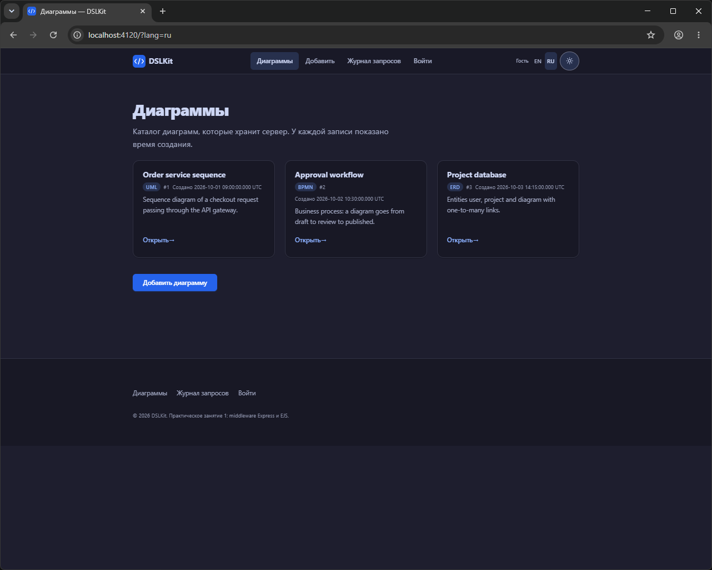

Рисунок 1 – Главная страница с карточками диаграмм и временем создания

Детальная страница одной записи с её ревизией и кодом показана на рисунке 2.

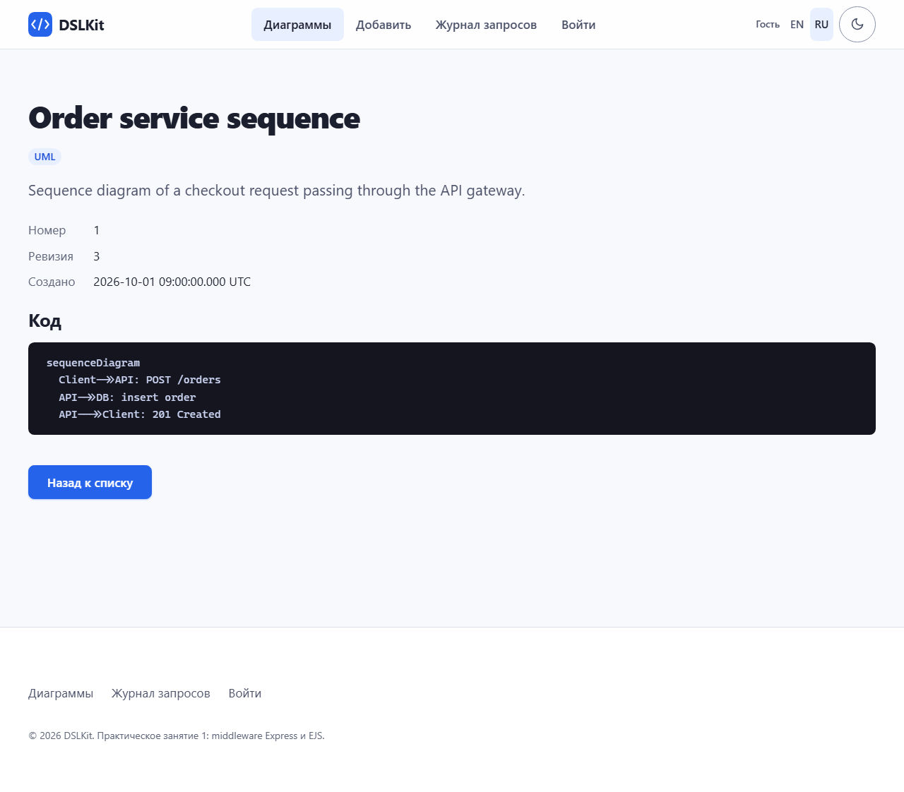

Рисунок 2 – Страница диаграммы с описанием, ревизией и исходным кодом

Пустая форма добавления до ввода данных показана на рисунке 3.

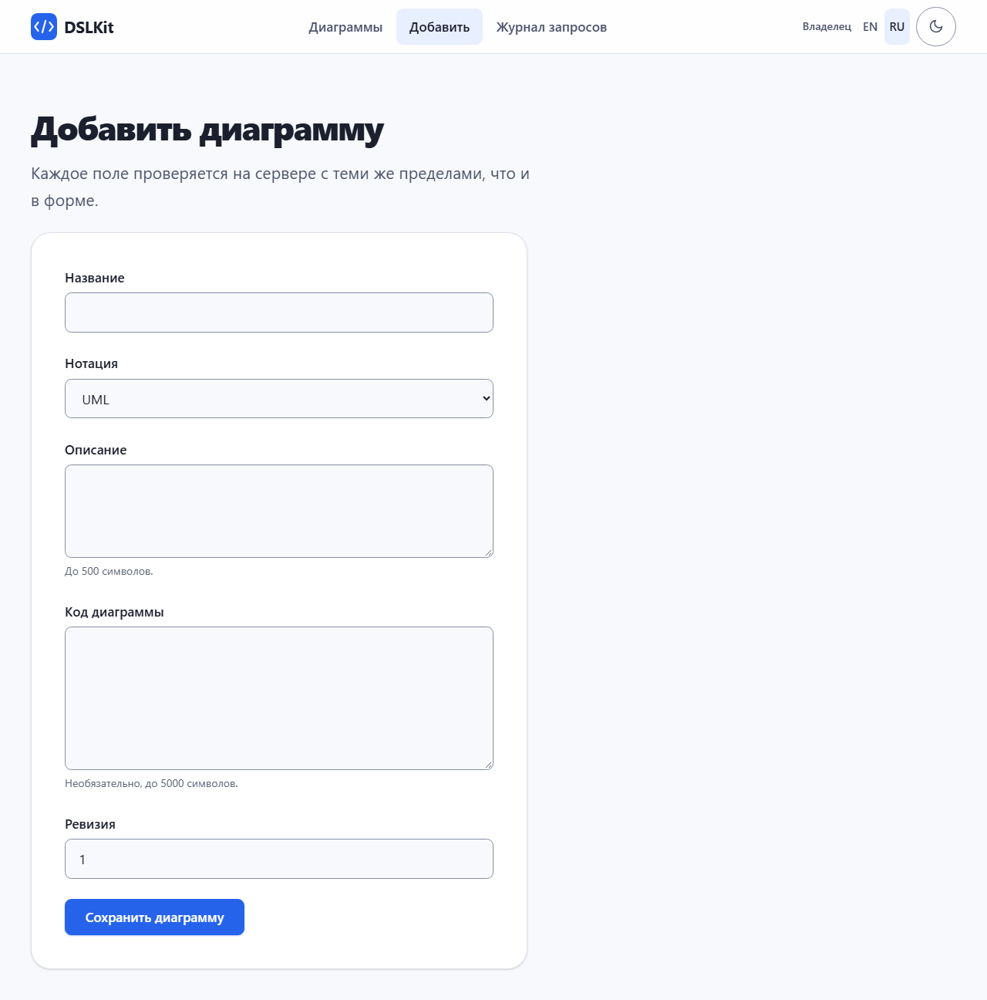

Рисунок 3 – Форма добавления диаграммы без введённых значений и без сообщений об ошибках

Форма после отправки пробельного названия и отрицательной ревизии показана на рисунке 4. Под каждым неверным полем стоит сообщение, а введённые значения сохранены.

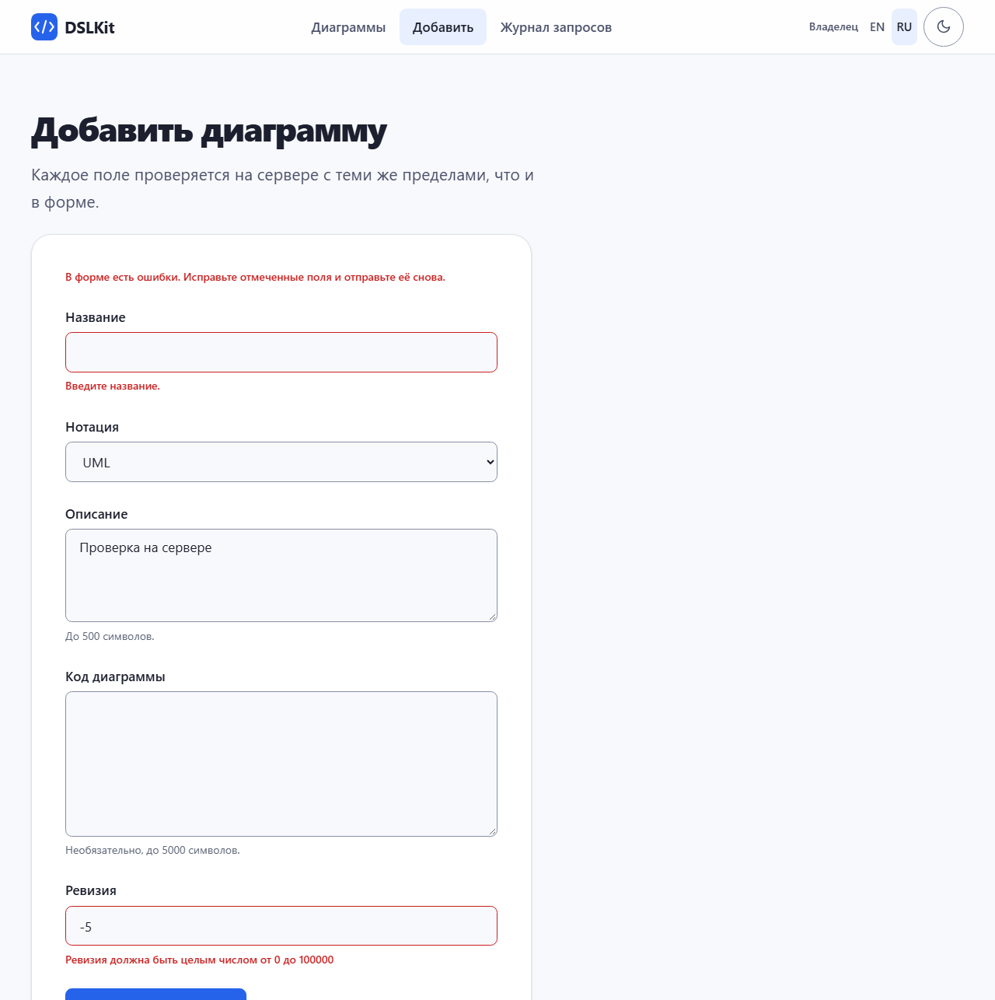

Рисунок 4 – Форма добавления с сообщениями о пустом названии и отрицательной ревизии

Таблица журнала запросов из базы данных показана на рисунке 5.

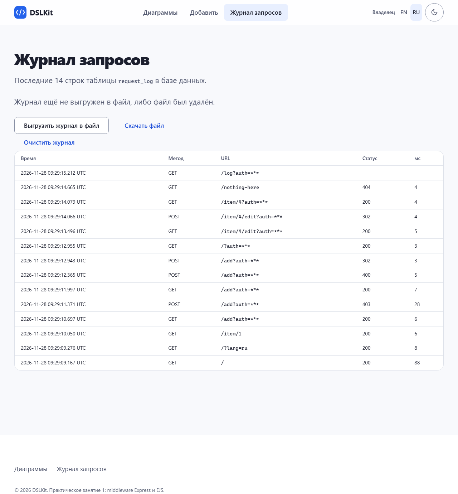

Рисунок 5 – Страница журнала с последними строками таблицы request_log и кнопками очистки и выгрузки

Страница 404 для неизвестного адреса показана на рисунке 6.

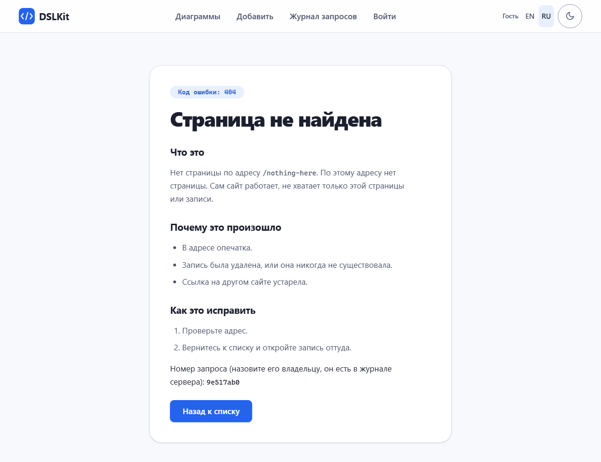

Рисунок 6 – Страница ошибки 404 с блоками «Что это», «Почему это произошло», «Как это исправить» и номером запроса

Страница 500 при настоящем сбое показана на рисунке 7. Сервер запущен с файлом базы, который нельзя создать, поэтому запись журнала не удалась.

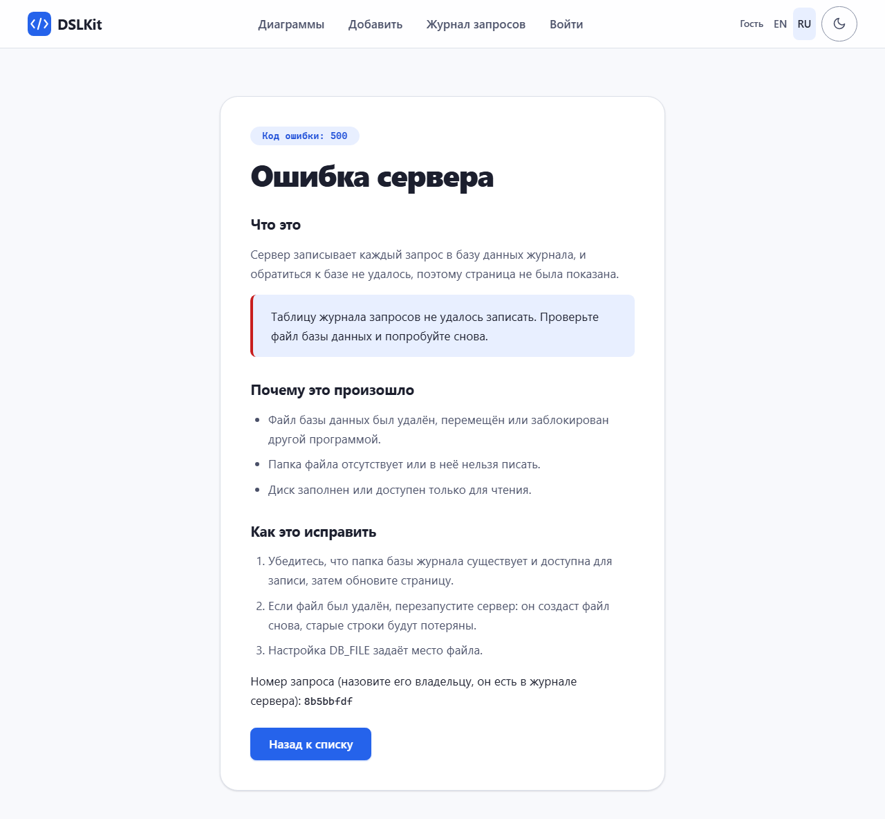

Рисунок 7 – Страница ошибки 500 с пояснением, что запись в таблицу журнала запросов не удалась

Журнал можно выгрузить в текстовый файл и скачать. Кнопка «Выгрузить журнал в файл» записывает строки таблицы через поток (`pipeline` с `createWriteStream`) во временный файл и переименовывает его в итоговый только после полной записи, поэтому сбой посреди записи не портит прежний файл. Кнопка «Скачать файл» отдаёт файл через `createReadStream`. Код потоков приведён в приложении С. Если файл удалён, перемещён или нечитаем, человек видит страницу, которая объясняет, что произошло, почему и как это исправить, а не обрыв соединения и не безымянную ошибку 500. Обрыв посреди передачи закрывает соединение и пишется в консоль сервера, сервер продолжает работать. Тексты всех страниц ошибок лежат в одном каталоге `src/errors.js`, каждая страница отвечает на три вопроса: что это, почему так вышло и как это исправить.

Та же форма с верными значениями сохраняет запись, и главная страница показывает новую карточку с собственным временем создания, как на рисунке 8.

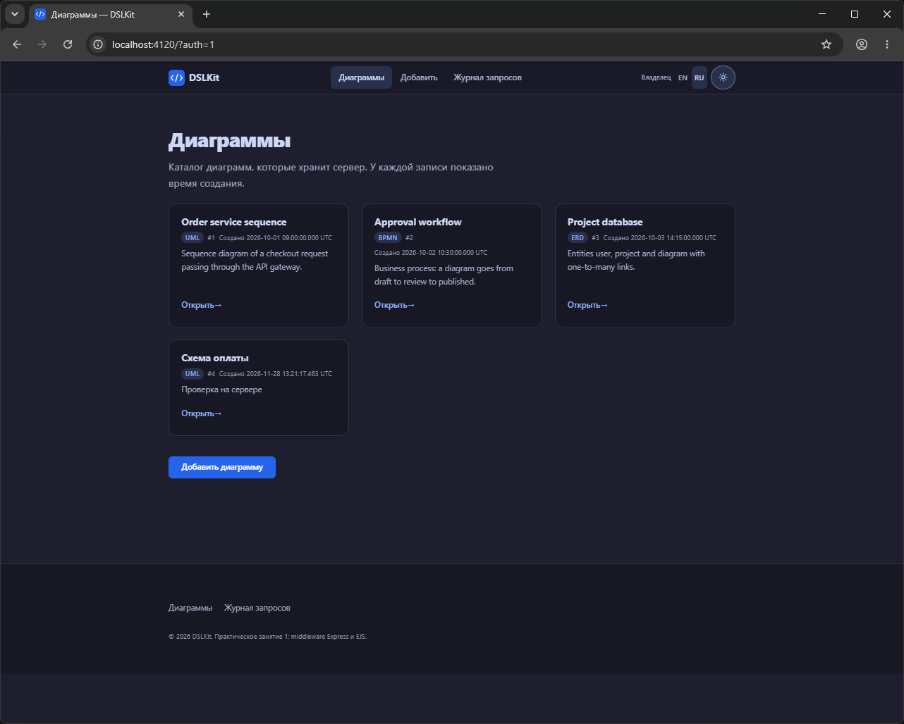

Рисунок 8 – Главная страница после добавления диаграммы через форму

Кнопка «Изменить» на детальной странице открывает форму изменения с текущими значениями полей, она показана на рисунке 9.


Рисунок 9 – Форма изменения добавленной диаграммы с текущими значениями и новой ревизией

После сохранения изменений открывается детальная страница с новой ревизией, а время создания остаётся прежним, как на рисунке 10.

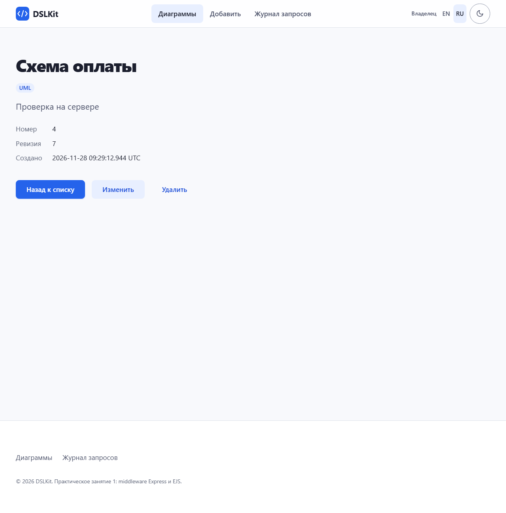

Рисунок 10 – Детальная страница диаграммы после изменения с новой ревизией

Кроме страниц 404 и 500 сайт показывает оформленные страницы для кодов 400, 403, 405, 413 и 429. Каждая страница объясняет, что произошло, почему и что сделать, а все тексты лежат в одном каталоге `src/errors.js`. Коды и случаи их показа сведены в таблице 4.

Таблица 4 – Страницы ошибок сайта

| Код | Заголовок страницы | Когда показывается |
| --- | --- | --- |
| 400 | Некорректный запрос | Адрес или данные формы нельзя прочитать |
| 403 | Запрос отклонён | В форме нет токена защиты или он не совпал с cookie, либо заголовок `Origin` указывает на другой сайт |
| 404 | Страница не найдена | По адресу нет страницы или записи |
| 405 | Метод не разрешён | Адрес существует, но не для этого метода запроса |
| 413 | Запрос слишком большой | Тело запроса больше предела из `limits.json` |
| 429 | Слишком много запросов | С одного адреса пришло больше запросов, чем разрешено |
| 500 | Ошибка сервера | Сбой сервера, в том числе недоступная база журнала или каталога |

Страница 403 при форме без токена защиты показана на рисунке 11.

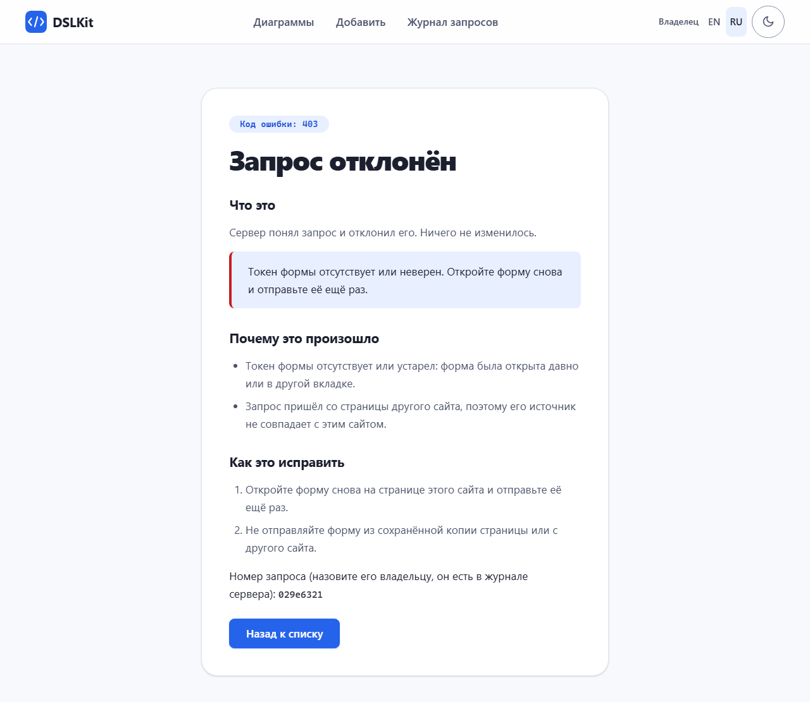

Рисунок 11 – Страница ошибки 403 после отправки формы без токена защиты

Страница 429 при превышении числа запросов показана на рисунке 12.

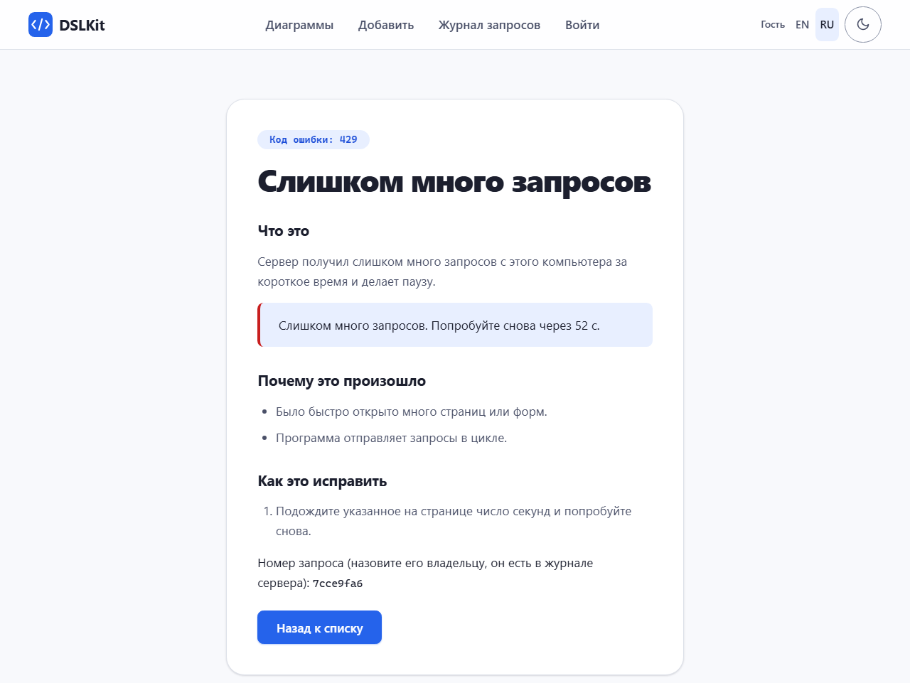

Рисунок 12 – Страница ошибки 429 при слишком частых запросах

Сбой журнала проверен остановкой базы: запрос получает страницу 500 с пояснением, что база журнала недоступна, а в консоль попадает строка об ошибке. Таблицы базы данных показаны на рисунке 13.

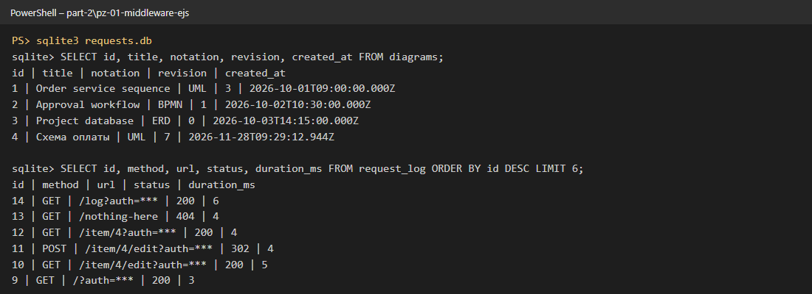

Рисунок 13 – Таблицы diagrams и request_log в базе данных SQLite

### 3.9 Автоматическая проверка

Автоматические тесты на встроенном `node:test` запускают сервер на свободном порту и проверяют страницы, перенаправление гостя, добавление записи, проверку полей, экранирование, таблицу журнала, недоступную базу, уникальное время создания, изменение и удаление записи с токеном CSRF, обе страницы ошибок, токен CSRF, заголовки безопасности, ограничение частоты, экранирование журнала и огромные значения. Команда запуска: `npm test` в каталоге проекта.

Консоль сервера при запуске командой `npm start` и после запросов показана на рисунке 14.

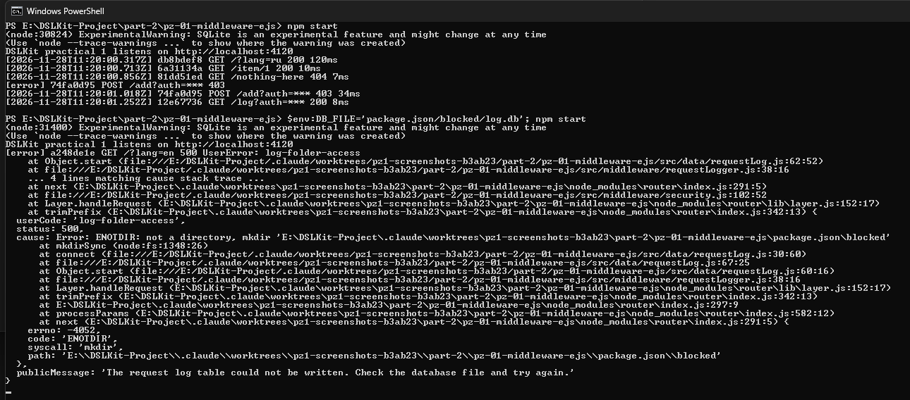

Рисунок 14 – Вывод консоли сервера со строками журнала запросов

Результат команды `npm test` с числом тестов и покрытием кода показан на рисунке 15.

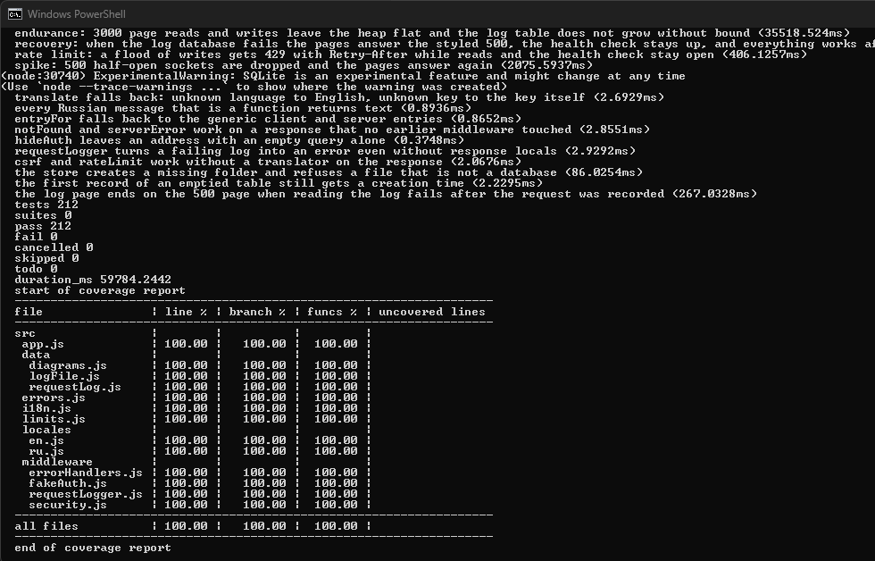

Рисунок 15 – Конец вывода команды npm test: число пройденных тестов и таблица покрытия

## 4 Ответы на контрольные вопросы

Номер в списке группы 26, поэтому ответы даны на вопросы 25, 26 и 27.

25. Как в Express реализовать защиту от CSRF с помощью middleware (теоретически)?

    Браузер сам прикладывает cookie к запросу на наш сайт, даже если форму отправила страница чужого сайта, поэтому одной cookie для защиты мало. В работе применена схема двойной отправки cookie (double submit cookie) вместе с проверкой заголовка `Origin`. Middleware выдаёт токен, кладёт его в cookie `dslkit_csrf` с флагами `HttpOnly` и `SameSite=Strict` и в скрытое поле `_csrf` каждой формы. Токен состоит из случайной части и подписи HMAC, а ключ подписи создаётся при запуске сервера, поэтому самодельное значение, которое злоумышленник подставил в cookie, не проходит проверку подписи. Запрос, меняющий данные (`POST`, `PUT`, `PATCH`, `DELETE`), принимается, только если значение поля совпадает с cookie, а заголовок `Origin`, когда он есть, указывает на этот же сайт. Безопасные методы, например `GET`, токен не проверяют, поэтому они не должны менять данные, и удаление сделано формой `POST`. Сравнение делается функцией `timingSafeEqual`. Порядок важен: middleware подключается после разбора формы, потому что токен лежит в теле, и до маршрутов. Пакет `csurf` снят с поддержки, а его преемник `csrf-csrf` строится на той же схеме, поэтому в работе она написана вручную без новых пакетов. Токен не привязан к сессии: у приложения нет сессий, и защита отделяет свой сайт от чужого, но не одного пользователя от другого. Из-за этого злоумышленник с родственного поддомена мог бы положить в cookie настоящий подписанный токен, который он сам получил от сайта, и вставить то же значение в форму: подпись такой токен не отвергнет, и защищают от этого только проверка заголовка `Origin` и флаг `SameSite=Strict`. После перезапуска сервера ключ меняется, и открытые формы приходится загружать заново.

26. Как в EJS использовать функцию helper (например, для форматирования даты) в шаблоне?

    Функцию кладут в `app.locals`, и она становится доступна во всех шаблонах, либо в `res.locals` для одного запроса, либо передают 2-м аргументом `res.render()`. В работе `app.locals.formatTime` превращает строку ISO вида `2026-10-01T09:00:00.000Z` в читаемое «2026-10-01 09:00:00.000 UTC». В шаблоне вызов выглядит так: `<%= formatTime(item.createdAt) %>`. Запись `<%=` экранирует результат, а точное машинное значение остаётся в атрибуте `datetime` элемента `time`.

27. Почему middleware для статики обычно подключается до всех маршрутов?

    Запрос файла стилей или логотипа должен получить ответ сразу, не проходя авторизацию, журнал, разбор формы и поиск среди маршрутов. Так страница быстрее, а в журнал не попадает по строке на каждый файл. В работе `express.static` стоит после заголовков безопасности, генератора номера запроса и проверки живости `/health`, но до имитации авторизации, ограничения частоты, журнала, разбора формы и маршрутов. Если файла нет, `express.static` вызывает `next()`, и запрос идёт дальше по цепочке, поэтому адрес без файла получает страницу 404 из обработчика `notFound`. Если поставить статику после маршрутов, шаблонный маршрут или обработчик 404 могут перехватить адрес файла раньше. Платой за такой порядок служит то, что статические файлы доступны без входа и не попадают под ограничение частоты запросов, поэтому в `public` нельзя класть ничего закрытого.

## Заключение

Для проекта DSLKit собрано приложение на Express с шаблонами EJS: список диаграмм, детальная страница и форма добавления получают данные из таблицы `diagrams` базы данных SQLite. Журнал запросов по правилам чётного варианта пишется в таблицу `request_log` той же базы, а его сбой показывается оформленной страницей 500, при этом действие не выполняется. Форма отвергает пустые и пробельные значения, слишком длинный текст и отрицательные числа по пределам из отдельного файла `limits.json`, а у каждой записи есть уникальное время создания. Записи можно изменять и удалять кнопками на детальной странице, а удаление выполняется формой `POST`. Форма защищена токеном CSRF, а сервер заголовками безопасности и ограничением частоты запросов. Страницы ошибок 400, 403, 404, 405, 413, 429 и 500 оформлены в стиле сайта и объясняют, что произошло, почему и как это исправить. Оформление взято из Части 1 проекта. Автоматические тесты на `node:test` проверяют страницы, формы, защиту и сбой журнала, а код приложения покрыт тестами полностью, что видно на рисунке 15. Снимки страниц приведены в тексте, а листинги в приложениях. Ответы на контрольные вопросы 25, 26 и 27 даны в разделе 4. Работа выполнена в ветке pz21 репозитория проекта.

## Приложение А (обязательное) Листинг index.ejs

Комментарии в листингах всех приложений написаны по-английски, как в исходных файлах проекта.

```ejs
<%- include('partials/header') %>
<section class="section" aria-labelledby="page-title">
  <h1 class="section__title" id="page-title"><%= t('page.index.heading') %></h1>
  <p class="section__lead"><%= t('page.index.lead') %></p>
  <% if (items.length === 0) { %>
    <p class="note"><%= t('page.index.empty') %></p>
  <% } else { %>
    <ul class="cards">
      <% items.forEach((item) => { %>
        <li class="cards__item">
          <article class="card">
            <h2 class="card__title"><%= item.title %></h2>
            <p class="card__meta">
              <span class="badge"><%= item.notation %></span>
              <span>#<%= item.id %></span>
              <span><%= t('page.index.created') %> <time datetime="<%= item.createdAt %>"><%= formatTime(item.createdAt) %></time></span>
            </p>
            <p class="card__text"><%= item.description %></p>
            <a class="card__link" href="/item/<%= item.id %><%= authQuery %>"><%= t('page.index.open') %><span class="visually-hidden"> <%= item.title %></span></a>
          </article>
        </li>
      <% }) %>
    </ul>
  <% } %>
  <div class="page-actions">
    <a class="button button--primary" href="/add<%= authQuery %>"><%= t('page.index.addButton') %></a>
  </div>
</section>
<%- include('partials/footer') %>
```

## Приложение Б (обязательное) Листинг app.js, middleware и общие функции

```js
import { randomBytes } from 'node:crypto';
import express from 'express';
import { fileURLToPath } from 'node:url';
import { createDiagramStore, validateDiagram, NOTATIONS } from './data/diagrams.js';
import { describeFile, exportLog, sendLogFile } from './data/logFile.js';
import { openRequestLog } from './data/requestLog.js';
import { requestLogger } from './middleware/requestLogger.js';
import { loadLimits } from './limits.js';
import { fakeAuth, requireAuth } from './middleware/fakeAuth.js';
import { notFound, serverError } from './middleware/errorHandlers.js';
import { csrf, rateLimit, securityHeaders } from './middleware/security.js';
import { i18n } from './i18n.js';

const dir = (path) => fileURLToPath(new URL(path, import.meta.url));

const DEFAULT_DB_FILE = dir('../data/requests.db');
const DEFAULT_LOG_FILE = dir('../data/request-log.txt');

export const createApp = ({
  store = createDiagramStore(),
  limits = loadLimits(),
  log = openRequestLog(DEFAULT_DB_FILE),
  logFile = process.env.LOG_EXPORT_FILE || DEFAULT_LOG_FILE,
  write = console.log,
  writeError = console.error,
  now = Date.now,
} = {}) => {
  const app = express();
  app.set('view engine', 'ejs');
  app.set('views', dir('../views'));

  app.disable('x-powered-by');
  // Off by default (the server cannot tell a real client address or a real HTTPS request from a forged header
  // unless it is told which hop to trust). Behind a reverse proxy, set TRUST_PROXY to the number of hops to
  // trust (usually 1), to an IP/subnet, or to "true"; then req.ip, req.secure, the Secure cookie and HSTS all
  // follow the proxy's X-Forwarded-* headers instead of the raw socket.
  if (process.env.TRUST_PROXY) {
    const value = process.env.TRUST_PROXY;
    app.set('trust proxy', value === 'true' ? true : value === 'false' ? false : /^\d+$/.test(value) ? Number(value) : value);
  }
  app.locals.limits = limits;
  // Records keep the exact ISO time for the machine; people read "2026-10-01 09:00:00.000 UTC".
  app.locals.formatTime = (iso) => String(iso).replace('T', ' ').replace('Z', ' UTC');

  // Order matters: headers first so every answer has them, then static files and the pure checks,
  // then the rate limits (a flood is refused before it reaches the database), then the logger (which can fail
  // and hand over to the error handler), the body parser and the CSRF check (the token is a form field), then the routes.
  // The two error handlers are the very last, so every failure ends on a styled page.
  app.use(securityHeaders);
  // A short identifier of this request: shown on every error page, sent as a header and written to the server log, so a visitor's report can be found.
  app.use((req, res, next) => {
    res.locals.requestId = randomBytes(4).toString('hex');
    res.set('X-Request-Id', res.locals.requestId);
    next();
  });
  // Liveness probe for Docker and monitoring: placed before the rate limit and the log, so probes neither use up the quota nor fill the table.
  app.get('/health', (req, res) => res.json({ status: 'ok' }));
  app.use(express.static(dir('../public')));
  app.use((req, res, next) => {
    res.locals.path = req.path;
    next();
  });
  // Language before everything else that can render a page or build an error message, so even an
  // early refusal (CSRF, rate limit) can show its text in the visitor's chosen language.
  app.use(i18n);
  app.use(fakeAuth);
  app.use(rateLimit({ ...limits.rateLimit.all, now }));
  app.use(rateLimit({ ...limits.rateLimit.write, only: ['POST'], now }));
  app.use(requestLogger(log, write, limits.logUrlMax));
  app.use(express.urlencoded({ extended: false, limit: limits.bodyLimit, parameterLimit: limits.parameterLimit }));
  // body-parser answers too many form fields with 413 ("payload too large"), but the body itself can be tiny:
  // the actual problem is a malformed request, so it is turned into the 400 it should have been.
  app.use((err, req, res, next) => next(err?.type === 'parameters.too.many' ? Object.assign(err, { status: 400, statusCode: 400 }) : err));
  app.use(csrf);

  app.get('/', (req, res) => res.render('index', { title: res.locals.t('title.diagrams'), items: store.all() }));

  // Only plain digits are a number: Number() would also accept "0x1" or "1e0". A leading zero is refused
  // (except "0" itself), so "/item/01" is not a second, hidden address for "/item/1".
  const ITEM_ID = /^(0|[1-9]\d{0,8})$/;
  const findItem = (req) => (ITEM_ID.test(req.params.id) ? store.find(Number(req.params.id)) : undefined);

  // Adding and editing share one template, only the texts and the address differ.
  const formView = (t) => ({ notations: NOTATIONS, heading: t('form.headingAdd'), action: '/add', submit: t('form.submitAdd') });
  const editView = (item, t) => ({ ...formView(t), heading: t('form.headingEdit'), action: `/item/${item.id}/edit`, submit: t('form.submitEdit') });

  // Repeated keys (arrays) must not crash: only plain strings count.
  const readForm = (body) => {
    const text = (value) => (typeof value === 'string' ? value.trim() : '');
    return {
      title: text(body.title),
      notation: text(body.notation),
      description: text(body.description),
      code: text(body.code),
      revision: text(body.revision),
    };
  };
```

## Приложение В (обязательное) Листинг requestLogger.js

```js
export const hideAuth = (url) => {
  const text = String(url);
  const mark = text.indexOf('?');
  if (mark === -1) return text;
  const query = text.slice(mark + 1);
  if (query === '') return text;
  const masked = new URLSearchParams();
  let changed = false;
  for (const [key, value] of new URLSearchParams(query)) {
    if (key.toLowerCase() === 'auth') {
      masked.append(key, '***');
      changed = true;
    } else {
      masked.append(key, value);
    }
  }
  return changed ? `${text.slice(0, mark)}?${masked.toString()}` : text;
};

export const requestLogger =
  (log, write = console.log, urlMax = 500) =>
  (req, res, next) => {
    const startedAt = Date.now();
    // The address is user input: line breaks and control characters are escaped and the length is cut (log injection).
    const url = safeLogText(hideAuth(req.originalUrl), urlMax);
    let id;
    try {
      id = log.start({ time: new Date(startedAt).toISOString(), method: req.method, url });
    } catch (cause) {
      // The database layer already names the problem (UserError); anything else is wrapped in a plain error.
      const error = cause instanceof UserError ? cause : new Error('Request log write failed', { cause });
      const t = res.locals?.t ?? ((key, vars) => translate('en', key, vars));
      error.publicMessage = t('error.logWriteFailed');
      return next(error);
    }
    res.on('finish', () => {
      const ms = Date.now() - startedAt;
      try {
        log.finish(id, res.statusCode, ms);
      } catch (error) {
        write(`[log] could not finish row ${id}: ${error.message}`);
      }
      write(`[${new Date(startedAt).toISOString()}] ${res.locals?.requestId ?? '-'} ${req.method} ${url} ${res.statusCode} ${ms}ms`);
    });
    return next();
  };
```

## Приложение Г (обязательное) Листинг requestLog.js с таблицей журнала

```js
import { DatabaseSync } from 'node:sqlite';
import { existsSync, mkdirSync, statSync } from 'node:fs';
import { dirname } from 'node:path';
import { UserError, fileFailure } from '../errors.js';

const CREATE_TABLE = `
  CREATE TABLE IF NOT EXISTS request_log (
    id INTEGER PRIMARY KEY AUTOINCREMENT,
    created_at TEXT NOT NULL,
    method TEXT NOT NULL,
    url TEXT NOT NULL,
    status INTEGER,
    duration_ms INTEGER
  )`;

// Nothing ever deleted an old row on its own: a server left running would grow the table forever.
// Every TRIM_EVERY-th insert removes rows past MAX_ROWS, so the table stays bounded without a cron job
// or a visit to the "clear the log" button.
const MAX_ROWS = 20000;
const TRIM_EVERY = 500;

// The request log is a table in a SQLite database. The connection opens lazily on first use,
// so a database that cannot be opened fails the request (and shows the 500 page), not the whole server.
export const openRequestLog = (file = ':memory:') => {
  let db = null;
  let statements = null;
  const connect = () => {
    if (statements) return statements;
    // The folder is made only when it is missing: mkdir on the root of a drive (E:/) fails on Windows even with recursive.
    if (file !== ':memory:' && !existsSync(dirname(file))) mkdirSync(dirname(file), { recursive: true });
    if (file !== ':memory:' && existsSync(file) && statSync(file).isDirectory()) throw Object.assign(new Error('a folder stands in the place of the file'), { code: 'EISDIR' });
    const opened = new DatabaseSync(file);
    try {
      opened.exec(CREATE_TABLE);
      // WAL lets readers (the log page) and the writer (every request) work at the same time instead of
      // taking turns, and NORMAL synchronous trades a little durability on a power loss for a much shorter
      // fsync on every insert; node:sqlite still runs each statement synchronously (it blocks the event loop
      // for as long as the write itself takes), so this shortens that block rather than removing it. A
      // :memory: database has no file to hold a WAL, so it keeps its own default journal.
      if (file !== ':memory:') opened.exec('PRAGMA journal_mode = WAL; PRAGMA synchronous = NORMAL;');
      statements = {
        insert: opened.prepare('INSERT INTO request_log (created_at, method, url) VALUES (?, ?, ?)'),
        finish: opened.prepare('UPDATE request_log SET status = ?, duration_ms = ? WHERE id = ?'),
        clear: opened.prepare('DELETE FROM request_log'),
        recent: opened.prepare('SELECT id, created_at AS time, method, url, status, duration_ms AS ms FROM request_log ORDER BY id DESC LIMIT ?'),
        trim: opened.prepare('DELETE FROM request_log WHERE id <= (SELECT MAX(id) FROM request_log) - ?'),
      };
    } catch (error) {
      opened.close();
      throw error;
    }
    db = opened;
    return statements;
  };
  // Any failure of the database (a deleted or locked file, a missing folder, a full disk) becomes the error page about the log database.
  const guard =
    (action) =>
    (...args) => {
      try {
        return action(...args);
      } catch (error) {
        throw error instanceof UserError ? error : new UserError(fileFailure(error, 'log-database-unavailable'), error);
      }
    };
  return {
    start: guard(({ time, method, url }) => {
      const id = Number(connect().insert.run(time, method, url).lastInsertRowid);
      if (id % TRIM_EVERY === 0) connect().trim.run(MAX_ROWS);
      return id;
    }),
    finish: guard((id, status, ms) => connect().finish.run(status, ms, id)),
    // Removes every row and returns how many were removed.
    clear: guard(() => Number(connect().clear.run().changes)),
    recent: guard((limit) =>
      connect()
        .recent.all(limit)
        .map((row) => ({ ...row })),
    ),
    // A lazy, row-by-row view of the same rows `recent` returns, for the export: the file is written
    // one line at a time, so even the full table is never held in memory as one array. The database is
    // opened (and can fail) the moment this is called, same as `recent`; only the row fetching itself is lazy.
    iterate: guard((limit) => {
      const statement = connect().recent;
      return (function* () {
        for (const row of statement.iterate(limit)) yield { ...row };
      })();
    }),
    close: () => {
      // A second close must not throw: the connection is closed once and then forgotten.
      if (db) db.close();
      db = null;
    },
  };
};
```

## Приложение Д (обязательное) Листинг fakeAuth.js

```js
// Simulated authorization: ?auth=1 means "signed in as the owner", anything else is a guest.
export const fakeAuth = (req, res, next) => {
  const signedIn = req.query.auth === '1';
  req.user = signedIn ? { name: 'Owner', guest: false } : { name: 'Guest', guest: true };
  res.locals.user = req.user;
  res.locals.authQuery = signedIn ? '?auth=1' : '';
  next();
};

// Guards a single route: guests are redirected to /login.
// Every page behind this guard can hold another visitor's data (the request log) or only makes sense for
// one visitor at one moment (an edit form), so it must never be kept by a shared cache or the browser's own.
export const requireAuth = (req, res, next) => {
  res.set('Cache-Control', 'no-store');
  return req.user.guest ? res.redirect('/login') : next();
};
```

## Приложение Е (обязательное) Листинг app.js, маршруты приложения

```js
  app.get('/item/:id', (req, res, next) => {
    const item = findItem(req);
    return item ? res.render('item', { title: item.title, item }) : next();
  });

  // The address of one record answers only to GET: another method is a mistake of the client, not a missing page.
  app.all('/item/:id', (req, res, next) => {
    if (req.method === 'GET' || req.method === 'HEAD') return next();
    res.set('Allow', 'GET, HEAD');
    return next(Object.assign(new Error('Method not allowed'), { status: 405, publicMessage: res.locals.t('error.methodNotAllowed') }));
  });

  app.get('/add', requireAuth, (req, res) =>
    res.render('add', { ...formView(res.locals.t), title: res.locals.t('title.addDiagram'), errors: {}, values: { revision: '1' } }),
  );

  app.post('/add', requireAuth, (req, res) => {
    const values = readForm(req.body); // the CSRF check has already proved that the form body exists
    const errors = validateDiagram(values, limits, res.locals.t);
    if (Object.keys(errors).length) {
      return res.status(400).render('add', { ...formView(res.locals.t), title: res.locals.t('title.addDiagram'), errors, values });
    }
    store.add({ ...values, revision: Number(values.revision) });
    return res.redirect(`/${res.locals.authQuery}`);
  });

  // Edit and delete change data, so both need the simulated sign-in and the CSRF token (the delete button is a form, not a link).
  app.get('/item/:id/edit', requireAuth, (req, res, next) => {
    const item = findItem(req);
    if (!item) return next();
    return res.render('add', {
      ...editView(item, res.locals.t),
      title: res.locals.t('title.editDiagram'),
      errors: {},
      values: { ...item, revision: String(item.revision) },
    });
  });

  app.post('/item/:id/edit', requireAuth, (req, res, next) => {
    const item = findItem(req);
    if (!item) return next();
    const values = readForm(req.body);
    const errors = validateDiagram(values, limits, res.locals.t);
    if (Object.keys(errors).length) {
      return res.status(400).render('add', { ...editView(item, res.locals.t), title: res.locals.t('title.editDiagram'), errors, values });
    }
    store.update(item.id, { ...values, revision: Number(values.revision) });
    return res.redirect(`/item/${item.id}${res.locals.authQuery}`);
  });

  app.post('/item/:id/delete', requireAuth, (req, res, next) => {
    const item = findItem(req);
    if (!item) return next();
    store.remove(item.id);
    return res.redirect(`/${res.locals.authQuery}`);
  });

  app.get('/login', (req, res) => res.render('login', { title: res.locals.t('title.signIn') }));
  app.get('/log', requireAuth, async (req, res, next) => {
    try {
      res.render('log', {
        title: res.locals.t('title.requestLog'),
        rows: log.recent(limits.logRows),
        file: await describeFile(logFile),
        exported: req.query.exported === '1',
      });
    } catch (error) {
      next(error);
    }
  });

  // The log can be written to a text file and downloaded; both steps use streams and every failure has its own page (see logFile.js and errors.js).
  app.post('/log/export', requireAuth, async (req, res, next) => {
    try {
      await exportLog(log, logFile);
      res.redirect(`/log?exported=1${res.locals.authQuery.replace('?', '&')}`);
    } catch (error) {
      next(error);
    }
  });

  app.get('/log/download', requireAuth, async (req, res, next) => {
    try {
      await sendLogFile(res, logFile, writeError);
    } catch (error) {
      next(error);
    }
  });

  // Clearing the log changes data, so it needs the simulated sign-in and the CSRF token, and it is a form, not a link.
  app.post('/log/clear', requireAuth, (req, res) => {
    log.clear();
    return res.redirect(`/log${res.locals.authQuery}`);
  });

  app.use(notFound);
  app.use(serverError(writeError));
  return app;
};
```

## Приложение Ж (обязательное) Листинг item.ejs

```ejs
<%- include('partials/header') %>
<section class="section" aria-labelledby="page-title">
  <h1 class="section__title" id="page-title"><%= item.title %></h1>
  <p><span class="badge"><%= item.notation %></span></p>
  <p class="section__lead"><%= item.description %></p>
  <dl class="facts">
    <dt><%= t('page.item.number') %></dt>
    <dd><%= item.id %></dd>
    <dt><%= t('page.item.revision') %></dt>
    <dd><%= item.revision %></dd>
    <dt><%= t('page.item.created') %></dt>
    <dd><time datetime="<%= item.createdAt %>"><%= formatTime(item.createdAt) %></time></dd>
  </dl>
  <% if (item.code) { %>
    <h2><%= t('page.item.source') %></h2>
    <pre class="code"><%= item.code %></pre>
  <% } %>
  <div class="page-actions">
    <a class="button button--primary" href="/<%= authQuery %>"><%= t('page.item.back') %></a>
    <% if (!user.guest) { %>
      <a class="button button--tonal" href="/item/<%= item.id %>/edit<%= authQuery %>"><%= t('page.item.edit') %><span class="visually-hidden"> <%= item.title %></span></a>
      <form class="inline-form" method="post" action="/item/<%= item.id %>/delete<%= authQuery %>">
        <input type="hidden" name="_csrf" value="<%= csrfToken %>" />
        <button class="button button--quiet" type="submit"><%= t('page.item.delete') %><span class="visually-hidden"> <%= item.title %></span></button>
      </form>
    <% } %>
  </div>
</section>
<%- include('partials/footer') %>
```

## Приложение И (обязательное) Листинг errorHandlers.js

```js
import { entryFor } from '../errors.js';
import { safeLogText } from './security.js';
import { translate } from '../i18n.js';
import { hideAuth } from './requestLogger.js';

export const notFound = (req, res) => {
  const lang = res.locals.lang ?? 'en';
  const t = res.locals.t ?? ((key, vars) => translate(lang, key, vars));
  const entry = entryFor({ userCode: undefined }, 404, lang);
  res.status(404).render('404', { title: t('title.notFound'), url: req.originalUrl, ...entry });
};

// Last resort when even the 500 template fails: still a styled page, never a bare text screen.
const fallbackPage = (status) =>
  `<!DOCTYPE html><html lang="en"><head><meta charset="utf-8"><title>${status} – DSLKit</title><link rel="stylesheet" href="/dslkit.css"><link rel="stylesheet" href="/pz.css"></head>` +
  `<body class="page"><main class="main"><section class="error"><p class="error__code">Error code: ${status}</p><h1 class="error__title">${status} – server error</h1><p class="error__text">The error page could not be drawn. The error was logged.</p><a class="button button--primary" href="/">Back to the list</a></section></main></body></html>`;

// Four parameters mark this as the error-handling middleware. It is mounted after every route and
// middleware, so any failure ends on the 500 page (or the 4xx variant for client errors).
export const serverError =
  (write = console.error) =>
  (err, req, res, _next) => {
    // Errors from body-parser and others carry their own 4xx/5xx status.
    const status = err.status >= 400 && err.status < 600 ? err.status : 500;
    // An ordinary 4xx (a bad address, a missing token, too many requests) is one line with no stack:
    // it is expected traffic, not a server fault, and a flood of them must not flood the console.
    const line = `[error] ${res.locals?.requestId ?? '-'} ${safeLogText(req.method)} ${safeLogText(hideAuth(req.originalUrl))} ${status}`;
    if (status >= 500) write(line, err);
    else write(line);
    if (res.headersSent) return res.end();
    if (err.retryAfter) res.set('Retry-After', String(err.retryAfter));
    // The failure may happen before the i18n middleware ran (a very early crash), so the page needs its own default.
    const lang = res.locals.lang ?? 'en';
    // The page tells what the error is, why it happened and how to solve it (see errors.js).
    const { heading, what, why, fix } = entryFor(err, status, lang);
    const locals = {
      title: heading,
      heading,
      status,
      message: err.publicMessage ?? '',
      what,
      why,
      fix,
      // The failure may happen before fakeAuth ran, so the page needs its own defaults.
      user: res.locals.user ?? { name: 'Guest', guest: true },
      authQuery: res.locals.authQuery ?? '',
      path: '',
      lang,
      t: res.locals.t ?? ((key, vars) => translate(lang, key, vars)),
      langHref: res.locals.langHref ?? { ru: `${req.originalUrl}?lang=ru`, en: `${req.originalUrl}?lang=en` },
    };
    return res.status(status).render('500', locals, (renderError, html) => {
      if (renderError) {
        write('[error] the 500 page failed to render', renderError);
        return res.type('html').send(fallbackPage(status));
      }
      return res.send(html);
    });
  };
```

## Приложение К (обязательное) Листинг diagrams.js, проверка полей формы

```js
const CONTROL = /[\p{Cc}\u2028\u2029\u202a-\u202e\u2066-\u2069]/u;
// Code keeps its line breaks and tabs (code is written on more than one line); every other control
// character and direction override is refused, the same as for the title and the description.
const CONTROL_IN_CODE = /[\u0000-\u0008\u000b-\u001f\u007f-\u009f\u2028\u2029\u202a-\u202e\u2066-\u2069]/u;
// Zero-width and filler characters look like nothing: a title made only of them would be an empty-looking line in every list.
const INVISIBLE_ONLY = /^[\p{Z}\p{Cf}\u115f\u1160\u3164\uffa0]*$/u;

// The default translator is plain English, byte-for-byte the text this module always returned before
// the translation layer existed, so a caller that does not pass `t` (every existing test, for one) sees
// no change at all.
const defaultT = (key, vars) => translate('en', key, vars);

const required = (t, field, value, max) => {
  if (value === '') return t(`validation.${field}.required`);
  if (value.length > max) return t(`validation.${field}.maxLength`, { max });
  return null;
};

// Values arrive already trimmed, so a whitespace-only value is an empty one.
// Returns an object of field errors, empty when the input is valid. Limits come from limits.json.
// `t` is the translator of the request (res.locals.t); callers that omit it get English, as before.
export const validateDiagram = (input, limits, t = defaultT) => {
  const errors = {};
  const set = (field, message) => message && (errors[field] = message);
  set('title', required(t, 'title', input.title, limits.title.maxLength));
  // Control characters (NUL, escape) and text-direction overrides are not part of a title: they break lists and can flip the text around it.
  if (!errors.title && CONTROL.test(input.title)) errors.title = t('validation.title.control');
  if (!errors.title && INVISIBLE_ONLY.test(input.title)) errors.title = t('validation.title.invisible');
  set('description', required(t, 'description', input.description, limits.description.maxLength));
  if (!errors.description && CONTROL.test(input.description)) errors.description = t('validation.description.control');
  if (input.code.length > limits.code.maxLength) errors.code = t('validation.code.maxLength', { max: limits.code.maxLength });
  if (!errors.code && CONTROL_IN_CODE.test(input.code)) errors.code = t('validation.code.control');
  if (!NOTATIONS.includes(input.notation)) errors.notation = t('validation.notation.invalid');
  const { min, max } = limits.revision;
  if (input.revision === '') errors.revision = t('validation.revision.required');
  else if (!/^\d+$/.test(input.revision) || Number(input.revision) < min || Number(input.revision) > max) {
    errors.revision = t('validation.revision.range', { min, max });
  }
  return errors;
};
```

## Приложение Л (обязательное) Листинг diagrams.js, начальные записи

```js

const seed = () => [
  {
    id: 1,
    title: 'Order service sequence',
    notation: 'UML',
    description: 'Sequence diagram of a checkout request passing through the API gateway.',
    code: 'sequenceDiagram\n  Client->>API: POST /orders\n  API->>DB: insert order\n  API-->>Client: 201 Created',
    revision: 3,
    createdAt: '2026-10-01T09:00:00.000Z',
  },
  {
    id: 2,
    title: 'Approval workflow',
    notation: 'BPMN',
    description: 'Business process: a diagram goes from draft to review to published.',
    code: 'start -> draft -> review -> published',
    revision: 1,
    createdAt: '2026-10-02T10:30:00.000Z',
  },
  {
    id: 3,
    title: 'Project database',
    notation: 'ERD',
    description: 'Entities user, project and diagram with one-to-many links.',
    code: 'user 1--* project\nproject 1--* diagram',
    revision: 0,
    createdAt: '2026-10-03T14:15:00.000Z',
  },
];

// A ceiling on the table: the oldest record is dropped first, like a ring buffer.
const MAX_ITEMS = 5000;
```

## Приложение М (обязательное) Листинг diagrams.js, таблица и хранилище записей

```js

// The diagrams live in a table of the same SQLite database as the request log (variant 26 is even: the data are
// kept in the database). The connection opens lazily, the schema is created on first use and the three sample
// records are seeded into an empty table; a database that cannot be reached fails the request (the styled 500 page),
// not the whole server. Without a file name the table is private to this store and lives in memory (tests).
// Every record gets its own creation time: it is always later than the previous one, even within one millisecond.
const CREATE_TABLE = `
  CREATE TABLE IF NOT EXISTS diagrams (
    id INTEGER PRIMARY KEY AUTOINCREMENT,
    title TEXT NOT NULL,
    notation TEXT NOT NULL,
    description TEXT NOT NULL,
    code TEXT NOT NULL,
    revision INTEGER NOT NULL CHECK (revision >= 0),
    created_at TEXT NOT NULL
  )`;
const COLUMNS = 'id, title, notation, description, code, revision, created_at AS createdAt';

export const createDiagramStore = (now = Date.now, file = ':memory:') => {
  let db = null;
  let sql = null;
  const connect = () => {
    if (sql) return sql;
    if (file !== ':memory:' && !existsSync(dirname(file))) mkdirSync(dirname(file), { recursive: true });
    if (file !== ':memory:' && existsSync(file) && statSync(file).isDirectory()) throw Object.assign(new Error('a folder stands in the place of the file'), { code: 'EISDIR' });
    const opened = new DatabaseSync(file);
    try {
      opened.exec(CREATE_TABLE);
      if (file !== ':memory:') opened.exec('PRAGMA journal_mode = WAL; PRAGMA synchronous = NORMAL; PRAGMA busy_timeout = 2000;');
      const insert = opened.prepare('INSERT INTO diagrams (title, notation, description, code, revision, created_at) VALUES (?, ?, ?, ?, ?, ?)');
      if (opened.prepare('SELECT COUNT(*) AS n FROM diagrams').get().n === 0) {
        for (const one of seed()) insert.run(one.title, one.notation, one.description, one.code, one.revision, one.createdAt);
      }
      sql = {
        insert,
        all: opened.prepare(`SELECT ${COLUMNS} FROM diagrams ORDER BY id`),
        find: opened.prepare(`SELECT ${COLUMNS} FROM diagrams WHERE id = ?`),
        latest: opened.prepare('SELECT created_at AS createdAt FROM diagrams ORDER BY id DESC LIMIT 1'),
        update: opened.prepare('UPDATE diagrams SET title = ?, notation = ?, description = ?, code = ?, revision = ? WHERE id = ?'),
        remove: opened.prepare('DELETE FROM diagrams WHERE id = ?'),
        trim: opened.prepare('DELETE FROM diagrams WHERE id IN (SELECT id FROM diagrams ORDER BY id LIMIT MAX(0, (SELECT COUNT(*) FROM diagrams) - ?))'),
        exec: (text) => opened.exec(text),
      };
    } catch (error) {
      opened.close();
      throw error;
    }
    db = opened;
    return sql;
  };
  // Any failure of the database becomes the error page about the database (the same page as for the request log).
  const guard =
    (action) =>
    (...args) => {
      try {
        return action(...args);
      } catch (error) {
        throw error instanceof UserError ? error : new UserError(fileFailure(error, 'log-database-unavailable'), error);
      }
    };
  // A row that does not look like a record (a damaged file) is a failure of the database, not a crash of the page.
  const asItem = (row) => {
    if (!row || typeof row.title !== 'string' || !Number.isSafeInteger(row.revision)) throw new Error('damaged diagram row');
    return { ...row };
  };
  return {
    all: guard(() => connect().all.all().map(asItem)),
    find: guard((id) => {
      const row = connect().find.get(id);
      return row ? asItem(row) : undefined;
    }),
    add: guard(({ title, notation, description, code, revision }) => {
      const q = connect();
      // The time is read and the row is written in one transaction, so two writers cannot take the same time.
      q.exec('BEGIN IMMEDIATE');
      try {
        const previous = q.latest.get();
        const last = Math.max(now(), previous ? Date.parse(previous.createdAt) + 1 : 0);
        const id = Number(q.insert.run(title, notation, description, code, revision, new Date(last).toISOString()).lastInsertRowid);
        q.trim.run(MAX_ITEMS);
        q.exec('COMMIT');
        return asItem(q.find.get(id));
      } catch (error) {
        q.exec('ROLLBACK');
        throw error;
      }
    }),
    // Edit keeps the id and the creation time, only the form fields change.
    update: guard((id, { title, notation, description, code, revision }) => {
      const q = connect();
      return q.update.run(title, notation, description, code, revision, id).changes ? asItem(q.find.get(id)) : undefined;
    }),
    remove: guard((id) => connect().remove.run(id).changes > 0),
    close: () => {
      if (db) db.close();
      db = null;
      sql = null;
    },
  };
};
```

## Приложение Н (обязательное) Файл пределов limits.json

```json
{
  "title": { "maxLength": 80 },
  "description": { "maxLength": 500 },
  "code": { "maxLength": 5000 },
  "revision": { "min": 0, "max": 100000 },
  "bodyLimit": "20kb",
  "parameterLimit": 20,
  "logRows": 100,
  "logUrlMax": 500,
  "rateLimit": {
    "all": { "windowMs": 60000, "max": 300 },
    "write": { "windowMs": 60000, "max": 20 }
  }
}
```

## Приложение П (обязательное) Листинг security.js, заголовки и защита CSRF

```js
import { randomBytes, timingSafeEqual, createHmac } from 'node:crypto';
import { translate } from '../i18n.js';

// Security headers set by hand, no extra package. The pages use only files from the same origin,
// so the policy can be strict: no inline script or style, no framing, forms post only to this site.
const CSP = [
  "default-src 'self'",
  "script-src 'self'",
  "style-src 'self'",
  "img-src 'self' data:",
  "object-src 'none'",
  "base-uri 'none'",
  "form-action 'self'",
  "frame-ancestors 'none'",
].join('; ');

export const securityHeaders = (req, res, next) => {
  res.set({
    'Content-Security-Policy': CSP,
    'X-Content-Type-Options': 'nosniff',
    'X-Frame-Options': 'DENY',
    // same-origin, not no-referrer: with no-referrer browsers send "Origin: null" with every form, and the Origin check below would refuse the site's own forms.
    'Referrer-Policy': 'same-origin',
    'Cross-Origin-Opener-Policy': 'same-origin',
    'Permissions-Policy': 'camera=(), microphone=(), geolocation=()',
  });
  // Told apart from plain HTTP only through `req.secure` (true behind a reverse proxy only once
  // `app.set('trust proxy', ...)` is configured, see TRUST_PROXY in app.js): browsers must not be told to
  // require HTTPS on a server that cannot tell HTTPS from HTTP.
  if (req.secure) res.set('Strict-Transport-Security', 'max-age=63072000; includeSubDomains');
  next();
};

const COOKIE = 'dslkit_csrf';
const NONCE_LEN = 32; // hex characters of the random half of the token
const TOKEN = /^[0-9a-f]{48}$/;
const UNSAFE = new Set(['POST', 'PUT', 'PATCH', 'DELETE']);

// The secret that signs every CSRF token, generated once when the server starts.
// A visitor who only controls the cookie (cookie fixation through a sibling subdomain, a response-splitting
// bug elsewhere, or simply typing one in devtools) cannot forge a token that carries a valid signature,
// so a double-submit of a self-chosen value is refused even though the cookie and the field match each other.
const CSRF_SECRET = randomBytes(32);

const signature = (nonce) => createHmac('sha256', CSRF_SECRET).update(nonce).digest('hex').slice(0, NONCE_LEN / 2);

const readCookie = (header = '', name) => {
  for (const part of header.split(';')) {
    const [key, ...rest] = part.trim().split('=');
    if (key === name) return rest.join('=');
  }
  return undefined;
};

const sameToken = (a, b) => typeof a === 'string' && typeof b === 'string' && a.length === b.length && timingSafeEqual(Buffer.from(a), Buffer.from(b));

// A token is only genuine when its tag matches the signature of its own nonce: the shape (48 hex characters)
// is not enough by itself, unlike a plain double-submit token.
const validToken = (value) => {
  if (!TOKEN.test(value ?? '')) return false;
  const nonce = value.slice(0, NONCE_LEN);
  const tag = value.slice(NONCE_LEN);
  return sameToken(tag, signature(nonce));
};

const newToken = () => {
  const nonce = randomBytes(NONCE_LEN / 2).toString('hex');
  return nonce + signature(nonce);
};

const refused = (message) => Object.assign(new Error(message), { status: 403, publicMessage: message });

// CSRF protection with a double-submit token: the server puts a token into a SameSite=Strict cookie
// and into a hidden field of every form. A state-changing request must send both and they must match.
// A page of another site can neither read the cookie nor guess the token. The Origin header is checked as well when it is present.
// The token itself is signed with a server secret (see CSRF_SECRET above), so cookie fixation cannot replace
// it with a self-chosen value: only "shape and signature both correct" counts as a known token.
// It runs after the form parser, because the token is a field of the form body.
export const csrf = (req, res, next) => {
  const t = res.locals?.t ?? ((key, vars) => translate('en', key, vars));
  let token = readCookie(req.headers.cookie, COOKIE);
  const known = validToken(token);
  if (UNSAFE.has(req.method)) {
    const origin = req.headers.origin;
    if (origin && origin !== `${req.protocol}://${req.headers.host}`) return next(refused(t('refused.csrf')));
    if (!known || !sameToken(token, req.body?._csrf)) return next(refused(t('refused.badToken')));
  }
  if (!known) {
    token = newToken();
    res.append('Set-Cookie', `${COOKIE}=${token}; Path=/; HttpOnly; SameSite=Strict${req.secure ? '; Secure' : ''}`);
  }
  res.locals.csrfToken = token;
  next();
};
```

## Приложение Р (обязательное) Листинг security.js, ограничение частоты и экранирование

```js
const tooMany = (retryAfter, t) => Object.assign(new Error('Too many requests'), { status: 429, retryAfter, publicMessage: t('error.tooManyRequests', { retryAfter }) });

// Fixed-window rate limit per client address, kept in memory. `only` limits it to some methods.
export const rateLimit = ({ windowMs, max, only, now = Date.now }) => {
  const hits = new Map();
  return (req, res, next) => {
    if (only && !only.includes(req.method)) return next();
    const time = now();
    if (hits.size > 10000) for (const [key, entry] of hits) if (entry.reset <= time) hits.delete(key);
    const key = req.ip ?? 'unknown';
    let entry = hits.get(key);
    if (!entry || entry.reset <= time) {
      entry = { count: 0, reset: time + windowMs };
      hits.set(key, entry);
    }
    entry.count += 1;
    if (entry.count <= max) return next();
    const retryAfter = Math.max(1, Math.ceil((entry.reset - time) / 1000));
    res.set('Retry-After', String(retryAfter));
    const t = res.locals?.t ?? ((key2, vars) => translate('en', key2, vars));
    return next(tooMany(retryAfter, t));
  };
};

// Control characters (line breaks, tabs, escape codes) in user input could forge extra lines in a log, so they are escaped.
// The text is also cut, so one huge address cannot fill the log.
export const safeLogText = (text, max = 500) => {
  let escaped = '';
  for (const char of String(text)) {
    const code = char.codePointAt(0);
    const control = code < 32 || (code >= 127 && code <= 159) || code === 0x2028 || code === 0x2029;
    escaped += control ? `\\u${code.toString(16).padStart(4, '0')}` : char;
  }
  return escaped.length > max ? `${escaped.slice(0, max)}…` : escaped;
};
```

## Приложение С (обязательное) Листинг logFile.js, выгрузка журнала потоками

```js
import { createReadStream, createWriteStream } from 'node:fs';
import { mkdir, rename, rm, stat } from 'node:fs/promises';
import { dirname } from 'node:path';
import { Readable } from 'node:stream';
import { pipeline } from 'node:stream/promises';
import { UserError, fileFailure } from '../errors.js';

// The request log lives in the database (the even variant), and it can also be exported to a text file and downloaded.
// Both steps work with streams, so a big log is never held in memory as one string, and every failure ends in a page that the person can understand.

const ROW_LIMIT = 100000;

const lineOf = (row) => `${row.time}\t${row.method}\t${String(row.url).replace(/[\u0000-\u001f\u007f-\u009f]/g, '?')}\t${row.status ?? ''}\t${row.ms ?? ''}\n`;

// One export at a time per destination file: two requests racing to write and rename the very same
// `${file}.part` otherwise step on each other (one renames the file out from under the other, which then
// fails with ENOENT and a 500 the person did not cause). A second export for the same file waits its turn
// instead of racing; an export to another file is never held up by this one.
const queues = new Map();
const exclusive = (key, task) => {
  const previous = queues.get(key) ?? Promise.resolve();
  const current = previous.then(task, task);
  queues.set(key, current.then(() => undefined, () => undefined));
  return current;
};

// Writes the rows to a temporary file through a stream and renames it over the old file only when the whole file is written,
// so a failure in the middle never leaves a half-written log in the place of a good one. The rows are read from the
// database and written to the file one at a time (see requestLog.js's `iterate`), so even the full table is
// never held in memory as one array, unlike a plain `log.recent(ROW_LIMIT)` would be.
export const exportLog = (log, file) => exclusive(file, () => doExport(log, file));

const doExport = async (log, file) => {
  const temporary = `${file}.part`;
  // Reading the table happens before the try: a database failure here is "the log database could not be
  // reached" (see requestLog.js), not "the export failed", and the two have different pages to explain them.
  const rows = log.iterate(ROW_LIMIT);
  let count = 0;
  const lines = async function* () {
    yield 'time\tmethod\turl\tstatus\tms\n';
    for (const row of rows) {
      count += 1;
      yield lineOf(row);
    }
  };
  try {
    // A deleted folder is made again; a folder with the name of the file is refused with its own page.
    await mkdir(dirname(file), { recursive: true });
    if ((await describeFile(file))?.folder) throw Object.assign(new Error('a folder stands in the place of the file'), { code: 'EISDIR' });
    await pipeline(Readable.from(lines()), createWriteStream(temporary, { flags: 'w' }));
    await rename(temporary, file);
  } catch (error) {
    await rm(temporary, { force: true }).catch(() => {});
    throw new UserError(fileFailure(error, 'log-export-failed'), error);
  }
  return count;
};

// Size and time of the exported file, null when there is no file (never made, deleted or renamed), { folder: true } when a folder has its name.
export const describeFile = async (file) => {
  try {
    const info = await stat(file);
    return info.isFile() ? { size: info.size, time: info.mtime.toISOString() } : { folder: true };
  } catch {
    return null;
  }
};

// Sends the file to the browser through a stream. A missing file is a page for the person (404), not a crash.
// An error in the middle of the transfer cannot become a page, because the answer has begun: then the connection is closed and the failure goes to the console.
// `open` opens the file for reading; a test replaces it to make the file fail in the middle of the transfer.
export const sendLogFile = async (res, file, writeError, open = createReadStream) => {
  const info = await describeFile(file);
  if (!info) throw new UserError('log-file-missing');
  if (info.folder) throw new UserError('log-path-is-folder');
  const input = open(file);
  // The file can disappear between the check and the opening: the open event decides.
  await new Promise((resolve, reject) => {
    input.once('open', resolve);
    input.once('error', reject);
  }).catch((error) => {
    throw new UserError(error.code === 'ENOENT' ? 'log-file-missing' : fileFailure(error, 'log-file-unreadable'), error);
  });
  res.set({
    'Content-Type': 'text/plain; charset=utf-8',
    'Content-Disposition': 'attachment; filename="request-log.txt"',
    'Content-Length': String(info.size),
    'Cache-Control': 'no-store',
  });
  try {
    await pipeline(input, res);
  } catch (error) {
    writeError('[error] the log file transfer failed', error);
    res.destroy();
  }
};
```
