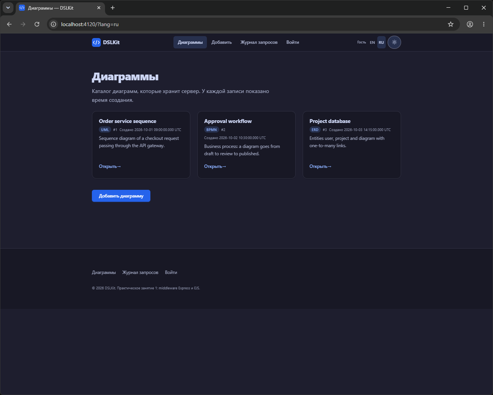
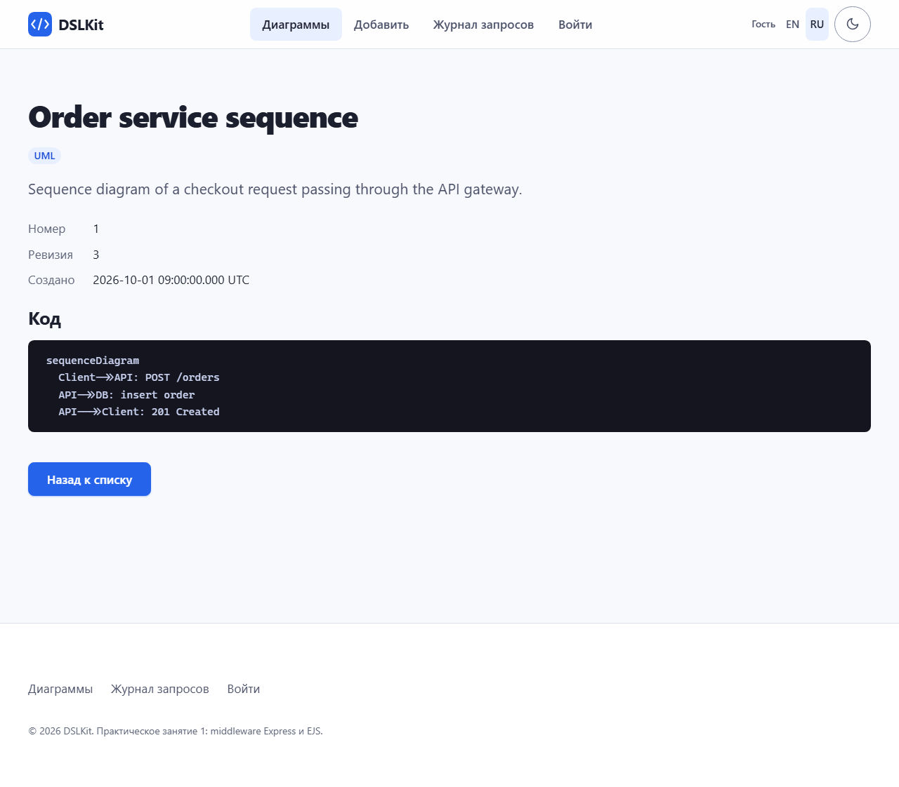
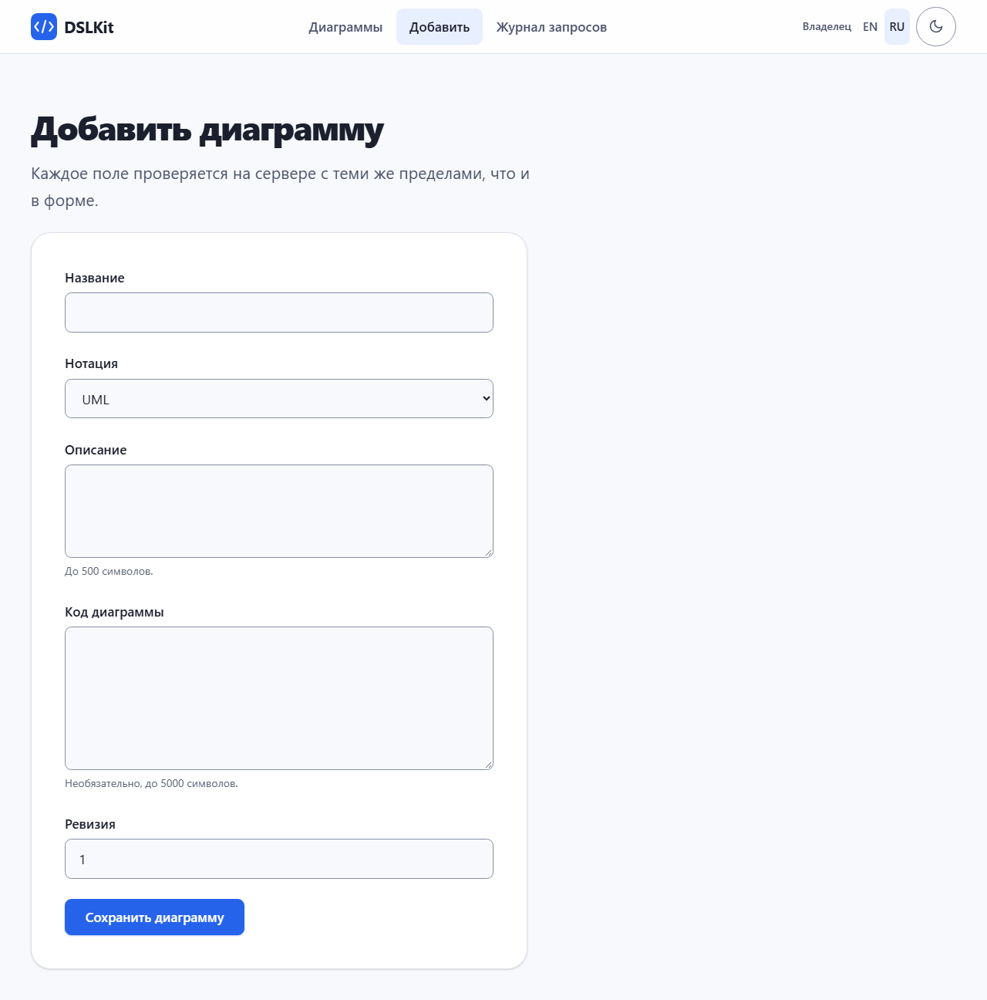
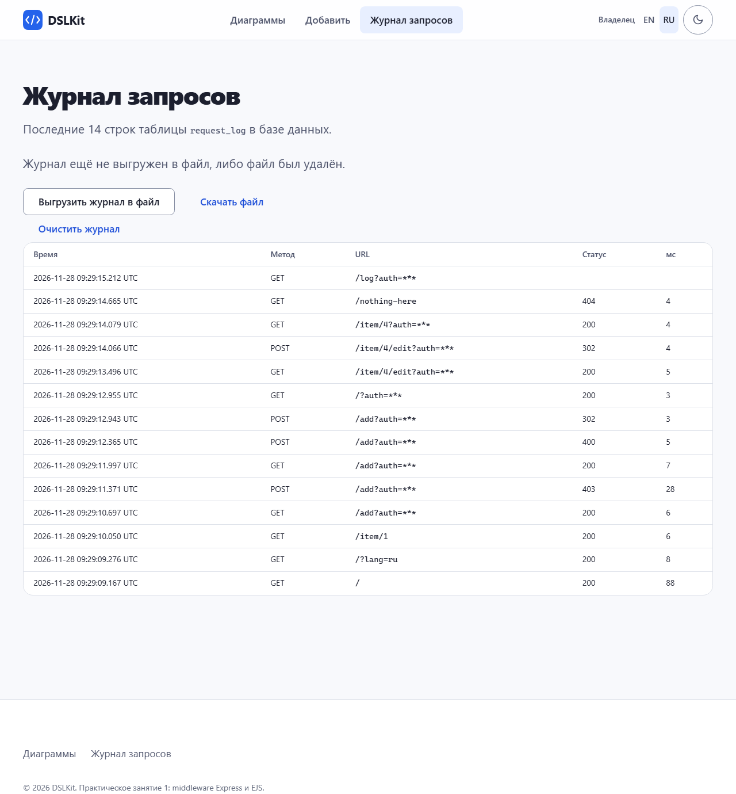
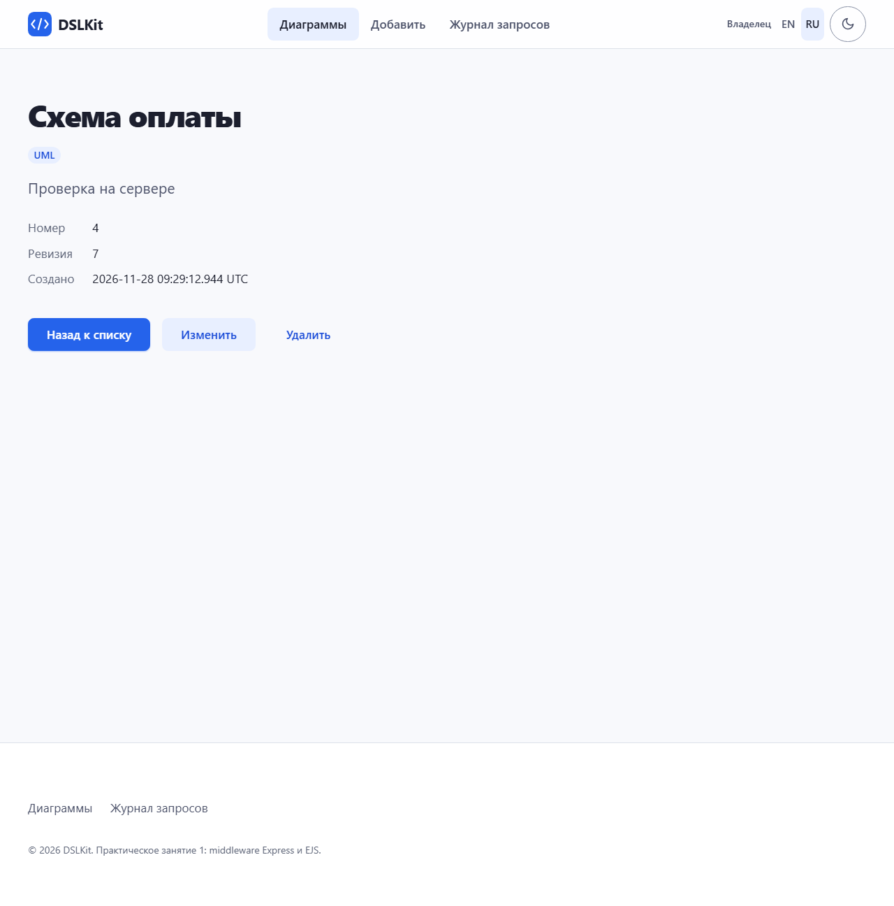
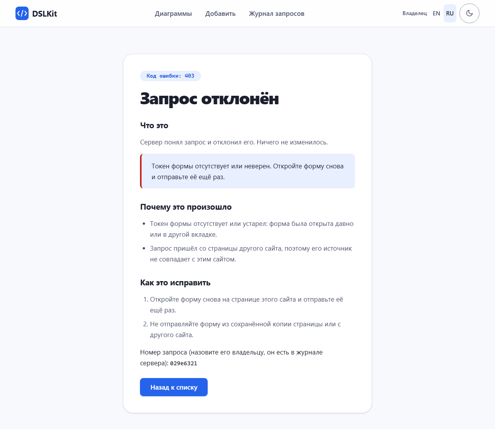
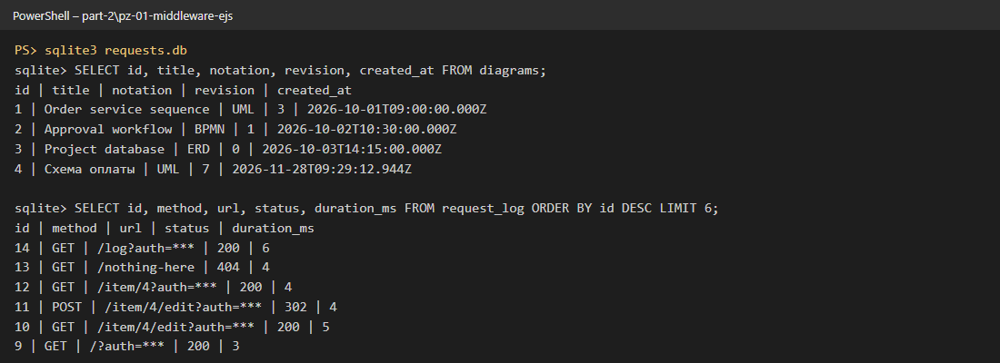
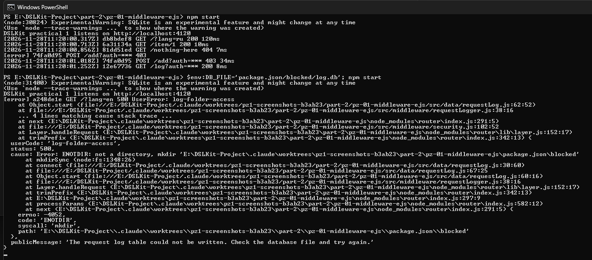

# Практическое занятие №1. Промежуточные обработчики и шаблонизаторы

## 1 Цель работы

Целью работы является освоение промежуточных обработчиков (middleware) в Express.js и шаблонизатора EJS на примере проекта DSLKit, веб-редактора диаграмм как кода, тематика которого соответствует направлению «программное обеспечение как услуга» и будущему курсовому проекту. Для достижения цели разработаны собственные обработчики журнала запросов, имитации авторизации и ошибок, подключены шаблоны EJS для четырех маршрутов и страниц ошибок, добавлена серверная проверка введенных значений, а все пределы длины и чисел вынесены в отдельный файл. Вариант 100 (номер в списке группы 26) четный, поэтому журнал запросов и данные каталога хранятся в таблицах базы данных, а не в файле. У каждой записи задано уникальное время создания, чтобы записи не совпадали визуально. Страница 500 открывается при настоящем сбое журнала, а не по кнопке, поэтому в отчете описан способ воспроизведения такого сбоя. Исходный код приложения размещен в репозитории {{meta:repository}} в ветке {{meta:branch}}.

## 2 Краткие теоретические сведения

**Промежуточный обработчик.** Это функция с параметрами `req`, `res` и `next`, получающая запрос и ответ и либо завершающая ответ, либо передающая управление дальше вызовом `next()`. Функции выполняются в порядке подключения, поэтому порядок определяет поведение приложения. Обработчик ошибок отличается четырьмя параметрами и подключается последним.

**Шаблонизатор EJS.** Шаблон содержит разметку HTML и вставки на языке JavaScript. Запись `<%= value %>` выводит значение с экранированием, запись `<% code %>` выполняет код, запись `<%- include() %>` подключает частичный шаблон. Данные передаются 2-м аргументом `res.render()`.

**Хранение данных.** Вариант 100 (номер в списке группы 26) четный, поэтому записи каталога и журнал запросов размещаются в базе данных SQLite, предоставляемой встроенным модулем `node:sqlite`. Записи хранятся в таблице `diagrams`, журнал в таблице `request_log`, установка отдельных пакетов не требуется. Таблицы создаются при 1-м обращении к базе, пустая таблица заполняется тремя начальными записями. При недоступной базе запрос завершается оформленной страницей 500, а сервер продолжает работу.

## 3 Ход работы

Работа выполнена в девяти этапах: описана структура проекта, реализованы журнал запросов, имитация авторизации, маршруты, страница 500, проверка полей и защита, затем оформлены страницы и проведена автоматическая проверка. Результаты каждого этапа приведены в подразделах 3.1–3.9.

### 3.1 Структура проекта

Проект размещен в каталоге `part-2/pz-01-middleware-ejs` и работает на Express 5 с шаблонизатором EJS. Структура показана в таблице 1.

Таблица 1 – Структура проекта практического занятия 1

| Файл | Назначение |
|---|---|
| `src/app.js` | Сборка приложения, порядок обработчиков и маршруты |
| `src/server.js` | Запуск сервера на порту |
| `src/middleware/requestLogger.js` | Запись каждого запроса в таблицу журнала |
| `src/middleware/fakeAuth.js` | Имитация авторизации |
| `src/middleware/errorHandlers.js` | Обработчики ошибок 404 и 500 |
| `src/middleware/security.js` | Заголовки безопасности, токен CSRF, ограничение частоты запросов, экранирование журнала |
| `src/errors.js` | Тексты страниц ошибок: что произошло, почему и как исправить |
| `src/i18n.js` | Выбор языка интерфейса по параметру `lang` и куки |
| `src/locales/` | Словари английского и русского языков |
| `src/limits.js` | Чтение файла `limits.json` |
| `src/data/requestLog.js` | Таблица `request_log` в SQLite |
| `src/data/diagrams.js` | Таблица `diagrams` в базе данных и проверка полей формы |
| `src/data/logFile.js` | Выгрузка журнала в файл и отдача файла потоками |
| `limits.json` | Все пределы длины и чисел |
| `views/` | Шаблоны EJS и частичные шаблоны |
| `public/` | Стили и логотип из Части 1 проекта, переключатель темы |

Настройка EJS выполнена в `src/app.js`, где заданы `view engine` и каталог `views`. Общий каркас страниц вынесен в частичные шаблоны `header` и `footer`, подключаемые в начале и в конце каждой страницы. Шаблон списка приведен в приложении А, сборка приложения и порядок подключения обработчиков в приложении Б.

### 3.2 Журнал запросов в таблице базы данных

Обработчик журнала подключен после статических файлов и имитации авторизации. До выполнения маршрута он вставляет в таблицу `request_log` строку со временем, методом и адресом запроса, а после завершения ответа дописывает в нее код статуса и длительность. Тот же результат выводится в консоль. Порядок выбран намеренно: запись выполняется до маршрута, поэтому ее сбой можно показать пользователю страницей 500, а после отправки ответа это невозможно. Таблица создается при 1-м обращении, если ее нет, а подключение к базе открывается отложенно, поэтому недоступная база не мешает запуску сервера и проявляется как ошибка запроса. Страница `/log` показывает последние строки таблицы, их число задано в `limits.json`. Листинг приведен в приложении В, описание таблицы в приложении Г.

### 3.3 Имитация авторизации

Обработчик `fakeAuth` проверяет параметр `?auth=1`. При его наличии в `req.user` записывается владелец, иначе гость, а в шаблоны передаются имя пользователя и хвост адреса для ссылок. Маршруты `/add` защищены функцией `requireAuth`: гость перенаправляется на страницу `/login`, где объяснен порядок «входа». Листинг приведен в приложении Д.

### 3.4 Маршруты и страницы

Реализованы четыре маршрута из условия и служебные маршруты, сведенные в таблицу 2. Код маршрутов приведен в приложении Е.

Таблица 2 – Маршруты приложения

| Маршрут | Результат |
|---|---|
| `GET /` | Список диаграмм из таблицы базы данных с временем создания каждой записи |
| `GET /item/:id` | Детальная страница, неизвестный номер ведет на страницу 404 |
| `GET /add` | Форма добавления, доступна с `?auth=1` |
| `POST /add` | Проверка полей, добавление в таблицу и переход на главную, при ошибке код 400 и форма с сохраненными значениями |
| `GET /item/:id/edit` | Форма изменения записи с текущими значениями, доступна с `?auth=1` |
| `POST /item/:id/edit` | Проверка полей и изменение записи, номер и время создания не меняются, при ошибке код 400 |
| `POST /item/:id/delete` | Удаление записи и переход на главную, повторное удаление дает 404 |
| `GET /login` | Страница-подсказка |
| `GET /log` | Таблица журнала запросов, доступна с `?auth=1` |

Шаблоны выводят все значения с экранированием, поэтому введенная в форме разметка отображается как текст. У каждой записи есть поле «время создания», задаваемое при добавлении и всегда более позднее, чем у предыдущей записи, даже при создании двух записей в одну миллисекунду, поэтому записи не совпадают визуально.

На детальной странице вошедшему пользователю показаны кнопки «Изменить» и «Удалить». Изменение открывает ту же форму, что и добавление, заполненную текущими значениями, и проверяет поля теми же правилами. Удаление выполнено не ссылкой, а формой с методом `POST`, потому что ссылка по адресу `GET` не должна менять данные. В обеих формах размещено скрытое поле `_csrf`, без которого сервер отвечает кодом 403 даже вошедшему пользователю. Гость, открывший защищенную страницу обычной ссылкой, переходит на страницу входа. Номер записи после удаления повторно не используется. Листинг шаблона item.ejs приведен в приложении Ж.

Страница журнала запросов содержит кнопку «Очистить журнал», реализованную формой с методом `POST` и скрытым полем CSRF, а не ссылкой. Запрос без токена получает ответ 403, гость с верным токеном перенаправляется на страницу входа, а у вошедшего пользователя таблица `request_log` очищается.

### 3.5 Страница 500 и порядок обработчиков

Страница 500 показывается при завершении запроса ошибкой сервера. Обработчик ошибок имеет четыре параметра и подключен после всех маршрутов и обработчиков, поэтому любое исключение, будь то сбой записи в журнал, ошибка маршрута или повреждение тела запроса, попадает именно в него. Обработчик записывает ошибку в консоль, выбирает код ответа и отображает шаблон `500.ejs` в общем оформлении сайта с шапкой, подвалом и таблицей стилей. Собственный код ошибки, например 413 для слишком большой формы, сохраняется, а страница получает собственный заголовок. При недоступной базе журнала на странице выводится понятное пояснение. Для сбоя до имитации авторизации обработчик подставляет гостя, чтобы шапка отобразилась. Если не удалось отобразить даже шаблон 500, отправляется запасная страница с тем же оформлением, поэтому пользователь не видит голый текст на черном фоне.

Страницу 500 вызывает настоящий сбой журнала, а не действие на странице сайта. Сбой воспроизводится в PowerShell командой `$env:DB_FILE='package.json/blocked/log.db'; npm start`: переменная окружения `DB_FILE` указывает на путь внутри файла, поэтому создать базу нельзя, и любой запрос заканчивается страницей 500. После проверки переменная удаляется командой `Remove-Item Env:DB_FILE`. Другой способ состоит в остановке базы во время работы сервера. Страница 404 устроена так же и подключена перед обработчиком 500. Листинг приведен в приложении И.

### 3.6 Проверка полей формы

Форма добавления проверяется на сервере, а те же пределы передаются в разметку атрибутами `maxlength`, `min` и `max`. Сначала значения обрезаются по краям, поэтому поле из одних пробелов считается пустым. Правила сведены в таблицу 3.

Таблица 3 – Проверки полей формы добавления

| Поле | Правило |
|---|---|
| Название | Обязательно, непусто после обрезки, не длиннее предела из `limits.json` |
| Описание | Обязательно, непусто после обрезки, не длиннее предела из `limits.json` |
| Нотация | Одно значение из списка |
| Код диаграммы | Необязательно, не длиннее предела из `limits.json` |
| Ревизия | Обязательна, целое число от 0 до предела из `limits.json`, отрицательные и дробные значения отвергаются |

При ошибке сервер отвечает кодом 400, повторно показывает форму с введенными значениями и выводит сообщение под каждым неверным полем. Отсутствующее тело запроса и повторяющиеся ключи формы тоже дают код 400, а не 500. Все пределы размещены в файле `limits.json`, а не в коде. Листинг проверки приведен в приложении К, хранилище записей в таблице `diagrams` в приложении Л и в приложении М, файл пределов в приложении Н.

### 3.7 Защита формы и сервера

Форма и сервер защищены от типовых атак без подключения новых пакетов. Для защиты от подделки межсайтового запроса (CSRF) сервер помещает подписанный случайный токен в куки `dslkit_csrf` с признаками `HttpOnly` и `SameSite=Strict` и в скрытое поле формы. Запрос на изменение данных принимается только при совпадении обоих значений и указании заголовком `Origin`, если он присутствует, на этот же сайт. В остальных случаях показывается страница с кодом 403. Каждый ответ получает заголовки `Content-Security-Policy`, `X-Content-Type-Options`, `X-Frame-Options` и `Referrer-Policy`, а имя фреймворка в заголовках скрыто. Политика не допускает встроенных скриптов и стилей, поэтому в шаблонах они отсутствуют.

Ограничение частоты запросов возвращает код 429 со страницей в общем оформлении и заголовком `Retry-After`: общий предел и более строгий предел для отправки формы заданы в `limits.json`. Размер тела формы и число ее полей ограничены тем же файлом, поэтому огромные значения приводят к странице с кодом 400 или 413, а не к сбою. Адрес запроса в журнале проходит экранирование: переводы строк и управляющие символы заменяются записью `\uXXXX`, а длина обрезается, поэтому подделка строк журнала невозможна. Страница `/log` открыта только с `?auth=1`, так как на ней видны адреса чужих запросов. Листинг заголовков и проверки CSRF приведен в приложении П, ограничения частоты и экранирования журнала в приложении Р.

### 3.8 Внешний вид страниц

Оформление страниц взято из Части 1 проекта: шапка с логотипом и навигацией, подвал, кнопки, карточки и поля формы используют те же стили и разметку, что сайт и приложение DSLKit. Переключатель светлой и темной темы работает так же, как в Части 1, шапка закреплена при прокрутке, на каждой странице размещена одна главная кнопка. Список диаграмм с временем создания каждой записи показан на рисунке 1.

Рисунок 1 – Главная страница с карточками диаграмм и временем создания

Детальная страница одной записи с ее ревизией и кодом показана на рисунке 2.

Рисунок 2 – Страница диаграммы с описанием, ревизией и исходным кодом

Пустая форма добавления до ввода данных показана на рисунке 3.

Рисунок 3 – Форма добавления диаграммы без введенных значений и без сообщений об ошибках

Форма после отправки пробельного названия и отрицательной ревизии показана на рисунке 4. Под каждым неверным полем выведено сообщение, введенные значения сохранены.

Рисунок 4 – Форма добавления с сообщениями о пустом названии и отрицательной ревизии

Таблица журнала запросов из базы данных показана на рисунке 5.

Рисунок 5 – Страница журнала с последними строками таблицы request_log и кнопками очистки и выгрузки

Журнал выгружается в текстовый файл и скачивается. Кнопка «Выгрузить журнал в файл» записывает строки таблицы потоком (`pipeline` с `createWriteStream`) во временный файл и переименовывает его в итоговый только после полной записи, поэтому сбой посреди записи не портит прежний файл. Кнопка «Скачать файл» отдает файл через `createReadStream`. Код потоков приведен в приложении С. Если файл удален, перемещен или нечитаем, пользователю показывается страница с объяснением, что произошло, почему и как исправить, а не обрыв соединения и не безымянная ошибка 500. Обрыв посреди передачи закрывает соединение и записывается в консоль сервера, работа сервера продолжается. Тексты всех страниц ошибок размещены в одном каталоге `src/errors.js`, каждая страница отвечает на три вопроса: что это, почему так произошло и как исправить.

Страница 404 для неизвестного адреса показана на рисунке 6.

Рисунок 6 – Страница ошибки 404 с блоками «Что это», «Почему это произошло», «Как это исправить» и номером запроса

Кроме страниц 404 и 500 сайт показывает оформленные страницы для кодов 400, 403, 405, 413 и 429. Каждая страница объясняет, что произошло, почему и что делать, все тексты размещены в каталоге `src/errors.js`. Коды и случаи показа сведены в таблицу 4.

Таблица 4 – Страницы ошибок сайта

| Код | Заголовок страницы | Когда показывается |
| --- | --- | --- |
| 400 | Некорректный запрос | Адрес или данные формы прочитать нельзя |
| 403 | Запрос отклонен | В форме нет токена защиты или он не совпал с куки, либо заголовок `Origin` указывает на другой сайт |
| 404 | Страница не найдена | По адресу нет страницы или записи |
| 405 | Метод не разрешен | Адрес существует, но не для этого метода запроса |
| 413 | Запрос слишком большой | Тело запроса больше предела из `limits.json` |
| 429 | Слишком много запросов | С одного адреса пришло больше запросов, чем разрешено |
| 500 | Ошибка сервера | Сбой сервера, в том числе недоступная база журнала или каталога |

Страница 500 при настоящем сбое показана на рисунке 7. Сервер запущен с файлом базы, который создать нельзя, поэтому запись журнала не удалась.

Рисунок 7 – Страница ошибки 500 с пояснением, что запись в таблицу журнала запросов не удалась

Та же форма с верными значениями сохраняет запись, и главная страница показывает новую карточку с собственным временем создания, как на рисунке 8.

Рисунок 8 – Главная страница после добавления диаграммы через форму

Кнопка «Изменить» на детальной странице открывает форму изменения с текущими значениями полей, показанную на рисунке 9.

Рисунок 9 – Форма изменения добавленной диаграммы с текущими значениями и новой ревизией

После сохранения изменений открывается детальная страница с новой ревизией, время создания остается прежним, как на рисунке 10.

Рисунок 10 – Детальная страница диаграммы после изменения с новой ревизией

Страница 403 при форме без токена защиты показана на рисунке 11.

Рисунок 11 – Страница ошибки 403 после отправки формы без токена защиты

Страница 429 при превышении числа запросов показана на рисунке 12.

Рисунок 12 – Страница ошибки 429 при слишком частых запросах

Сбой журнала проверен остановкой базы: запрос получает страницу 500 с пояснением о недоступности базы журнала, а в консоль выводится строка об ошибке. Таблицы базы данных показаны на рисунке 13.

Рисунок 13 – Строки таблиц diagrams и request_log, прочитанные запросами SELECT из файла базы SQLite

### 3.9 Автоматическая проверка

Автоматические тесты на встроенном `node:test` запускают сервер на свободном порту и проверяют страницы, перенаправление гостя, добавление записи, проверку полей, экранирование, таблицу журнала, недоступную базу, уникальное время создания, изменение и удаление записи с токеном CSRF, обе страницы ошибок, токен CSRF, заголовки безопасности, ограничение частоты, экранирование журнала и огромные значения. Запуск выполняется командой `npm test` в каталоге проекта.

Консоль сервера при запуске командой `npm start` и после запросов показана на рисунке 14.

Рисунок 14 – Консоль сервера: запросы со статусами 200, 404 и 403, затем строка ошибки 500 при недоступном файле базы

Результат команды `npm test` с числом тестов и покрытием кода показан на рисунке 15.

Рисунок 15 – Конец вывода команды npm test: число пройденных тестов и таблица покрытия

## 4 Ответы на контрольные вопросы

Номер в списке группы 26, поэтому даны ответы на вопросы 25, 26 и 27.

25. Как в Express реализовать защиту от CSRF с помощью промежуточного обработчика (теоретически)?

    Браузер сам прикладывает куки к запросу на сайт, даже если форму отправила страница чужого сайта, поэтому одних куки для защиты недостаточно. В работе применена схема двойной отправки значения вместе с проверкой заголовка `Origin`. Обработчик выдает токен и помещает его в куки `dslkit_csrf` с признаками `HttpOnly` и `SameSite=Strict` и в скрытое поле `_csrf` каждой формы. Токен состоит из случайной части и подписи `HMAC`, ключ подписи создается при запуске сервера, поэтому самодельное значение, подставленное злоумышленником в куки, проверку подписи не проходит. Запрос, меняющий данные (`POST`, `PUT`, `PATCH`, `DELETE`), принимается только при совпадении значения поля с куки и указании заголовком `Origin`, если он есть, на этот же сайт. Безопасные методы, например `GET`, токен не проверяют, поэтому они не должны менять данные, и удаление выполнено формой `POST`. Сравнение выполняется функцией `timingSafeEqual`. Порядок важен: обработчик подключается после разбора формы, так как токен находится в теле, и до маршрутов. Пакет `csurf` снят с поддержки, а его преемник `csrf-csrf` построен на той же схеме, поэтому в работе она реализована вручную без новых пакетов. Токен не привязан к сессии: у приложения нет сессий, защита отделяет свой сайт от чужого, но не одного пользователя от другого. Поэтому злоумышленник с родственного поддомена мог бы поместить в куки настоящий подписанный токен, полученный от сайта, и вставить то же значение в форму: подпись такой токен не отвергнет, а защитой служат только проверка заголовка `Origin` и признак `SameSite=Strict`. После перезапуска сервера ключ меняется, и открытые формы приходится загружать заново.

26. Как в EJS использовать вспомогательную функцию (например, для форматирования даты) в шаблоне?

    Функция помещается в `app.locals` и становится доступной во всех шаблонах, либо в `res.locals` для одного запроса, либо передается 2-м аргументом `res.render()`. В работе `app.locals.formatTime` преобразует строку ISO вида `2026-10-01T09:00:00.000Z` в читаемую запись «2026-10-01 09:00:00.000 UTC». В шаблоне вызов выглядит так: `<%= formatTime(item.createdAt) %>`. Запись `<%=` экранирует результат, а точное машинное значение сохраняется в атрибуте `datetime` элемента `time`.

27. Почему обработчик статических файлов обычно подключается до всех маршрутов?

    Запрос файла стилей или логотипа должен получить ответ сразу, без прохождения авторизации, журнала, разбора формы и поиска среди маршрутов. Страница при этом загружается быстрее, а в журнал не попадает строка на каждый файл. В работе `express.static` размещен после заголовков безопасности, генератора номера запроса и проверки живости `/health`, но до имитации авторизации, ограничения частоты, журнала, разбора формы и маршрутов. При отсутствии файла `express.static` вызывает `next()`, запрос идет дальше по цепочке, и адрес без файла получает страницу 404 из обработчика `notFound`. Если разместить статику после маршрутов, шаблонный маршрут или обработчик 404 могут перехватить адрес файла раньше. Платой за такой порядок служит доступность статических файлов без входа и вне ограничения частоты запросов, поэтому в `public` нельзя помещать закрытые данные.

## Заключение

Для проекта DSLKit разработано приложение на Express с шаблонами EJS: список диаграмм, детальная страница и форма добавления получают данные из таблицы `diagrams` базы данных SQLite. Журнал запросов по правилам четного варианта записывается в таблицу `request_log` той же базы, а его сбой показывается оформленной страницей 500 без выполнения действия. Форма отвергает пустые и пробельные значения, слишком длинный текст и отрицательные числа по пределам из отдельного файла `limits.json`, у каждой записи задано уникальное время создания. Записи изменяются и удаляются кнопками на детальной странице, удаление выполняется формой `POST`. Форма защищена токеном CSRF, сервер заголовками безопасности и ограничением частоты запросов. Страницы ошибок 400, 403, 404, 405, 413, 429 и 500 оформлены в стиле сайта и объясняют, что произошло, почему и как исправить. Оформление взято из Части 1 проекта. Автоматические тесты на `node:test` проверяют страницы, формы, защиту и сбой журнала, код приложения покрыт тестами полностью, что видно на рисунке 15. Снимки страниц приведены в тексте, листинги в приложениях. Ответы на контрольные вопросы 25, 26 и 27 даны в разделе 4. Работа выполнена в ветке {{meta:branch}} репозитория проекта.

## Приложение А (обязательное) index.ejs

Комментарии в листингах всех приложений написаны по-английски, как в исходных файлах проекта.

{{code:part-2/pz-01-middleware-ejs/views/index.ejs}}

## Приложение Б (обязательное) app.js, сборка

{{code:part-2/pz-01-middleware-ejs/src/app.js#1-97}}

## Приложение В (обязательное) Логгер запросов

{{code:part-2/pz-01-middleware-ejs/src/middleware/requestLogger.js#11-56}}

## Приложение Г (обязательное) requestLog.js

{{code:part-2/pz-01-middleware-ejs/src/data/requestLog.js}}

## Приложение Д (обязательное) fakeAuth.js

{{code:part-2/pz-01-middleware-ejs/src/middleware/fakeAuth.js}}

## Приложение Е (обязательное) Маршруты app.js

{{code:part-2/pz-01-middleware-ejs/src/app.js#99-197}}

## Приложение Ж (обязательное) item.ejs

{{code:part-2/pz-01-middleware-ejs/views/item.ejs}}

## Приложение И (обязательное) Ошибки 404, 500

{{code:part-2/pz-01-middleware-ejs/src/middleware/errorHandlers.js}}

## Приложение К (обязательное) Проверка полей

{{code:part-2/pz-01-middleware-ejs/src/data/diagrams.js#142-181}}

## Приложение Л (обязательное) Данные записей

{{code:part-2/pz-01-middleware-ejs/src/data/diagrams.js#8-40}}

## Приложение М (обязательное) Хранилище

{{code:part-2/pz-01-middleware-ejs/src/data/diagrams.js#41-140}}

## Приложение Н (обязательное) limits.json

{{code:part-2/pz-01-middleware-ejs/limits.json}}

## Приложение П (обязательное) Заголовки, CSRF

{{code:part-2/pz-01-middleware-ejs/src/middleware/security.js#1-94}}

## Приложение Р (обязательное) Ограничения

{{code:part-2/pz-01-middleware-ejs/src/middleware/security.js#96-130}}

## Приложение С (обязательное) logFile.js

{{code:part-2/pz-01-middleware-ejs/src/data/logFile.js}}
