# Practical Session 2. Design and Implementation of a REST API

## 1 Purpose of the Work

To learn the principles of designing a RESTful API, to implement endpoints for CRUD operations and extra operations, to add input validation and to document the API, using the DSLKit project, a diagram-as-code web editor whose theme matches the SaaS direction and the future course project.

## 2 Brief Theory

**Resources and methods.** REST describes the subject area as a set of resources with plural addresses such as `/api/diagrams`. Operations map to HTTP methods: `GET` reads, `POST` creates, `PUT` replaces a record entirely, `PATCH` changes part of the fields, `DELETE` removes. The methods `GET`, `PUT` and `DELETE` are idempotent: repeating a request does not change the result.

**Status codes.** Code 200 means success, 201 creation with a `Location` header, 204 success without a body, 400 a client error in the request, 404 a missing record, 409 a conflict with the current state of the data, 413 a body that is too large, 500 a server failure.

**Data validation.** The server does not trust the client: required fields, types, length and allowed values are checked before writing, and an error response has a single format.

## 3 Course of the Work

### 3.1 API design

Three related resources are chosen: users `users`, projects `projects` and diagrams `diagrams`. A user owns projects and a project holds diagrams. The fields are listed in table 1.

Table 1 – API resources and fields

| Resource   | Fields                                                                    |
| ---------- | ------------------------------------------------------------------------- |
| `users`    | `name`, `email`, `role` (`owner`, `editor`, `viewer`)                     |
| `projects` | `name`, `description`, `ownerId`                                          |
| `diagrams` | `title`, `notation`, `code`, `projectId`, `status` (`draft`, `published`) |

Every record has the service fields `id` and `createdAt`, which the client cannot change. The data lives in arrays in memory, as the task requires, so the initial records return after a server restart.

### 3.2 Endpoints

Each resource has six standard operations, and diagrams and projects have three extra ones. All addresses are listed in table 2. The application assembly is shown in appendix A, the shared resource logic in appendix B and the field checks in appendix C.

Table 2 – API endpoints

| Method and address                 | Purpose                                   | Success |
| ---------------------------------- | ----------------------------------------- | ------- |
| `GET /api/{resource}`              | List with filter, search, sort and paging | 200     |
| `GET /api/{resource}/:id`          | One record                                | 200     |
| `POST /api/{resource}`             | Create                                    | 201     |
| `PUT /api/{resource}/:id`          | Full replacement                          | 200     |
| `PATCH /api/{resource}/:id`        | Partial change                            | 200     |
| `DELETE /api/{resource}/:id`       | Delete                                    | 204     |
| `GET /api/users/:id/projects`      | Projects of one user                      | 200     |
| `GET /api/projects/:id/diagrams`   | Diagrams of one project                   | 200     |
| `POST /api/diagrams/:id/publish`   | Publish, repeating changes nothing        | 200     |
| `POST /api/diagrams/:id/duplicate` | Copy of a diagram as a draft              | 201     |

Examples of the request body and the expected response for the main operations are in table 3. The data come from `API.md` and match the answers of the running server (port 3962). The `createdAt` field is shortened to `…`, and `id` depends on the number of records already created.

Table 3 – Request and response examples

| Request | Request body | Expected response |
| ------- | ------------ | ----------------- |
| `POST /api/users` | `{"name":"Anna","email":"anna@example.com","role":"owner"}` | 201, `{"id":3,"name":"Anna","email":"anna@example.com","role":"owner","createdAt":"…"}` |
| `POST /api/diagrams` | `{"title":"Billing schema","notation":"ERD","code":"invoice -> payment","projectId":1}` | 201, `{"id":4,"title":"Billing schema","notation":"ERD","code":"invoice -> payment","projectId":1,"status":"draft","createdAt":"…"}` |
| `GET /api/diagrams?q=billing&sort=-title` | none | 200, `{"data":[{…},{…}],"meta":{"page":1,"limit":20,"total":2}}` |
| `PATCH /api/users/1` | `{"role":"editor"}` | 200, the user with `"role":"editor"` |
| `POST /api/diagrams/1/publish` | none | 200, the diagram with `"status":"published"` |
| `POST /api/diagrams/1/duplicate` | none | 201, a copy with `"title":"Checkout sequence (copy)"` and `"status":"draft"` |
| `DELETE /api/diagrams/2` | none | 204, no body |
| `DELETE /api/users/1` | none | 409, `{"error":{"code":"conflict","message":"User still owns projects"}}` |
| `POST /api/users` | `{"name":"","email":"x"}` | 400, `{"error":{"code":"validation_failed","message":"Request body is invalid","details":[{"field":"name",…},{"field":"email",…}]}}` |

Lists accept `page` and `limit` for paging, `sort` for sorting (a minus sign means descending), `q` for search in text fields and any field name for an exact filter. A list response holds the array `data` and the object `meta` with the total count. The route `GET /api/users/:id/projects` returns the projects of one user with the same list parameters and answers 404 for an unknown user. The file `API.md` collects detailed request and response examples.

### 3.3 Validation and errors

The schema of every resource sets the type, whether the field is required, the maximum length, the list of allowed values and the default. Validation returns all problems at once, rejects unknown fields and checks that `ownerId` and `projectId` point to existing records. The `PATCH` method checks only the sent fields. Deleting a user who owns projects or a project that has diagrams is rejected with code 409. All errors, including broken JSON, an unknown address and an unexpected failure, come back in one format with the fields `code` and `message`. Appendices A and B hold the listings.

### 3.4 Verification

Automatic tests start the server on a free port and check every method, the status codes, filters, sorting, paging, validation errors, the links between resources, the extra operations and the 500 response. Line and function coverage is 100 percent and branch coverage is above 98 percent. The command is `npm test` in the project folder. Manual checks in Postman or Insomnia can use the requests from `API.md`.

The server is started with `npm start`, and the console message is shown in figure 1.

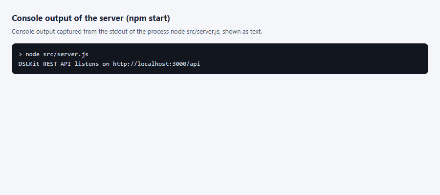

Figure 1 – Console message after the server starts on port 3000 (process output captured as text)

A browser does not send `POST`, `PUT`, `PATCH` and `DELETE` from the address bar, so the script `shots/shots.mjs` sent such requests, and the real requests and server answers are drawn on a page. Creating a user, a project and a diagram is shown in figure 2.

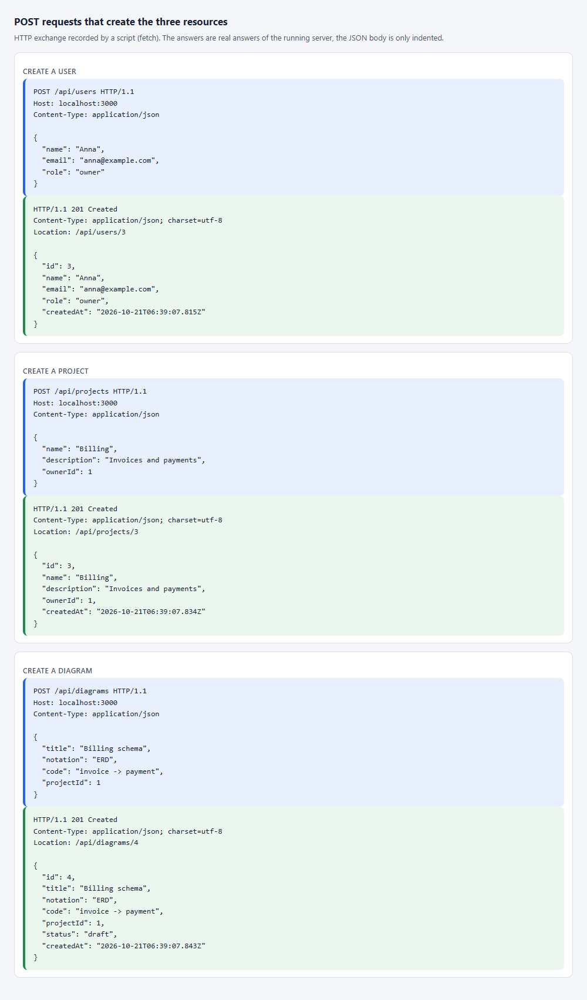

Figure 2 – POST requests and the answers 201 for a user, a project and a diagram, recorded by a script (not a Postman window)

The `GET /api/users` request is opened in the browser at `http://localhost:3000/api/users`, and the answer is shown in figure 3.

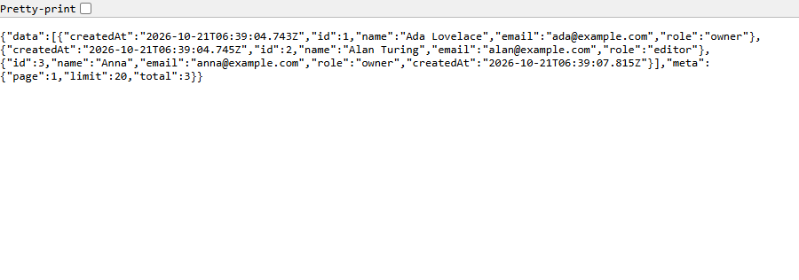

Figure 3 – Answer to GET /api/users in a browser window: an array of users

A single record at `http://localhost:3000/api/users/1` is shown in figure 4.

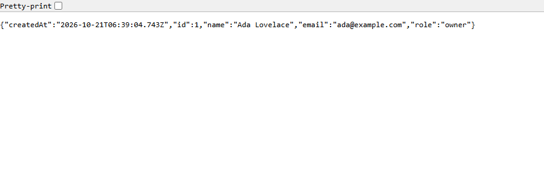

Figure 4 – Answer to GET /api/users/1 in a browser window: the object of one user

A request for a missing record at `http://localhost:3000/api/users/999` gives the error shown in figure 5.

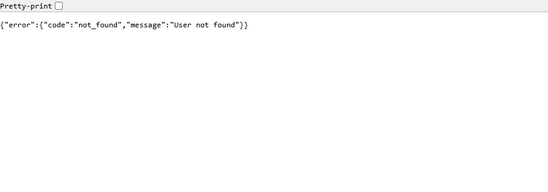

Figure 5 – Answer to GET /api/users/999 in a browser window: JSON with the code not_found (code 404)

A wrong id in the address `http://localhost:3000/api/users/abc` is refused, as in figure 6.

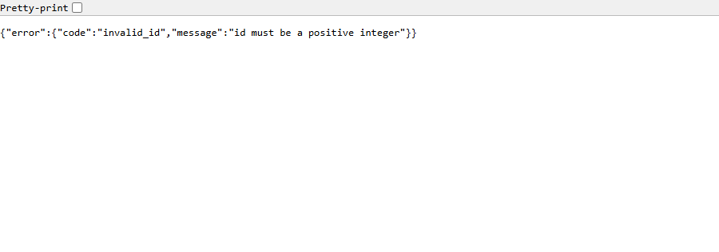

Figure 6 – Answer to GET /api/users/abc in a browser window: JSON with a message about a wrong id (code 400)

Search, sorting and paging work through the address parameters `?q=billing&sort=-title&page=1&limit=10`, and the result is shown in figure 7.

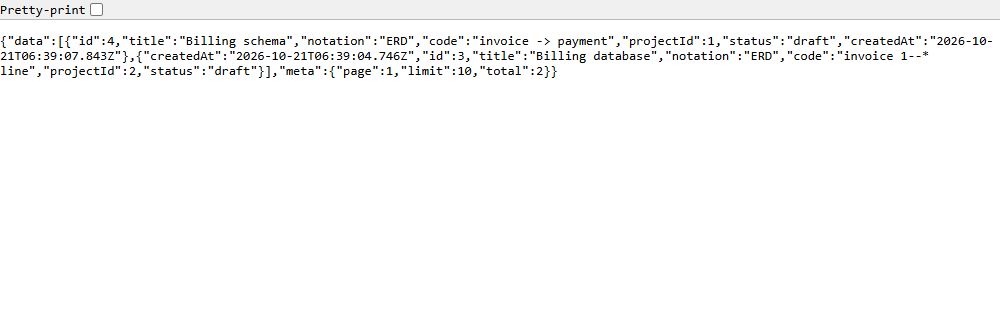

Figure 7 – Answer to GET /api/diagrams with the q, sort, page and limit parameters in a browser window

The additional route `GET /api/users/1/projects` returns the projects of one user, as in figure 8.

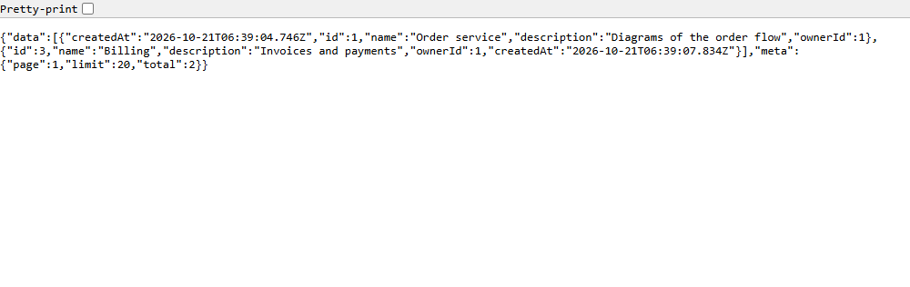

Figure 8 – Answer to GET /api/users/1/projects in a browser window: the projects of the user

The data validation errors, including an unknown field and a project that does not exist, are shown in figure 9.

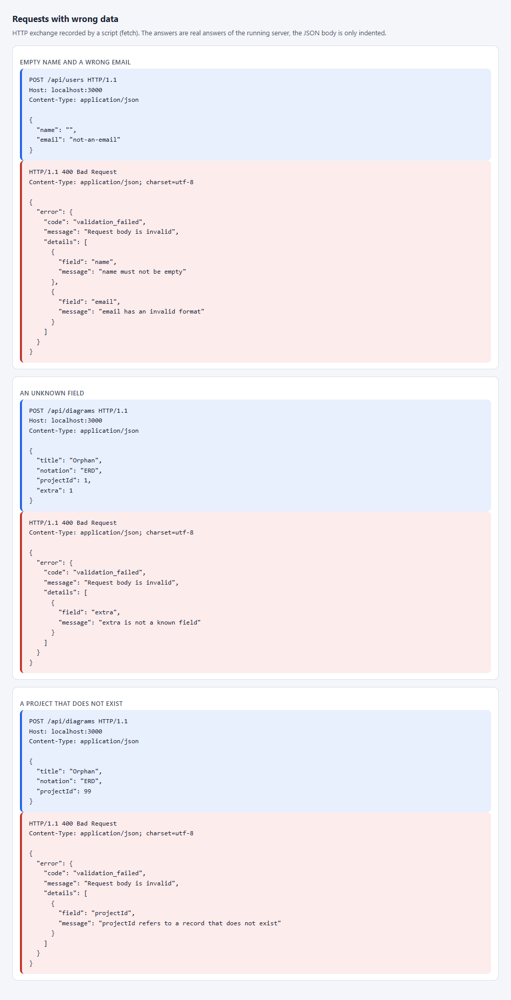

Figure 9 – Answers 400 with the list of field problems, recorded by a script (not a Postman window)

A partial change and a full replacement of a record are shown in figure 10.

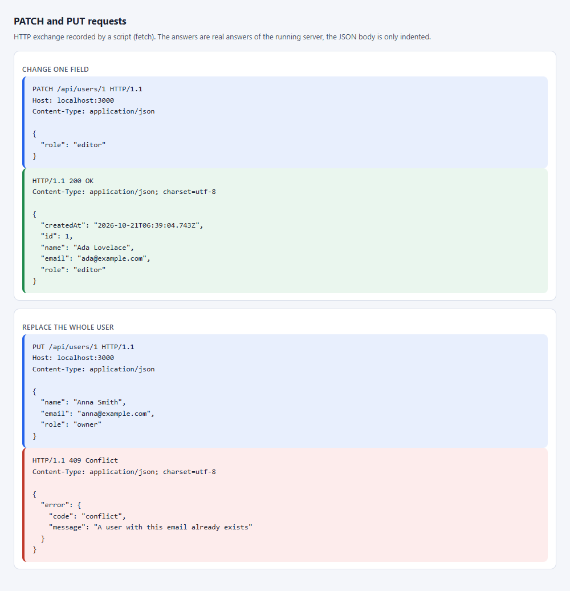

Figure 10 – PATCH and PUT requests and the server answers, recorded by a script (not a Postman window)

The additional operations of a diagram are shown in figure 11: publishing again changes nothing, and the copy is created as a draft.

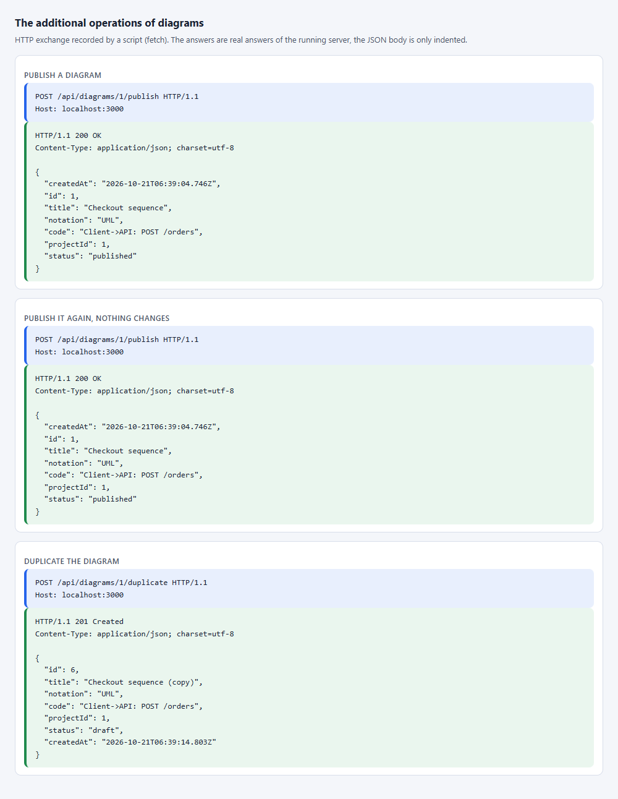

Figure 11 – Publish and duplicate requests and the server answers, recorded by a script (not a Postman window)

Deleting a user with projects is refused, and deleting a diagram passes, as in figure 12.

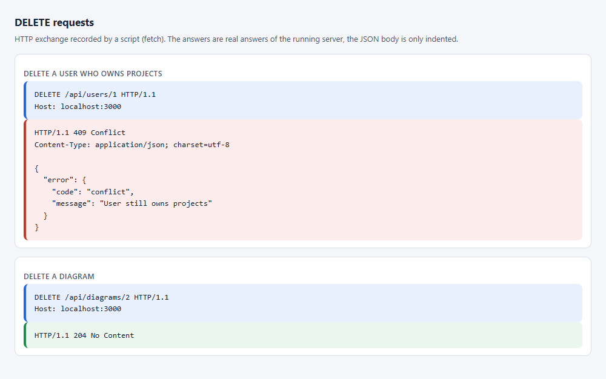

Figure 12 – DELETE requests: the answer 409 for a user with projects and the answer 204 for a diagram, recorded by a script (not a Postman window)

The result of the `npm test` command with the number of tests and the code coverage is shown in figure 13.

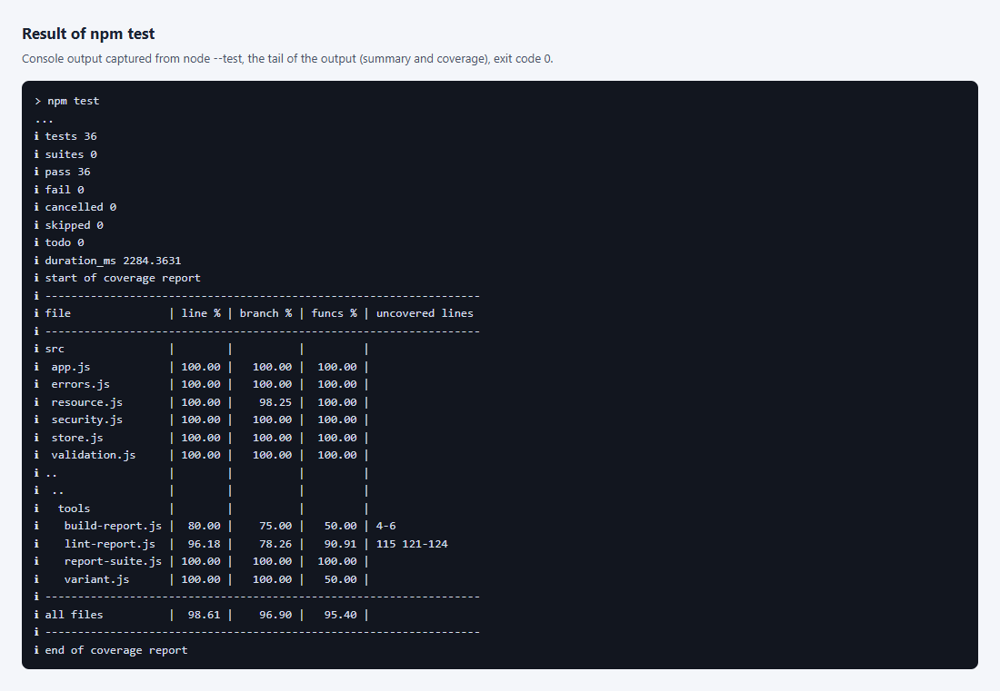

Figure 13 – End of the npm test output: the number of passed tests and the coverage table (process output captured as text)

### 3.5 Answers to the control questions

25. What are "cross-resource links" and how are they implemented in a REST API (for example, getting the orders of a user)?

    These are links between records of different resources, for example a project belongs to a user and a diagram belongs to a project. An API expresses a link in three ways. The first is a reference field in the record, in the work this is `ownerId` of a project and `projectId` of a diagram, and the server checks that such a record exists. The second is a nested route for reading, for example `GET /api/users/:id/projects` returns the projects of a user and `GET /api/projects/:id/diagrams` the diagrams of a project. The third is a list filter, and `GET /api/projects?ownerId=1` gives the same result. Nesting is kept at most two levels deep, and resource names are plural. The link guards deletion as well: a user with projects and a project with diagrams are not deleted, the answer is 409.

26. Which status codes are used for redirects (3xx)? Are they needed in a REST API?

    Code 301 means a permanent move of the address, 302 a temporary one, 307 and 308 do the same but keep the request method, 303 sends the client to another address with `GET`, and 304 says the cached response is still current. In Express a redirect is made by `res.redirect(status, url)`. A REST API needs redirects rarely: after `POST` it returns 201 with a `Location` header and the record itself instead of redirecting the client. Redirects are used when an address or an API version moves, and 304 for conditional requests with `ETag`. This work has no redirects.

27. How do you state the possible error codes and their descriptions in the API documentation?

    In OpenAPI each operation lists the codes in its `responses` section, for example `400`, `404` and `409`, and gives a description and a body schema for each. The common error schema is described once in `components` and attached by reference. In the work the documentation lives in `API.md`: the table of each route has a column with the possible error codes, and the "Errors" section shows the single response shape `{ "error": { "code", "message", "details" } }` and lists the `code` values with their status codes. That way a client knows which errors to expect and how to parse them.

### 3.6 OpenAPI description

The route `GET /api/openapi.json` returns the description of the API in the OpenAPI 3.0 format. It is built from the same schemas that validate the requests, so field lengths, lists of allowed values and required fields in the document match the code. The `email` field is not offered as a filter of the user list. The document can be opened in Swagger UI or imported into Postman.

A fragment of the API documentation is shown in figure 14.

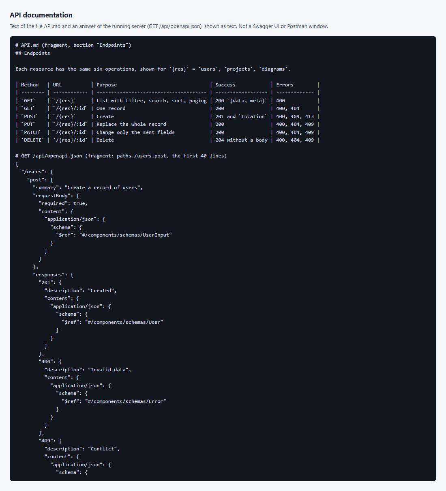

Figure 14 – A fragment of the file `API.md` and of the answer of `GET /api/openapi.json` (text captured by the script `shots/docs-shot.mjs`, not a Swagger UI window)

No Postman window was captured in this work: real screenshots of the program window cannot be produced here, so a script sent the requests in figures 2 and 9–12, and the captions say so. The ready collection `postman_collection.json` and the file `requests.http` allow repeating the check and taking such screenshots by hand.

## Conclusion

For the DSLKit project a REST API with three related resources was designed and implemented. It supports CRUD operations, filtering, search, sorting, paging, publishing and copying of diagrams, validates input and the links between records, and answers with errors in one format. `API.md` holds the API description and request examples, and automatic tests cover all the code. Postman screenshots and documentation excerpts remain to be attached.

## Appendix A (mandatory) Listing of the file app.js

```js
import { readFileSync } from 'node:fs';
import express from 'express';
import { ApiError, errorBody, notFound } from './errors.js';
import { createResourceRouter, listItems, methodsOnly, parseId } from './resource.js';
import { logSafe, rateLimit, securityHeaders } from './security.js';
import { buildOpenApi } from './openapi.js';
import { createStores } from './store.js';
import { normalizeEmail } from './validation.js';

// All sizes live in limits.json, not in the code.
export const LIMITS = JSON.parse(readFileSync(new URL('../limits.json', import.meta.url), 'utf8'));

export const NOTATIONS = ['UML', 'BPMN', 'ERD', 'DFD', 'IDEF0', 'Petri'];

const ID = { type: 'integer', required: true, min: 1, max: LIMITS.idMax };

// Local part: ASCII, no leading/trailing/doubled dot. Domain: one or more dot-separated labels, no leading,
// trailing or doubled hyphen or dot. Every alternation below is a single, disjoint character class repeated
// with its own quantifier, so there is no ambiguity for the engine to backtrack over; matching stays linear
// in the length of the string even for a deliberately pathological input.
const LOCAL_PART = "[A-Za-z0-9!#$%&'*+/=?^_`{|}~-]+(?:\\.[A-Za-z0-9!#$%&'*+/=?^_`{|}~-]+)*";
const DOMAIN_LABEL = '[A-Za-z0-9](?:[A-Za-z0-9-]*[A-Za-z0-9])?';
const EMAIL_PATTERN = new RegExp(`^${LOCAL_PART}@${DOMAIN_LABEL}(?:\\.${DOMAIN_LABEL})+$`);

export const schemas = {
  users: {
    name: { type: 'string', required: true, max: LIMITS.userName },
    email: { type: 'string', required: true, max: LIMITS.userEmail, pattern: EMAIL_PATTERN, transform: normalizeEmail },
    role: { type: 'string', enum: ['owner', 'editor', 'viewer'], default: 'viewer' },
  },
  projects: {
    name: { type: 'string', required: true, max: LIMITS.projectName },
    description: { type: 'string', max: LIMITS.projectDescription, default: '', multiline: true },
    ownerId: ID,
  },
  diagrams: {
    title: { type: 'string', required: true, max: LIMITS.diagramTitle },
    notation: { type: 'string', enum: NOTATIONS, required: true },
    code: { type: 'string', max: LIMITS.diagramCode, default: '', multiline: true },
    projectId: ID,
    status: { type: 'string', enum: ['draft', 'published'], default: 'draft' },
  },
};

const CLIENT_ERRORS = {
  400: ['bad_request', 'The request URL or headers are malformed'],
  415: ['unsupported_media_type', 'The request encoding or charset is not supported'],
};

const missingReference = (field, collection, value) =>
  value !== undefined && !collection.find(value) ? [{ field, message: `${field} refers to a record that does not exist` }] : [];

const conflict = (message) => new ApiError(409, 'conflict', message);

// Methods that normally send no body; a body on one of these is simply not read rather than being a reason
// to reject the request (a non-JSON Content-Type is only an error on a request that is meant to carry JSON).
const BODYLESS_METHODS = new Set(['GET', 'HEAD', 'DELETE']);

export const createApp = ({
  stores = createStores(undefined, LIMITS.maxRecordsPerCollection),
  writeError = console.error,
  limit = { windowMs: LIMITS.rateWindowMs, max: LIMITS.rateMax, maxClients: LIMITS.rateMaxClients },
  now = Date.now,
} = {}) => {
  const { users, projects, diagrams } = stores;
  const app = express();
  app.disable('x-powered-by');
  app.use(securityHeaders);
  // Liveness probe, before the rate limit so monitoring never uses up the quota.
  app.get('/health', (req, res) => res.json({ status: 'ok' }));
  // Refused before the body is read, so a flood costs little.
  app.use(rateLimit({ ...limit, now }));
  // This API answers only JSON; a client that explicitly asks for something else gets 406 instead of JSON it
  // did not ask for. A request with no Accept header, or "*/*", is always welcome.
  app.use((req, res, next) => {
    const accept = req.headers.accept;
    if (!accept) return next();
    const acceptsJson = accept.split(',').some((part) => {
      const type = part.split(';')[0].trim().toLowerCase();
      return type === '*/*' || type === 'application/*' || type === 'application/json';
    });
    if (!acceptsJson) return next(new ApiError(406, 'not_acceptable', 'This API only returns application/json'));
    return next();
  });
  // A declared charset other than UTF-8 is rejected up front with 415, instead of being read as UTF-8 anyway
  // and failing JSON parsing later with the unrelated 400 invalid_json.
  app.use((req, res, next) => {
    const match = /charset=("?)([^;"]+)\1/i.exec(req.headers['content-type'] ?? '');
    if (match && match[2].trim().toLowerCase() !== 'utf-8') return next(new ApiError(415, 'unsupported_media_type', 'Only charset=utf-8 is supported'));
    return next();
  });
  app.use(express.json({ limit: LIMITS.bodyBytes }));
  // A body that express.json did not read (another Content-Type) is refused with 415, not taken as a missing
  // body - but only for a method that is meant to carry one; GET/HEAD/DELETE never need a JSON body, so any
  // body they do carry is simply ignored instead of failing the request over an unrelated Content-Type.
  app.use((req, res, next) => {
    if (BODYLESS_METHODS.has(req.method)) return next();
    const hasBody = Number(req.headers['content-length'] ?? 0) > 0 || req.headers['transfer-encoding'] !== undefined;
    if (hasBody && req.body === undefined) return next(new ApiError(415, 'unsupported_media_type', 'Content-Type must be application/json'));
    return next();
  });

  const api = express.Router();
  // The machine-readable description of the API, built from the schemas above.
  api.get('/openapi.json', (req, res) => res.json(buildOpenApi(schemas, { hidden: { users: ['email'] } })));
  api.all('/openapi.json', methodsOnly('GET'));
  // Link between resources: the projects that belong to one user. It is mounted before the standard router so it wins over /:id.
  api.get('/users/:id/projects', (req, res) => {
    const user = users.find(parseId(req.params.id));
    if (!user) throw notFound('User');
    res.json(
      listItems(
        projects.all().filter((p) => p.ownerId === user.id),
        schemas.projects,
        req.query,
      ),
    );
  });
  api.all('/users/:id/projects', methodsOnly('GET'));
  api.use(
    '/users',
    createResourceRouter({
      label: 'User',
      collection: users,
      schema: schemas.users,
      // The email is personal data: the list shows id, name and role, the email only comes with one user.
      hiddenInList: ['email'],
      hooks: {
        check: (data, current) => {
          const taken = data.email !== undefined && users.all().some((user) => user !== current && user.email.toLowerCase() === data.email.toLowerCase());
          if (taken) throw conflict('A user with this email already exists');
          return [];
        },
        beforeRemove: (user) => {
          if (projects.all().some((project) => project.ownerId === user.id)) throw conflict('User still owns projects');
        },
      },
    }),
  );

  // Extra operations are mounted before the standard routers so they win over /:id.
  api.get('/projects/:id/diagrams', (req, res) => {
    const project = projects.find(parseId(req.params.id));
    if (!project) throw notFound('Project');
    res.json(
      listItems(
        diagrams.all().filter((d) => d.projectId === project.id),
        schemas.diagrams,
        req.query,
      ),
    );
  });
  api.all('/projects/:id/diagrams', methodsOnly('GET'));
  api.use(
    '/projects',
    createResourceRouter({
      label: 'Project',
      collection: projects,
      schema: schemas.projects,
      hooks: {
        check: (data) => missingReference('ownerId', users, data.ownerId),
        beforeRemove: (project) => {
          if (diagrams.all().some((diagram) => diagram.projectId === project.id)) throw conflict('Project still has diagrams');
        },
      },
    }),
  );

  const diagram = (req) => {
    const found = diagrams.find(parseId(req.params.id));
    if (!found) throw notFound('Diagram');
    return found;
  };
  api.post('/diagrams/:id/publish', (req, res) => res.json(diagrams.update(diagram(req), { status: 'published' })));
  api.post('/diagrams/:id/duplicate', (req, res) => {
    const { id, createdAt, ...rest } = diagram(req);
    // Cut by code points, not by UTF-16 units: slicing a surrogate pair in half would store (and re-serve) a
    // lone surrogate, which is not valid Unicode text.
    const title = [...`${rest.title} (copy)`].slice(0, LIMITS.diagramTitle).join('');
    res.status(201).json(diagrams.create({ ...rest, title, status: 'draft' }));
  });
  api.all('/diagrams/:id/publish', methodsOnly('POST'));
  api.all('/diagrams/:id/duplicate', methodsOnly('POST'));
  api.use(
    '/diagrams',
    createResourceRouter({
      label: 'Diagram',
      collection: diagrams,
      schema: schemas.diagrams,
      hooks: { check: (data) => missingReference('projectId', projects, data.projectId) },
    }),
  );

  app.use('/api', api);
  app.use((req, res, next) => next(notFound('Route')));

  // Four parameters: the single place where every error becomes JSON.
  app.use((err, req, res, _next) => {
    if (err instanceof ApiError) return res.status(err.status).json(errorBody(err));
    if (err.type === 'entity.parse.failed') return res.status(400).json(errorBody(new ApiError(400, 'invalid_json', 'Request body is not valid JSON')));
    if (err.type === 'entity.too.large') return res.status(413).json(errorBody(new ApiError(413, 'payload_too_large', 'Request body is too large')));
    // Errors of the framework and of the body parser that blame the client keep their 4xx status: a broken
    // percent escape in the URL is 400 and an unsupported Content-Encoding is 415, neither is a server failure.
    const status = err.status ?? err.statusCode;
    if (status >= 400 && status < 500) {
      const known = CLIENT_ERRORS[status] ?? ['bad_request', 'The request cannot be processed'];
      return res.status(status).json(errorBody(new ApiError(status, known[0], known[1])));
    }
    writeError(`[error] ${logSafe(req.method)} ${logSafe(req.originalUrl)}`, err);
    return res.status(500).json(errorBody(new ApiError(500, 'internal_error', 'Internal server error')));
  });
  return app;
};
```

## Appendix B (mandatory) Listing of the file resource.js

```js
import { Router } from 'express';
import { ApiError, notFound, validationFailed } from './errors.js';
import { applyDefaults, trimStrings, validate } from './validation.js';

// Answers 405 with an Allow header for methods a known path does not support; OPTIONS lists them.
export const methodsOnly = (...methods) => {
  const allow = [...methods, ...(methods.includes('GET') ? ['HEAD'] : []), 'OPTIONS'].join(', ');
  return (req, res, next) => {
    res.set('Allow', allow);
    if (req.method === 'OPTIONS') return res.status(204).end();
    return next(new ApiError(405, 'method_not_allowed', `${req.method} is not allowed here, use: ${allow}`));
  };
};

const DIGITS = /^[1-9]\d{0,14}$/;

export const parseId = (raw) => {
  if (!DIGITS.test(String(raw))) throw new ApiError(400, 'invalid_id', 'id must be a positive integer');
  return Number(raw);
};

// The largest integer `DIGITS` can ever match (15 nines): the real ceiling for page/limit/id, below
// Number.MAX_SAFE_INTEGER. Error messages quote this instead of a bound that is never actually enforced.
const MAX_QUERY_INT = 999999999999999;

const scalar = (raw, name) => {
  if (Array.isArray(raw)) throw new ApiError(400, 'invalid_query', `${name} must not be repeated`);
  return raw;
};

const parsePositive = (raw, name, fallback, max = MAX_QUERY_INT) => {
  if (raw === undefined) return fallback;
  if (!DIGITS.test(String(scalar(raw, name))) || Number(raw) > max) throw new ApiError(400, 'invalid_query', `${name} must be an integer from 1 to ${max}`);
  return Number(raw);
};

// Filtering by any schema field (?status=draft), search (?q=text), sorting (?sort=-title), pagination (?page=2&limit=10).
// hidden: fields that never appear in a list; filtering, searching or sorting by one is silently a no-op
// (otherwise ?email= or ?sort=email would reveal it) rather than an error, so it still cannot be used as an oracle.
// Any OTHER query key that is not a schema field, page, limit, sort or q is unknown and answers 400, instead of
// being read and then quietly ignored.
export const listItems = (items, schema, query, hidden = []) => {
  const known = new Set(['page', 'limit', 'sort', 'q', ...Object.keys(schema)]);
  for (const key of Object.keys(query)) {
    if (!known.has(key)) throw new ApiError(400, 'invalid_query', `${key} is not a known query parameter`);
  }
  const page = parsePositive(query.page, 'page', 1);
  const limit = parsePositive(query.limit, 'limit', 20, 100);
  let result = items.filter((item) =>
    Object.keys(schema).every((field) => {
      if (hidden.includes(field) || query[field] === undefined) return true;
      const raw = scalar(query[field], field);
      const rule = schema[field];
      if (rule.type === 'integer' && !DIGITS.test(String(raw))) throw new ApiError(400, 'invalid_query', `${field} must be a positive integer`);
      if (rule.enum && !rule.enum.includes(String(raw))) throw new ApiError(400, 'invalid_query', `${field} must be one of: ${rule.enum.join(', ')}`);
      return String(item[field]) === String(raw);
    }),
  );
  if (query.q !== undefined) {
    const needle = String(scalar(query.q, 'q')).toLowerCase();
    const textFields = Object.keys(schema).filter((field) => schema[field].type === 'string' && !hidden.includes(field));
    result = result.filter((item) =>
      textFields.some((field) =>
        String(item[field] ?? '')
          .toLowerCase()
          .includes(needle),
      ),
    );
  }
  if (query.sort !== undefined) {
    const raw = String(scalar(query.sort, 'sort'));
    const desc = raw.startsWith('-');
    const field = raw.replace(/^-/, '');
    if (hidden.includes(field) || (field !== 'id' && field !== 'createdAt' && !Object.hasOwn(schema, field))) throw new ApiError(400, 'invalid_query', `cannot sort by ${field}`);
    // Locale-aware for text (so case and accents sort the way a reader expects), tie-broken by id so equal
    // keys keep a fixed, repeatable order instead of whatever order the sort happened to leave them in.
    const compare = (a, b) => (typeof a[field] === 'string' && typeof b[field] === 'string' ? a[field].localeCompare(b[field]) : a[field] > b[field] ? 1 : a[field] < b[field] ? -1 : 0);
    result = [...result].sort((a, b) => {
      const primary = compare(a, b) * (desc ? -1 : 1);
      return primary !== 0 ? primary : a.id - b.id;
    });
  }
  const total = result.length;
  const data = result.slice((page - 1) * limit, page * limit).map((item) => Object.fromEntries(Object.entries(item).filter(([field]) => !hidden.includes(field))));
  return { data, meta: { page, limit, total } };
};

// Builds the six standard routes for one resource.
// hooks.check(data, current) returns extra validation details for the fields present (references)
// and may throw a conflict; current is the record being changed, undefined on create.
//
// hooks.beforeRemove(item) may throw.
export const createResourceRouter = ({ label, collection, schema, hooks = {}, hiddenInList = [] }) => {
  const router = Router();
  const body = (req, partial, current) => {
    const input = trimStrings(schema, req.body);
    const errors = validate(schema, input, { partial });
    const data = partial ? input : applyDefaults(schema, input, current);
    const details = errors.length ? errors : (hooks.check?.(data, current) ?? []);
    if (details.length) throw validationFailed(details);
    return data;
  };
  const load = (req) => {
    const item = collection.find(parseId(req.params.id));
    if (!item) throw notFound(label);
    return item;
  };

  router.get('/', (req, res) => res.json(listItems(collection.all(), schema, req.query, hiddenInList)));
  router.get('/:id', (req, res) => res.json(load(req)));
  router.post('/', (req, res) => {
    const item = collection.create(body(req, false));
    res.status(201).location(`${req.baseUrl}/${item.id}`).json(item);
  });
  router.put('/:id', (req, res) => {
    const item = load(req);
    res.json(collection.replace(item, body(req, false, item)));
  });
  router.patch('/:id', (req, res) => {
    const item = load(req);
    res.json(collection.update(item, body(req, true, item)));
  });
  router.delete('/:id', (req, res) => {
    const item = load(req);
    hooks.beforeRemove?.(item);
    collection.remove(item);
    res.status(204).end();
  });
  router.all('/', methodsOnly('GET', 'POST'));
  router.all('/:id', methodsOnly('GET', 'PUT', 'PATCH', 'DELETE'));
  return router;
};
```

## Appendix C (mandatory) Listing of the file validation.js

```js
// C0/C1 control characters (NUL, BEL, newline, ...) minus tab/newline/CR, which `multiline` fields allow.
const CONTROL_STRICT = /[\u0000-\u001F\u007F-\u009F]/;
const CONTROL_MULTILINE = /[\u0000-\u0008\u000B\u000C\u000E-\u001F\u007F-\u009F]/;
// Invisible formatting characters that a reader cannot see and that a plain `trim()` does not remove:
// zero-width space, bidi marks and overrides, byte-order mark, soft hyphen. The zero-width joiner/non-joiner
// are left out on purpose, they are part of ordinary emoji and script text (e.g. "👩‍💻").
const INVISIBLE_CODE_POINTS = [0x00ad, 0x200b, 0x200e, 0x200f, 0x202a, 0x202b, 0x202c, 0x202d, 0x202e, 0x2066, 0x2067, 0x2068, 0x2069, 0xfeff];
const INVISIBLE_FORMAT = new RegExp(`[${INVISIBLE_CODE_POINTS.map((cp) => String.fromCodePoint(cp)).join('')}]`, 'u');

// A schema maps a field name to { type, required, max, enum, pattern, default, multiline }.
// Types: 'string', 'integer'. Returns a list of { field, message }.
const checkField = (name, rule, value) => {
  if (rule.type === 'integer') {
    if (!Number.isInteger(value)) return `${name} must be an integer`;
    if (value < rule.min || value > rule.max) return `${name} must be between ${rule.min} and ${rule.max}`;
  }
  if (rule.type === 'string') {
    if (typeof value !== 'string') return `${name} must be a string`;
    // Rejects an unpaired (lone) surrogate: valid in a JS string and in JSON, but not valid Unicode text.
    if (!value.isWellFormed()) return `${name} contains an invalid character (an unpaired surrogate)`;
    if ((rule.multiline ? CONTROL_MULTILINE : CONTROL_STRICT).test(value) || INVISIBLE_FORMAT.test(value)) {
      return `${name} must not contain control or invisible characters`;
    }
    if (rule.required && value.trim() === '') return `${name} must not be empty`;
    // Counted by code points, so an emoji is one character as the user sees it, not two UTF-16 units.
    if (rule.max && [...value].length > rule.max) return `${name} must be at most ${rule.max} characters`;
    if (rule.pattern && !rule.pattern.test(value)) return `${name} has an invalid format`;
  }
  if (rule.enum && !rule.enum.includes(value)) return `${name} must be one of: ${rule.enum.join(', ')}`;
  return null;
};

// partial=true is used by PATCH: required fields may be missing, present ones are still checked.
export const validate = (schema, body, { partial = false } = {}) => {
  if (body === null || typeof body !== 'object' || Array.isArray(body)) return [{ field: 'body', message: 'body must be a JSON object' }];
  if (partial && Object.keys(body).length === 0) return [{ field: 'body', message: 'send at least one field to change' }];
  const errors = [];
  for (const field of Object.keys(body)) {
    if (!Object.hasOwn(schema, field)) errors.push({ field, message: `${field} is not a known field` });
  }
  for (const [field, rule] of Object.entries(schema)) {
    const value = body[field];
    if (value === undefined) {
      if (rule.required && !partial && rule.default === undefined) errors.push({ field, message: `${field} is required` });
      continue;
    }
    const message = checkField(field, rule, value);
    if (message) errors.push({ field, message });
  }
  return errors;
};

// current: the record being replaced (PUT) so a field left out of the body keeps its current value instead of
// being silently reset to the schema default (a role, for example, must not be lowered just by omitting it).
// undefined on create (POST), where an omitted field does take the schema default.
export const applyDefaults = (schema, body, current) => {
  const result = { ...body };
  for (const [field, rule] of Object.entries(schema)) {
    if (result[field] !== undefined) continue;
    if (current && Object.hasOwn(current, field)) result[field] = current[field];
    else if (rule.default !== undefined) result[field] = rule.default;
  }
  return result;
};

// Unicode compatibility normalization so "é" (one code point) and "e" + combining acute (two code points) become
// the same text, then strips invisible formatting characters a `trim()` would miss, then lower-cases: two emails
// that render identically can no longer be told apart or used to register two look-alike accounts.
export const normalizeEmail = (value) => value.normalize('NFKC').replace(/[\u0000-\u001F\u007F-\u009F\p{Cf}]/gu, '').toLowerCase();

// Trims surrounding whitespace of known string fields, so " Ada " is stored as "Ada", then applies the field's
// own transform (e-mails are normalized) so validation and storage see the same, final text.
export const trimStrings = (schema, body) => {
  if (body === null || typeof body !== 'object' || Array.isArray(body)) return body;
  const result = { ...body };
  for (const field of Object.keys(result)) {
    if (!Object.hasOwn(schema, field) || typeof result[field] !== 'string') continue;
    const trimmed = result[field].trim();
    result[field] = schema[field].transform ? schema[field].transform(trimmed) : trimmed;
  }
  return result;
};
```
