# Practical Session 2. Design and Implementation of a REST API

## 1 Purpose of the Work

The purpose of the work is the study of the principles of designing a RESTful API using the DSLKit project, a diagram-as-code web editor whose theme matches the SaaS direction and the future course project. To reach it, three linked resources are designed, CRUD and extra operations are implemented for them, and input validation, one error format and an API description are added. Variant 100 (number 26 in the group list) is even, so the request journal is kept in a database table, not in a file, and a request is recorded in it before the action. The data of the resources is kept in in-memory arrays, as the task requires. The source code is placed in the repository https://github.com/KsushaKhadzhinova/DSLKit-Project, branch pz22.

## 2 Brief Theory

**Resources and methods.** REST describes the subject area as a set of resources with plural addresses, for example `/api/diagrams`. Operations are expressed by HTTP methods: `GET` reads, `POST` creates, `PUT` replaces a record entirely, `PATCH` changes some fields, `DELETE` removes. The methods `GET`, `PUT` and `DELETE` are idempotent: repeating the request does not change the result.

**Status codes.** Code 200 means success, 201 creation with a `Location` header, 204 success without a body, 400 a client error in the request, 403 a refusal of the right to act, 404 a missing record, 409 a conflict with the current state of the data, 413 a body that is too large, 429 too frequent requests, 500 a server failure.

**Data validation.** The server does not trust the client: required fields, types, length and allowed values are checked before writing, and an error answer has one format.

**Request journal.** For an even variant the journal is kept in a database table. A record of the request is written before the action, so with an unavailable journal the action is not carried out and the answer 500 is returned to the client.

## 3 Course of the Work

### 3.1 API design

Three linked resources are chosen: users `users`, projects `projects` and diagrams `diagrams`. A user owns projects and a project contains diagrams. The fields and validation rules are collected in table 1.

Table 1 – API resources and fields

| Resource | Fields |
| --- | --- |
| `users` | `name`, `email`, `role` (`owner`, `editor`, `viewer`) |
| `projects` | `name`, `description`, `ownerId` |
| `diagrams` | `title`, `notation`, `code`, `projectId`, `status` (`draft`, `published`) |

Every record has the service fields `id` and `createdAt`, which a client cannot change. The data of the resources is kept in in-memory arrays, as the task requires, so after a server restart the initial records are restored: two users, two projects and three diagrams. The request journal is kept in the table `request_log` of an SQLite database. The files of the project and their purpose are listed in table 2.

Table 2 – Files of the project of practical session No. 2

| File | Purpose |
| --- | --- |
| `src/app.js` | Resource schemas, middleware order, routes and the single error handler |
| `src/resource.js` | Common routes of a resource and parsing of list parameters |
| `src/validation.js` | Request body validation against a schema |
| `src/store.js` | Array storage and the initial records |
| `src/server.js`, `src/start.js` | Server start: reading the environment settings, the port, the graceful stop and the time limits for slow clients |
| `src/journal.js` | The table `request_log` and the journal middleware |
| `src/security.js` | Security headers, rate limit, roles, console output without line breaks |
| `src/errors.js`, `src/error-catalog.js`, `src/error-page.js` | The error class, error texts and the error page for a browser |
| `src/openapi.js` | The OpenAPI 3.0 description built from the same schemas |
| `limits.json` | All limits of length, page size, body size and request rate |

### 3.2 Endpoints

For every resource six standard operations are implemented, and extra operations for diagrams and projects. All operations with the method, address, description, request body example and expected answer are given in table 3. The address `/api/users` is given as an example, the same operations are implemented for `projects` and `diagrams`. The application assembly is shown in appendix A, the routes and the error handler in appendix B, the common logic of resources in appendix C and the field validation in appendix D.

Table 3 – API endpoints with request and response examples

| Method | URL | Description | Request body example | Expected answer |
| --- | --- | --- | --- | --- |
| `GET` | `/api/users` | List of users | none | 200, `{"data":[{…},{…}],"meta":{"page":1,"limit":20,"total":2}}` |
| `GET` | `/api/users/1` | One record | none | 200, the user object |
| `POST` | `/api/users` | Create a user | `{"name":"Anna","email":"anna@example.com","role":"owner"}` | 201, a user with `id` and `createdAt` |
| `PUT` | `/api/users/2` | Full replacement | `{"name":"Alan T","email":"alan@example.com","role":"editor"}` | 200, the user with new fields |
| `PATCH` | `/api/users/1` | Partial change | `{"role":"editor"}` | 200, the user with `"role":"editor"` |
| `DELETE` | `/api/users/1` | Delete a user | none | 409, the user still owns projects |
| `DELETE` | `/api/diagrams/2` | Delete a diagram | none | 204, no body |
| `GET` | `/api/diagrams?q=billing&sort=-title` | List with search and sorting | none | 200, a list with the `meta` object |
| `POST` | `/api/diagrams` | Create a diagram | `{"title":"Billing schema","notation":"ERD","code":"invoice -> payment","projectId":1}` | 201, a diagram with `"status":"draft"` |
| `GET` | `/api/users/1/projects` | Projects of one user | none | 200, a list of projects with `meta` |
| `GET` | `/api/projects/1/diagrams` | Diagrams of one project | none | 200, a list of diagrams with `meta` |
| `POST` | `/api/diagrams/1/publish` | Publish, a repeat changes nothing | none | 200, a diagram with `"status":"published"` |
| `POST` | `/api/diagrams/1/duplicate` | A copy of a diagram as a draft | none | 201, a copy with `"status":"draft"` |
| `POST` | `/api/users` | Invalid data | `{"name":"","email":"x"}` | 400, `validation_failed` and the list of fields |

The field `createdAt` is unique for every record: the clock is strictly increasing, so two records never match even within one millisecond. Lists accept the parameters `page` and `limit` for pages, `sort` for sorting (a minus sign means descending), `q` for search over text fields and a field name for an exact filter. A list answer holds the array `data` and the object `meta` with the total number of records. The route `GET /api/users/:id/projects` answers 404 for an unknown user. Detailed examples are collected in the file `API.md`.

### 3.3 Input validation and errors

The schema of every resource sets the type, whether the field is required, the maximum length, the list of allowed values and the default value. The validation is implemented so that all problems found are returned at once, unknown fields and whitespace-only values are rejected, and the references `ownerId` and `projectId` are matched with existing records. For `PATCH` only the fields present in the request are validated. All limits are kept in the file `limits.json`. All errors, including invalid JSON, an unknown address and an unexpected failure, are returned in one format with the fields `code`, `message`, `title`, `description` and `requestId`. The error codes are collected in table 4.

Table 4 – API error codes

| Code | When it is returned |
| --- | --- |
| 400 | Invalid body, JSON or field value, invalid headers `X-User-Id` and `X-Role` |
| 403 | An ordinary user changes someone else's record or deletes a project |
| 404 | The record or the address does not exist |
| 405, 406, 415 | The method is not supported, the needed answer type or body type is not supported |
| 409 | A user with projects or a project with diagrams is deleted, the parent of a new record is already deleted |
| 412 | The `If-Match` condition did not match on change or delete |
| 413 | The request body is larger than the limit from `limits.json` |
| 429 | More requests than allowed arrive within a minute |
| 500 | A server failure, including an unavailable request journal |

Deleting a user with projects or a project with diagrams is rejected with code 409 instead of silently deleting the linked records. If a parent is deleted at the moment a child record is added to it, the outcome is always one of three: 201, 404 or 409. A 5xx answer and a dangling record without a parent never happen. One test checks the creation of a project while its owner is deleted, in both orders, and another one checks twenty parallel requests of every kind: there is no 5xx answer and the ids stay unique. A conditional request with the `If-Match` header protects against a lost update: if the record has already been changed, the answer is 412.

### 3.4 Roles and the answer 403

Sign-in is not implemented in the work, the identity is set by headers. The header `X-User-Id` holds the number of a user, and `X-Role` is `user` by default or `admin`. A request without `X-User-Id` is anonymous and not restricted, as before the roles. The rules for a request with `X-User-Id` are collected in table 5.

Table 5 – Rights of the roles

| Action | Ordinary user | Administrator |
| --- | --- | --- |
| Change or delete one's own user record | yes | yes |
| Change or delete the record of another user | 403 | yes |
| Change one's own project, create a project for oneself | yes | yes |
| Change someone else's project, give a project to another user | 403 | yes |
| Delete a project | 403 | yes |
| Change, delete, publish, copy a diagram and create one | only in one's own project, otherwise 403 | yes |

A wrong header value gives 400, and the number of a non-existent user in `X-User-Id` gives 403. First it is checked that the record exists (404), then the rights (403), then the request body. The headers are trusted: this is a teaching simplification, in a real system the identity is taken from a verified session or token. The listing is given in appendix E.

### 3.5 Request journal and the order of actions

The journal is kept in the table `request_log` of an SQLite database with the columns time, method, path, client address, status code and request number `request_id`. The order for every request is as follows. First a number is assigned to the request and returned in the header `X-Request-Id`. Then, before the action, a row with the time, method, path, client address and request number is inserted into the table. After a failed insert the action is not carried out and the answer 500 with the code `journal_unavailable` is returned: work without a journal is forbidden. After a successful insert the action is carried out and the final status code is added to the row. Failed attempts with codes 400, 403, 404, 409 and 412 stay in the journal too.

Two groups of requests do not reach the journal: the health check `GET /health` and the requests rejected by the rate limit with code 429. The health check goes before the journal so that monitoring does not fill the table or use up the limit. Excess requests are rejected before the journal so that their flow does not fill the table. The journal write and the action on the data are not in one transaction, because the data of the resources is kept in an array, so the atomicity "no record, no action" is provided by the order of the steps: a journal failure cancels the action. A failure after the action, while the final code is written, does not change the answer to the client, the error is written to the server console. The listing is given in appendix F.

A journal failure is reproduced while the server runs, not by a button. The server is started with `$env:JOURNAL_FILE='demo.sqlite'; npm start`, then in another window the journal table is dropped by the command `node tools/break-journal.mjs demo.sqlite`, after which every request received the answer 500. The table is restored by `node tools/break-journal.mjs demo.sqlite --restore`. The environment variable is removed by `Remove-Item Env:JOURNAL_FILE`. The journal table with real rows is shown in figure 1.

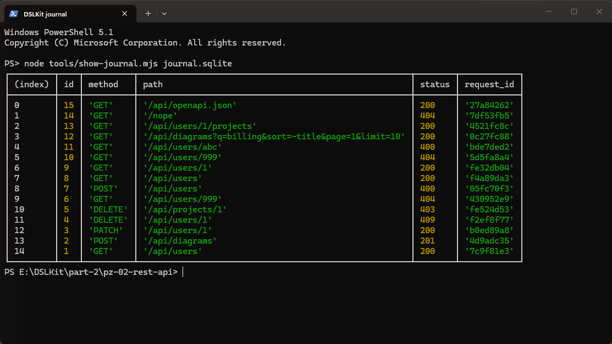

Figure 1 – The table request_log of the SQLite database printed in a PowerShell window: method, path, status code and request number

### 3.6 Error pages

For a browser an arranged page is returned instead of JSON, with the code, a title, three blocks "What happened", "Likely cause" and "What to do", and the request number. The same number is given in the header `X-Request-Id`, in the error body, in the journal table and in the server console line, so the request is easy to find by it. The error texts are written in English, like the other API texts. The 404 page for an unknown address is shown in figure 2.

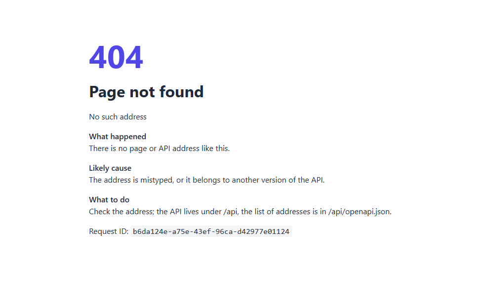

Figure 2 – The 404 error page for an address that does not exist in the API, with the explanation blocks and the request number

The 429 page is returned when the limit of requests per minute set in `limits.json` is exceeded. For the shot the limit is lowered to three requests by the variable `RATE_LIMIT_MAX`. The page is shown in figure 3.

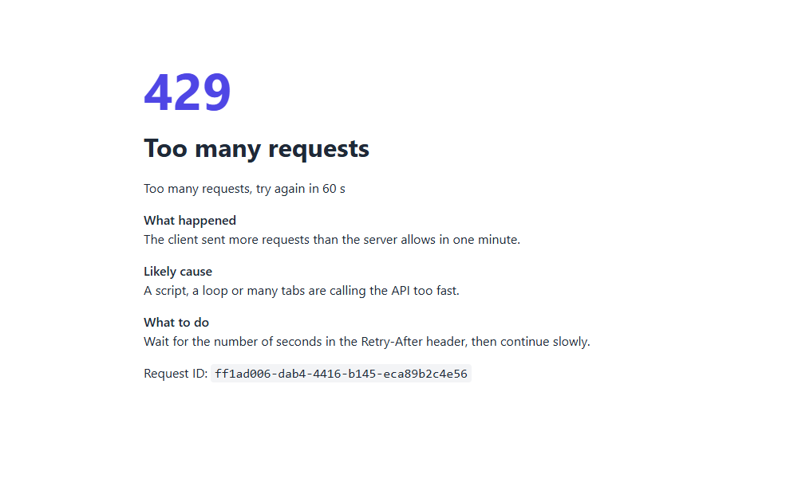

Figure 3 – The 429 error page after the request limit is exceeded, this request is not written to the journal

The 500 page for an unavailable journal is shown in figure 4. It comes from a real failure: the journal table is dropped under the running server, and the action is not carried out.

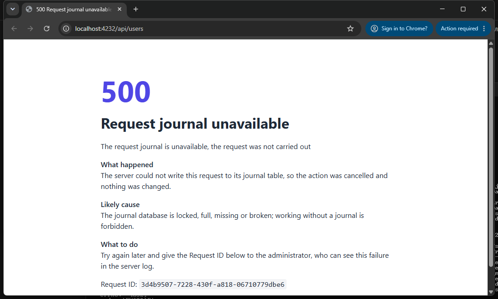

Figure 4 – The 500 error page for an unavailable request journal, the action is not carried out

The 403 page is returned when an ordinary user tries to delete a project. The `X-User-Id` header and `DELETE` cannot be sent from the address bar of a browser, so the shot is taken in Postman and shown in figure 5.

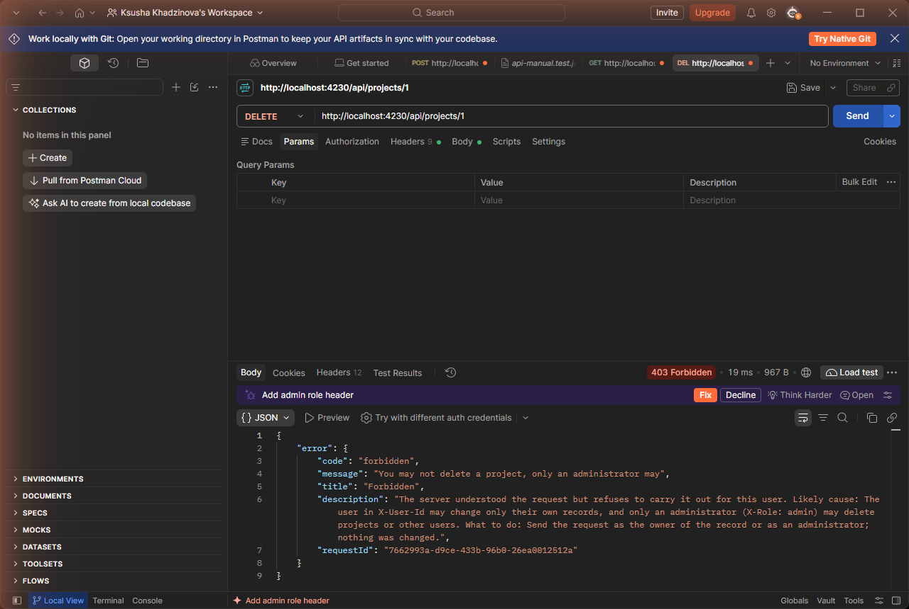

Figure 5 – The answer 403 to the request DELETE /api/projects/1 with the X-User-Id header of an ordinary user

### 3.7 API documentation

The route `GET /api/openapi.json` returns the API description in the OpenAPI 3.0 format. It is built from the same schemas that validate requests, so field lengths, lists of allowed values and required fields in the document match the code. The document is suitable for opening in Swagger UI and for import into Postman. The description is opened in a browser window at `http://localhost:4230/api/openapi.json`, and a fragment is shown in figure 6. In it the change and delete operations have the headers `X-User-Id` and `X-Role` and the answer 403. The reference of operations is generated from the same document by the script `tools/gen-api-md.mjs` into the files `API.generated.ru.md` and `API.generated.en.md`. A test compares them with the server answer, so they do not drift from the code. The possible error codes are listed in the reference for every operation.

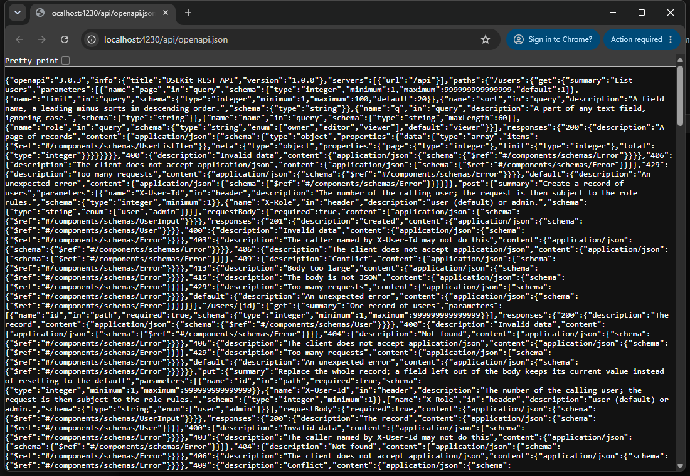

Figure 6 – The API description in the OpenAPI format at GET /api/openapi.json in a browser window: paths, parameters, role headers and response codes

### 3.8 Checking requests in Postman

The requests of every method are sent in Postman by hand, and the same set of requests is collected in the collection `postman_collection.json` for import and in the file `requests.http`. A separate window shot is obtained for every method: the request, the status code and the response body. Reading the list with `GET /api/users` is shown in figure 7.

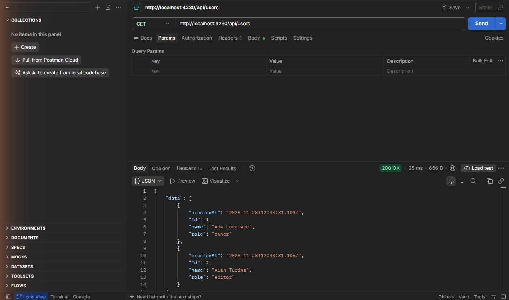

Figure 7 – The request GET /api/users and the answer 200 with the list of users in Postman

Creating a diagram with `POST /api/diagrams` and a JSON body is shown in figure 8.

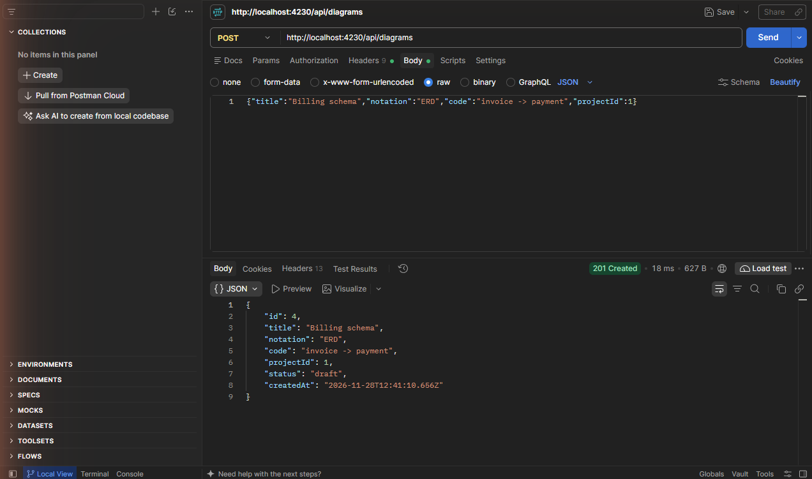

Figure 8 – The request POST /api/diagrams with a JSON body and the answer 201 in Postman

A full replacement with `PUT /api/users/2` is shown in figure 9.

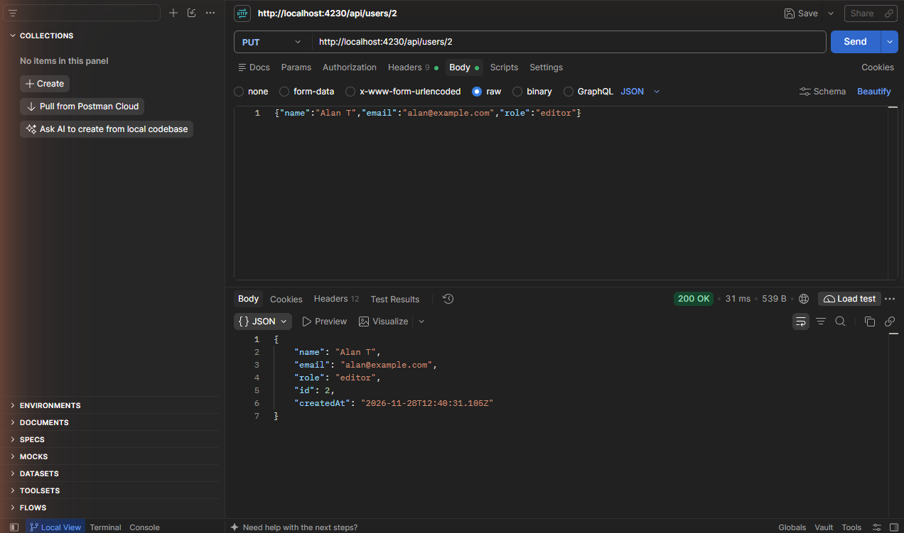

Figure 9 – The request PUT /api/users/2 with a full body and the answer 200 with new fields in Postman

A partial change with `PATCH /api/users/1` is shown in figure 10.

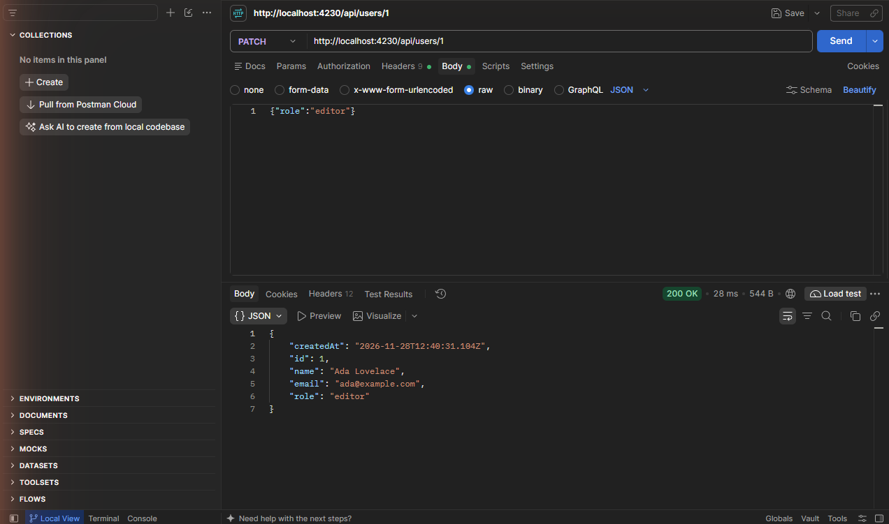

Figure 10 – The request PATCH /api/users/1 with a one-field body and the answer 200 in Postman

Deleting a diagram with `DELETE /api/diagrams/2` passes without a response body, as in figure 11.

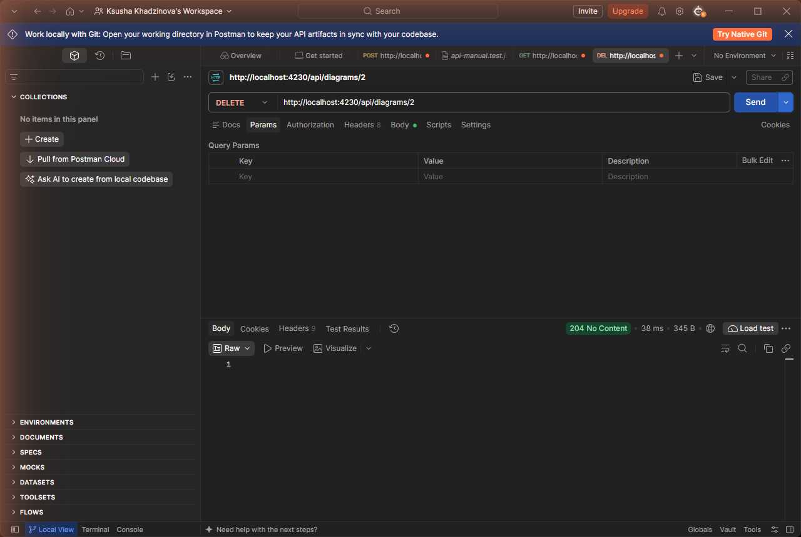

Figure 11 – The request DELETE /api/diagrams/2 and the answer 204 without a body in Postman

Deleting a user who still owns projects is rejected with code 409, as in figure 12.

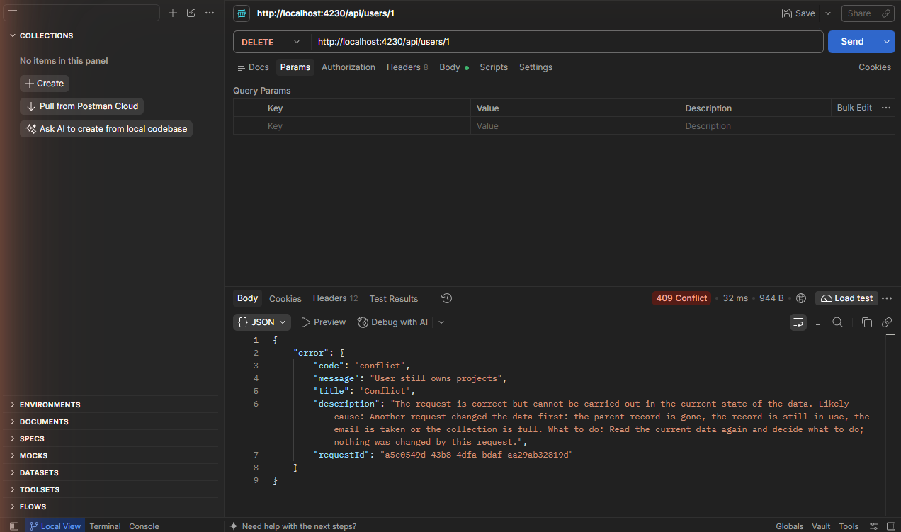

Figure 12 – The request DELETE /api/users/1 and the answer 409 saying that the user owns projects, in Postman

The request `POST /api/users` with an empty name and a wrong email is rejected, as in figure 13.

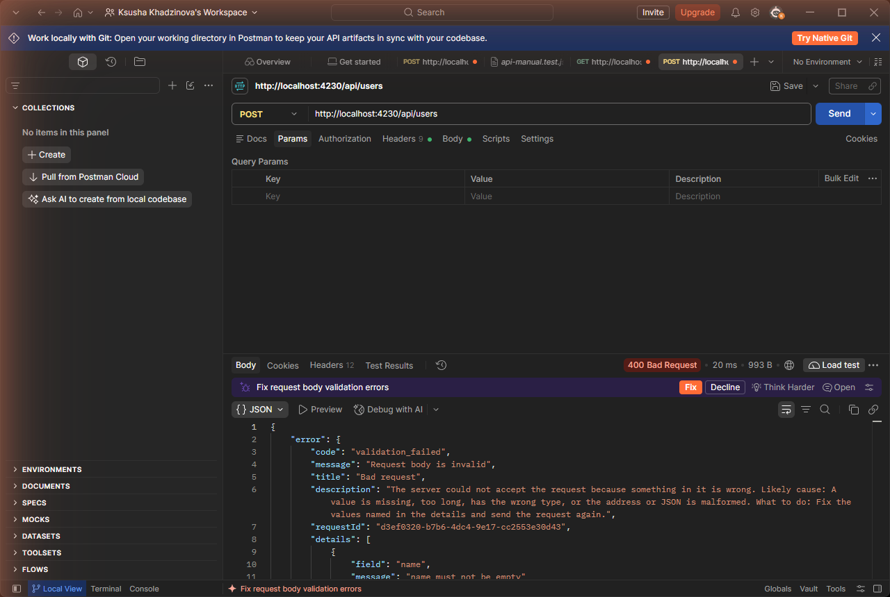

Figure 13 – The request POST /api/users with invalid data and the answer 400 with the list of field problems in Postman

### 3.9 Checking requests from a browser

Only `GET` requests are sent from the address bar of a browser, the other methods are shown above in Postman. The server is started with `npm start` and the variable `PORT` set to 4230, and the requests are opened in a Chrome window with the address bar. The answer to `GET /api/users` at `http://localhost:4230/api/users` is shown in figure 14.

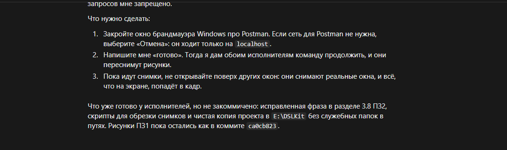

Figure 14 – The answer to GET /api/users in a browser window: an array of users and the meta object

One record at `http://localhost:4230/api/users/1` is shown in figure 15.

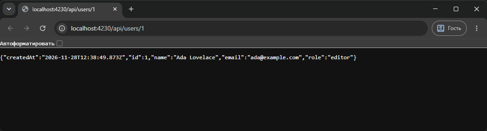

Figure 15 – The answer to GET /api/users/1 in a browser window: the object of one user

A request for a non-existent record at `http://localhost:4230/api/users/999` gives the error shown in figure 16.

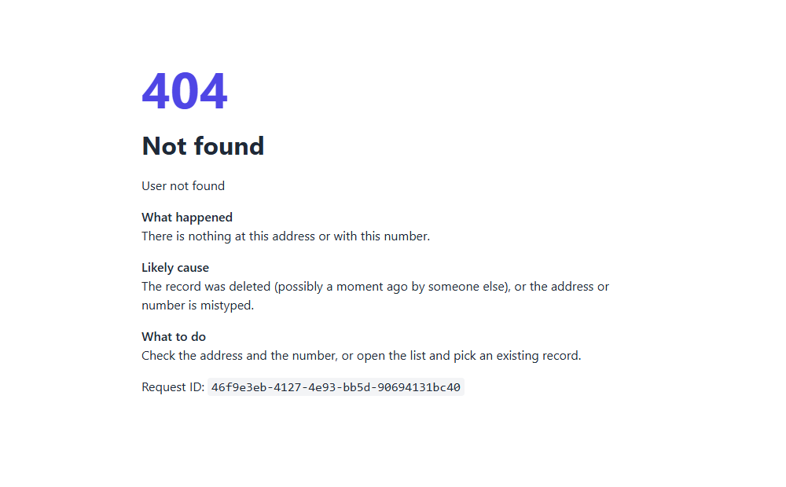

Figure 16 – The answer to GET /api/users/999 in a browser window: the 404 error page with the request number

A wrong number in the address `http://localhost:4230/api/users/abc` is rejected, as in figure 17.

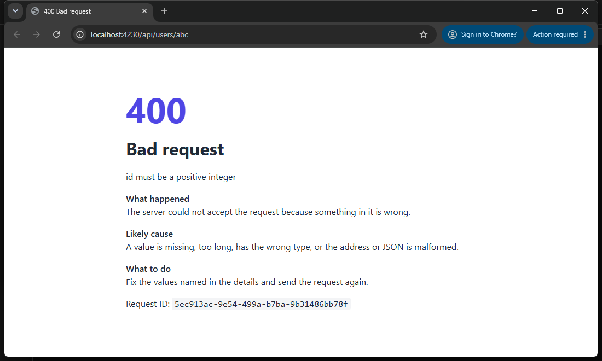

Figure 17 – The answer to GET /api/users/abc in a browser window: the 400 error page with an explanation

Search, sorting and pages work through the address parameters `?q=billing&sort=-title&page=1&limit=10`, and the result is shown in figure 18.

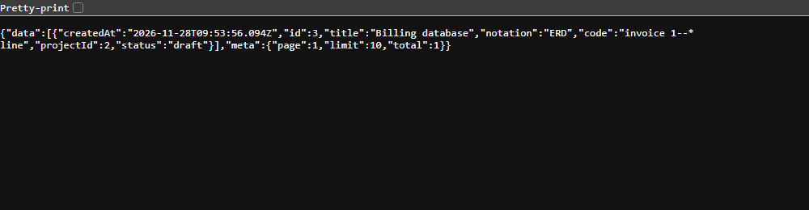

Figure 18 – The answer to GET /api/diagrams with the q, sort, page and limit parameters in a browser window

The extra route `GET /api/users/1/projects` returns the projects of one user, as in figure 19.

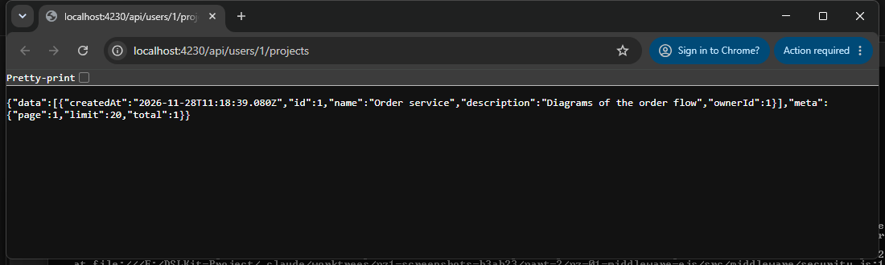

Figure 19 – The answer to GET /api/users/1/projects in a browser window: the projects of the user

### 3.10 Automatic checks

Automatic tests are written that start the server on a free port and check every method, the status codes, filters, sorting, pages, validation errors, links between resources, extra operations, roles with the answer 403, the order "journal record before the action", a journal failure with the answer 500, the exclusion of `/health` and of the answer 429 from the journal, races when a parent is deleted, and the error pages. There are 176 server tests, 179 together with the report checks, and the coverage of lines, branches and functions is 100 percent. The command is `npm test` in the project folder. The console message at server start is shown in figure 20.

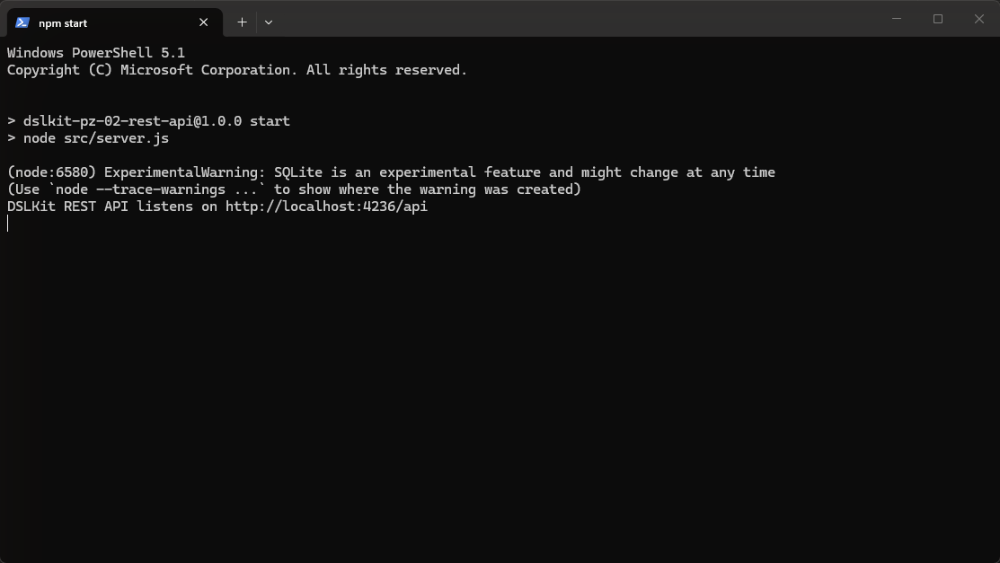

Figure 20 – A PowerShell window with the server message after the start with npm start on port 4236

The result of `npm test` with the number of tests and the code coverage is shown in figure 21.

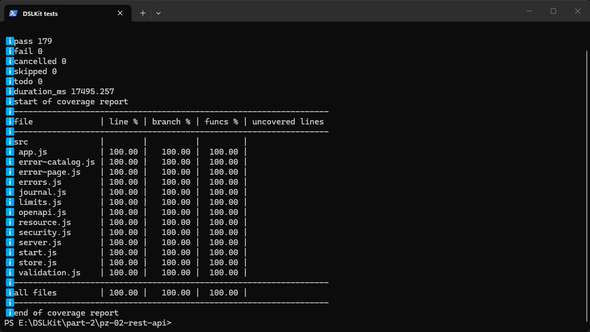

Figure 21 – The end of the npm test output: the number of passed tests and the coverage table

## 4 Answers to the Control Questions

The number in the group list is 26, so the answers are given to questions 25, 26 and 27.

25. What are "cross-resource links" and how are they implemented in a REST API (for example, getting the orders of a user)?

    These are links between records of different resources, for example a project belongs to a user and a diagram belongs to a project. A link is expressed in an API in three ways. By way 1 the link is a reference field in the record, in this work `ownerId` of a project and `projectId` of a diagram, and the existence of such a record is checked by the server, otherwise 409 is returned. By way 2 a nested route is used for reading, for example `GET /api/users/:id/projects` returns the projects of a user and `GET /api/projects/:id/diagrams` the diagrams of a project. By way 3 a list filter is used, and `GET /api/projects?ownerId=1` gives the same. A link protects deletion as well: a user with projects and a project with diagrams are not deleted, the answer is 409.

26. Which status codes are used for redirects (3xx)? Are they needed in a REST API?

    Code 301 means a permanent move of an address, 302 a temporary one, codes 307 and 308 do the same but keep the request method, code 303 sends the client to another address with the `GET` method, and code 304 says that the cached answer is still valid. In Express a redirect is performed by the call `res.redirect(status, url)`. In a REST API redirects are rarely needed: after `POST` the server returns 201 with the `Location` header and the record itself instead of redirecting the client. They are used when an address or an API version moves, and code 304 is used for conditional requests with `ETag`. Redirects are not used in this work, and `ETag` is returned in the answers.

27. How do you state the possible error codes and their descriptions in the API documentation?

    In OpenAPI the codes are listed for every operation in the `responses` section, for example `400`, `403`, `404` and `409`, and each gets a description and a body schema. The common error schema is described once in `components` and linked by reference. In this work the documentation is available at `GET /api/openapi.json` and in the file `API.md`: every route has a column with the possible error codes, and the section "Errors" shows the single answer shape `{ "error": { "code", "message", "title", "description", "requestId", "details" } }` and lists the `code` values. The expected errors are thus known to the client.

## Conclusion

A REST API with three linked resources is designed and implemented for the DSLKit project. CRUD operations, filtering, search, sorting, pages, publishing and copying of diagrams, validation of the input data and of the links between records, and errors of one format with a request number are implemented. Roles distinguish an ordinary user and an administrator and give a real answer 403. The request journal is kept in a database table by the rules of the even variant and is written before the action, and its failure gives the answer 500 without carrying out the action. The API description is collected in `API.md` and in `GET /api/openapi.json`, the automatic tests cover all the code, and the requests of every method are checked in Postman.

The limits of the work are named directly. The data of the resources is kept in in-memory arrays and is lost when the server restarts, as the task requires, and only the request journal is kept in a database. The identity of a user is set by the headers `X-User-Id` and `X-Role` and is trusted, so in a real system it must be taken from a verified session or token. The error texts are written in English. The journal write and the action on the data are not in one transaction, and this is solved by the order of the steps: first the journal row, then the action, and if the journal fails the action is not carried out. These limits are described in the text of the work and in the file `README.md` of the project.

## Appendix A (mandatory) Listing of the file app.js, application assembly

The comments in the listings of all appendices are written in English, as in the source files of the project.

```js
export const createApp = ({
  stores = createStores(undefined, LIMITS.maxRecordsPerCollection),
  writeError = console.error,
  limit = { windowMs: LIMITS.rateWindowMs, max: LIMITS.rateMax, maxClients: LIMITS.rateMaxClients },
  now = Date.now,
  journal = createJournal(),
} = {}) => {
  const { users, projects, diagrams } = stores;
  const app = express();
  app.disable('x-powered-by');
  app.use(requestId);
  app.use(securityHeaders);
  // Liveness probe, before the rate limit so monitoring never uses up the quota.
  app.get('/health', (req, res) => res.json({ status: 'ok' }));
  // Refused before the body is read, so a flood costs little.
  app.use(rateLimit({ ...limit, now }));
  // Every request is written to the journal table before it runs; a failed write answers 500 and nothing else happens.
  app.use(journaling(journal, writeError));
  // This API answers only JSON; a client that explicitly asks for something else gets 406 instead of JSON it
  // did not ask for. A request with no Accept header, or "*/*", is always welcome.
  app.use((req, res, next) => {
    const accept = req.headers.accept;
    if (!accept) return next();
    const acceptsJson = accept.split(',').some((part) => {
      const type = part.split(';')[0].trim().toLowerCase();
      return type === '*/*' || type === 'application/*' || type === 'application/json' || type === 'text/html';
    });
    if (!acceptsJson) return next(new ApiError(406, 'not_acceptable', 'This API only returns application/json'));
    return next();
  });
  // A declared charset other than UTF-8 is rejected up front with 415, instead of being read as UTF-8 anyway
  // and failing JSON parsing later with the unrelated 400 invalid_json.
  app.use((req, res, next) => {
    const match = /charset=("?)([^;"]+)\1/i.exec(req.headers['content-type'] ?? '');
    if (match && match[2].trim().toLowerCase() !== 'utf-8') return next(new ApiError(415, 'unsupported_media_type', 'Only charset=utf-8 is supported'));
    return next();
  });
  app.use(express.json({ limit: LIMITS.bodyBytes }));
  // A body that express.json did not read (another Content-Type) is refused with 415, not taken as a missing
  // body - but only for a method that is meant to carry one; GET/HEAD/DELETE never need a JSON body, so any
  // body they do carry is simply ignored instead of failing the request over an unrelated Content-Type.
  app.use((req, res, next) => {
    if (BODYLESS_METHODS.has(req.method)) return next();
    const hasBody = Number(req.headers['content-length'] ?? 0) > 0 || req.headers['transfer-encoding'] !== undefined;
    if (hasBody && req.body === undefined) return next(new ApiError(415, 'unsupported_media_type', 'Content-Type must be application/json'));
    return next();
  });

  app.use(identify((id) => users.find(id)));

  // Ownership rules for a caller who named itself with X-User-Id. A "restricted" caller is a non-admin user; an
  // anonymous caller and an administrator are not restricted. A project belongs to its owner and a diagram to the
  // owner of its project.
  const restricted = (actor) => actor.userId !== undefined && actor.role !== 'admin';
  const ownsProject = (actor, projectId) => !restricted(actor) || projects.find(projectId)?.ownerId === actor.userId;
  const deny = (what) => {
    throw forbidden(`You may not ${what}`);
  };

  const api = express.Router();
```

## Appendix B (mandatory) Listing of the file app.js, routes and error handler

```js
  // The machine-readable description of the API, built from the schemas above.
  api.get('/openapi.json', (req, res) => res.json(buildOpenApi(schemas, { hidden: { users: ['email'] } })));
  api.all('/openapi.json', methodsOnly('GET'));
  // Link between resources: the projects that belong to one user. It is mounted before the standard router so it wins over /:id.
  api.get('/users/:id/projects', (req, res) => {
    const user = users.find(parseId(req.params.id));
    if (!user) throw notFound('User');
    res.json(
      listItems(
        projects.all().filter((p) => p.ownerId === user.id),
        schemas.projects,
        req.query,
      ),
    );
  });
  api.all('/users/:id/projects', methodsOnly('GET'));
  api.use(
    '/users',
    createResourceRouter({
      label: 'User',
      collection: users,
      schema: schemas.users,
      // The email is personal data: the list shows id, name and role, the email only comes with one user.
      hiddenInList: ['email'],
      hooks: {
        authorize: (actor, action, user) => {
          if (restricted(actor) && actor.userId !== user.id) deny(`${action} another user's record`);
        },
        check: (data, current) => {
          const taken = data.email !== undefined && users.all().some((user) => user !== current && user.email.toLowerCase() === data.email.toLowerCase());
          if (taken) throw conflict('A user with this email already exists');
          return [];
        },
        beforeRemove: (user) => {
          if (projects.all().some((project) => project.ownerId === user.id)) throw conflict('User still owns projects');
        },
      },
    }),
  );

  // Extra operations are mounted before the standard routers so they win over /:id.
  api.get('/projects/:id/diagrams', (req, res) => {
    const project = projects.find(parseId(req.params.id));
    if (!project) throw notFound('Project');
    res.json(
      listItems(
        diagrams.all().filter((d) => d.projectId === project.id),
        schemas.diagrams,
        req.query,
      ),
    );
  });
  api.all('/projects/:id/diagrams', methodsOnly('GET'));
  api.use(
    '/projects',
    createResourceRouter({
      label: 'Project',
      collection: projects,
      schema: schemas.projects,
      hooks: {
        authorize: (actor, action, project) => {
          if (action === 'remove' && restricted(actor)) deny('delete a project, only an administrator may');
          if (restricted(actor) && project.ownerId !== actor.userId) deny("change another user's project");
        },
        authorizeData: (actor, data) => {
          if (restricted(actor) && data.ownerId !== undefined && data.ownerId !== actor.userId) deny('give a project to another user');
        },
        check: (data) => missingReference('ownerId', users, data.ownerId),
        beforeRemove: (project) => {
          if (diagrams.all().some((diagram) => diagram.projectId === project.id)) throw conflict('Project still has diagrams');
        },
      },
    }),
  );

  const diagram = (req) => {
    const found = diagrams.find(parseId(req.params.id));
    if (!found) throw notFound('Diagram');
    return found;
  };
  const ownDiagram = (req, what) => {
    const found = diagram(req);
    if (!ownsProject(req.actor, found.projectId)) deny(`${what} a diagram of another user's project`);
    return found;
  };
  api.post('/diagrams/:id/publish', (req, res) => res.json(diagrams.update(ownDiagram(req, 'publish'), { status: 'published' })));
  api.post('/diagrams/:id/duplicate', (req, res) => {
    const { id, createdAt, ...rest } = ownDiagram(req, 'copy');
    // Cut by code points, not by UTF-16 units: slicing a surrogate pair in half would store (and re-serve) a
    // lone surrogate, which is not valid Unicode text.
    const title = [...`${rest.title} (copy)`].slice(0, LIMITS.diagramTitle).join('');
    res.status(201).json(diagrams.create({ ...rest, title, status: 'draft' }));
  });
  api.all('/diagrams/:id/publish', methodsOnly('POST'));
  api.all('/diagrams/:id/duplicate', methodsOnly('POST'));
  api.use(
    '/diagrams',
    createResourceRouter({
      label: 'Diagram',
      collection: diagrams,
      schema: schemas.diagrams,
      hooks: {
        authorize: (actor, action, item) => {
          if (!ownsProject(actor, item.projectId)) deny(`${action} a diagram of another user's project`);
        },
        authorizeData: (actor, data) => {
          if (data.projectId !== undefined && !ownsProject(actor, data.projectId)) deny("put a diagram into another user's project");
        },
        check: (data) => missingReference('projectId', projects, data.projectId),
      },
    }),
  );

  app.use('/api', api);
  app.use((req, res, next) => next(routeNotFound()));

  // Turns any thrown value into the ApiError that describes it. Anything unknown is a server failure (500).
  const toApiError = (err, req, res) => {
    if (err instanceof ApiError) return err;
    if (err.type === 'entity.parse.failed') return new ApiError(400, 'invalid_json', 'Request body is not valid JSON');
    if (err.type === 'entity.too.large') return new ApiError(413, 'payload_too_large', 'Request body is too large');
    // Errors of the framework and of the body parser that blame the client keep their 4xx status: a broken
    // percent escape in the URL is 400 and an unsupported Content-Encoding is 415, neither is a server failure.
    const status = err.status ?? err.statusCode;
    if (status >= 400 && status < 500) {
      const known = CLIENT_ERRORS[status] ?? ['bad_request', 'The request cannot be processed'];
      return new ApiError(status, known[0], known[1]);
    }
    writeError(`[error] request ${res.locals.requestId} ${logSafe(req.method)} ${logSafe(req.originalUrl)}`, err);
    return new ApiError(500, 'internal_error', 'Internal server error');
  };

  // Four parameters: the single place where every error is answered, as JSON for a client and as a described page
  // for a browser, always with the Request ID.
  app.use((err, req, res, _next) => {
    const apiError = toApiError(err, req, res);
    if (wantsHtml(req)) {
      const page = renderErrorPage({ status: apiError.status, code: apiError.code, message: apiError.message, details: apiError.details, requestId: res.locals.requestId });
      return res.status(apiError.status).set('Content-Security-Policy', PAGE_CSP).type('html').send(page);
    }
    return res.status(apiError.status).json(errorBody(apiError, res.locals.requestId));
  });
  return app;
};
```

## Appendix C (mandatory) Listing of the file resource.js, common routes of a resource

```js
// A weak tag computed from the record itself, so it changes exactly when the record changes and needs no extra field.
export const etagOf = (item) => `W/"${createHash('sha1').update(JSON.stringify(item)).digest('hex').slice(0, 16)}"`;

// Optional conditional update: with If-Match the write only happens if the record is still the one the client read;
// otherwise 412, so a stale form cannot silently overwrite a newer change. Without the header the write is unconditional.
const requireFresh = (req, item) => {
  const header = req.headers['if-match'];
  if (header === undefined || header.trim() === '*') return;
  const tags = header.split(',').map((tag) => tag.trim().replace(/^W\//, ''));
  if (!tags.includes(etagOf(item).replace(/^W\//, ''))) throw new ApiError(412, 'precondition_failed', 'The record changed since you read it, read it again');
};

const DIGITS = /^[1-9]\d{0,14}$/;

export const parseId = (raw) => {
  if (!DIGITS.test(String(raw))) throw new ApiError(400, 'invalid_id', 'id must be a positive integer');
  return Number(raw);
};

// The largest integer `DIGITS` can ever match (15 nines): the real ceiling for page/limit/id, below
// Number.MAX_SAFE_INTEGER. Error messages quote this instead of a bound that is never actually enforced.
const MAX_QUERY_INT = 999999999999999;

const scalar = (raw, name) => {
  if (Array.isArray(raw)) throw new ApiError(400, 'invalid_query', `${name} must not be repeated`);
  return raw;
};

const parsePositive = (raw, name, fallback, max = MAX_QUERY_INT) => {
  if (raw === undefined) return fallback;
  if (!DIGITS.test(String(scalar(raw, name))) || Number(raw) > max) throw new ApiError(400, 'invalid_query', `${name} must be an integer from 1 to ${max}`);
  return Number(raw);
};

// Filtering by any schema field (?status=draft), search (?q=text), sorting (?sort=-title), pagination (?page=2&limit=10).
// hidden: fields that never appear in a list; filtering, searching or sorting by one is silently a no-op
// (otherwise ?email= or ?sort=email would reveal it) rather than an error, so it still cannot be used as an oracle.
// Any OTHER query key that is not a schema field, page, limit, sort or q is unknown and answers 400, instead of
// being read and then quietly ignored.
export const listItems = (items, schema, query, hidden = []) => {
  const known = new Set(['page', 'limit', 'sort', 'q', ...Object.keys(schema)]);
  for (const key of Object.keys(query)) {
    if (!known.has(key)) throw new ApiError(400, 'invalid_query', `${key} is not a known query parameter`);
  }
  const page = parsePositive(query.page, 'page', 1);
  const limit = parsePositive(query.limit, 'limit', LIMITS.defaultPageSize, LIMITS.maxPageSize);
  let result = items.filter((item) =>
    Object.keys(schema).every((field) => {
      if (hidden.includes(field) || query[field] === undefined) return true;
      const raw = scalar(query[field], field);
      const rule = schema[field];
      if (rule.type === 'integer' && !DIGITS.test(String(raw))) throw new ApiError(400, 'invalid_query', `${field} must be a positive integer`);
      if (rule.enum && !rule.enum.includes(String(raw))) throw new ApiError(400, 'invalid_query', `${field} must be one of: ${rule.enum.join(', ')}`);
      return String(item[field]) === String(raw);
    }),
  );
  if (query.q !== undefined) {
    const needle = String(scalar(query.q, 'q')).toLowerCase();
    const textFields = Object.keys(schema).filter((field) => schema[field].type === 'string' && !hidden.includes(field));
    result = result.filter((item) =>
      textFields.some((field) =>
        String(item[field] ?? '')
          .toLowerCase()
          .includes(needle),
      ),
    );
  }
  if (query.sort !== undefined) {
    const raw = String(scalar(query.sort, 'sort'));
    const desc = raw.startsWith('-');
    const field = raw.replace(/^-/, '');
    if (hidden.includes(field) || (field !== 'id' && field !== 'createdAt' && !Object.hasOwn(schema, field))) throw new ApiError(400, 'invalid_query', `cannot sort by ${field}`);
    // Locale-aware for text (so case and accents sort the way a reader expects), tie-broken by id so equal
    // keys keep a fixed, repeatable order instead of whatever order the sort happened to leave them in.
    const compare = (a, b) => (typeof a[field] === 'string' && typeof b[field] === 'string' ? a[field].localeCompare(b[field]) : a[field] > b[field] ? 1 : a[field] < b[field] ? -1 : 0);
    result = [...result].sort((a, b) => {
      const primary = compare(a, b) * (desc ? -1 : 1);
      return primary !== 0 ? primary : a.id - b.id;
    });
  }
  const total = result.length;
  const data = result.slice((page - 1) * limit, page * limit).map((item) => Object.fromEntries(Object.entries(item).filter(([field]) => !hidden.includes(field))));
  return { data, meta: { page, limit, total } };
};

// Builds the six standard routes for one resource.
// hooks.check(data, current) returns extra validation details for the fields present (references)
// and may throw a conflict; current is the record being changed, undefined on create.
//
// hooks.beforeRemove(item) may throw.
// hooks.authorize(actor, action, item) may throw 403 for 'change' or 'remove' of an existing record, before anything
// else is checked; hooks.authorizeData(actor, data) may throw 403 for the validated data of a create or an update.
export const createResourceRouter = ({ label, collection, schema, hooks = {}, hiddenInList = [] }) => {
  const router = Router();
  const body = (req, partial, current) => {
    const input = trimStrings(schema, req.body);
    const errors = validate(schema, input, { partial });
    const data = partial ? input : applyDefaults(schema, input, current);
    const details = errors.length ? errors : (hooks.check?.(data, current) ?? []);
    if (details.length) throw validationFailed(details);
    return data;
  };
  const load = (req) => {
    const item = collection.find(parseId(req.params.id));
    if (!item) throw notFound(label);
    return item;
  };

  router.get('/', (req, res) => res.json(listItems(collection.all(), schema, req.query, hiddenInList)));
  router.get('/:id', (req, res) => {
    const item = load(req);
    res.set('ETag', etagOf(item)).json(item);
  });
  router.post('/', (req, res) => {
    const data = body(req, false);
    hooks.authorizeData?.(req.actor, data);
    const item = collection.create(data);
    res.status(201).location(`${req.baseUrl}/${item.id}`).json(item);
  });
  router.put('/:id', (req, res) => {
    const item = load(req);
    hooks.authorize?.(req.actor, 'change', item);
    requireFresh(req, item);
    const data = body(req, false, item);
    hooks.authorizeData?.(req.actor, data);
    const saved = collection.replace(item, data);
    res.set('ETag', etagOf(saved)).json(saved);
  });
  router.patch('/:id', (req, res) => {
    const item = load(req);
    hooks.authorize?.(req.actor, 'change', item);
    requireFresh(req, item);
    const data = body(req, true, item);
    hooks.authorizeData?.(req.actor, data);
    const saved = collection.update(item, data);
    res.set('ETag', etagOf(saved)).json(saved);
  });
  router.delete('/:id', (req, res) => {
    const item = load(req);
    hooks.authorize?.(req.actor, 'remove', item);
    requireFresh(req, item);
    hooks.beforeRemove?.(item);
    collection.remove(item);
    res.status(204).end();
  });
  router.all('/', methodsOnly('GET', 'POST'));
  router.all('/:id', methodsOnly('GET', 'PUT', 'PATCH', 'DELETE'));
  return router;
};
```

## Appendix D (mandatory) Listing of the file validation.js, field validation

```js
// C0/C1 control characters (NUL, BEL, newline, ...) minus tab/newline/CR, which `multiline` fields allow.
const CONTROL_STRICT = /[\u0000-\u001F\u007F-\u009F]/;
const CONTROL_MULTILINE = /[\u0000-\u0008\u000B\u000C\u000E-\u001F\u007F-\u009F]/;
// Invisible formatting characters that a reader cannot see and that a plain `trim()` does not remove:
// zero-width space, bidi marks and overrides, byte-order mark, soft hyphen. The zero-width joiner/non-joiner
// are left out on purpose, they are part of ordinary emoji and script text (e.g. "👩‍💻").
const INVISIBLE_CODE_POINTS = [0x00ad, 0x200b, 0x200e, 0x200f, 0x202a, 0x202b, 0x202c, 0x202d, 0x202e, 0x2066, 0x2067, 0x2068, 0x2069, 0xfeff];
const INVISIBLE_FORMAT = new RegExp(`[${INVISIBLE_CODE_POINTS.map((cp) => String.fromCodePoint(cp)).join('')}]`, 'u');

// A schema maps a field name to { type, required, max, enum, pattern, default, multiline }.
// Types: 'string', 'integer'. Returns a list of { field, message }.
const checkField = (name, rule, value) => {
  if (rule.type === 'integer') {
    if (!Number.isInteger(value)) return `${name} must be an integer`;
    if (value < rule.min || value > rule.max) return `${name} must be between ${rule.min} and ${rule.max}`;
  }
  if (rule.type === 'string') {
    if (typeof value !== 'string') return `${name} must be a string`;
    // Rejects an unpaired (lone) surrogate: valid in a JS string and in JSON, but not valid Unicode text.
    if (!value.isWellFormed()) return `${name} contains an invalid character (an unpaired surrogate)`;
    if ((rule.multiline ? CONTROL_MULTILINE : CONTROL_STRICT).test(value) || INVISIBLE_FORMAT.test(value)) {
      return `${name} must not contain control or invisible characters`;
    }
    if (rule.required && value.trim() === '') return `${name} must not be empty`;
    // Counted by code points, so an emoji is one character as the user sees it, not two UTF-16 units.
    if (rule.max && [...value].length > rule.max) return `${name} must be at most ${rule.max} characters`;
    if (rule.pattern && !rule.pattern.test(value)) return `${name} has an invalid format`;
  }
  if (rule.enum && !rule.enum.includes(value)) return `${name} must be one of: ${rule.enum.join(', ')}`;
  return null;
};

// partial=true is used by PATCH: required fields may be missing, present ones are still checked.
export const validate = (schema, body, { partial = false } = {}) => {
  if (body === null || typeof body !== 'object' || Array.isArray(body)) return [{ field: 'body', message: 'body must be a JSON object' }];
  if (partial && Object.keys(body).length === 0) return [{ field: 'body', message: 'send at least one field to change' }];
  const errors = [];
  for (const field of Object.keys(body)) {
    if (!Object.hasOwn(schema, field)) errors.push({ field, message: `${field} is not a known field` });
  }
  for (const [field, rule] of Object.entries(schema)) {
    const value = body[field];
    if (value === undefined) {
      if (rule.required && !partial && rule.default === undefined) errors.push({ field, message: `${field} is required` });
      continue;
    }
    const message = checkField(field, rule, value);
    if (message) errors.push({ field, message });
  }
  return errors;
};

// current: the record being replaced (PUT) so a field left out of the body keeps its current value instead of
// being silently reset to the schema default (a role, for example, must not be lowered just by omitting it).
// undefined on create (POST), where an omitted field does take the schema default.
export const applyDefaults = (schema, body, current) => {
  const result = { ...body };
  for (const [field, rule] of Object.entries(schema)) {
    if (result[field] !== undefined) continue;
    if (current && Object.hasOwn(current, field)) result[field] = current[field];
    else if (rule.default !== undefined) result[field] = rule.default;
  }
  return result;
};

// Unicode compatibility normalization so "é" (one code point) and "e" + combining acute (two code points) become
// the same text, then strips invisible formatting characters a `trim()` would miss, then lower-cases: two emails
// that render identically can no longer be told apart or used to register two look-alike accounts.
export const normalizeEmail = (value) => value.normalize('NFKC').replace(/[\u0000-\u001F\u007F-\u009F\p{Cf}]/gu, '').toLowerCase();

// Trims surrounding whitespace of known string fields, so " Ada " is stored as "Ada", then applies the field's
// own transform (e-mails are normalized) so validation and storage see the same, final text.
export const trimStrings = (schema, body) => {
  if (body === null || typeof body !== 'object' || Array.isArray(body)) return body;
  const result = { ...body };
  for (const field of Object.keys(result)) {
    if (!Object.hasOwn(schema, field) || typeof result[field] !== 'string') continue;
    const trimmed = result[field].trim();
    result[field] = schema[field].transform ? schema[field].transform(trimmed) : trimmed;
  }
  return result;
};
```

## Appendix E (mandatory) Listing of the file security.js, roles and protection

```js
import { randomUUID } from 'node:crypto';
import { ApiError } from './errors.js';

// Headers for a JSON-only API, set by hand without extra packages. The API sends no HTML, so the policy forbids everything.
export const securityHeaders = (req, res, next) => {
  res.set({
    'Content-Security-Policy': "default-src 'none'; frame-ancestors 'none'",
    'X-Content-Type-Options': 'nosniff',
    'X-Frame-Options': 'DENY',
    'Referrer-Policy': 'no-referrer',
    'Cache-Control': 'no-store',
  });
  next();
};

// An IPv4 client reaching a dual-stack server is seen by Node as "::ffff:<ipv4>" on some connections and as the
// plain "<ipv4>" on others; without this the same client gets two separate buckets and can double its quota.
const bucketKey = (ip) => (typeof ip === 'string' && ip.startsWith('::ffff:') ? ip.slice(7) : ip ?? 'unknown');

// Fixed-window rate limit per client address, kept in memory. The answer is the usual JSON error with Retry-After.
//
// Cleanup is amortized, not a periodic full scan: every call walks at most SWEEP_BATCH map entries (resuming
// where the previous call left off) and drops the ones that expired, so the per-request cost stays bounded
// however large the map has grown, instead of occasionally scanning the whole thing (a CPU-cost amplifier an
// attacker rotating addresses could lean on). maxClients is a hard ceiling on distinct addresses tracked at
// once: once it is reached, the oldest tracked address is evicted to make room, so the map itself cannot grow
// without bound even if the sweep never catches up (for example many different IPv6 addresses, each used once).
const SWEEP_BATCH = 500;

export const rateLimit = ({ windowMs, max, now = Date.now, maxClients = 50000 }) => {
  const hits = new Map();
  let cursor = null;

  const sweep = (time) => {
    const iterator = cursor ?? hits.entries();
    for (let i = 0; i < SWEEP_BATCH; i += 1) {
      const next = iterator.next();
      if (next.done) {
        cursor = null;
        return;
      }
      const [key, entry] = next.value;
      if (entry.reset <= time) hits.delete(key);
    }
    cursor = iterator;
  };

  return (req, res, next) => {
    const time = now();
    sweep(time);
    const key = bucketKey(req.ip);
    let entry = hits.get(key);
    if (!entry || entry.reset <= time) {
      if (!entry && hits.size >= maxClients) {
        const oldest = hits.keys().next().value;
        if (oldest !== undefined) hits.delete(oldest);
      }
      entry = { count: 0, reset: time + windowMs };
      hits.set(key, entry);
    }
    entry.count += 1;
    if (entry.count <= max) return next();
    const retryAfter = Math.max(1, Math.ceil((entry.reset - time) / 1000));
    res.set('Retry-After', String(retryAfter));
    return next(new ApiError(429, 'too_many_requests', `Too many requests, try again in ${retryAfter} s`));
  };
};

// Request data in a log line could carry line breaks and forge extra lines, so it is written as a JSON string (escaped and quoted).
export const logSafe = (text) => JSON.stringify(String(text)).slice(0, 300);

// Every request gets its own id, always generated here (a client-supplied value could forge or collide with log
// lines). It travels in the X-Request-Id header, in the journal row and in every error answer.
export const requestId = (req, res, next) => {
  res.locals.requestId = randomUUID();
  res.set('X-Request-Id', res.locals.requestId);
  next();
};

// A deliberately small identity for this practical (there is no login): X-User-Id says who is acting, X-Role is
// "user" (the default) or "admin". Without X-User-Id the caller is anonymous and is not restricted, as before roles
// existed; with it, the ownership rules of the routes apply. The headers are trusted as they come, a real system
// would take them from a verified session.
export const identify = (findUser) => (req, res, next) => {
  const role = req.headers['x-role'] ?? 'user';
  if (role !== 'user' && role !== 'admin') return next(new ApiError(400, 'invalid_identity', 'X-Role must be user or admin'));
  const raw = req.headers['x-user-id'];
  if (raw === undefined) {
    req.actor = { role };
    return next();
  }
  if (!/^[1-9]\d{0,14}$/.test(raw)) return next(new ApiError(400, 'invalid_identity', 'X-User-Id must be a positive whole number'));
  if (!findUser(Number(raw))) return next(new ApiError(403, 'forbidden', 'X-User-Id names a user that does not exist'));
  req.actor = { userId: Number(raw), role };
  return next();
};
```

## Appendix F (mandatory) Listing of the file journal.js, request journal

```js
export const createJournal = (file = ':memory:') => {
  const db = new DatabaseSync(file);
  db.exec(`CREATE TABLE IF NOT EXISTS request_log (
    id INTEGER PRIMARY KEY AUTOINCREMENT,
    created_at TEXT NOT NULL,
    method TEXT NOT NULL,
    path TEXT NOT NULL,
    ip TEXT NOT NULL,
    status INTEGER,
    request_id TEXT
  )`);
  // A journal file made before the Request ID existed gets the column added instead of failing on every insert.
  if (!db.prepare('PRAGMA table_info(request_log)').all().some((column) => column.name === 'request_id')) db.exec('ALTER TABLE request_log ADD COLUMN request_id TEXT');
  const insert = db.prepare('INSERT INTO request_log (created_at, method, path, ip, request_id) VALUES (?, ?, ?, ?, ?)');
  const finish = db.prepare('UPDATE request_log SET status = ? WHERE id = ?');
  const recent = db.prepare('SELECT id, created_at, method, path, ip, status, request_id FROM request_log ORDER BY id DESC LIMIT ?');
  return {
    begin: ({ method, path, ip, requestId = null, at = new Date().toISOString() }) => Number(insert.run(at, method, path, ip, requestId).lastInsertRowid),
    finish: (id, status) => finish.run(status, id),
    recent: (count = 20) => recent.all(count),
    close: () => db.close(),
  };
};

// Express middleware. The path is cut so one huge URL cannot fill the table.
export const journaling = (journal, writeError = console.error) => (req, res, next) => {
  let id;
  try {
    id = journal.begin({ method: req.method, path: req.originalUrl.slice(0, 300), ip: req.ip ?? 'unknown', requestId: res.locals.requestId });
  } catch (err) {
    writeError(`[journal] cannot write ${logSafe(req.method)} ${logSafe(req.originalUrl)} request ${res.locals.requestId}`, err);
    return next(new ApiError(500, 'journal_unavailable', 'The request journal is unavailable, the request was not carried out'));
  }
  // The answer is already gone when this runs, so a failure here can only be reported, not turned into a 500.
  res.on('finish', () => {
    try {
      journal.finish(id, res.statusCode);
    } catch (err) {
      writeError('[journal] cannot record the status', err);
    }
  });
  return next();
};
```
