# Practical Session 2. Design and Implementation of a REST API

## 1 Purpose of the Work

The purpose of the work is to learn the principles of designing a RESTful API using the DSLKit project, a diagram-as-code web editor whose theme matches the SaaS direction and the future course project. To reach it, three linked resources are designed, CRUD and extra operations are implemented for them, and input validation, one error format and an API description are added. Variant 100 (number 26 in the group list) is even, so the request journal is kept in a database table, not in a file, and a request is written to it before the action is carried out. The data of the resources lies in in-memory arrays, as the task requires. The source code is in the repository {{meta:repository}}, branch {{meta:branch}}.

## 2 Brief Theory

**Resources and methods.** REST describes the subject area as a set of resources with plural addresses, for example `/api/diagrams`. Operations are expressed by HTTP methods: `GET` reads, `POST` creates, `PUT` replaces a record entirely, `PATCH` changes some fields, `DELETE` removes. The methods `GET`, `PUT` and `DELETE` are idempotent: repeating the request does not change the result.

**Status codes.** Code 200 means success, 201 creation with a `Location` header, 204 success without a body, 400 a client error in the request, 403 a refusal of the right to act, 404 a missing record, 409 a conflict with the current state of the data, 413 a body that is too large, 429 too frequent requests, 500 a server failure.

**Data validation.** The server does not trust the client: required fields, types, length and allowed values are checked before writing, and an error answer has one format.

**Request journal.** For an even variant the journal is kept in a database table. A record of the request is written before the action, so if the journal is unavailable the action is not carried out and the client gets the answer 500.

## 3 Course of the Work

### 3.1 API design

Three linked resources are chosen: users `users`, projects `projects` and diagrams `diagrams`. A user owns projects and a project contains diagrams. The fields and validation rules are collected in table 1.

Table 1 – API resources and fields

| Resource | Fields |
| --- | --- |
| `users` | `name`, `email`, `role` (`owner`, `editor`, `viewer`) |
| `projects` | `name`, `description`, `ownerId` |
| `diagrams` | `title`, `notation`, `code`, `projectId`, `status` (`draft`, `published`) |

Every record has the service fields `id` and `createdAt`, which a client cannot change. The data of the resources lies in in-memory arrays, as the task requires, so after a server restart the initial records return: two users, two projects and three diagrams. The request journal is kept in the table `request_log` of an SQLite database. The files of the project and their purpose are listed in table 2.

Table 2 – Files of the project of practical session No. 2

| File | Purpose |
| --- | --- |
| `src/app.js` | Resource schemas, middleware order, routes and the single error handler |
| `src/resource.js` | Common routes of a resource and parsing of list parameters |
| `src/validation.js` | Request body validation against a schema |
| `src/store.js` | Array storage and the initial records |
| `src/journal.js` | The table `request_log` and the journal middleware |
| `src/security.js` | Security headers, rate limit, roles, console output without line breaks |
| `src/errors.js`, `src/error-catalog.js`, `src/error-page.js` | The error class, error texts and the error page for a browser |
| `src/openapi.js` | The OpenAPI 3.0 description built from the same schemas |
| `limits.json` | All limits of length, page size, body size and request rate |

### 3.2 Endpoints

For every resource six standard operations are implemented, and extra operations for diagrams and projects. All operations with the method, address, description, request body example and expected answer are given in table 3. The address `/api/users` stands for an example, the same operations exist for `projects` and `diagrams`. The application assembly is shown in appendix A, the routes and the error handler in appendix B, the common logic of resources in appendix C and the field validation in appendix D.

Table 3 – API endpoints with request and response examples

| Method | URL | Description | Request body example | Expected answer |
| --- | --- | --- | --- | --- |
| `GET` | `/api/users` | List of users | none | 200, `{"data":[{…},{…}],"meta":{"page":1,"limit":20,"total":2}}` |
| `GET` | `/api/users/1` | One record | none | 200, the user object |
| `POST` | `/api/users` | Create a user | `{"name":"Anna","email":"anna@example.com","role":"owner"}` | 201, a user with `id` and `createdAt` |
| `PUT` | `/api/users/2` | Full replacement | `{"name":"Alan T","email":"alan@example.com","role":"editor"}` | 200, the user with new fields |
| `PATCH` | `/api/users/1` | Partial change | `{"role":"editor"}` | 200, the user with `"role":"editor"` |
| `DELETE` | `/api/users/1` | Delete a user | none | 409, the user still owns projects |
| `DELETE` | `/api/diagrams/2` | Delete a diagram | none | 204, no body |
| `GET` | `/api/diagrams?q=billing&sort=-title` | List with search and sorting | none | 200, a list with the `meta` object |
| `POST` | `/api/diagrams` | Create a diagram | `{"title":"Billing schema","notation":"ERD","code":"invoice -> payment","projectId":1}` | 201, a diagram with `"status":"draft"` |
| `GET` | `/api/users/1/projects` | Projects of one user | none | 200, a list of projects with `meta` |
| `GET` | `/api/projects/1/diagrams` | Diagrams of one project | none | 200, a list of diagrams with `meta` |
| `POST` | `/api/diagrams/1/publish` | Publish, a repeat changes nothing | none | 200, a diagram with `"status":"published"` |
| `POST` | `/api/diagrams/1/duplicate` | A copy of a diagram as a draft | none | 201, a copy with `"status":"draft"` |
| `POST` | `/api/users` | Invalid data | `{"name":"","email":"x"}` | 400, `validation_failed` and the list of fields |

The field `createdAt` is unique for every record: the clock is strictly increasing, so two records never match even within one millisecond. Lists accept the parameters `page` and `limit` for pages, `sort` for sorting (a minus sign means descending), `q` for search over text fields and a field name for an exact filter. A list answer holds the array `data` and the object `meta` with the total number of records. The route `GET /api/users/:id/projects` answers 404 for an unknown user. Detailed examples are collected in the file `API.md`.

### 3.3 Input validation and errors

The schema of every resource sets the type, whether the field is required, the maximum length, the list of allowed values and the default value. The validation returns all problems found at once, rejects unknown fields and whitespace-only values, and checks that `ownerId` and `projectId` point to existing records. The `PATCH` method validates only the fields that come in the request. All limits are kept in the file `limits.json`. All errors, including invalid JSON, an unknown address and an unexpected failure, are returned in one format with the fields `code`, `message`, `title`, `description` and `requestId`. The error codes are collected in table 4.

Table 4 – API error codes

| Code | When it is returned |
| --- | --- |
| 400 | Invalid body, JSON or field value, invalid headers `X-User-Id` and `X-Role` |
| 403 | An ordinary user changes someone else's record or deletes a project |
| 404 | The record or the address does not exist |
| 405, 406, 415 | The method is not supported, the needed answer type or body type is not supported |
| 409 | A user with projects or a project with diagrams is deleted, the parent of a new record is already deleted |
| 412 | The `If-Match` condition did not match on change or delete |
| 413 | The request body is larger than the limit from `limits.json` |
| 429 | More requests than allowed arrive within a minute |
| 500 | A server failure, including an unavailable request journal |

Deleting a user with projects or a project with diagrams is rejected with code 409 instead of silently deleting the linked records. If a parent is deleted at the moment a child record is added to it, the outcome is always one of three: 201, 404 or 409. A 5xx answer and a dangling record without a parent never happen. One test creates a project while its owner is deleted, in both orders, and another sends twenty parallel requests of every kind and checks that there is no 5xx answer and the ids stay unique. A conditional request with the `If-Match` header protects against a lost update: if the record has already been changed, the answer is 412.

### 3.4 Roles and the answer 403

There is no sign-in in the work, and the identity is set by headers. The header `X-User-Id` holds the number of a user, and `X-Role` is `user` by default or `admin`. A request without `X-User-Id` is anonymous and not restricted, as it was before roles appeared. The rules for a request with `X-User-Id` are collected in table 5.

Table 5 – Rights of the roles

| Action | Ordinary user | Administrator |
| --- | --- | --- |
| Change or delete one's own user record | yes | yes |
| Change or delete the record of another user | 403 | yes |
| Change one's own project, create a project for oneself | yes | yes |
| Change someone else's project, give a project to another user | 403 | yes |
| Delete a project | 403 | yes |
| Change, delete, publish, copy a diagram and create one | only in one's own project, otherwise 403 | yes |

A wrong header value gives 400, and the number of a non-existent user in `X-User-Id` gives 403. First it is checked that the record exists (404), then the rights (403), then the request body. The headers are trusted: this is a teaching simplification, and a real system takes the identity from a verified session or token. The listing is given in appendix E.

### 3.5 Request journal and the order of actions

The journal is kept in the table `request_log` of an SQLite database with the columns time, method, path, client address, status code and request number `request_id`. The order for every request is as follows. First the server assigns a number to the request and returns it in the header `X-Request-Id`. Then, before the action is carried out, a row with the time, method, path, client address and request number is inserted into the table. If the insert fails, the action is not carried out and the client gets the answer 500 with the code `journal_unavailable`: working without a journal is forbidden. If the insert succeeds, the action is carried out and the final status code is added to the row. Failed attempts with codes 400, 403, 404, 409 and 412 stay in the journal too.

Two groups of requests do not reach the journal: the health check `GET /health` and the requests rejected by the rate limit with code 429. The health check goes before the journal so that monitoring does not fill the table or use up the limit. Excess requests are rejected before the journal so that their flow does not fill the table. The journal write and the action on the data are not in one transaction, because the data of the resources lives in an array, so the atomicity "no record, no action" is kept by the order of the steps: a journal failure cancels the action. If a failure happens after the action, while the final code is written, the answer to the client does not change and the error is written to the server console. The listing is given in appendix F.

A journal failure is reproduced while the server runs, not by a button. The server is started with `$env:JOURNAL_FILE='demo.sqlite'; npm start`, then in another window the command `node tools/break-journal.mjs demo.sqlite` drops the journal table, and every request gets the answer 500. The table is restored by `node tools/break-journal.mjs demo.sqlite --restore`. The environment variable is removed by `Remove-Item Env:JOURNAL_FILE`. The journal table with real rows is shown in figure 1.

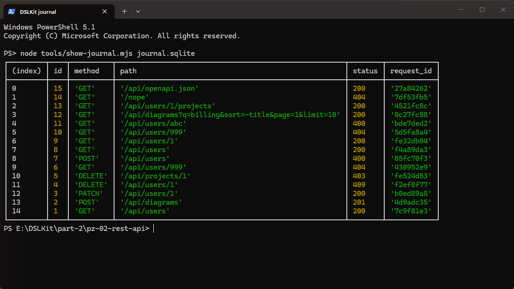

Figure 1 – The table request_log of the SQLite database printed in a PowerShell window: method, path, status code and request number

### 3.6 Error pages

A browser gets an arranged page instead of JSON, with the code, a title, three blocks "What happened", "Likely cause" and "What to do", and the request number. The same number is in the header `X-Request-Id`, in the error body, in the journal table and in the server console line, so the request is easy to find by it. The error texts are written in English, like the other API texts. The 404 page for an unknown address is shown in figure 2.

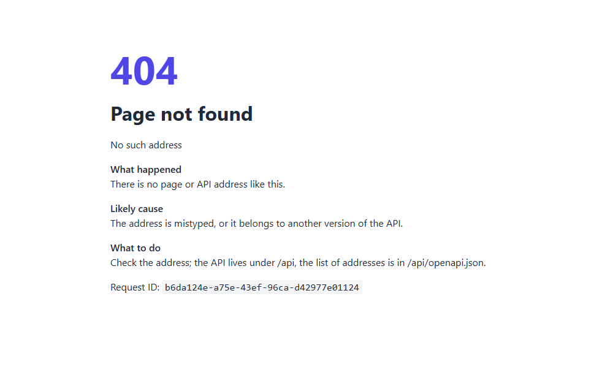

Figure 2 – The 404 error page for an address that does not exist in the API, with the explanation blocks and the request number

The 429 page appears when more requests are sent within a minute than `limits.json` allows. For the shot the limit is lowered to three requests by the variable `RATE_LIMIT_MAX`. The page is shown in figure 3.

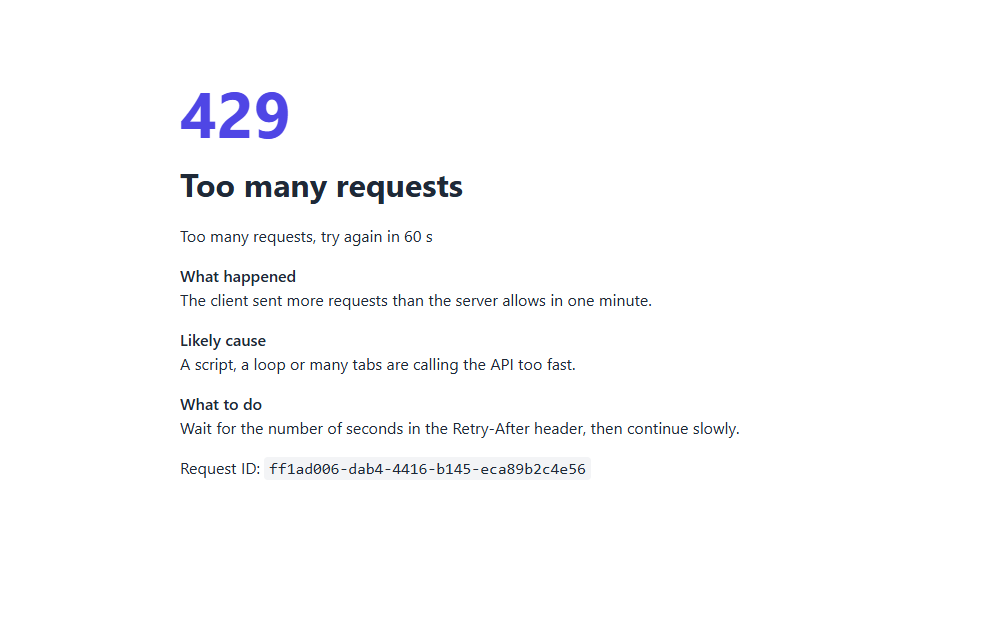

Figure 3 – The 429 error page after the request limit is exceeded, this request is not written to the journal

The 500 page for an unavailable journal is shown in figure 4. It comes from a real failure: the journal table is dropped under the running server, and the action is not carried out.

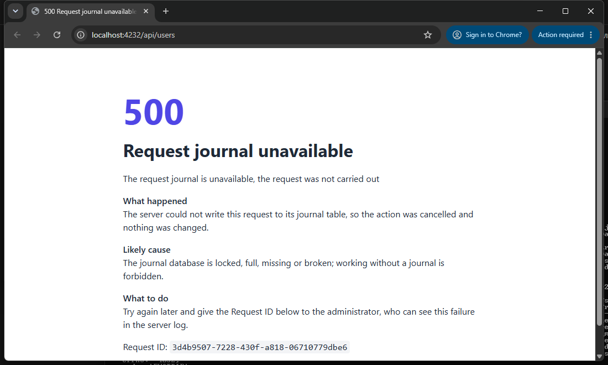

Figure 4 – The 500 error page for an unavailable request journal, the action is not carried out

The 403 page appears when an ordinary user tries to delete a project. A browser cannot send the `X-User-Id` header and `DELETE` from the address bar, so the shot is taken in Postman and shown in figure 5.

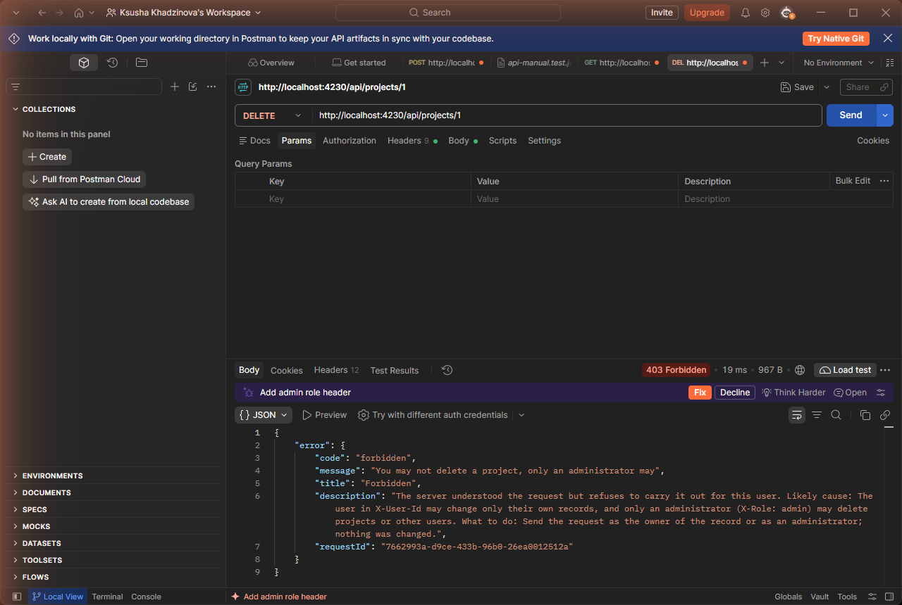

Figure 5 – The answer 403 to the request DELETE /api/projects/1 with the X-User-Id header of an ordinary user

### 3.7 API documentation

The route `GET /api/openapi.json` returns the API description in the OpenAPI 3.0 format. It is built from the same schemas that validate requests, so field lengths, lists of allowed values and required fields in the document match the code. The document can be opened in Swagger UI or imported into Postman. The description is opened in a browser window at `http://localhost:4230/api/openapi.json`, and a fragment is shown in figure 6. In it the change and delete operations have the headers `X-User-Id` and `X-Role` and the answer 403. The reference of operations is generated from the same document by the script `tools/gen-api-md.mjs` into the files `API.generated.ru.md` and `API.generated.en.md`. A test compares them with the server answer, so they do not drift from the code. The possible error codes are listed in the reference for every operation.

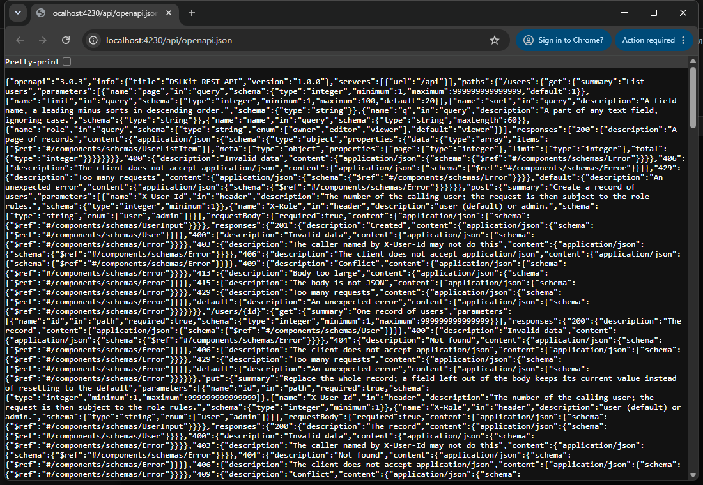

Figure 6 – The API description in the OpenAPI format at GET /api/openapi.json in a browser window: paths, parameters, role headers and response codes

### 3.8 Checking requests in Postman

All operations are checked in Postman with the collection `postman_collection.json`, and the same set of requests is in the file `requests.http`. A separate window shot is made for every method: the request, the status code and the response body. Reading the list with `GET /api/users` is shown in figure 7.

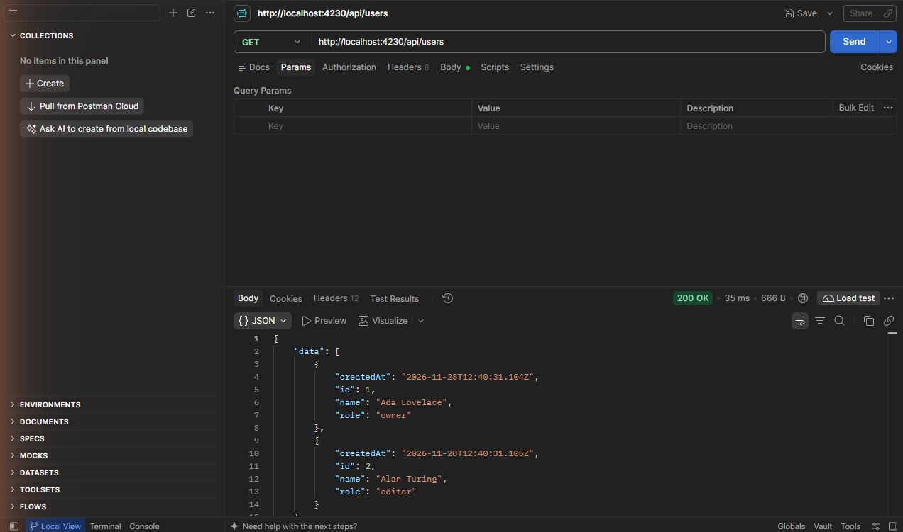

Figure 7 – The request GET /api/users and the answer 200 with the list of users in Postman

Creating a diagram with `POST /api/diagrams` and a JSON body is shown in figure 8.

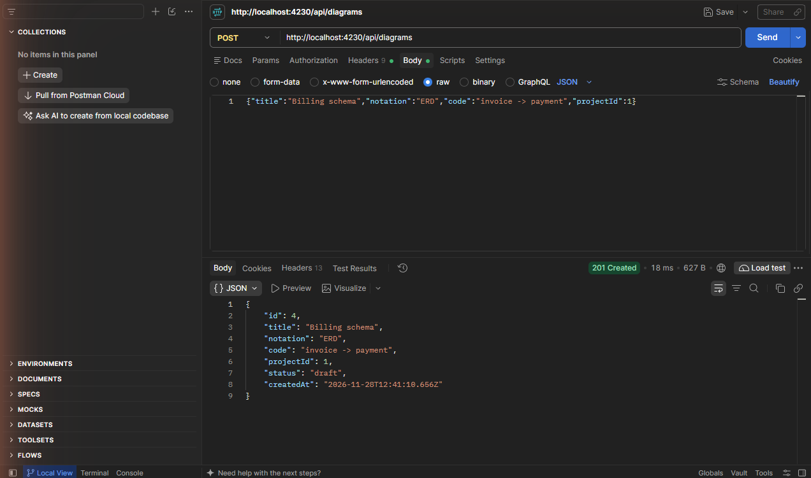

Figure 8 – The request POST /api/diagrams with a JSON body and the answer 201 in Postman

A full replacement with `PUT /api/users/2` is shown in figure 9.

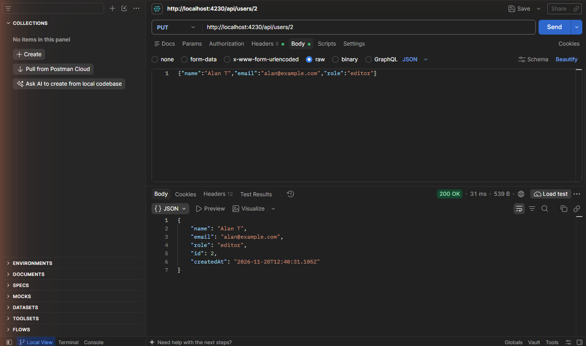

Figure 9 – The request PUT /api/users/2 with a full body and the answer 200 with new fields in Postman

A partial change with `PATCH /api/users/1` is shown in figure 10.

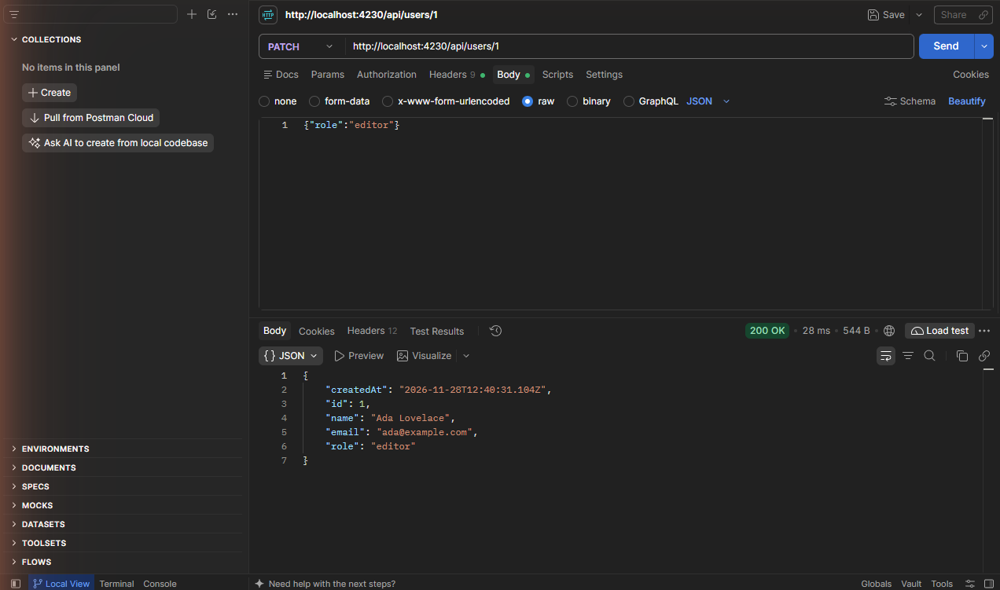

Figure 10 – The request PATCH /api/users/1 with a one-field body and the answer 200 in Postman

Deleting a diagram with `DELETE /api/diagrams/2` passes without a response body, as in figure 11.

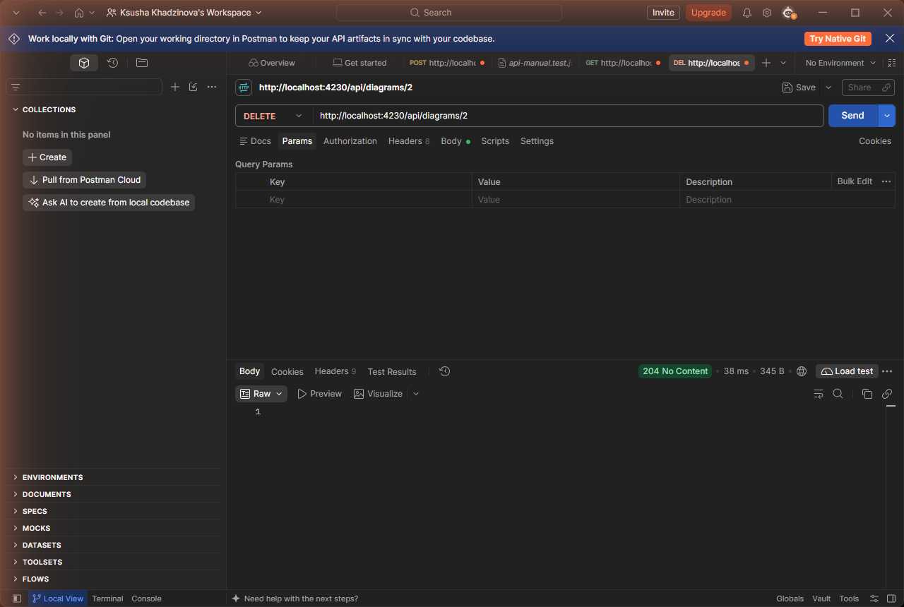

Figure 11 – The request DELETE /api/diagrams/2 and the answer 204 without a body in Postman

Deleting a user who still owns projects is rejected with code 409, as in figure 12.

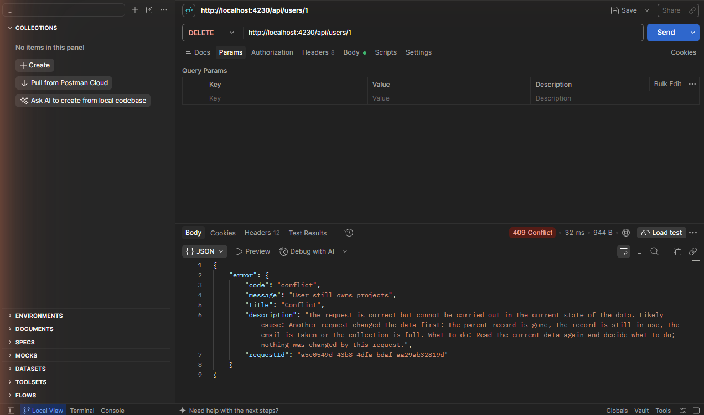

Figure 12 – The request DELETE /api/users/1 and the answer 409 saying that the user owns projects, in Postman

The request `POST /api/users` with an empty name and a wrong email is rejected, as in figure 13.

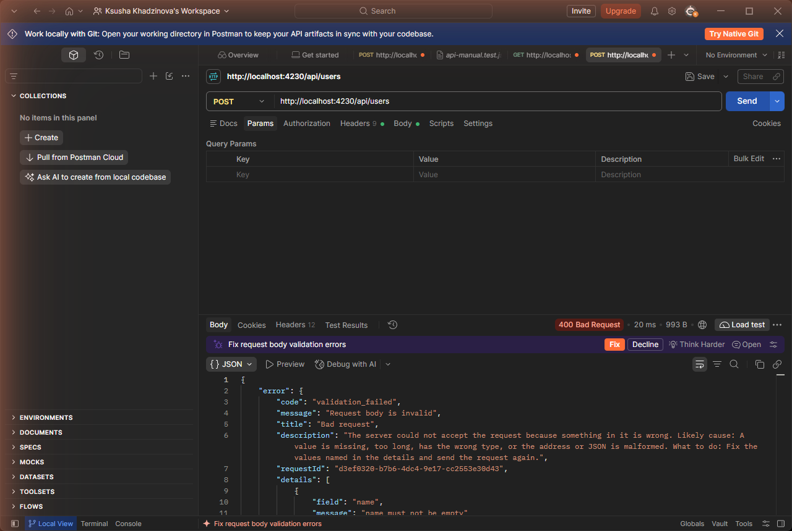

Figure 13 – The request POST /api/users with invalid data and the answer 400 with the list of field problems in Postman

### 3.9 Checking requests from a browser

A browser sends only `GET` requests from the address bar, and the other methods are shown above in Postman. The server is started with `npm start` and the variable `PORT` set to 4230, and the requests are opened in a Chrome window with the address bar. The answer to `GET /api/users` at `http://localhost:4230/api/users` is shown in figure 14.

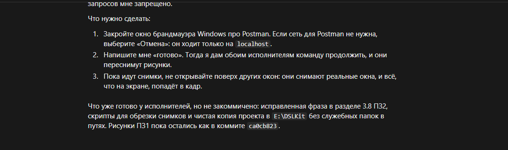

Figure 14 – The answer to GET /api/users in a browser window: an array of users and the meta object

One record at `http://localhost:4230/api/users/1` is shown in figure 15.

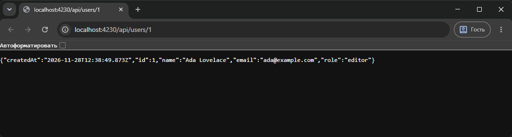

Figure 15 – The answer to GET /api/users/1 in a browser window: the object of one user

A request for a non-existent record at `http://localhost:4230/api/users/999` gives the error shown in figure 16.

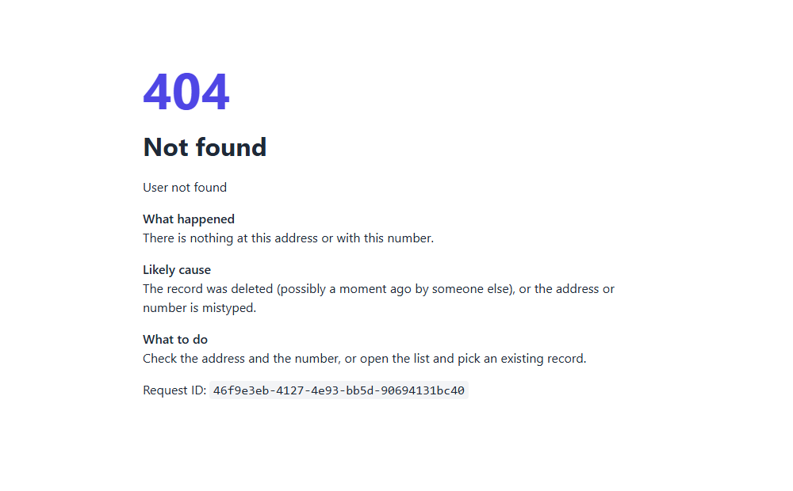

Figure 16 – The answer to GET /api/users/999 in a browser window: the 404 error page with the request number

A wrong number in the address `http://localhost:4230/api/users/abc` is rejected, as in figure 17.

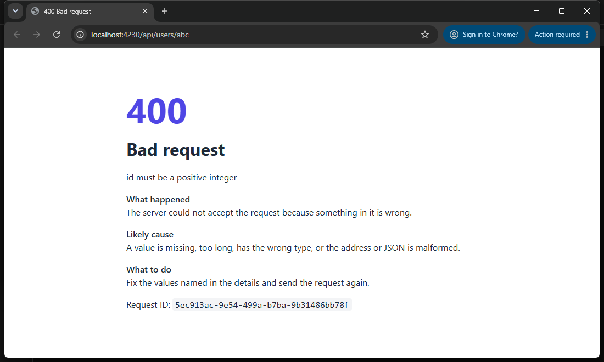

Figure 17 – The answer to GET /api/users/abc in a browser window: the 400 error page with an explanation

Search, sorting and pages work through the address parameters `?q=billing&sort=-title&page=1&limit=10`, and the result is shown in figure 18.

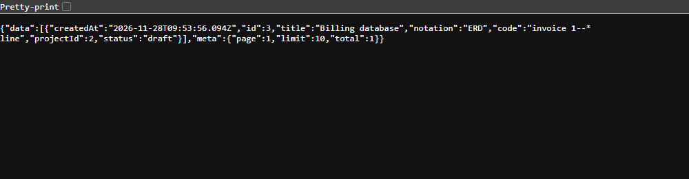

Figure 18 – The answer to GET /api/diagrams with the q, sort, page and limit parameters in a browser window

The extra route `GET /api/users/1/projects` returns the projects of one user, as in figure 19.

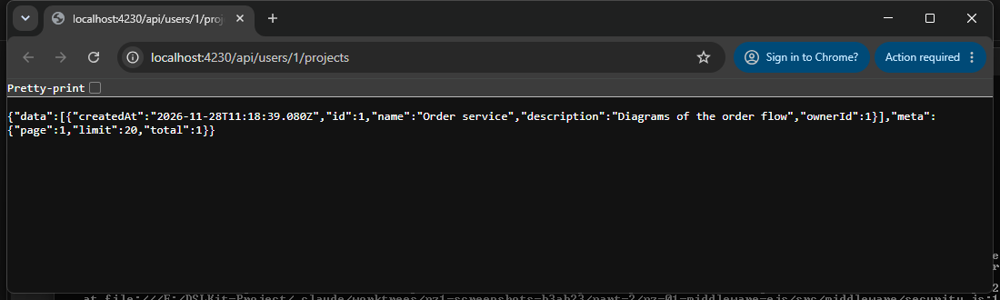

Figure 19 – The answer to GET /api/users/1/projects in a browser window: the projects of the user

### 3.10 Automatic checks

The automatic tests start the server on a free port and check every method, the status codes, filters, sorting, pages, validation errors, links between resources, extra operations, roles with the answer 403, the order "journal record before the action", a journal failure with the answer 500, the exclusion of `/health` and of the answer 429 from the journal, races when a parent is deleted, and the error pages. There are 173 server tests, 176 together with the report checks, and the coverage of lines, branches and functions is 100 percent. The command is `npm test` in the project folder. The console message at server start is shown in figure 20.

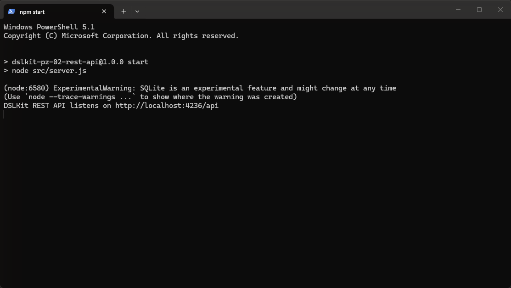

Figure 20 – A PowerShell window with the server message after the start with npm start on port 4236

The result of `npm test` with the number of tests and the code coverage is shown in figure 21.

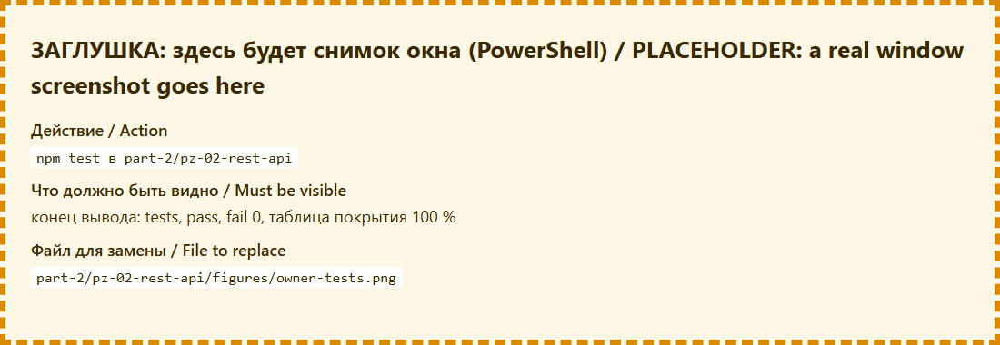

Figure 21 – The end of the npm test output: the number of passed tests and the coverage table

## 4 Answers to the Control Questions

The number in the group list is 26, so the answers are given to questions 25, 26 and 27.

25. What are "cross-resource links" and how are they implemented in a REST API (for example, getting the orders of a user)?

    These are links between records of different resources, for example a project belongs to a user and a diagram belongs to a project. An API expresses a link in three ways. By way 1 the link is a reference field in the record, in this work `ownerId` of a project and `projectId` of a diagram, and the server checks that such a record exists, otherwise it answers 409. By way 2 a nested route is used for reading, for example `GET /api/users/:id/projects` returns the projects of a user and `GET /api/projects/:id/diagrams` the diagrams of a project. By way 3 a list filter is used, and `GET /api/projects?ownerId=1` gives the same. A link protects deletion as well: a user with projects and a project with diagrams are not deleted, the answer is 409.

26. Which status codes are used for redirects (3xx)? Are they needed in a REST API?

    Code 301 means a permanent move of an address, 302 a temporary one, codes 307 and 308 do the same but keep the request method, code 303 sends the client to another address with the `GET` method, and code 304 says that the cached answer is still valid. In Express a redirect is made by `res.redirect(status, url)`. In a REST API redirects are rarely needed: after `POST` the server returns 201 with the `Location` header and the record itself instead of redirecting the client. They are used when an address or an API version moves, and code 304 is used for conditional requests with `ETag`. There are no redirects in this work, and the server returns `ETag` in its answers.

27. How do you state the possible error codes and their descriptions in the API documentation?

    In OpenAPI the codes are listed for every operation in the `responses` section, for example `400`, `403`, `404` and `409`, and each gets a description and a body schema. The common error schema is described once in `components` and linked by reference. In this work the documentation is available at `GET /api/openapi.json` and in the file `API.md`: every route has a column with the possible error codes, and the section "Errors" shows the single answer shape `{ "error": { "code", "message", "title", "description", "requestId", "details" } }` and lists the `code` values. So a client knows which errors to expect.

## Conclusion

A REST API with three linked resources is designed and implemented for the DSLKit project. It supports CRUD operations, filtering, search, sorting, pages, publishing and copying of diagrams, validates the input data and the links between records, and answers with errors of one format with a request number. Roles tell an ordinary user from an administrator and give a real answer 403. The request journal is kept in a database table by the rules of the even variant and is written before the action, and its failure gives the answer 500 without carrying out the action. The API description is collected in `API.md` and in `GET /api/openapi.json`, the automatic tests cover all the code, and the requests of every method are checked in Postman.

The work has limits that must be named directly. The data of the resources lies in in-memory arrays and disappears when the server restarts, as the task requires, and only the request journal is kept in a database. The identity of a user is set by the headers `X-User-Id` and `X-Role` and is trusted, so a real system has to take it from a verified session or token. The error texts are written in English. The journal write and the action on the data are not in one transaction, and this is solved by the order of the steps: first the journal row, then the action, and if the journal fails the action is not carried out. These limits are described in the text of the work and in the file `README.md` of the project.

## Appendix A (mandatory) Listing of the file app.js, application assembly

The comments in the listings of all appendices are written in English, as in the source files of the project.

{{code:part-2/pz-02-rest-api/src/app.js#65-124}}

## Appendix B (mandatory) Listing of the file app.js, routes and error handler

{{code:part-2/pz-02-rest-api/src/app.js#125-268}}

## Appendix C (mandatory) Listing of the file resource.js, common routes of a resource

{{code:part-2/pz-02-rest-api/src/resource.js#17-165}}

## Appendix D (mandatory) Listing of the file validation.js, field validation

{{code:part-2/pz-02-rest-api/src/validation.js}}

## Appendix E (mandatory) Listing of the file security.js, roles and protection

{{code:part-2/pz-02-rest-api/src/security.js}}

## Appendix F (mandatory) Listing of the file journal.js, request journal

{{code:part-2/pz-02-rest-api/src/journal.js#9-51}}
