# Practical Session 2. Design and Implementation of a REST API

## 1 Purpose of the Work

To learn the principles of designing a RESTful API, to implement endpoints for CRUD operations and extra operations, to add input validation and to document the API, using the DSLKit project, a diagram-as-code web editor whose theme matches the SaaS direction and the future course project.

## 2 Brief Theory

**Resources and methods.** REST describes the subject area as a set of resources with plural addresses such as `/api/diagrams`. Operations map to HTTP methods: `GET` reads, `POST` creates, `PUT` replaces a record entirely, `PATCH` changes part of the fields, `DELETE` removes. The methods `GET`, `PUT` and `DELETE` are idempotent: repeating a request does not change the result.

**Status codes.** Code 200 means success, 201 creation with a `Location` header, 204 success without a body, 400 a client error in the request, 404 a missing record, 409 a conflict with the current state of the data, 413 a body that is too large, 500 a server failure.

**Data validation.** The server does not trust the client: required fields, types, length and allowed values are checked before writing, and an error response has a single format.

## 3 Course of the Work

### 3.1 API design

Three related resources are chosen: users `users`, projects `projects` and diagrams `diagrams`. A user owns projects and a project holds diagrams. The fields are listed in table 1.

Table 1 – API resources and fields

| Resource   | Fields                                                                    |
| ---------- | ------------------------------------------------------------------------- |
| `users`    | `name`, `email`, `role` (`owner`, `editor`, `viewer`)                     |
| `projects` | `name`, `description`, `ownerId`                                          |
| `diagrams` | `title`, `notation`, `code`, `projectId`, `status` (`draft`, `published`) |

Every record has the service fields `id` and `createdAt`, which the client cannot change. The data lives in arrays in memory, as the task requires, so the initial records return after a server restart.

### 3.2 Endpoints

Each resource has six standard operations, and diagrams and projects have three extra ones. All addresses are listed in table 2. The application assembly is shown in appendix A, the shared resource logic in appendix B and the field checks in appendix C.

Table 2 – API endpoints

| Method and address                 | Purpose                                   | Success |
| ---------------------------------- | ----------------------------------------- | ------- |
| `GET /api/{resource}`              | List with filter, search, sort and paging | 200     |
| `GET /api/{resource}/:id`          | One record                                | 200     |
| `POST /api/{resource}`             | Create                                    | 201     |
| `PUT /api/{resource}/:id`          | Full replacement                          | 200     |
| `PATCH /api/{resource}/:id`        | Partial change                            | 200     |
| `DELETE /api/{resource}/:id`       | Delete                                    | 204     |
| `GET /api/users/:id/projects`      | Projects of one user                      | 200     |
| `GET /api/projects/:id/diagrams`   | Diagrams of one project                   | 200     |
| `POST /api/diagrams/:id/publish`   | Publish, repeating changes nothing        | 200     |
| `POST /api/diagrams/:id/duplicate` | Copy of a diagram as a draft              | 201     |

Examples of the request body and the expected response for the main operations are in table 3. The data come from `API.md` and match the answers of the running server (port 3962). The `createdAt` field is shortened to `…`, and `id` depends on the number of records already created.

Table 3 – Request and response examples

| Request | Request body | Expected response |
| ------- | ------------ | ----------------- |
| `POST /api/users` | `{"name":"Anna","email":"anna@example.com","role":"owner"}` | 201, `{"id":3,"name":"Anna","email":"anna@example.com","role":"owner","createdAt":"…"}` |
| `POST /api/diagrams` | `{"title":"Billing schema","notation":"ERD","code":"invoice -> payment","projectId":1}` | 201, `{"id":4,"title":"Billing schema","notation":"ERD","code":"invoice -> payment","projectId":1,"status":"draft","createdAt":"…"}` |
| `GET /api/diagrams?q=billing&sort=-title` | none | 200, `{"data":[{…},{…}],"meta":{"page":1,"limit":20,"total":2}}` |
| `PATCH /api/users/1` | `{"role":"editor"}` | 200, the user with `"role":"editor"` |
| `POST /api/diagrams/1/publish` | none | 200, the diagram with `"status":"published"` |
| `POST /api/diagrams/1/duplicate` | none | 201, a copy with `"title":"Checkout sequence (copy)"` and `"status":"draft"` |
| `DELETE /api/diagrams/2` | none | 204, no body |
| `DELETE /api/users/1` | none | 409, `{"error":{"code":"conflict","message":"User still owns projects"}}` |
| `POST /api/users` | `{"name":"","email":"x"}` | 400, `{"error":{"code":"validation_failed","message":"Request body is invalid","details":[{"field":"name",…},{"field":"email",…}]}}` |

Lists accept `page` and `limit` for paging, `sort` for sorting (a minus sign means descending), `q` for search in text fields and any field name for an exact filter. A list response holds the array `data` and the object `meta` with the total count. The route `GET /api/users/:id/projects` returns the projects of one user with the same list parameters and answers 404 for an unknown user. The file `API.md` collects detailed request and response examples.

### 3.3 Validation and errors

The schema of every resource sets the type, whether the field is required, the maximum length, the list of allowed values and the default. Validation returns all problems at once, rejects unknown fields and checks that `ownerId` and `projectId` point to existing records. The `PATCH` method checks only the sent fields. Deleting a user who owns projects or a project that has diagrams is rejected with code 409. All errors, including broken JSON, an unknown address and an unexpected failure, come back in one format with the fields `code` and `message`. Appendices A and B hold the listings.

### 3.4 Verification

Automatic tests start the server on a free port and check every method, the status codes, filters, sorting, paging, validation errors, the links between resources, the extra operations and the 500 response. Line and function coverage is 100 percent and branch coverage is above 98 percent. The command is `npm test` in the project folder. Manual checks in Postman or Insomnia can use the requests from `API.md`.

The server is started with `npm start`, and the console message is shown in figure 1.

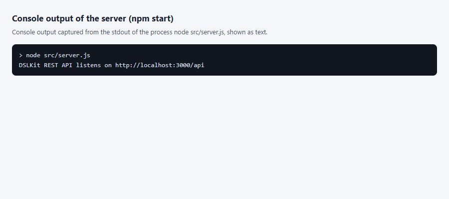

Figure 1 – Console message after the server starts on port 3000 (process output captured as text)

A browser does not send `POST`, `PUT`, `PATCH` and `DELETE` from the address bar, so the script `shots/shots.mjs` sent such requests, and the real requests and server answers are drawn on a page. Creating a user, a project and a diagram is shown in figure 2.

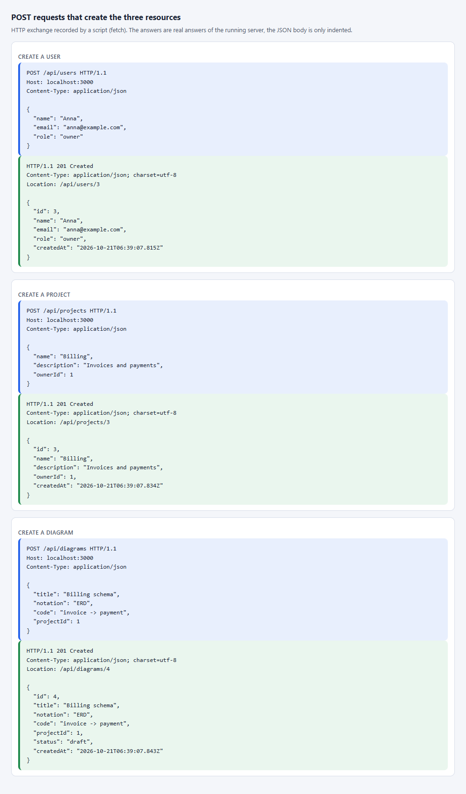

Figure 2 – POST requests and the answers 201 for a user, a project and a diagram, recorded by a script (not a Postman window)

The `GET /api/users` request is opened in the browser at `http://localhost:3000/api/users`, and the answer is shown in figure 3.

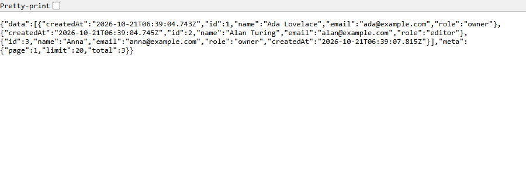

Figure 3 – Answer to GET /api/users in a browser window: an array of users

A single record at `http://localhost:3000/api/users/1` is shown in figure 4.

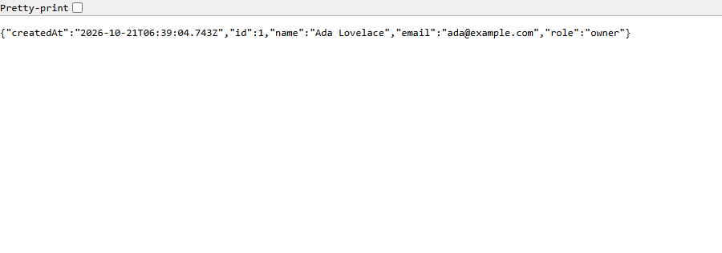

Figure 4 – Answer to GET /api/users/1 in a browser window: the object of one user

A request for a missing record at `http://localhost:3000/api/users/999` gives the error shown in figure 5.

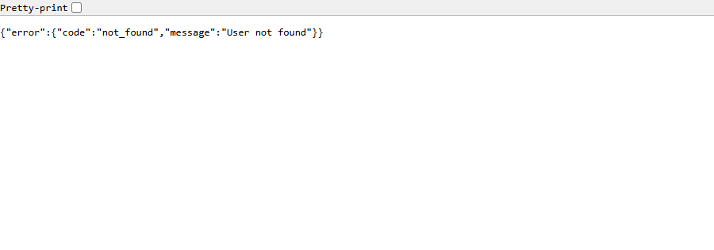

Figure 5 – Answer to GET /api/users/999 in a browser window: JSON with the code not_found (code 404)

A wrong id in the address `http://localhost:3000/api/users/abc` is refused, as in figure 6.

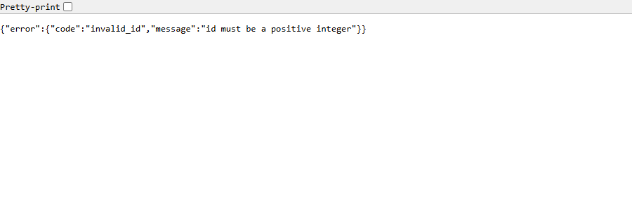

Figure 6 – Answer to GET /api/users/abc in a browser window: JSON with a message about a wrong id (code 400)

Search, sorting and paging work through the address parameters `?q=billing&sort=-title&page=1&limit=10`, and the result is shown in figure 7.

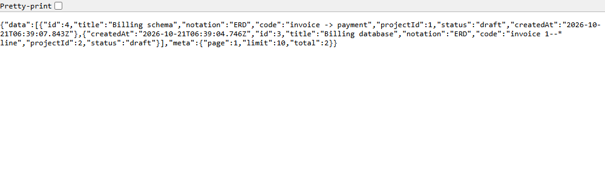

Figure 7 – Answer to GET /api/diagrams with the q, sort, page and limit parameters in a browser window

The additional route `GET /api/users/1/projects` returns the projects of one user, as in figure 8.

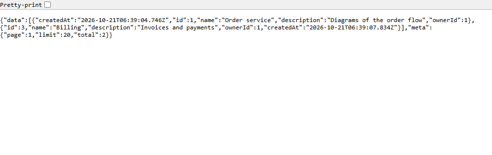

Figure 8 – Answer to GET /api/users/1/projects in a browser window: the projects of the user

The data validation errors, including an unknown field and a project that does not exist, are shown in figure 9.

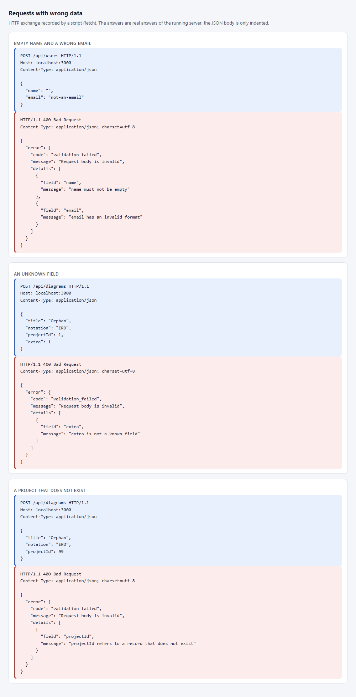

Figure 9 – Answers 400 with the list of field problems, recorded by a script (not a Postman window)

A partial change and a full replacement of a record are shown in figure 10.

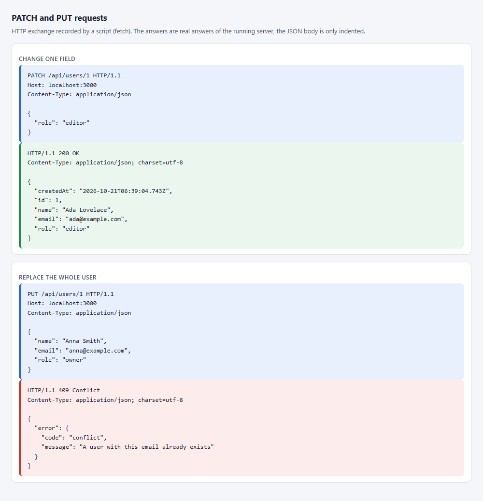

Figure 10 – PATCH and PUT requests and the server answers, recorded by a script (not a Postman window)

The additional operations of a diagram are shown in figure 11: publishing again changes nothing, and the copy is created as a draft.

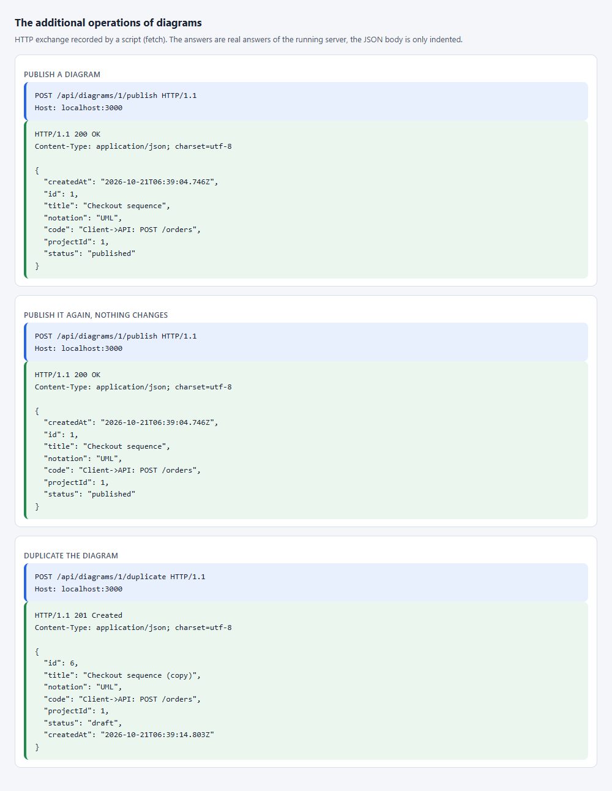

Figure 11 – Publish and duplicate requests and the server answers, recorded by a script (not a Postman window)

Deleting a user with projects is refused, and deleting a diagram passes, as in figure 12.

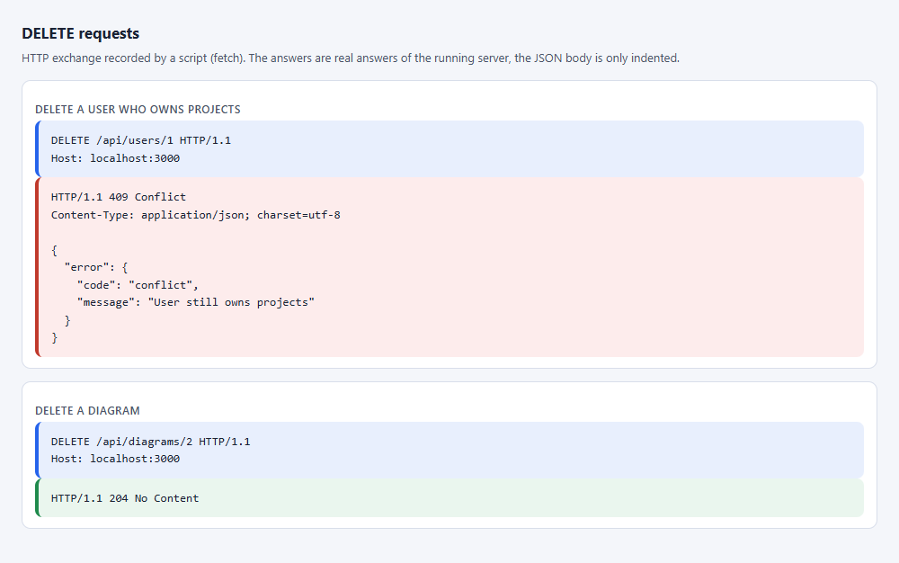

Figure 12 – DELETE requests: the answer 409 for a user with projects and the answer 204 for a diagram, recorded by a script (not a Postman window)

The result of the `npm test` command with the number of tests and the code coverage is shown in figure 13.

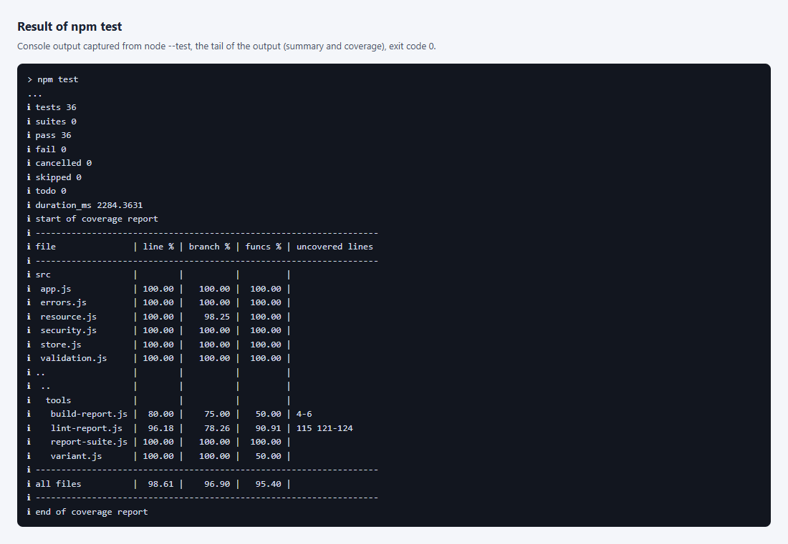

Figure 13 – End of the npm test output: the number of passed tests and the coverage table (process output captured as text)

### 3.5 Answers to the control questions

25. What are "cross-resource links" and how are they implemented in a REST API (for example, getting the orders of a user)?

    These are links between records of different resources, for example a project belongs to a user and a diagram belongs to a project. An API expresses a link in three ways. The first is a reference field in the record, in the work this is `ownerId` of a project and `projectId` of a diagram, and the server checks that such a record exists. The second is a nested route for reading, for example `GET /api/users/:id/projects` returns the projects of a user and `GET /api/projects/:id/diagrams` the diagrams of a project. The third is a list filter, and `GET /api/projects?ownerId=1` gives the same result. Nesting is kept at most two levels deep, and resource names are plural. The link guards deletion as well: a user with projects and a project with diagrams are not deleted, the answer is 409.

26. Which status codes are used for redirects (3xx)? Are they needed in a REST API?

    Code 301 means a permanent move of the address, 302 a temporary one, 307 and 308 do the same but keep the request method, 303 sends the client to another address with `GET`, and 304 says the cached response is still current. In Express a redirect is made by `res.redirect(status, url)`. A REST API needs redirects rarely: after `POST` it returns 201 with a `Location` header and the record itself instead of redirecting the client. Redirects are used when an address or an API version moves, and 304 for conditional requests with `ETag`. This work has no redirects.

27. How do you state the possible error codes and their descriptions in the API documentation?

    In OpenAPI each operation lists the codes in its `responses` section, for example `400`, `404` and `409`, and gives a description and a body schema for each. The common error schema is described once in `components` and attached by reference. In the work the documentation lives in `API.md`: the table of each route has a column with the possible error codes, and the "Errors" section shows the single response shape `{ "error": { "code", "message", "details" } }` and lists the `code` values with their status codes. That way a client knows which errors to expect and how to parse them.

### 3.6 OpenAPI description

The route `GET /api/openapi.json` returns the description of the API in the OpenAPI 3.0 format. It is built from the same schemas that validate the requests, so field lengths, lists of allowed values and required fields in the document match the code. The `email` field is not offered as a filter of the user list. The document can be opened in Swagger UI or imported into Postman.

A fragment of the API documentation is shown in figure 14.

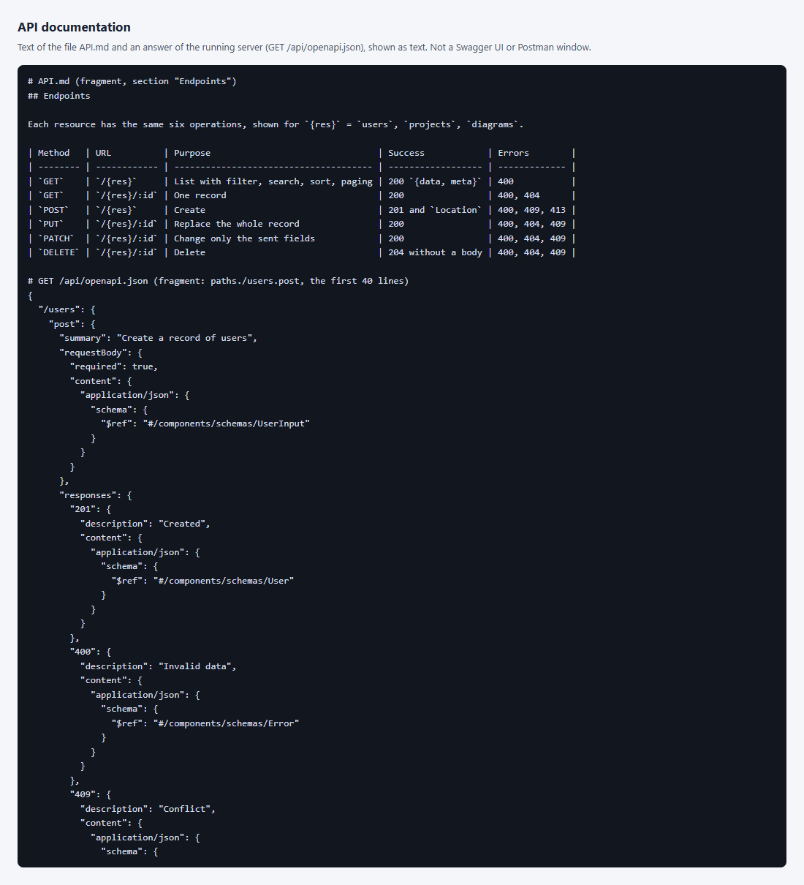

Figure 14 – A fragment of the file `API.md` and of the answer of `GET /api/openapi.json` (text captured by the script `shots/docs-shot.mjs`, not a Swagger UI window)

No Postman window was captured in this work: real screenshots of the program window cannot be produced here, so a script sent the requests in figures 2 and 9–12, and the captions say so. The ready collection `postman_collection.json` and the file `requests.http` allow repeating the check and taking such screenshots by hand.

## Conclusion

For the DSLKit project a REST API with three related resources was designed and implemented. It supports CRUD operations, filtering, search, sorting, paging, publishing and copying of diagrams, validates input and the links between records, and answers with errors in one format. `API.md` holds the API description and request examples, and automatic tests cover all the code. Postman screenshots and documentation excerpts remain to be attached.

## Appendix A (mandatory) Listing of the file app.js

{{code:part-2/pz-02-rest-api/src/app.js}}

## Appendix B (mandatory) Listing of the file resource.js

{{code:part-2/pz-02-rest-api/src/resource.js}}

## Appendix C (mandatory) Listing of the file validation.js

{{code:part-2/pz-02-rest-api/src/validation.js}}
