# Практическое занятие №2. Проектирование и реализация REST API

## 1 Цель работы

Цель работы состоит в том, чтобы освоить принципы проектирования RESTful API на примере проекта DSLKit, веб-редактора диаграмм как кода, тематика которого соответствует направлению SaaS и будущему курсовому проекту. Для достижения цели нужно спроектировать три связанных ресурса, реализовать для них операции CRUD и дополнительные операции, добавить проверку входных данных, единый формат ошибок и описание API. Вариант 100 (номер в списке группы 26) чётный, поэтому журнал запросов хранится в таблице базы данных, а не в файле, и запись в него делается до выполнения действия. Данные самих ресурсов, как требует условие, лежат в массивах в памяти. Исходный код приложения лежит в репозитории https://github.com/KsushaKhadzhinova/DSLKit-Project в ветке pz22.

## 2 Краткие теоретические сведения

**Ресурсы и методы.** REST описывает предметную область как набор ресурсов с адресами во множественном числе, например `/api/diagrams`. Операции выражаются методами HTTP: `GET` читает, `POST` создаёт, `PUT` заменяет запись целиком, `PATCH` меняет часть полей, `DELETE` удаляет. Методы `GET`, `PUT` и `DELETE` идемпотентны: повтор запроса не меняет результат.

**Коды состояния.** Код 200 означает успех, 201 создание с заголовком `Location`, 204 успех без тела, 400 ошибку клиента в запросе, 403 отказ в праве на действие, 404 отсутствие записи, 409 конфликт с текущим состоянием данных, 413 слишком большое тело, 429 слишком частые запросы, 500 сбой сервера.

**Проверка данных.** Сервер не доверяет клиенту: обязательные поля, типы, длина и допустимые значения проверяются до записи, а ответ с ошибкой имеет единый формат.

**Журнал запросов.** Для чётного варианта журнал ведётся в таблице базы данных. Запись о запросе делается до действия, поэтому если журнал недоступен, действие не выполняется, а клиент получает ответ 500.

## 3 Ход работы

### 3.1 Проектирование API

Выбраны три связанных ресурса: пользователи `users`, проекты `projects` и диаграммы `diagrams`. Пользователь владеет проектами, проект содержит диаграммы. Поля и правила проверки сведены в таблице 1.

Таблица 1 – Ресурсы и поля API

| Ресурс | Поля |
| --- | --- |
| `users` | `name`, `email`, `role` (`owner`, `editor`, `viewer`) |
| `projects` | `name`, `description`, `ownerId` |
| `diagrams` | `title`, `notation`, `code`, `projectId`, `status` (`draft`, `published`) |

У каждой записи есть служебные поля `id` и `createdAt`, которые клиент изменить не может. Данные ресурсов лежат в массивах в памяти, как требует условие, поэтому после перезапуска сервера возвращаются начальные записи: два пользователя, два проекта и три диаграммы. Журнал запросов лежит в таблице `request_log` базы данных SQLite. Файлы проекта и их назначение перечислены в таблице 2.

Таблица 2 – Файлы проекта практического занятия 2

| Файл | Назначение |
| --- | --- |
| `src/app.js` | Схемы ресурсов, порядок middleware, маршруты и единый обработчик ошибок |
| `src/resource.js` | Общие маршруты ресурса и разбор параметров списка |
| `src/validation.js` | Проверка тела запроса по схеме |
| `src/store.js` | Хранилище в массивах и начальные записи |
| `src/journal.js` | Таблица `request_log` и middleware журнала |
| `src/security.js` | Заголовки безопасности, ограничение частоты, роли, запись в консоль без переводов строк |
| `src/errors.js`, `src/error-catalog.js`, `src/error-page.js` | Класс ошибки, тексты ошибок и страница ошибки для браузера |
| `src/openapi.js` | Описание OpenAPI 3.0, которое строится из тех же схем |
| `limits.json` | Все пределы длины, размера страницы, тела и частоты запросов |

### 3.2 Эндпоинты

Для каждого ресурса реализованы шесть стандартных операций, а для диаграмм и проектов дополнительные. Все операции с методом, адресом, описанием, примером тела запроса и ожидаемым ответом приведены в таблице 3. Адрес `/api/users` стоит для примера, те же операции есть у `projects` и `diagrams`. Сборка приложения показана в приложении А, маршруты и обработчик ошибок в приложении Б, общая логика ресурсов в приложении Д, а проверка полей в приложении Е.

Таблица 3 – Эндпоинты API с примерами запросов и ответов

| Метод | URL | Описание | Пример тела запроса | Ожидаемый ответ |
| --- | --- | --- | --- | --- |
| `GET` | `/api/users` | Список пользователей | нет | 200, `{"data":[{…},{…}],"meta":{"page":1,"limit":20,"total":2}}` |
| `GET` | `/api/users/1` | Одна запись | нет | 200, объект пользователя |
| `POST` | `/api/users` | Создание пользователя | `{"name":"Anna","email":"anna@example.com","role":"owner"}` | 201, пользователь с `id` и `createdAt` |
| `PUT` | `/api/users/2` | Полная замена | `{"name":"Alan T","email":"alan@example.com","role":"editor"}` | 200, пользователь с новыми полями |
| `PATCH` | `/api/users/1` | Частичное изменение | `{"role":"editor"}` | 200, пользователь с `"role":"editor"` |
| `DELETE` | `/api/users/1` | Удаление пользователя | нет | 409, пользователь ещё владеет проектами |
| `DELETE` | `/api/diagrams/2` | Удаление диаграммы | нет | 204, тела нет |
| `GET` | `/api/diagrams?q=billing&sort=-title` | Список с поиском и сортировкой | нет | 200, список с объектом `meta` |
| `POST` | `/api/diagrams` | Создание диаграммы | `{"title":"Billing schema","notation":"ERD","code":"invoice -> payment","projectId":1}` | 201, диаграмма со `"status":"draft"` |
| `GET` | `/api/users/1/projects` | Проекты одного пользователя | нет | 200, список проектов с `meta` |
| `GET` | `/api/projects/1/diagrams` | Диаграммы одного проекта | нет | 200, список диаграмм с `meta` |
| `POST` | `/api/diagrams/1/publish` | Публикация, повтор ничего не меняет | нет | 200, диаграмма со `"status":"published"` |
| `POST` | `/api/diagrams/1/duplicate` | Копия диаграммы черновиком | нет | 201, копия с `"status":"draft"` |
| `POST` | `/api/users` | Неверные данные | `{"name":"","email":"x"}` | 400, `validation_failed` и перечень полей |

Поле `createdAt` у каждой записи своё: часы строго возрастают, поэтому две записи не совпадают даже в одну миллисекунду. Списки принимают параметры `page` и `limit` для страниц, `sort` для сортировки (знак минус означает убывание), `q` для поиска по текстовым полям и имя поля для точного фильтра. Ответ списка содержит массив `data` и объект `meta` с общим числом записей. Маршрут `GET /api/users/:id/projects` для неизвестного пользователя отвечает 404. Подробные примеры собраны в файле `API.md`.

### 3.3 Проверка входных данных и ошибки

Схема каждого ресурса задаёт тип, обязательность, предельную длину, список допустимых значений и значение по умолчанию. Проверка возвращает все найденные проблемы сразу, отвергает неизвестные поля и пробельные значения и проверяет, что `ownerId` и `projectId` указывают на существующие записи. Метод `PATCH` проверяет только присланные поля. Все пределы вынесены в файл `limits.json`. Все ошибки, включая неверный JSON, неизвестный адрес и неожиданный сбой, возвращаются в одном формате с полями `code`, `message`, `title`, `description` и `requestId`. Коды ошибок сведены в таблице 4.

Таблица 4 – Коды ошибок API

| Код | Когда возвращается |
| --- | --- |
| 400 | Неверное тело, JSON или значение поля, неверные заголовки `X-User-Id` и `X-Role` |
| 403 | Обычный пользователь меняет чужую запись или удаляет проект |
| 404 | Записи или адреса нет |
| 405, 406, 415 | Метод не поддерживается, нужный тип ответа или тела не поддерживается |
| 409 | Пользователь с проектами или проект с диаграммами удаляется, родительская запись для новой записи уже удалена |
| 412 | Не совпало условие `If-Match` при изменении или удалении |
| 413 | Тело запроса больше предела из `limits.json` |
| 429 | За минуту прислано больше запросов, чем разрешено |
| 500 | Сбой сервера, в том числе недоступный журнал запросов |

Удаление пользователя с проектами и проекта с диаграммами отклоняется кодом 409, а не удаляет связанные записи молча. Если родитель удаляется в тот момент, когда к нему добавляют дочернюю запись, исход всегда один из трёх: 201, 404 или 409. Ответа 5xx и «висячей» записи без родителя не бывает, это проверяют тесты гонок. Условный запрос с заголовком `If-Match` защищает от потерянного изменения: если запись уже изменили, ответ 412.

### 3.4 Роли и ответ 403

Входа в систему в работе нет, личность задаётся заголовками. Заголовок `X-User-Id` содержит номер пользователя, а `X-Role` равен `user` по умолчанию или `admin`. Запрос без `X-User-Id` анонимный и не ограничен, как и до введения ролей. Правила для запроса с `X-User-Id` сведены в таблице 5.

Таблица 5 – Права ролей

| Действие | Обычный пользователь | Администратор |
| --- | --- | --- |
| Менять или удалять свою запись пользователя | да | да |
| Менять или удалять запись другого пользователя | 403 | да |
| Менять свой проект, создавать проект на себя | да | да |
| Менять чужой проект, отдавать проект другому | 403 | да |
| Удалять проект | 403 | да |
| Изменять, удалять, публиковать, копировать диаграмму и создавать её | только в своём проекте, иначе 403 | да |

Неверное значение заголовка даёт 400, а номер несуществующего пользователя в `X-User-Id` даёт 403. Сначала проверяется, что запись есть (404), потом права (403), потом тело запроса. Заголовки принимаются на веру: это учебное упрощение, настоящая система берёт личность из проверенной сессии или токена. Листинг приведён в приложении Г.

### 3.5 Журнал запросов и порядок действий

Журнал лежит в таблице `request_log` базы данных SQLite со столбцами время, метод, путь, адрес клиента, код ответа и номер запроса `request_id`. Порядок для каждого запроса такой. Сначала сервер присваивает запросу номер и отдаёт его в заголовке `X-Request-Id`. Затем до выполнения действия в таблицу вставляется строка с временем, методом, путём, адресом клиента и номером запроса. Если вставка не удалась, действие не выполняется, а клиент получает ответ 500 с кодом `journal_unavailable`: работать без журнала запрещено. Если вставка удалась, действие выполняется, а в строку дописывается итоговый код ответа. Неудачные попытки с кодами 400, 404, 409 и 412 тоже остаются в журнале.

В журнал не попадают две группы запросов: проверка работоспособности `GET /health` и запросы, отклонённые ограничением частоты с кодом 429. Проверка работоспособности идёт до журнала, чтобы мониторинг не засорял таблицу и не расходовал лимит. Лишние запросы отклоняются до журнала, чтобы их поток не заполнял таблицу. Запись в журнал и действие над данными не лежат в одной транзакции, потому что данные ресурсов живут в массиве, поэтому правило «нет записи, нет действия» обеспечено порядком шагов. Если сбой случится уже после действия, при записи итогового кода, ответ клиенту не меняется, а ошибка пишется в консоль сервера. Листинг приведён в приложении В.

Сбой журнала воспроизводится при запущенном сервере, а не кнопкой. Сервер запускается командой `$env:JOURNAL_FILE='demo.sqlite'; npm start`, затем в другом окне командой `node tools/break-journal.mjs demo.sqlite` удаляется таблица журнала, и любой запрос получает ответ 500. Вернуть таблицу можно командой `node tools/break-journal.mjs demo.sqlite --restore`. Переменная окружения удаляется командой `Remove-Item Env:JOURNAL_FILE`. Таблица журнала с реальными строками показана на рисунке 1.

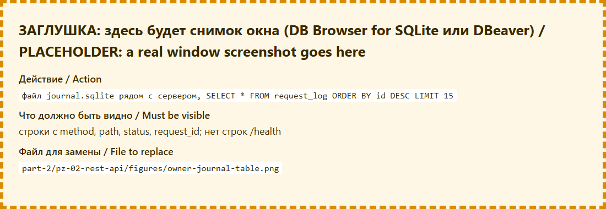

Рисунок 1 – Таблица request_log в базе данных SQLite со столбцами метода, пути, кода ответа и номера запроса

### 3.6 Страницы ошибок

Браузер получает вместо JSON оформленную страницу с кодом, заголовком и тремя блоками «What happened», «Likely cause» и «What to do» и номером запроса. Тот же номер лежит в заголовке `X-Request-Id`, в теле ошибки, в таблице журнала и в строке консоли сервера, поэтому по нему легко найти запрос. Тексты ошибок написаны по-английски, как и остальные тексты API. Страница 404 для неизвестного адреса показана на рисунке 2.

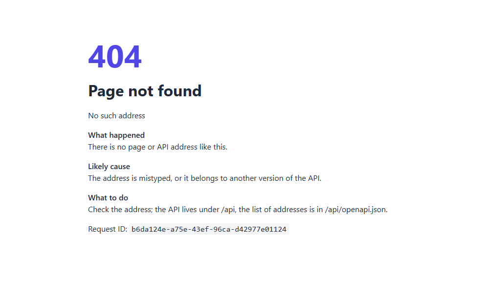

Рисунок 2 – Страница ошибки 404 для адреса, которого нет в API, с блоками пояснений и номером запроса

Страница 429 появляется, когда за минуту прислано больше запросов, чем разрешает `limits.json`. Для снимка предел снижен до трёх запросов переменной `RATE_LIMIT_MAX`. Страница показана на рисунке 3.

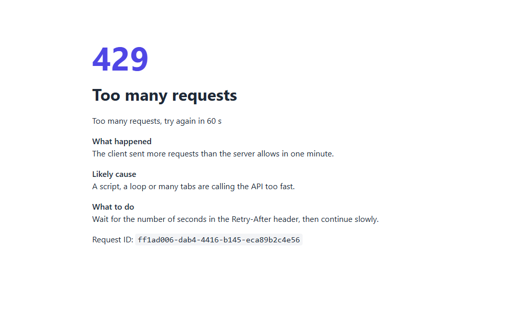

Рисунок 3 – Страница ошибки 429 после превышения предела запросов, запись об этом запросе в журнал не попадает

Страница 500 при недоступном журнале показана на рисунке 4. Она получена настоящим сбоем: таблица журнала удалена под работающим сервером, и действие не выполнено.

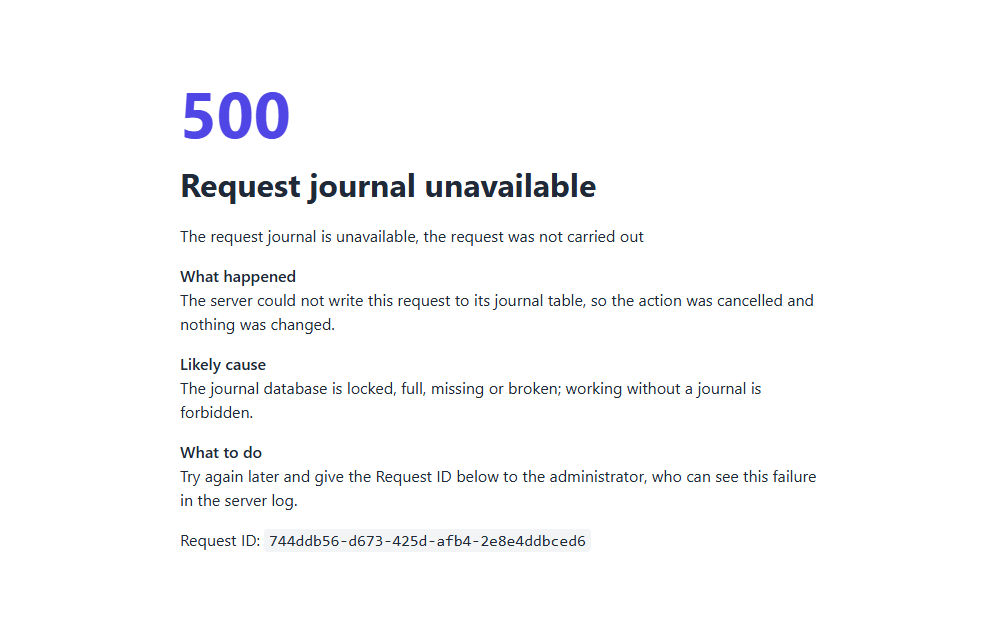

Рисунок 4 – Страница ошибки 500 при недоступном журнале запросов, действие не выполнено

Страница 403 появляется, когда обычный пользователь пытается удалить проект. Браузер не умеет отправлять заголовки `X-User-Id` и `DELETE` из адресной строки, поэтому снимок сделан в Postman и показан на рисунке 5.

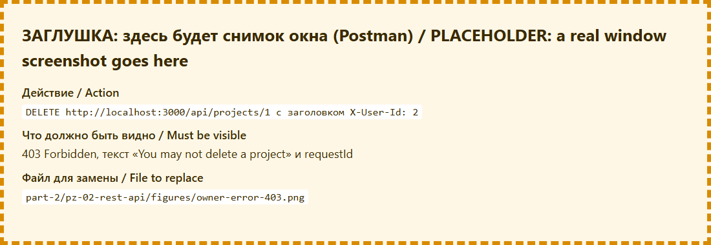

Рисунок 5 – Ответ 403 на запрос DELETE /api/projects/1 с заголовком X-User-Id обычного пользователя

### 3.7 Документация API

Маршрут `GET /api/openapi.json` отдаёт описание API в формате OpenAPI 3.0. Оно строится из тех же схем, которые проверяют запросы, поэтому длины полей, списки допустимых значений и обязательные поля в документе совпадают с кодом. Документ можно открыть в Swagger UI или импортировать в Postman. Справочник по операциям собирается из того же документа скриптом `tools/gen-api-md.mjs` в файлы `API.generated.ru.md` и `API.generated.en.md`. Тест сравнивает их с ответом сервера, поэтому они не расходятся с кодом. Для каждой операции в справочнике указаны возможные коды ошибок.

### 3.8 Проверка запросов в Postman

Все операции проверены в Postman по коллекции `postman_collection.json`, а тот же набор запросов лежит в файле `requests.http`. Для каждого метода сделан отдельный снимок окна: запрос, код ответа и тело ответа. Чтение списка запросом `GET /api/users` показано на рисунке 6.

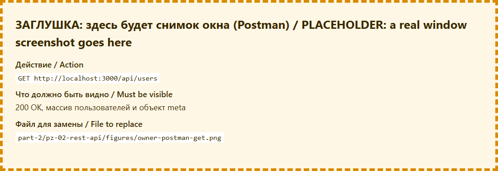

Рисунок 6 – Запрос GET /api/users и ответ 200 со списком пользователей в Postman

Создание диаграммы запросом `POST /api/diagrams` с телом JSON показано на рисунке 7.

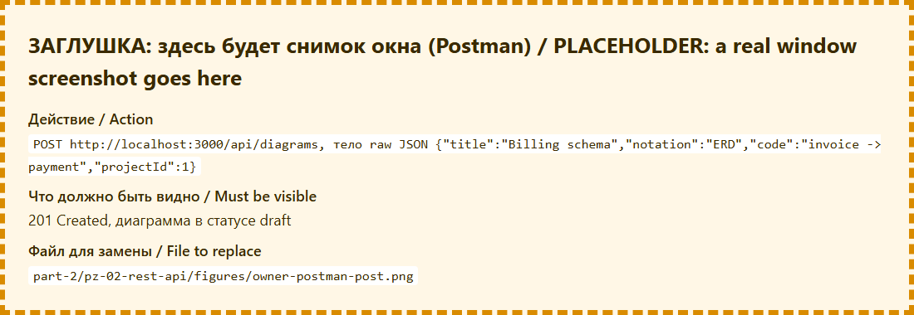

Рисунок 7 – Запрос POST /api/diagrams с телом JSON и ответ 201 в Postman

Полная замена записи запросом `PUT /api/users/2` показана на рисунке 8.

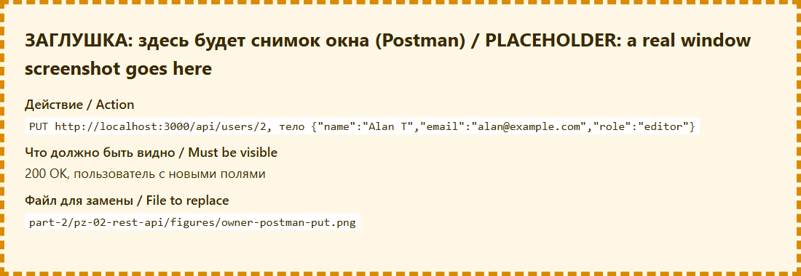

Рисунок 8 – Запрос PUT /api/users/2 с полным телом и ответ 200 с новыми полями в Postman

Частичное изменение запросом `PATCH /api/users/1` показано на рисунке 9.

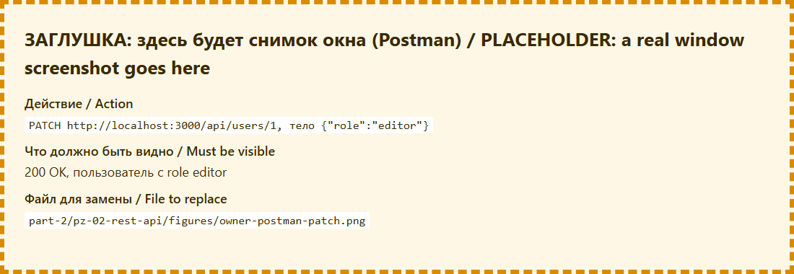

Рисунок 9 – Запрос PATCH /api/users/1 с телом из одного поля и ответ 200 в Postman

Удаление диаграммы запросом `DELETE /api/diagrams/2` проходит без тела ответа, как на рисунке 10.

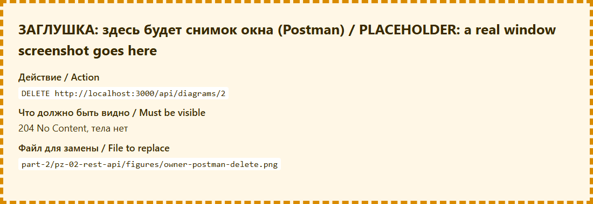

Рисунок 10 – Запрос DELETE /api/diagrams/2 и ответ 204 без тела в Postman

Удаление пользователя, который ещё владеет проектами, отклоняется кодом 409, как на рисунке 11.

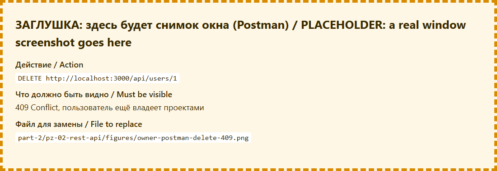

Рисунок 11 – Запрос DELETE /api/users/1 и ответ 409 о том, что пользователь владеет проектами, в Postman

Запрос `POST /api/users` с пустым именем и неверной почтой отклоняется, как на рисунке 12.

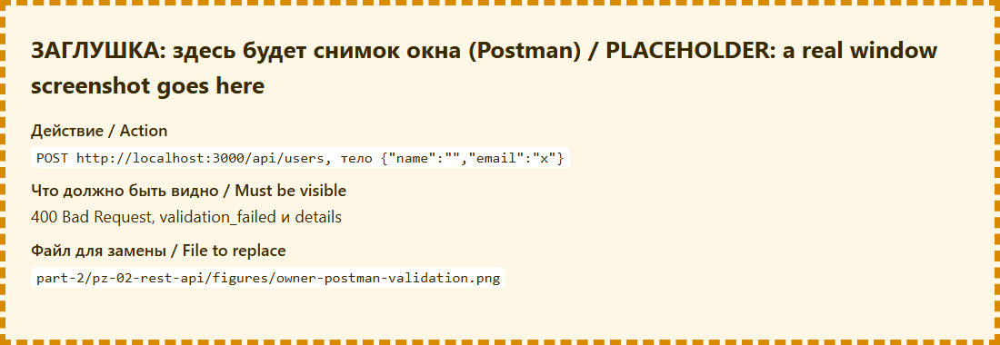

Рисунок 12 – Запрос POST /api/users с неверными данными и ответ 400 с перечнем проблем полей в Postman

### 3.9 Проверка запросов из браузера

Браузер отправляет из адресной строки только запросы `GET`, остальные методы показаны в Postman выше. Сервер запущен командой `npm start`, а запросы открыты в окне браузера. Ответ `GET /api/users` по адресу `http://localhost:3000/api/users` показан на рисунке 13.

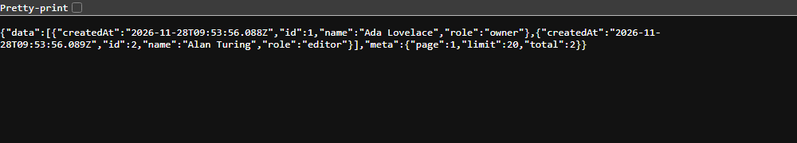

Рисунок 13 – Ответ GET /api/users в окне браузера: массив пользователей и объект meta

Одна запись по адресу `http://localhost:3000/api/users/1` показана на рисунке 14.

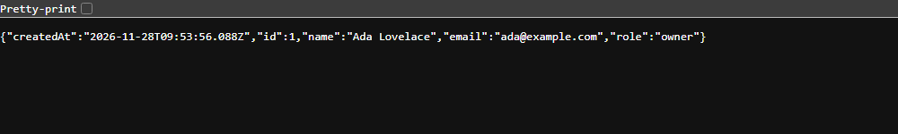

Рисунок 14 – Ответ GET /api/users/1 в окне браузера: объект одного пользователя

Запрос несуществующей записи по адресу `http://localhost:3000/api/users/999` даёт ошибку, показанную на рисунке 15.

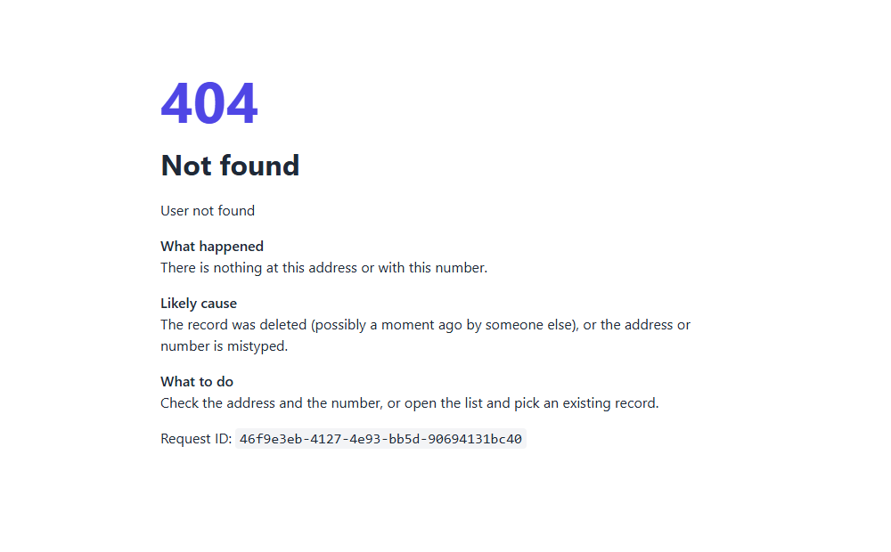

Рисунок 15 – Ответ GET /api/users/999 в окне браузера: страница ошибки 404 с номером запроса

Неверный номер в адресе `http://localhost:3000/api/users/abc` отклоняется, как на рисунке 16.

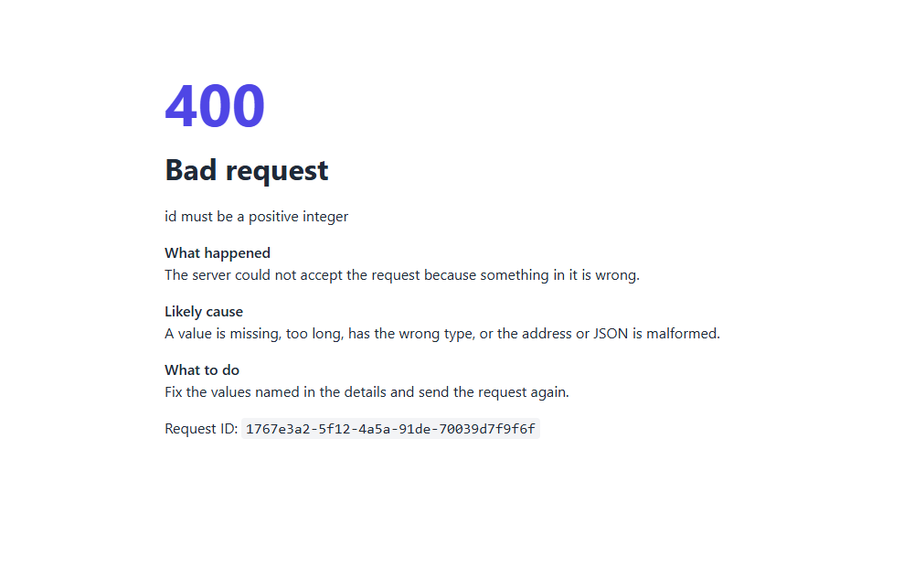

Рисунок 16 – Ответ GET /api/users/abc в окне браузера: страница ошибки 400 с пояснением

Поиск, сортировка и страницы работают через параметры адреса `?q=billing&sort=-title&page=1&limit=10`, результат показан на рисунке 17.

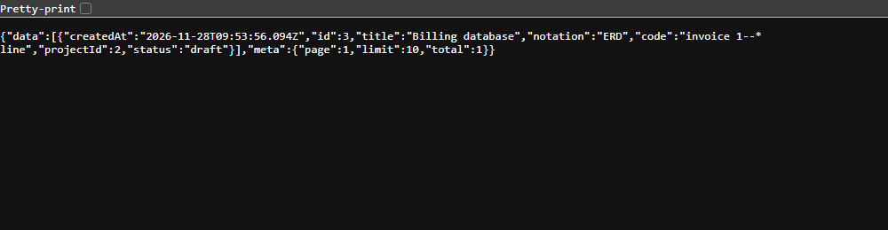

Рисунок 17 – Ответ GET /api/diagrams с параметрами q, sort, page и limit в окне браузера

Дополнительный маршрут `GET /api/users/1/projects` возвращает проекты одного пользователя, как на рисунке 18.

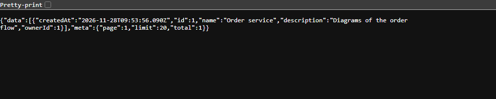

Рисунок 18 – Ответ GET /api/users/1/projects в окне браузера: проекты пользователя

### 3.10 Автоматическая проверка

Автоматические тесты запускают сервер на свободном порту и проверяют каждый метод, коды ответов, фильтры, сортировку, страницы, ошибки проверки, связи между ресурсами, дополнительные операции, роли с ответом 403, порядок «запись журнала до действия», сбой журнала с ответом 500, исключение из журнала `/health` и ответа 429, гонки при удалении родителя и страницы ошибок. Тестов сервера 173, вместе с проверками отчёта команда выводит 176, а покрытие строк, ветвей и функций равно 100 процентам. Команда запуска: `npm test` в каталоге проекта. Сообщение консоли при запуске сервера показано на рисунке 19.

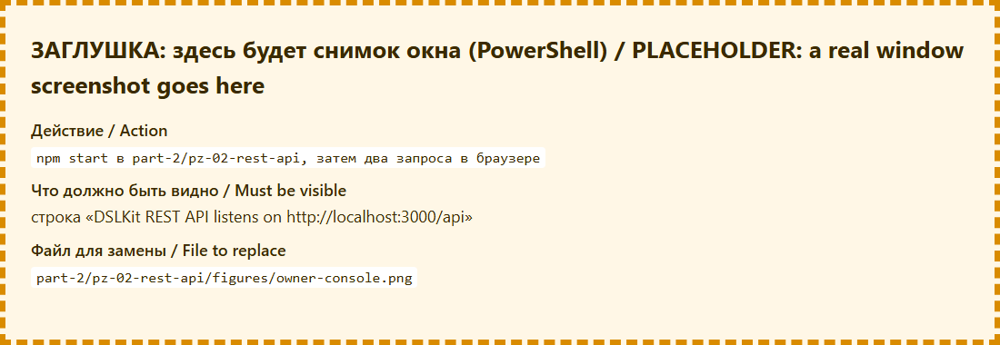

Рисунок 19 – Сообщение консоли после запуска сервера командой npm start

Результат команды `npm test` с числом тестов и покрытием кода показан на рисунке 20.

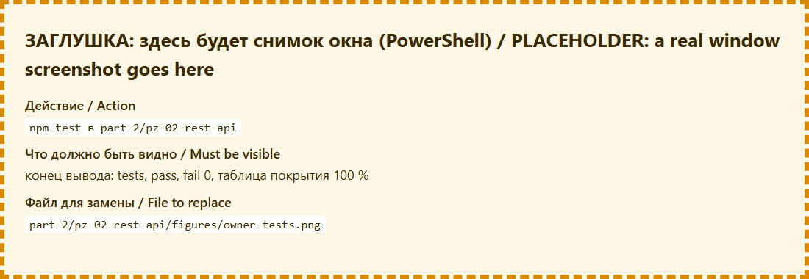

Рисунок 20 – Конец вывода команды npm test: число пройденных тестов и таблица покрытия

## 4 Ответы на контрольные вопросы

Номер в списке группы 26, поэтому ответы даны на вопросы 25, 26 и 27.

25. Что такое «межресурсные связи» и как их реализовать в REST API (например, получить заказы пользователя)?

    Это связи между записями разных ресурсов, например проект принадлежит пользователю, а диаграмма проекту. В API связь выражают тремя способами. По 1-му способу связью служит поле-ссылка в записи, в работе это `ownerId` у проекта и `projectId` у диаграммы, и сервер проверяет, что такая запись существует, иначе отвечает 409. По 2-му способу берут вложенный маршрут для чтения, например `GET /api/users/:id/projects` отдаёт проекты пользователя, а `GET /api/projects/:id/diagrams` диаграммы проекта. По 3-му способу применяют фильтр списка, то же самое даёт `GET /api/projects?ownerId=1`. Связь защищает и удаление: пользователь с проектами и проект с диаграммами не удаляются, ответ 409.

26. Какие статус коды используются для редиректов (3xx)? Нужны ли они в REST API?

    Код 301 означает постоянный перенос адреса, код 302 временный, коды 307 и 308 делают то же, но сохраняют метод запроса, код 303 отправляет клиента к другому адресу методом `GET`, а код 304 сообщает, что кэшированный ответ ещё актуален. В Express редирект делает `res.redirect(status, url)`. В REST API редиректы нужны редко: после `POST` возвращают 201 с заголовком `Location` и самой записью, а не перенаправляют клиента. Их применяют при переезде адреса и версии API, а код 304 при условных запросах с `ETag`. В этой работе редиректов нет, а `ETag` сервер отдаёт в ответах.

27. Как в документации API указать возможные коды ошибок и их описание?

    В OpenAPI у каждой операции в разделе `responses` перечисляют коды, например `400`, `403`, `404` и `409`, и для каждого дают описание и схему тела. Общую схему ошибки описывают один раз в `components` и подключают ссылкой. В работе документация доступна по адресу `GET /api/openapi.json` и в файле `API.md`: у каждого маршрута есть столбец с возможными кодами ошибок, а раздел «Errors» показывает единый вид ответа `{ "error": { "code", "message", "title", "description", "requestId", "details" } }` и перечисляет значения `code`. Так клиент знает, какие ошибки ждать.

## Заключение

Для проекта DSLKit спроектирован и реализован REST API с тремя связанными ресурсами. Он поддерживает операции CRUD, фильтрацию, поиск, сортировку, страницы, публикацию и копирование диаграмм, проверяет входные данные и связи между записями и отвечает ошибками единого формата с номером запроса. Роли отличают обычного пользователя от администратора и дают настоящий ответ 403. Журнал запросов по правилам чётного варианта ведётся в таблице базы данных и пишется до выполнения действия, а его сбой даёт ответ 500 без выполнения действия. Описание API собрано в `API.md` и в `GET /api/openapi.json`, автоматические тесты покрывают весь код, а запросы каждого метода проверены в Postman.

У работы есть границы, которые нужно называть прямо. Данные ресурсов лежат в массивах в памяти и пропадают при перезапуске сервера, как и требует условие, а в базе данных хранится только журнал запросов. Личность пользователя задаётся заголовками `X-User-Id` и `X-Role` и принимается на веру, поэтому в настоящей системе её нужно брать из проверенной сессии или токена. Тексты ошибок написаны по-английски. Запись в журнал и действие над данными не лежат в одной транзакции, и это решено порядком шагов: сначала строка журнала, потом действие, а при сбое журнала действие не выполняется. Эти границы описаны в тексте работы и в файле `README.md` проекта.

## Приложение А (обязательное) Листинг app.js, сборка приложения

Комментарии в листингах всех приложений написаны по-английски, как в исходных файлах проекта.

```js
export const createApp = ({
  stores = createStores(undefined, LIMITS.maxRecordsPerCollection),
  writeError = console.error,
  limit = { windowMs: LIMITS.rateWindowMs, max: LIMITS.rateMax, maxClients: LIMITS.rateMaxClients },
  now = Date.now,
  journal = createJournal(),
} = {}) => {
  const { users, projects, diagrams } = stores;
  const app = express();
  app.disable('x-powered-by');
  app.use(requestId);
  app.use(securityHeaders);
  // Liveness probe, before the rate limit so monitoring never uses up the quota.
  app.get('/health', (req, res) => res.json({ status: 'ok' }));
  // Refused before the body is read, so a flood costs little.
  app.use(rateLimit({ ...limit, now }));
  // Every request is written to the journal table before it runs; a failed write answers 500 and nothing else happens.
  app.use(journaling(journal, writeError));
  // This API answers only JSON; a client that explicitly asks for something else gets 406 instead of JSON it
  // did not ask for. A request with no Accept header, or "*/*", is always welcome.
  app.use((req, res, next) => {
    const accept = req.headers.accept;
    if (!accept) return next();
    const acceptsJson = accept.split(',').some((part) => {
      const type = part.split(';')[0].trim().toLowerCase();
      return type === '*/*' || type === 'application/*' || type === 'application/json' || type === 'text/html';
    });
    if (!acceptsJson) return next(new ApiError(406, 'not_acceptable', 'This API only returns application/json'));
    return next();
  });
  // A declared charset other than UTF-8 is rejected up front with 415, instead of being read as UTF-8 anyway
  // and failing JSON parsing later with the unrelated 400 invalid_json.
  app.use((req, res, next) => {
    const match = /charset=("?)([^;"]+)\1/i.exec(req.headers['content-type'] ?? '');
    if (match && match[2].trim().toLowerCase() !== 'utf-8') return next(new ApiError(415, 'unsupported_media_type', 'Only charset=utf-8 is supported'));
    return next();
  });
  app.use(express.json({ limit: LIMITS.bodyBytes }));
  // A body that express.json did not read (another Content-Type) is refused with 415, not taken as a missing
  // body - but only for a method that is meant to carry one; GET/HEAD/DELETE never need a JSON body, so any
  // body they do carry is simply ignored instead of failing the request over an unrelated Content-Type.
  app.use((req, res, next) => {
    if (BODYLESS_METHODS.has(req.method)) return next();
    const hasBody = Number(req.headers['content-length'] ?? 0) > 0 || req.headers['transfer-encoding'] !== undefined;
    if (hasBody && req.body === undefined) return next(new ApiError(415, 'unsupported_media_type', 'Content-Type must be application/json'));
    return next();
  });

  app.use(identify((id) => users.find(id)));

  // Ownership rules for a caller who named itself with X-User-Id. A "restricted" caller is a non-admin user; an
  // anonymous caller and an administrator are not restricted. A project belongs to its owner and a diagram to the
  // owner of its project.
  const restricted = (actor) => actor.userId !== undefined && actor.role !== 'admin';
  const ownsProject = (actor, projectId) => !restricted(actor) || projects.find(projectId)?.ownerId === actor.userId;
  const deny = (what) => {
    throw forbidden(`You may not ${what}`);
  };

  const api = express.Router();
```

## Приложение Б (обязательное) Листинг app.js, маршруты и обработчик ошибок

```js
  // The machine-readable description of the API, built from the schemas above.
  api.get('/openapi.json', (req, res) => res.json(buildOpenApi(schemas, { hidden: { users: ['email'] } })));
  api.all('/openapi.json', methodsOnly('GET'));
  // Link between resources: the projects that belong to one user. It is mounted before the standard router so it wins over /:id.
  api.get('/users/:id/projects', (req, res) => {
    const user = users.find(parseId(req.params.id));
    if (!user) throw notFound('User');
    res.json(
      listItems(
        projects.all().filter((p) => p.ownerId === user.id),
        schemas.projects,
        req.query,
      ),
    );
  });
  api.all('/users/:id/projects', methodsOnly('GET'));
  api.use(
    '/users',
    createResourceRouter({
      label: 'User',
      collection: users,
      schema: schemas.users,
      // The email is personal data: the list shows id, name and role, the email only comes with one user.
      hiddenInList: ['email'],
      hooks: {
        authorize: (actor, action, user) => {
          if (restricted(actor) && actor.userId !== user.id) deny(`${action} another user's record`);
        },
        check: (data, current) => {
          const taken = data.email !== undefined && users.all().some((user) => user !== current && user.email.toLowerCase() === data.email.toLowerCase());
          if (taken) throw conflict('A user with this email already exists');
          return [];
        },
        beforeRemove: (user) => {
          if (projects.all().some((project) => project.ownerId === user.id)) throw conflict('User still owns projects');
        },
      },
    }),
  );

  // Extra operations are mounted before the standard routers so they win over /:id.
  api.get('/projects/:id/diagrams', (req, res) => {
    const project = projects.find(parseId(req.params.id));
    if (!project) throw notFound('Project');
    res.json(
      listItems(
        diagrams.all().filter((d) => d.projectId === project.id),
        schemas.diagrams,
        req.query,
      ),
    );
  });
  api.all('/projects/:id/diagrams', methodsOnly('GET'));
  api.use(
    '/projects',
    createResourceRouter({
      label: 'Project',
      collection: projects,
      schema: schemas.projects,
      hooks: {
        authorize: (actor, action, project) => {
          if (action === 'remove' && restricted(actor)) deny('delete a project, only an administrator may');
          if (restricted(actor) && project.ownerId !== actor.userId) deny("change another user's project");
        },
        authorizeData: (actor, data) => {
          if (restricted(actor) && data.ownerId !== undefined && data.ownerId !== actor.userId) deny('give a project to another user');
        },
        check: (data) => missingReference('ownerId', users, data.ownerId),
        beforeRemove: (project) => {
          if (diagrams.all().some((diagram) => diagram.projectId === project.id)) throw conflict('Project still has diagrams');
        },
      },
    }),
  );

  const diagram = (req) => {
    const found = diagrams.find(parseId(req.params.id));
    if (!found) throw notFound('Diagram');
    return found;
  };
  const ownDiagram = (req, what) => {
    const found = diagram(req);
    if (!ownsProject(req.actor, found.projectId)) deny(`${what} a diagram of another user's project`);
    return found;
  };
  api.post('/diagrams/:id/publish', (req, res) => res.json(diagrams.update(ownDiagram(req, 'publish'), { status: 'published' })));
  api.post('/diagrams/:id/duplicate', (req, res) => {
    const { id, createdAt, ...rest } = ownDiagram(req, 'copy');
    // Cut by code points, not by UTF-16 units: slicing a surrogate pair in half would store (and re-serve) a
    // lone surrogate, which is not valid Unicode text.
    const title = [...`${rest.title} (copy)`].slice(0, LIMITS.diagramTitle).join('');
    res.status(201).json(diagrams.create({ ...rest, title, status: 'draft' }));
  });
  api.all('/diagrams/:id/publish', methodsOnly('POST'));
  api.all('/diagrams/:id/duplicate', methodsOnly('POST'));
  api.use(
    '/diagrams',
    createResourceRouter({
      label: 'Diagram',
      collection: diagrams,
      schema: schemas.diagrams,
      hooks: {
        authorize: (actor, action, item) => {
          if (!ownsProject(actor, item.projectId)) deny(`${action} a diagram of another user's project`);
        },
        authorizeData: (actor, data) => {
          if (data.projectId !== undefined && !ownsProject(actor, data.projectId)) deny("put a diagram into another user's project");
        },
        check: (data) => missingReference('projectId', projects, data.projectId),
      },
    }),
  );

  app.use('/api', api);
  app.use((req, res, next) => next(routeNotFound()));

  // Turns any thrown value into the ApiError that describes it. Anything unknown is a server failure (500).
  const toApiError = (err, req, res) => {
    if (err instanceof ApiError) return err;
    if (err.type === 'entity.parse.failed') return new ApiError(400, 'invalid_json', 'Request body is not valid JSON');
    if (err.type === 'entity.too.large') return new ApiError(413, 'payload_too_large', 'Request body is too large');
    // Errors of the framework and of the body parser that blame the client keep their 4xx status: a broken
    // percent escape in the URL is 400 and an unsupported Content-Encoding is 415, neither is a server failure.
    const status = err.status ?? err.statusCode;
    if (status >= 400 && status < 500) {
      const known = CLIENT_ERRORS[status] ?? ['bad_request', 'The request cannot be processed'];
      return new ApiError(status, known[0], known[1]);
    }
    writeError(`[error] request ${res.locals.requestId} ${logSafe(req.method)} ${logSafe(req.originalUrl)}`, err);
    return new ApiError(500, 'internal_error', 'Internal server error');
  };

  // Four parameters: the single place where every error is answered, as JSON for a client and as a described page
  // for a browser, always with the Request ID.
  app.use((err, req, res, _next) => {
    const apiError = toApiError(err, req, res);
    if (wantsHtml(req)) {
      const page = renderErrorPage({ status: apiError.status, code: apiError.code, message: apiError.message, details: apiError.details, requestId: res.locals.requestId });
      return res.status(apiError.status).set('Content-Security-Policy', PAGE_CSP).type('html').send(page);
    }
    return res.status(apiError.status).json(errorBody(apiError, res.locals.requestId));
  });
  return app;
};
```

## Приложение В (обязательное) Листинг journal.js, журнал запросов

```js
export const createJournal = (file = ':memory:') => {
  const db = new DatabaseSync(file);
  db.exec(`CREATE TABLE IF NOT EXISTS request_log (
    id INTEGER PRIMARY KEY AUTOINCREMENT,
    created_at TEXT NOT NULL,
    method TEXT NOT NULL,
    path TEXT NOT NULL,
    ip TEXT NOT NULL,
    status INTEGER,
    request_id TEXT
  )`);
  // A journal file made before the Request ID existed gets the column added instead of failing on every insert.
  if (!db.prepare('PRAGMA table_info(request_log)').all().some((column) => column.name === 'request_id')) db.exec('ALTER TABLE request_log ADD COLUMN request_id TEXT');
  const insert = db.prepare('INSERT INTO request_log (created_at, method, path, ip, request_id) VALUES (?, ?, ?, ?, ?)');
  const finish = db.prepare('UPDATE request_log SET status = ? WHERE id = ?');
  const recent = db.prepare('SELECT id, created_at, method, path, ip, status, request_id FROM request_log ORDER BY id DESC LIMIT ?');
  return {
    begin: ({ method, path, ip, requestId = null, at = new Date().toISOString() }) => Number(insert.run(at, method, path, ip, requestId).lastInsertRowid),
    finish: (id, status) => finish.run(status, id),
    recent: (count = 20) => recent.all(count),
    close: () => db.close(),
  };
};

// Express middleware. The path is cut so one huge URL cannot fill the table.
export const journaling = (journal, writeError = console.error) => (req, res, next) => {
  let id;
  try {
    id = journal.begin({ method: req.method, path: req.originalUrl.slice(0, 300), ip: req.ip ?? 'unknown', requestId: res.locals.requestId });
  } catch (err) {
    writeError(`[journal] cannot write ${logSafe(req.method)} ${logSafe(req.originalUrl)} request ${res.locals.requestId}`, err);
    return next(new ApiError(500, 'journal_unavailable', 'The request journal is unavailable, the request was not carried out'));
  }
  // The answer is already gone when this runs, so a failure here can only be reported, not turned into a 500.
  res.on('finish', () => {
    try {
      journal.finish(id, res.statusCode);
    } catch (err) {
      writeError('[journal] cannot record the status', err);
    }
  });
  return next();
};
```

## Приложение Г (обязательное) Листинг security.js, роли и защита

```js
import { randomUUID } from 'node:crypto';
import { ApiError } from './errors.js';

// Headers for a JSON-only API, set by hand without extra packages. The API sends no HTML, so the policy forbids everything.
export const securityHeaders = (req, res, next) => {
  res.set({
    'Content-Security-Policy': "default-src 'none'; frame-ancestors 'none'",
    'X-Content-Type-Options': 'nosniff',
    'X-Frame-Options': 'DENY',
    'Referrer-Policy': 'no-referrer',
    'Cache-Control': 'no-store',
  });
  next();
};

// An IPv4 client reaching a dual-stack server is seen by Node as "::ffff:<ipv4>" on some connections and as the
// plain "<ipv4>" on others; without this the same client gets two separate buckets and can double its quota.
const bucketKey = (ip) => (typeof ip === 'string' && ip.startsWith('::ffff:') ? ip.slice(7) : ip ?? 'unknown');

// Fixed-window rate limit per client address, kept in memory. The answer is the usual JSON error with Retry-After.
//
// Cleanup is amortized, not a periodic full scan: every call walks at most SWEEP_BATCH map entries (resuming
// where the previous call left off) and drops the ones that expired, so the per-request cost stays bounded
// however large the map has grown, instead of occasionally scanning the whole thing (a CPU-cost amplifier an
// attacker rotating addresses could lean on). maxClients is a hard ceiling on distinct addresses tracked at
// once: once it is reached, the oldest tracked address is evicted to make room, so the map itself cannot grow
// without bound even if the sweep never catches up (for example many different IPv6 addresses, each used once).
const SWEEP_BATCH = 500;

export const rateLimit = ({ windowMs, max, now = Date.now, maxClients = 50000 }) => {
  const hits = new Map();
  let cursor = null;

  const sweep = (time) => {
    const iterator = cursor ?? hits.entries();
    for (let i = 0; i < SWEEP_BATCH; i += 1) {
      const next = iterator.next();
      if (next.done) {
        cursor = null;
        return;
      }
      const [key, entry] = next.value;
      if (entry.reset <= time) hits.delete(key);
    }
    cursor = iterator;
  };

  return (req, res, next) => {
    const time = now();
    sweep(time);
    const key = bucketKey(req.ip);
    let entry = hits.get(key);
    if (!entry || entry.reset <= time) {
      if (!entry && hits.size >= maxClients) {
        const oldest = hits.keys().next().value;
        if (oldest !== undefined) hits.delete(oldest);
      }
      entry = { count: 0, reset: time + windowMs };
      hits.set(key, entry);
    }
    entry.count += 1;
    if (entry.count <= max) return next();
    const retryAfter = Math.max(1, Math.ceil((entry.reset - time) / 1000));
    res.set('Retry-After', String(retryAfter));
    return next(new ApiError(429, 'too_many_requests', `Too many requests, try again in ${retryAfter} s`));
  };
};

// Request data in a log line could carry line breaks and forge extra lines, so it is written as a JSON string (escaped and quoted).
export const logSafe = (text) => JSON.stringify(String(text)).slice(0, 300);

// Every request gets its own id, always generated here (a client-supplied value could forge or collide with log
// lines). It travels in the X-Request-Id header, in the journal row and in every error answer.
export const requestId = (req, res, next) => {
  res.locals.requestId = randomUUID();
  res.set('X-Request-Id', res.locals.requestId);
  next();
};

// A deliberately small identity for this practical (there is no login): X-User-Id says who is acting, X-Role is
// "user" (the default) or "admin". Without X-User-Id the caller is anonymous and is not restricted, as before roles
// existed; with it, the ownership rules of the routes apply. The headers are trusted as they come, a real system
// would take them from a verified session.
export const identify = (findUser) => (req, res, next) => {
  const role = req.headers['x-role'] ?? 'user';
  if (role !== 'user' && role !== 'admin') return next(new ApiError(400, 'invalid_identity', 'X-Role must be user or admin'));
  const raw = req.headers['x-user-id'];
  if (raw === undefined) {
    req.actor = { role };
    return next();
  }
  if (!/^[1-9]\d{0,14}$/.test(raw)) return next(new ApiError(400, 'invalid_identity', 'X-User-Id must be a positive whole number'));
  if (!findUser(Number(raw))) return next(new ApiError(403, 'forbidden', 'X-User-Id names a user that does not exist'));
  req.actor = { userId: Number(raw), role };
  return next();
};
```

## Приложение Д (обязательное) Листинг resource.js, общие маршруты ресурса

```js
// A weak tag computed from the record itself, so it changes exactly when the record changes and needs no extra field.
export const etagOf = (item) => `W/"${createHash('sha1').update(JSON.stringify(item)).digest('hex').slice(0, 16)}"`;

// Optional conditional update: with If-Match the write only happens if the record is still the one the client read;
// otherwise 412, so a stale form cannot silently overwrite a newer change. Without the header the write is unconditional.
const requireFresh = (req, item) => {
  const header = req.headers['if-match'];
  if (header === undefined || header.trim() === '*') return;
  const tags = header.split(',').map((tag) => tag.trim().replace(/^W\//, ''));
  if (!tags.includes(etagOf(item).replace(/^W\//, ''))) throw new ApiError(412, 'precondition_failed', 'The record changed since you read it, read it again');
};

const DIGITS = /^[1-9]\d{0,14}$/;

export const parseId = (raw) => {
  if (!DIGITS.test(String(raw))) throw new ApiError(400, 'invalid_id', 'id must be a positive integer');
  return Number(raw);
};

// The largest integer `DIGITS` can ever match (15 nines): the real ceiling for page/limit/id, below
// Number.MAX_SAFE_INTEGER. Error messages quote this instead of a bound that is never actually enforced.
const MAX_QUERY_INT = 999999999999999;

const scalar = (raw, name) => {
  if (Array.isArray(raw)) throw new ApiError(400, 'invalid_query', `${name} must not be repeated`);
  return raw;
};

const parsePositive = (raw, name, fallback, max = MAX_QUERY_INT) => {
  if (raw === undefined) return fallback;
  if (!DIGITS.test(String(scalar(raw, name))) || Number(raw) > max) throw new ApiError(400, 'invalid_query', `${name} must be an integer from 1 to ${max}`);
  return Number(raw);
};

// Filtering by any schema field (?status=draft), search (?q=text), sorting (?sort=-title), pagination (?page=2&limit=10).
// hidden: fields that never appear in a list; filtering, searching or sorting by one is silently a no-op
// (otherwise ?email= or ?sort=email would reveal it) rather than an error, so it still cannot be used as an oracle.
// Any OTHER query key that is not a schema field, page, limit, sort or q is unknown and answers 400, instead of
// being read and then quietly ignored.
export const listItems = (items, schema, query, hidden = []) => {
  const known = new Set(['page', 'limit', 'sort', 'q', ...Object.keys(schema)]);
  for (const key of Object.keys(query)) {
    if (!known.has(key)) throw new ApiError(400, 'invalid_query', `${key} is not a known query parameter`);
  }
  const page = parsePositive(query.page, 'page', 1);
  const limit = parsePositive(query.limit, 'limit', LIMITS.defaultPageSize, LIMITS.maxPageSize);
  let result = items.filter((item) =>
    Object.keys(schema).every((field) => {
      if (hidden.includes(field) || query[field] === undefined) return true;
      const raw = scalar(query[field], field);
      const rule = schema[field];
      if (rule.type === 'integer' && !DIGITS.test(String(raw))) throw new ApiError(400, 'invalid_query', `${field} must be a positive integer`);
      if (rule.enum && !rule.enum.includes(String(raw))) throw new ApiError(400, 'invalid_query', `${field} must be one of: ${rule.enum.join(', ')}`);
      return String(item[field]) === String(raw);
    }),
  );
  if (query.q !== undefined) {
    const needle = String(scalar(query.q, 'q')).toLowerCase();
    const textFields = Object.keys(schema).filter((field) => schema[field].type === 'string' && !hidden.includes(field));
    result = result.filter((item) =>
      textFields.some((field) =>
        String(item[field] ?? '')
          .toLowerCase()
          .includes(needle),
      ),
    );
  }
  if (query.sort !== undefined) {
    const raw = String(scalar(query.sort, 'sort'));
    const desc = raw.startsWith('-');
    const field = raw.replace(/^-/, '');
    if (hidden.includes(field) || (field !== 'id' && field !== 'createdAt' && !Object.hasOwn(schema, field))) throw new ApiError(400, 'invalid_query', `cannot sort by ${field}`);
    // Locale-aware for text (so case and accents sort the way a reader expects), tie-broken by id so equal
    // keys keep a fixed, repeatable order instead of whatever order the sort happened to leave them in.
    const compare = (a, b) => (typeof a[field] === 'string' && typeof b[field] === 'string' ? a[field].localeCompare(b[field]) : a[field] > b[field] ? 1 : a[field] < b[field] ? -1 : 0);
    result = [...result].sort((a, b) => {
      const primary = compare(a, b) * (desc ? -1 : 1);
      return primary !== 0 ? primary : a.id - b.id;
    });
  }
  const total = result.length;
  const data = result.slice((page - 1) * limit, page * limit).map((item) => Object.fromEntries(Object.entries(item).filter(([field]) => !hidden.includes(field))));
  return { data, meta: { page, limit, total } };
};

// Builds the six standard routes for one resource.
// hooks.check(data, current) returns extra validation details for the fields present (references)
// and may throw a conflict; current is the record being changed, undefined on create.
//
// hooks.beforeRemove(item) may throw.
// hooks.authorize(actor, action, item) may throw 403 for 'change' or 'remove' of an existing record, before anything
// else is checked; hooks.authorizeData(actor, data) may throw 403 for the validated data of a create or an update.
export const createResourceRouter = ({ label, collection, schema, hooks = {}, hiddenInList = [] }) => {
  const router = Router();
  const body = (req, partial, current) => {
    const input = trimStrings(schema, req.body);
    const errors = validate(schema, input, { partial });
    const data = partial ? input : applyDefaults(schema, input, current);
    const details = errors.length ? errors : (hooks.check?.(data, current) ?? []);
    if (details.length) throw validationFailed(details);
    return data;
  };
  const load = (req) => {
    const item = collection.find(parseId(req.params.id));
    if (!item) throw notFound(label);
    return item;
  };

  router.get('/', (req, res) => res.json(listItems(collection.all(), schema, req.query, hiddenInList)));
  router.get('/:id', (req, res) => {
    const item = load(req);
    res.set('ETag', etagOf(item)).json(item);
  });
  router.post('/', (req, res) => {
    const data = body(req, false);
    hooks.authorizeData?.(req.actor, data);
    const item = collection.create(data);
    res.status(201).location(`${req.baseUrl}/${item.id}`).json(item);
  });
  router.put('/:id', (req, res) => {
    const item = load(req);
    hooks.authorize?.(req.actor, 'change', item);
    requireFresh(req, item);
    const data = body(req, false, item);
    hooks.authorizeData?.(req.actor, data);
    const saved = collection.replace(item, data);
    res.set('ETag', etagOf(saved)).json(saved);
  });
  router.patch('/:id', (req, res) => {
    const item = load(req);
    hooks.authorize?.(req.actor, 'change', item);
    requireFresh(req, item);
    const data = body(req, true, item);
    hooks.authorizeData?.(req.actor, data);
    const saved = collection.update(item, data);
    res.set('ETag', etagOf(saved)).json(saved);
  });
  router.delete('/:id', (req, res) => {
    const item = load(req);
    hooks.authorize?.(req.actor, 'remove', item);
    requireFresh(req, item);
    hooks.beforeRemove?.(item);
    collection.remove(item);
    res.status(204).end();
  });
  router.all('/', methodsOnly('GET', 'POST'));
  router.all('/:id', methodsOnly('GET', 'PUT', 'PATCH', 'DELETE'));
  return router;
};
```

## Приложение Е (обязательное) Листинг validation.js, проверка полей

```js
// C0/C1 control characters (NUL, BEL, newline, ...) minus tab/newline/CR, which `multiline` fields allow.
const CONTROL_STRICT = /[\u0000-\u001F\u007F-\u009F]/;
const CONTROL_MULTILINE = /[\u0000-\u0008\u000B\u000C\u000E-\u001F\u007F-\u009F]/;
// Invisible formatting characters that a reader cannot see and that a plain `trim()` does not remove:
// zero-width space, bidi marks and overrides, byte-order mark, soft hyphen. The zero-width joiner/non-joiner
// are left out on purpose, they are part of ordinary emoji and script text (e.g. "👩‍💻").
const INVISIBLE_CODE_POINTS = [0x00ad, 0x200b, 0x200e, 0x200f, 0x202a, 0x202b, 0x202c, 0x202d, 0x202e, 0x2066, 0x2067, 0x2068, 0x2069, 0xfeff];
const INVISIBLE_FORMAT = new RegExp(`[${INVISIBLE_CODE_POINTS.map((cp) => String.fromCodePoint(cp)).join('')}]`, 'u');

// A schema maps a field name to { type, required, max, enum, pattern, default, multiline }.
// Types: 'string', 'integer'. Returns a list of { field, message }.
const checkField = (name, rule, value) => {
  if (rule.type === 'integer') {
    if (!Number.isInteger(value)) return `${name} must be an integer`;
    if (value < rule.min || value > rule.max) return `${name} must be between ${rule.min} and ${rule.max}`;
  }
  if (rule.type === 'string') {
    if (typeof value !== 'string') return `${name} must be a string`;
    // Rejects an unpaired (lone) surrogate: valid in a JS string and in JSON, but not valid Unicode text.
    if (!value.isWellFormed()) return `${name} contains an invalid character (an unpaired surrogate)`;
    if ((rule.multiline ? CONTROL_MULTILINE : CONTROL_STRICT).test(value) || INVISIBLE_FORMAT.test(value)) {
      return `${name} must not contain control or invisible characters`;
    }
    if (rule.required && value.trim() === '') return `${name} must not be empty`;
    // Counted by code points, so an emoji is one character as the user sees it, not two UTF-16 units.
    if (rule.max && [...value].length > rule.max) return `${name} must be at most ${rule.max} characters`;
    if (rule.pattern && !rule.pattern.test(value)) return `${name} has an invalid format`;
  }
  if (rule.enum && !rule.enum.includes(value)) return `${name} must be one of: ${rule.enum.join(', ')}`;
  return null;
};

// partial=true is used by PATCH: required fields may be missing, present ones are still checked.
export const validate = (schema, body, { partial = false } = {}) => {
  if (body === null || typeof body !== 'object' || Array.isArray(body)) return [{ field: 'body', message: 'body must be a JSON object' }];
  if (partial && Object.keys(body).length === 0) return [{ field: 'body', message: 'send at least one field to change' }];
  const errors = [];
  for (const field of Object.keys(body)) {
    if (!Object.hasOwn(schema, field)) errors.push({ field, message: `${field} is not a known field` });
  }
  for (const [field, rule] of Object.entries(schema)) {
    const value = body[field];
    if (value === undefined) {
      if (rule.required && !partial && rule.default === undefined) errors.push({ field, message: `${field} is required` });
      continue;
    }
    const message = checkField(field, rule, value);
    if (message) errors.push({ field, message });
  }
  return errors;
};

// current: the record being replaced (PUT) so a field left out of the body keeps its current value instead of
// being silently reset to the schema default (a role, for example, must not be lowered just by omitting it).
// undefined on create (POST), where an omitted field does take the schema default.
export const applyDefaults = (schema, body, current) => {
  const result = { ...body };
  for (const [field, rule] of Object.entries(schema)) {
    if (result[field] !== undefined) continue;
    if (current && Object.hasOwn(current, field)) result[field] = current[field];
    else if (rule.default !== undefined) result[field] = rule.default;
  }
  return result;
};

// Unicode compatibility normalization so "é" (one code point) and "e" + combining acute (two code points) become
// the same text, then strips invisible formatting characters a `trim()` would miss, then lower-cases: two emails
// that render identically can no longer be told apart or used to register two look-alike accounts.
export const normalizeEmail = (value) => value.normalize('NFKC').replace(/[\u0000-\u001F\u007F-\u009F\p{Cf}]/gu, '').toLowerCase();

// Trims surrounding whitespace of known string fields, so " Ada " is stored as "Ada", then applies the field's
// own transform (e-mails are normalized) so validation and storage see the same, final text.
export const trimStrings = (schema, body) => {
  if (body === null || typeof body !== 'object' || Array.isArray(body)) return body;
  const result = { ...body };
  for (const field of Object.keys(result)) {
    if (!Object.hasOwn(schema, field) || typeof result[field] !== 'string') continue;
    const trimmed = result[field].trim();
    result[field] = schema[field].transform ? schema[field].transform(trimmed) : trimmed;
  }
  return result;
};
```
