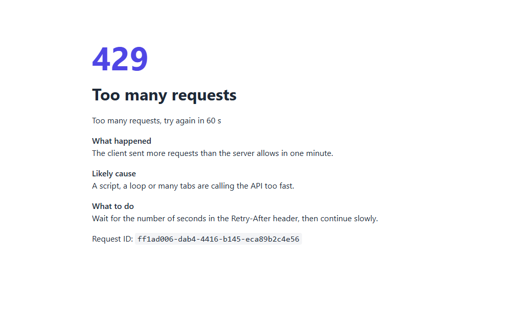
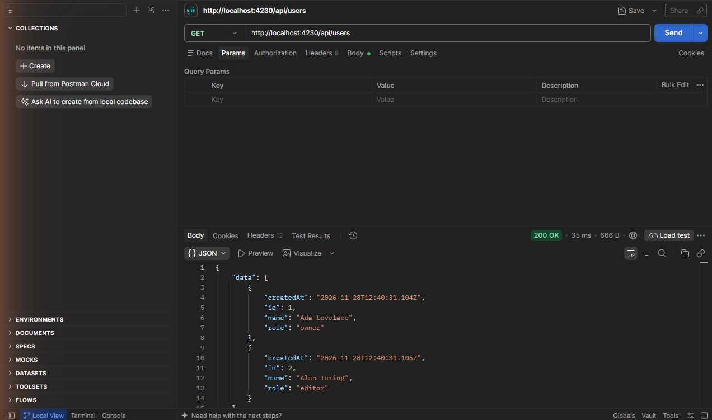
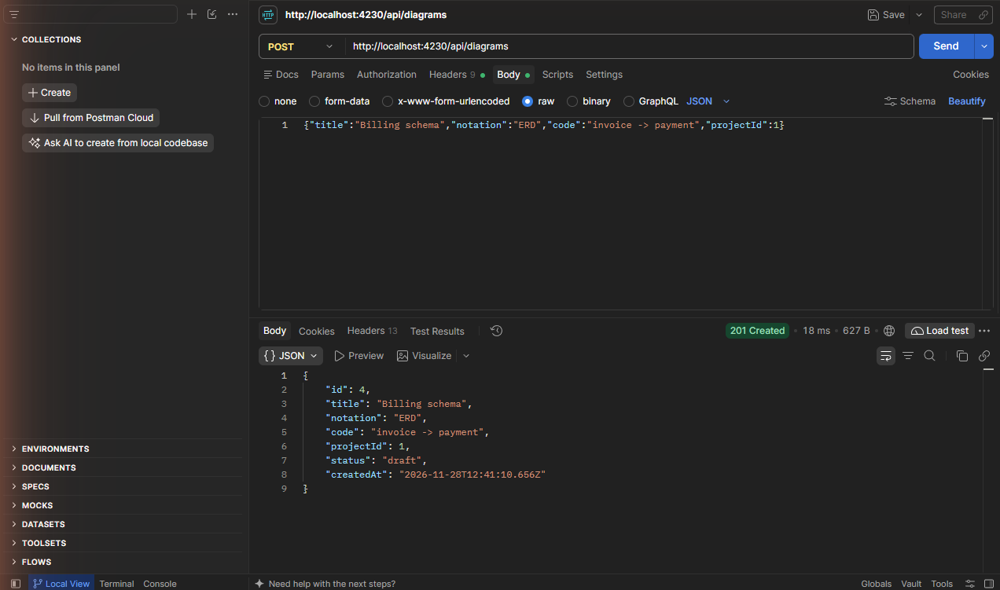
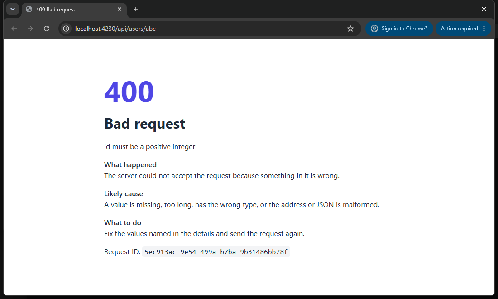
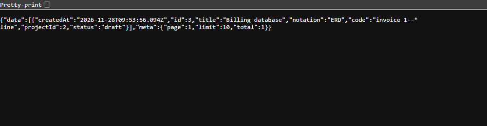
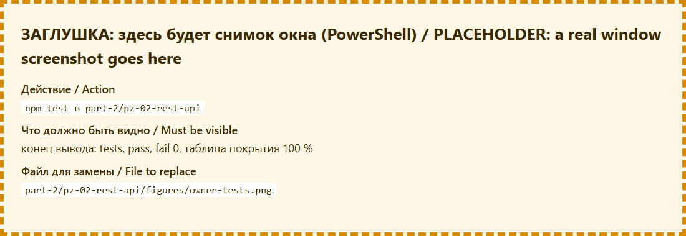

# Практическое занятие №2. Проектирование и реализация REST API

## 1 Цель работы

Цель работы состоит в том, чтобы освоить принципы проектирования RESTful API на примере проекта DSLKit, веб-редактора диаграмм как кода, тематика которого соответствует направлению SaaS и будущему курсовому проекту. Для достижения цели нужно спроектировать три связанных ресурса, реализовать для них операции CRUD и дополнительные операции, добавить проверку входных данных, единый формат ошибок и описание API. Вариант 100 (номер в списке группы 26) чётный, поэтому журнал запросов хранится в таблице базы данных, а не в файле, и запись в него делается до выполнения действия. Данные самих ресурсов, как требует условие, лежат в массивах в памяти. Исходный код приложения лежит в репозитории {{meta:repository}} в ветке {{meta:branch}}.

## 2 Краткие теоретические сведения

**Ресурсы и методы.** REST описывает предметную область как набор ресурсов с адресами во множественном числе, например `/api/diagrams`. Операции выражаются методами HTTP: `GET` читает, `POST` создаёт, `PUT` заменяет запись целиком, `PATCH` меняет часть полей, `DELETE` удаляет. Методы `GET`, `PUT` и `DELETE` идемпотентны: повтор запроса не меняет результат.

**Коды состояния.** Код 200 означает успех, 201 создание с заголовком `Location`, 204 успех без тела, 400 ошибку клиента в запросе, 403 отказ в праве на действие, 404 отсутствие записи, 409 конфликт с текущим состоянием данных, 413 слишком большое тело, 429 слишком частые запросы, 500 сбой сервера.

**Проверка данных.** Сервер не доверяет клиенту: обязательные поля, типы, длина и допустимые значения проверяются до записи, а ответ с ошибкой имеет единый формат.

**Журнал запросов.** Для чётного варианта журнал ведётся в таблице базы данных. Запись о запросе делается до действия, поэтому если журнал недоступен, действие не выполняется, а клиент получает ответ 500.

## 3 Ход работы

### 3.1 Проектирование API

Выбраны три связанных ресурса: пользователи `users`, проекты `projects` и диаграммы `diagrams`. Пользователь владеет проектами, проект содержит диаграммы. Поля и правила проверки сведены в таблице 1.

Таблица 1 – Ресурсы и поля API

| Ресурс | Поля |
| --- | --- |
| `users` | `name`, `email`, `role` (`owner`, `editor`, `viewer`) |
| `projects` | `name`, `description`, `ownerId` |
| `diagrams` | `title`, `notation`, `code`, `projectId`, `status` (`draft`, `published`) |

У каждой записи есть служебные поля `id` и `createdAt`, которые клиент изменить не может. Данные ресурсов лежат в массивах в памяти, как требует условие, поэтому после перезапуска сервера возвращаются начальные записи: два пользователя, два проекта и три диаграммы. Журнал запросов лежит в таблице `request_log` базы данных SQLite. Файлы проекта и их назначение перечислены в таблице 2.

Таблица 2 – Файлы проекта практического занятия №2

| Файл | Назначение |
| --- | --- |
| `src/app.js` | Схемы ресурсов, порядок middleware, маршруты и единый обработчик ошибок |
| `src/resource.js` | Общие маршруты ресурса и разбор параметров списка |
| `src/validation.js` | Проверка тела запроса по схеме |
| `src/store.js` | Хранилище в массивах и начальные записи |
| `src/journal.js` | Таблица `request_log` и middleware журнала |
| `src/security.js` | Заголовки безопасности, ограничение частоты, роли, запись в консоль без переводов строк |
| `src/errors.js`, `src/error-catalog.js`, `src/error-page.js` | Класс ошибки, тексты ошибок и страница ошибки для браузера |
| `src/openapi.js` | Описание OpenAPI 3.0, которое строится из тех же схем |
| `limits.json` | Все пределы длины, размера страницы, тела и частоты запросов |

### 3.2 Эндпоинты

Для каждого ресурса реализованы шесть стандартных операций, а для диаграмм и проектов дополнительные. Все операции с методом, адресом, описанием, примером тела запроса и ожидаемым ответом приведены в таблице 3. Адрес `/api/users` стоит для примера, те же операции есть у `projects` и `diagrams`. Сборка приложения показана в приложении А, маршруты и обработчик ошибок в приложении Б, общая логика ресурсов в приложении В, а проверка полей в приложении Г.

Таблица 3 – Эндпоинты API с примерами запросов и ответов

| Метод | URL | Описание | Пример тела запроса | Ожидаемый ответ |
| --- | --- | --- | --- | --- |
| `GET` | `/api/users` | Список пользователей | нет | 200, `{"data":[{…},{…}],"meta":{"page":1,"limit":20,"total":2}}` |
| `GET` | `/api/users/1` | Одна запись | нет | 200, объект пользователя |
| `POST` | `/api/users` | Создание пользователя | `{"name":"Anna","email":"anna@example.com","role":"owner"}` | 201, пользователь с `id` и `createdAt` |
| `PUT` | `/api/users/2` | Полная замена | `{"name":"Alan T","email":"alan@example.com","role":"editor"}` | 200, пользователь с новыми полями |
| `PATCH` | `/api/users/1` | Частичное изменение | `{"role":"editor"}` | 200, пользователь с `"role":"editor"` |
| `DELETE` | `/api/users/1` | Удаление пользователя | нет | 409, пользователь ещё владеет проектами |
| `DELETE` | `/api/diagrams/2` | Удаление диаграммы | нет | 204, тела нет |
| `GET` | `/api/diagrams?q=billing&sort=-title` | Список с поиском и сортировкой | нет | 200, список с объектом `meta` |
| `POST` | `/api/diagrams` | Создание диаграммы | `{"title":"Billing schema","notation":"ERD","code":"invoice -> payment","projectId":1}` | 201, диаграмма со `"status":"draft"` |
| `GET` | `/api/users/1/projects` | Проекты одного пользователя | нет | 200, список проектов с `meta` |
| `GET` | `/api/projects/1/diagrams` | Диаграммы одного проекта | нет | 200, список диаграмм с `meta` |
| `POST` | `/api/diagrams/1/publish` | Публикация, повтор ничего не меняет | нет | 200, диаграмма со `"status":"published"` |
| `POST` | `/api/diagrams/1/duplicate` | Копия диаграммы черновиком | нет | 201, копия с `"status":"draft"` |
| `POST` | `/api/users` | Неверные данные | `{"name":"","email":"x"}` | 400, `validation_failed` и перечень полей |

Поле `createdAt` у каждой записи своё: часы строго возрастают, поэтому две записи не совпадают даже в одну миллисекунду. Списки принимают параметры `page` и `limit` для страниц, `sort` для сортировки (знак минус означает убывание), `q` для поиска по текстовым полям и имя поля для точного фильтра. Ответ списка содержит массив `data` и объект `meta` с общим числом записей. Маршрут `GET /api/users/:id/projects` для неизвестного пользователя отвечает 404. Подробные примеры собраны в файле `API.md`.

### 3.3 Проверка входных данных и ошибки

Схема каждого ресурса задаёт тип, обязательность, предельную длину, список допустимых значений и значение по умолчанию. Проверка возвращает все найденные проблемы сразу, отвергает неизвестные поля и пробельные значения и проверяет, что `ownerId` и `projectId` указывают на существующие записи. Метод `PATCH` проверяет только присланные поля. Все пределы вынесены в файл `limits.json`. Все ошибки, включая неверный JSON, неизвестный адрес и неожиданный сбой, возвращаются в одном формате с полями `code`, `message`, `title`, `description` и `requestId`. Коды ошибок сведены в таблице 4.

Таблица 4 – Коды ошибок API

| Код | Когда возвращается |
| --- | --- |
| 400 | Неверное тело, JSON или значение поля, неверные заголовки `X-User-Id` и `X-Role` |
| 403 | Обычный пользователь меняет чужую запись или удаляет проект |
| 404 | Записи или адреса нет |
| 405, 406, 415 | Метод не поддерживается, нужный тип ответа или тела не поддерживается |
| 409 | Пользователь с проектами или проект с диаграммами удаляется, родительская запись для новой записи уже удалена |
| 412 | Не совпало условие `If-Match` при изменении или удалении |
| 413 | Тело запроса больше предела из `limits.json` |
| 429 | За минуту прислано больше запросов, чем разрешено |
| 500 | Сбой сервера, в том числе недоступный журнал запросов |

Удаление пользователя с проектами и проекта с диаграммами отклоняется кодом 409, а не удаляет связанные записи молча. Если родитель удаляется в тот момент, когда к нему добавляют дочернюю запись, исход всегда один из трёх: 201, 404 или 409. Ответа 5xx и «висячей» записи без родителя не бывает. Тест создаёт проект и одновременно удаляет его владельца в обоих порядках, а другой тест отправляет двадцать параллельных запросов всех видов и проверяет, что нет ответов 5xx и номера не повторяются. Условный запрос с заголовком `If-Match` защищает от потерянного изменения: если запись уже изменили, ответ 412.

### 3.4 Роли и ответ 403

Входа в систему в работе нет, личность задаётся заголовками. Заголовок `X-User-Id` содержит номер пользователя, а `X-Role` равен `user` по умолчанию или `admin`. Запрос без `X-User-Id` анонимный и не ограничен, как и до введения ролей. Правила для запроса с `X-User-Id` сведены в таблице 5.

Таблица 5 – Права ролей

| Действие | Обычный пользователь | Администратор |
| --- | --- | --- |
| Менять или удалять свою запись пользователя | да | да |
| Менять или удалять запись другого пользователя | 403 | да |
| Менять свой проект, создавать проект на себя | да | да |
| Менять чужой проект, отдавать проект другому | 403 | да |
| Удалять проект | 403 | да |
| Изменять, удалять, публиковать, копировать диаграмму и создавать её | только в своём проекте, иначе 403 | да |

Неверное значение заголовка даёт 400, а номер несуществующего пользователя в `X-User-Id` даёт 403. Сначала проверяется, что запись есть (404), потом права (403), потом тело запроса. Заголовки принимаются на веру: это учебное упрощение, настоящая система берёт личность из проверенной сессии или токена. Листинг приведён в приложении Д.

### 3.5 Журнал запросов и порядок действий

Журнал лежит в таблице `request_log` базы данных SQLite со столбцами время, метод, путь, адрес клиента, код ответа и номер запроса `request_id`. Порядок для каждого запроса такой. Сначала сервер присваивает запросу номер и отдаёт его в заголовке `X-Request-Id`. Затем до выполнения действия в таблицу вставляется строка с временем, методом, путём, адресом клиента и номером запроса. Если вставка не удалась, действие не выполняется, а клиент получает ответ 500 с кодом `journal_unavailable`: работать без журнала запрещено. Если вставка удалась, действие выполняется, а в строку дописывается итоговый код ответа. Неудачные попытки с кодами 400, 403, 404, 409 и 412 тоже остаются в журнале.

В журнал не попадают две группы запросов: проверка работоспособности `GET /health` и запросы, отклонённые ограничением частоты с кодом 429. Проверка работоспособности идёт до журнала, чтобы мониторинг не засорял таблицу и не расходовал лимит. Лишние запросы отклоняются до журнала, чтобы их поток не заполнял таблицу. Запись в журнал и действие над данными не лежат в одной транзакции, потому что данные ресурсов живут в массиве, поэтому атомарность «нет записи, нет действия» обеспечена порядком шагов: отказ журнала отменяет действие. Если сбой случится уже после действия, при записи итогового кода, ответ клиенту не меняется, а ошибка пишется в консоль сервера. Листинг приведён в приложении Е.

Сбой журнала воспроизведён при запущенном сервере, а не кнопкой. Сервер запущен командой `$env:JOURNAL_FILE='demo.sqlite'; npm start`, затем в другом окне командой `node tools/break-journal.mjs demo.sqlite` удалена таблица журнала, после чего любой запрос получил ответ 500. Таблица возвращена командой `node tools/break-journal.mjs demo.sqlite --restore`. Переменная окружения удалена командой `Remove-Item Env:JOURNAL_FILE`. Таблица журнала с реальными строками показана на рисунке 1.

Рисунок 1 – Таблица request_log в базе данных SQLite, выведенная в окне PowerShell: метод, путь, код ответа и номер запроса

### 3.6 Страницы ошибок

Браузер получает вместо JSON оформленную страницу с кодом, заголовком и тремя блоками «What happened», «Likely cause» и «What to do» и номером запроса. Тот же номер лежит в заголовке `X-Request-Id`, в теле ошибки, в таблице журнала и в строке консоли сервера, поэтому по нему легко найти запрос. Тексты ошибок написаны по-английски, как и остальные тексты API. Страница 404 для неизвестного адреса показана на рисунке 2.

Рисунок 2 – Страница ошибки 404 для адреса, которого нет в API, с блоками пояснений и номером запроса

Страница 429 появляется, когда за минуту прислано больше запросов, чем разрешает `limits.json`. Для снимка предел снижен до трёх запросов переменной `RATE_LIMIT_MAX`. Страница показана на рисунке 3.

Рисунок 3 – Страница ошибки 429 после превышения предела запросов, запись об этом запросе в журнал не попадает

Страница 500 при недоступном журнале показана на рисунке 4. Она получена настоящим сбоем: таблица журнала удалена под работающим сервером, и действие не выполнено.

Рисунок 4 – Страница ошибки 500 при недоступном журнале запросов, действие не выполнено

Страница 403 появляется, когда обычный пользователь пытается удалить проект. Браузер не умеет отправлять заголовки `X-User-Id` и `DELETE` из адресной строки, поэтому снимок сделан в Postman и показан на рисунке 5.

Рисунок 5 – Ответ 403 на запрос DELETE /api/projects/1 с заголовком X-User-Id обычного пользователя

### 3.7 Документация API

Маршрут `GET /api/openapi.json` отдаёт описание API в формате OpenAPI 3.0. Оно строится из тех же схем, которые проверяют запросы, поэтому длины полей, списки допустимых значений и обязательные поля в документе совпадают с кодом. Документ можно открыть в Swagger UI или импортировать в Postman. Описание открыто в окне браузера по адресу `http://localhost:4230/api/openapi.json`, фрагмент показан на рисунке 6. В нём у операций изменения и удаления есть заголовки `X-User-Id` и `X-Role` и ответ 403. Справочник по операциям собирается из того же документа скриптом `tools/gen-api-md.mjs` в файлы `API.generated.ru.md` и `API.generated.en.md`. Тест сравнивает их с ответом сервера, поэтому они не расходятся с кодом. Для каждой операции в справочнике указаны возможные коды ошибок.

Рисунок 6 – Описание API в формате OpenAPI по адресу GET /api/openapi.json в окне браузера: пути, параметры, заголовки ролей и коды ответов

### 3.8 Проверка запросов в Postman

Запросы каждого метода отправлены в Postman вручную, а тот же набор запросов собран в коллекции `postman_collection.json` для импорта и в файле `requests.http`. Для каждого метода сделан отдельный снимок окна: запрос, код ответа и тело ответа. Чтение списка запросом `GET /api/users` показано на рисунке 7.

Рисунок 7 – Запрос GET /api/users и ответ 200 со списком пользователей в Postman

Создание диаграммы запросом `POST /api/diagrams` с телом JSON показано на рисунке 8.

Рисунок 8 – Запрос POST /api/diagrams с телом JSON и ответ 201 в Postman

Полная замена записи запросом `PUT /api/users/2` показана на рисунке 9.

Рисунок 9 – Запрос PUT /api/users/2 с полным телом и ответ 200 с новыми полями в Postman

Частичное изменение запросом `PATCH /api/users/1` показано на рисунке 10.

Рисунок 10 – Запрос PATCH /api/users/1 с телом из одного поля и ответ 200 в Postman

Удаление диаграммы запросом `DELETE /api/diagrams/2` проходит без тела ответа, как на рисунке 11.

Рисунок 11 – Запрос DELETE /api/diagrams/2 и ответ 204 без тела в Postman

Удаление пользователя, который ещё владеет проектами, отклоняется кодом 409, как на рисунке 12.

Рисунок 12 – Запрос DELETE /api/users/1 и ответ 409 о том, что пользователь владеет проектами, в Postman

Запрос `POST /api/users` с пустым именем и неверной почтой отклоняется, как на рисунке 13.

Рисунок 13 – Запрос POST /api/users с неверными данными и ответ 400 с перечнем проблем полей в Postman

### 3.9 Проверка запросов из браузера

Браузер отправляет из адресной строки только запросы `GET`, остальные методы показаны в Postman выше. Сервер запущен командой `npm start` с переменной `PORT`, равной 4230, а запросы открыты в окне браузера Chrome с адресной строкой. Ответ `GET /api/users` по адресу `http://localhost:4230/api/users` показан на рисунке 14.

Рисунок 14 – Ответ GET /api/users в окне браузера: массив пользователей и объект meta

Одна запись по адресу `http://localhost:4230/api/users/1` показана на рисунке 15.

Рисунок 15 – Ответ GET /api/users/1 в окне браузера: объект одного пользователя

Запрос несуществующей записи по адресу `http://localhost:4230/api/users/999` даёт ошибку, показанную на рисунке 16.

Рисунок 16 – Ответ GET /api/users/999 в окне браузера: страница ошибки 404 с номером запроса

Неверный номер в адресе `http://localhost:4230/api/users/abc` отклоняется, как на рисунке 17.

Рисунок 17 – Ответ GET /api/users/abc в окне браузера: страница ошибки 400 с пояснением

Поиск, сортировка и страницы работают через параметры адреса `?q=billing&sort=-title&page=1&limit=10`, результат показан на рисунке 18.

Рисунок 18 – Ответ GET /api/diagrams с параметрами q, sort, page и limit в окне браузера

Дополнительный маршрут `GET /api/users/1/projects` возвращает проекты одного пользователя, как на рисунке 19.

Рисунок 19 – Ответ GET /api/users/1/projects в окне браузера: проекты пользователя

### 3.10 Автоматическая проверка

Написаны автоматические тесты, которые запускают сервер на свободном порту и проверяют каждый метод, коды ответов, фильтры, сортировку, страницы, ошибки проверки, связи между ресурсами, дополнительные операции, роли с ответом 403, порядок «запись журнала до действия», сбой журнала с ответом 500, исключение из журнала `/health` и ответа 429, гонки при удалении родителя и страницы ошибок. Тестов сервера 173, вместе с проверками отчёта команда выводит 176, а покрытие строк, ветвей и функций равно 100 процентам. Команда запуска: `npm test` в каталоге проекта. Сообщение консоли при запуске сервера показано на рисунке 20.

Рисунок 20 – Окно PowerShell с сообщением сервера после запуска командой npm start на порту 4236

Результат команды `npm test` с числом тестов и покрытием кода показан на рисунке 21.

Рисунок 21 – Конец вывода команды npm test: число пройденных тестов и таблица покрытия

## 4 Ответы на контрольные вопросы

Номер в списке группы 26, поэтому ответы даны на вопросы 25, 26 и 27.

25. Что такое «межресурсные связи» и как их реализовать в REST API (например, получить заказы пользователя)?

    Это связи между записями разных ресурсов, например проект принадлежит пользователю, а диаграмма проекту. В API связь выражают тремя способами. По 1-му способу связью служит поле-ссылка в записи, в работе это `ownerId` у проекта и `projectId` у диаграммы, и сервер проверяет, что такая запись существует, иначе отвечает 409. По 2-му способу берут вложенный маршрут для чтения, например `GET /api/users/:id/projects` отдаёт проекты пользователя, а `GET /api/projects/:id/diagrams` диаграммы проекта. По 3-му способу применяют фильтр списка, то же самое даёт `GET /api/projects?ownerId=1`. Связь защищает и удаление: пользователь с проектами и проект с диаграммами не удаляются, ответ 409.

26. Какие статус коды используются для редиректов (3xx)? Нужны ли они в REST API?

    Код 301 означает постоянный перенос адреса, код 302 временный, коды 307 и 308 делают то же, но сохраняют метод запроса, код 303 отправляет клиента к другому адресу методом `GET`, а код 304 сообщает, что кэшированный ответ ещё актуален. В Express редирект делает `res.redirect(status, url)`. В REST API редиректы нужны редко: после `POST` возвращают 201 с заголовком `Location` и самой записью, а не перенаправляют клиента. Их применяют при переезде адреса и версии API, а код 304 при условных запросах с `ETag`. В этой работе редиректов нет, а `ETag` сервер отдаёт в ответах.

27. Как в документации API указать возможные коды ошибок и их описание?

    В OpenAPI у каждой операции в разделе `responses` перечисляют коды, например `400`, `403`, `404` и `409`, и для каждого дают описание и схему тела. Общую схему ошибки описывают один раз в `components` и подключают ссылкой. В работе документация доступна по адресу `GET /api/openapi.json` и в файле `API.md`: у каждого маршрута есть столбец с возможными кодами ошибок, а раздел «Errors» показывает единый вид ответа `{ "error": { "code", "message", "title", "description", "requestId", "details" } }` и перечисляет значения `code`. Так клиент знает, какие ошибки ждать.

## Заключение

Для проекта DSLKit спроектирован и реализован REST API с тремя связанными ресурсами. Он поддерживает операции CRUD, фильтрацию, поиск, сортировку, страницы, публикацию и копирование диаграмм, проверяет входные данные и связи между записями и отвечает ошибками единого формата с номером запроса. Роли отличают обычного пользователя от администратора и дают настоящий ответ 403. Журнал запросов по правилам чётного варианта ведётся в таблице базы данных и пишется до выполнения действия, а его сбой даёт ответ 500 без выполнения действия. Описание API собрано в `API.md` и в `GET /api/openapi.json`, автоматические тесты покрывают весь код, а запросы каждого метода проверены в Postman.

У работы есть границы, которые нужно называть прямо. Данные ресурсов лежат в массивах в памяти и пропадают при перезапуске сервера, как и требует условие, а в базе данных хранится только журнал запросов. Личность пользователя задаётся заголовками `X-User-Id` и `X-Role` и принимается на веру, поэтому в настоящей системе её нужно брать из проверенной сессии или токена. Тексты ошибок написаны по-английски. Запись в журнал и действие над данными не лежат в одной транзакции, и это решено порядком шагов: сначала строка журнала, потом действие, а при сбое журнала действие не выполняется. Эти границы описаны в тексте работы и в файле `README.md` проекта.

## Приложение А (обязательное) Листинг app.js, сборка приложения

Комментарии в листингах всех приложений написаны по-английски, как в исходных файлах проекта.

{{code:part-2/pz-02-rest-api/src/app.js#65-124}}

## Приложение Б (обязательное) Листинг app.js, маршруты и обработчик ошибок

{{code:part-2/pz-02-rest-api/src/app.js#125-268}}

## Приложение В (обязательное) Листинг resource.js, общие маршруты ресурса

{{code:part-2/pz-02-rest-api/src/resource.js#17-165}}

## Приложение Г (обязательное) Листинг validation.js, проверка полей

{{code:part-2/pz-02-rest-api/src/validation.js}}

## Приложение Д (обязательное) Листинг security.js, роли и защита

{{code:part-2/pz-02-rest-api/src/security.js}}

## Приложение Е (обязательное) Листинг journal.js, журнал запросов

{{code:part-2/pz-02-rest-api/src/journal.js#9-51}}
