# Практическое занятие №2. Проектирование и реализация REST API

## 1 Цель работы

Освоить принципы проектирования RESTful API, реализовать эндпоинты для операций CRUD и дополнительных операций, добавить проверку входных данных и описать API на примере проекта DSLKit, веб-редактора диаграмм как кода, тематика которого соответствует направлению SaaS и будущему курсовому проекту.

## 2 Краткие теоретические сведения

**Ресурсы и методы.** REST описывает предметную область как набор ресурсов с адресами во множественном числе, например `/api/diagrams`. Операции выражаются методами HTTP: `GET` читает, `POST` создаёт, `PUT` заменяет запись целиком, `PATCH` меняет часть полей, `DELETE` удаляет. Методы `GET`, `PUT` и `DELETE` идемпотентны: повтор запроса не меняет результат.

**Коды состояния.** Код 200 означает успех, 201 создание с заголовком `Location`, 204 успех без тела, 400 ошибку клиента в запросе, 404 отсутствие записи, 409 конфликт с текущим состоянием данных, 413 слишком большое тело, 500 сбой сервера.

**Проверка данных.** Сервер не доверяет клиенту: обязательные поля, типы, длина и допустимые значения проверяются до записи, а ответ с ошибкой имеет единый формат.

## 3 Ход работы

### 3.1 Проектирование API

Выбраны три связанных ресурса: пользователи `users`, проекты `projects` и диаграммы `diagrams`. Пользователь владеет проектами, проект содержит диаграммы. Поля и правила проверки сведены в таблице 1.

Таблица 1 – Ресурсы и поля API

| Ресурс     | Поля                                                                      |
| ---------- | ------------------------------------------------------------------------- |
| `users`    | `name`, `email`, `role` (`owner`, `editor`, `viewer`)                     |
| `projects` | `name`, `description`, `ownerId`                                          |
| `diagrams` | `title`, `notation`, `code`, `projectId`, `status` (`draft`, `published`) |

У каждой записи есть служебные поля `id` и `createdAt`, которые клиент изменить не может. Данные лежат в массивах в памяти, как требует условие, поэтому после перезапуска сервера возвращаются начальные записи.

### 3.2 Эндпоинты

Для каждого ресурса реализованы шесть стандартных операций, а для диаграмм и проектов три дополнительные. Все операции с методом, адресом, описанием, примером тела запроса и ожидаемым ответом приведены в таблице 2. Адрес `/api/users` стоит для примера, те же операции есть у `projects` и `diagrams`. Сборка приложения показана в приложении А, общая логика ресурсов в приложении Б, а проверка полей в приложении В.

Таблица 2 – Эндпоинты API с примерами запросов и ответов

| Метод | URL | Описание | Пример тела запроса | Ожидаемый ответ |
| --- | --- | --- | --- | --- |
| `GET` | `/api/users` | Список пользователей | нет | 200, `{"data":[{…},{…}],"meta":{"page":1,"limit":20,"total":2}}` |
| `GET` | `/api/users/1` | Одна запись | нет | 200, объект пользователя |
| `POST` | `/api/users` | Создание пользователя | `{"name":"Anna","email":"anna@example.com","role":"owner"}` | 201, `{"id":3,"name":"Anna","email":"anna@example.com","role":"owner","createdAt":"…"}` |
| `PUT` | `/api/users/1` | Полная замена | `{"name":"Anna","email":"anna@example.com","role":"editor"}` | 200, пользователь с новыми полями |
| `PATCH` | `/api/users/1` | Частичное изменение | `{"role":"editor"}` | 200, пользователь с `"role":"editor"` |
| `DELETE` | `/api/users/1` | Удаление пользователя | нет | 409, `{"error":{"code":"conflict","message":"User still owns projects"}}` |
| `GET` | `/api/diagrams?q=billing&sort=-title` | Список с поиском и сортировкой | нет | 200, `{"data":[{…},{…}],"meta":{"page":1,"limit":20,"total":2}}` |
| `POST` | `/api/diagrams` | Создание диаграммы | `{"title":"Billing schema","notation":"ERD","code":"invoice -> payment","projectId":1}` | 201, диаграмма со `"status":"draft"` и `"createdAt":"…"` |
| `DELETE` | `/api/diagrams/2` | Удаление диаграммы | нет | 204, тела нет |
| `GET` | `/api/users/1/projects` | Проекты одного пользователя | нет | 200, список проектов с `meta` |
| `GET` | `/api/projects/1/diagrams` | Диаграммы одного проекта | нет | 200, список диаграмм с `meta` |
| `POST` | `/api/diagrams/1/publish` | Публикация, повтор ничего не меняет | нет | 200, диаграмма с `"status":"published"` |
| `POST` | `/api/diagrams/1/duplicate` | Копия диаграммы черновиком | нет | 201, копия с `"title":"Checkout sequence (copy)"` и `"status":"draft"` |
| `POST` | `/api/users` | Неверные данные | `{"name":"","email":"x"}` | 400, `{"error":{"code":"validation_failed","message":"Request body is invalid","details":[{…}]}}` |

Поле `createdAt` сокращено до `…`, а `id` зависит от числа уже созданных записей. Данные взяты из `API.md` и проверены на запущенном сервере. Списки принимают параметры `page` и `limit` для страниц, `sort` для сортировки (знак минус означает убывание), `q` для поиска по текстовым полям и любое имя поля для точного фильтра. Ответ списка содержит массив `data` и объект `meta` с общим числом записей. Маршрут `GET /api/users/:id/projects` для неизвестного пользователя отвечает 404. Подробные примеры собраны в файле `API.md`.

### 3.3 Проверка входных данных и ошибки

Схема каждого ресурса задаёт тип, обязательность, предельную длину, список допустимых значений и значение по умолчанию. Проверка возвращает все найденные проблемы сразу, отвергает неизвестные поля и проверяет, что `ownerId` и `projectId` указывают на существующие записи. Метод `PATCH` проверяет только присланные поля. Удаление пользователя с проектами и проекта с диаграммами отклоняется кодом 409. Все ошибки, включая неверный JSON, неизвестный адрес и неожиданный сбой, возвращаются в одном формате с полями `code` и `message`. Листинги приведены в приложениях А и Б.

### 3.4 Документация API

Маршрут `GET /api/openapi.json` отдаёт описание API в формате OpenAPI 3.0. Оно строится из тех же схем, которые проверяют запросы, поэтому длины полей, списки допустимых значений и обязательные поля в документе совпадают с кодом. Поле `email` не предлагается как фильтр списка пользователей. Документ можно открыть в Swagger UI или импортировать в Postman.

Фрагмент документации API показан на рисунке 1.

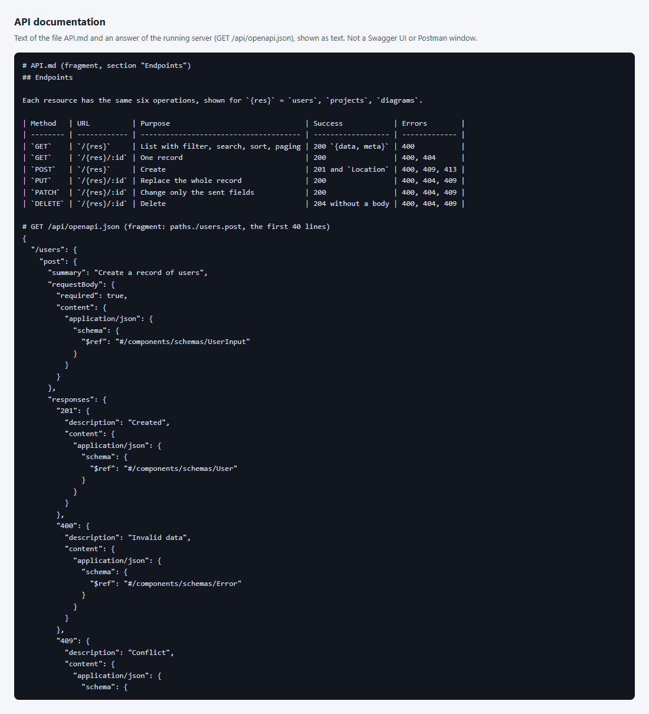

Рисунок 1 – Фрагмент файла `API.md` и ответа `GET /api/openapi.json` (текст, снятый скриптом `shots/docs-shot.mjs`, не окно Swagger UI)

Тот же документ открыт в Swagger UI. Страницу рисует Swagger UI 5.17.14, подключённый с CDN скриптом `shots/swagger-shot.mjs`: документ берётся у запущенного сервера и передаётся странице как объект. Список всех операций показан на рисунке 2.

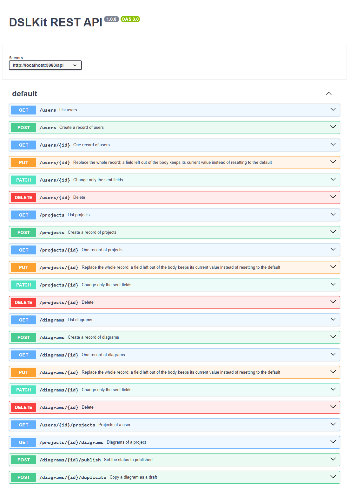

Рисунок 2 – Swagger UI: все операции API из `GET /api/openapi.json`

Операция `POST /users` с телом запроса и кодами ответов показана на рисунке 3.

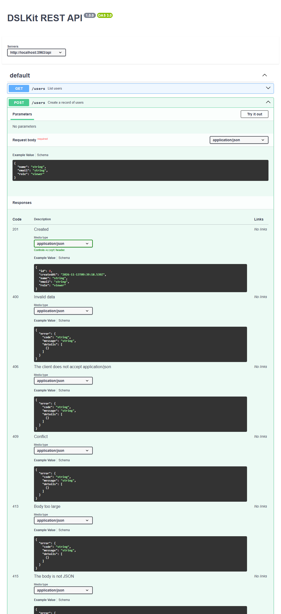

Рисунок 3 – Swagger UI: операция `POST /users`, тело запроса и коды ответов

Справочник по операциям собирается из того же документа скриптом `tools/gen-api-md.mjs` в файлы `API.generated.ru.md` и `API.generated.en.md`. Тест сравнивает их с ответом сервера, поэтому они не расходятся с кодом.

### 3.5 Проверка запросов в Postman

Все операции проверены в Postman по коллекции `postman_collection.json`, а тот же набор запросов лежит в файле `requests.http`. Пять разных операций показаны на рисунках ниже: чтение списка, создание, частичное изменение, отклонённые данные и конфликт при удалении.

Запрос `GET /api/users` отправлен в Postman, ответ 200 со списком пользователей показан на рисунке 4.

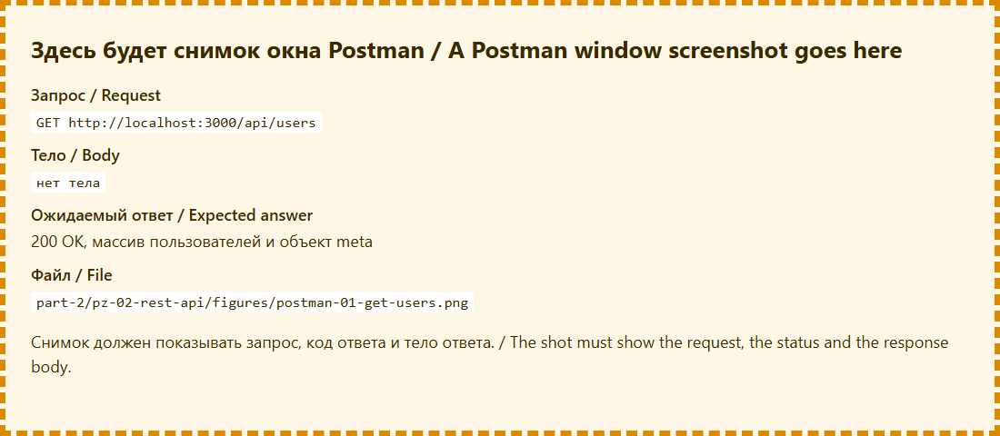

Рисунок 4 – Список пользователей: запрос GET /api/users и ответ 200 в Postman

Создание диаграммы запросом `POST /api/diagrams` с телом JSON показано на рисунке 5.

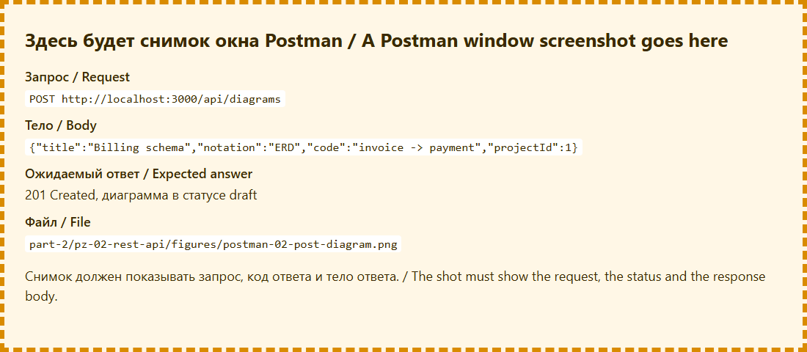

Рисунок 5 – Создание диаграммы: запрос POST /api/diagrams, тело запроса и ответ 201 в Postman

Частичное изменение пользователя запросом `PATCH /api/users/1` показано на рисунке 6.

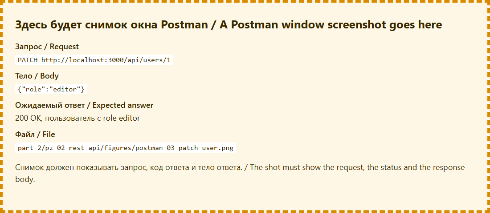

Рисунок 6 – Изменение роли пользователя: запрос PATCH /api/users/1 и ответ 200 в Postman

Запрос `POST /api/users` с пустым именем и неверной почтой отклоняется, как на рисунке 7.

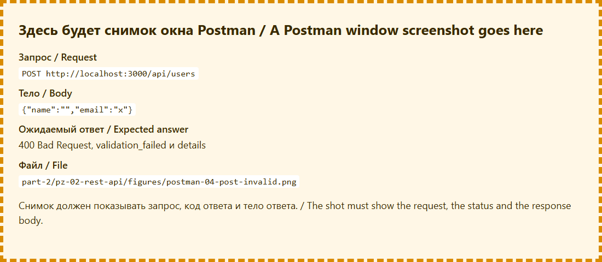

Рисунок 7 – Неверные данные: запрос POST /api/users и ответ 400 с перечнем проблем полей в Postman

Удаление пользователя, который ещё владеет проектами, отклоняется кодом 409, как на рисунке 8.

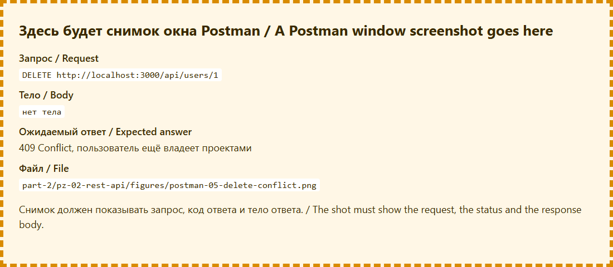

Рисунок 8 – Конфликт при удалении: запрос DELETE /api/users/1 и ответ 409 в Postman

### 3.6 Проверка тестами и запросами из браузера

Автоматические тесты запускают сервер на свободном порту и проверяют каждый метод, коды ответов, фильтры, сортировку, страницы, ошибки проверки, связи между ресурсами, дополнительные операции и ответ 500. Покрытие строк и функций равно 100 процентам, покрытие ветвей выше 98 процентов. Команда запуска: `npm test` в каталоге проекта. Ручную проверку в Postman или Insomnia можно выполнить запросами из `API.md`.

Сервер запущен командой `npm start`, сообщение консоли показано на рисунке 9.

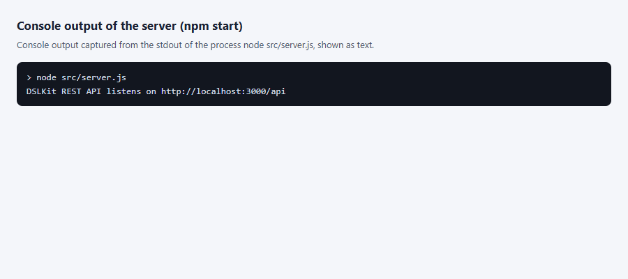

Рисунок 9 – Сообщение консоли после запуска сервера на порту 3000 (вывод процесса, снятый как текст)

Браузер не отправляет запросы `POST`, `PUT`, `PATCH` и `DELETE` из адресной строки, поэтому такие запросы отправил скрипт `shots/shots.mjs`, а настоящие запросы и ответы сервера выведены на странице. Создание пользователя, проекта и диаграммы показано на рисунке 10.

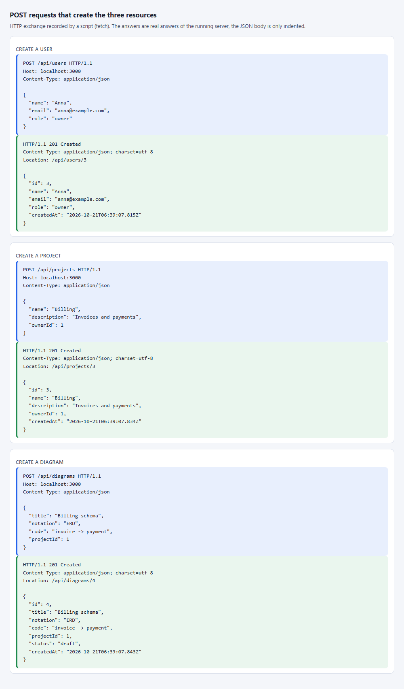

Рисунок 10 – Запросы POST и ответы 201 для пользователя, проекта и диаграммы, записанные скриптом (не окно Postman)

Запрос `GET /api/users` открыт в браузере по адресу `http://localhost:3000/api/users`, ответ показан на рисунке 11.

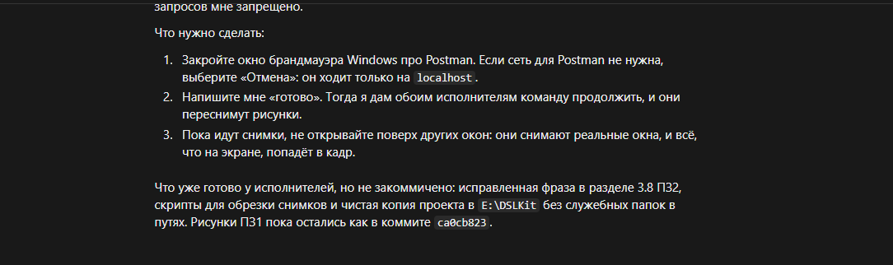

Рисунок 11 – Ответ GET /api/users в окне браузера: массив пользователей

Одна запись по адресу `http://localhost:3000/api/users/1` показана на рисунке 12.

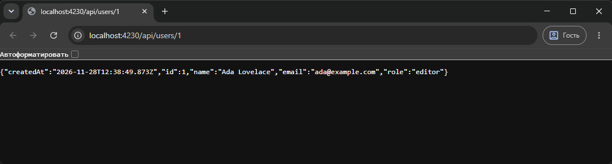

Рисунок 12 – Ответ GET /api/users/1 в окне браузера: объект одного пользователя

Запрос несуществующей записи по адресу `http://localhost:3000/api/users/999` даёт ошибку, показанную на рисунке 13.

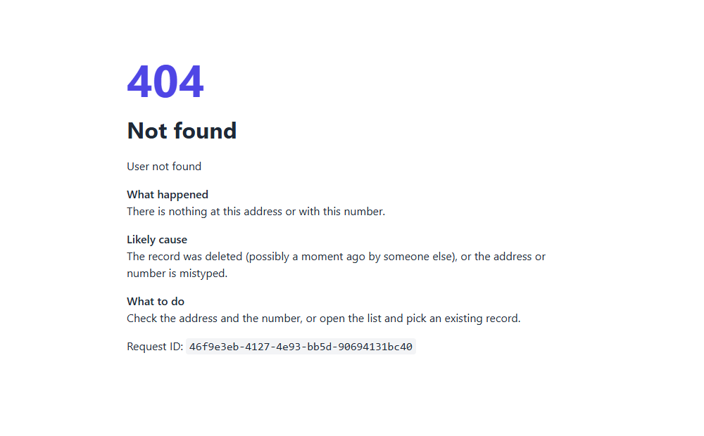

Рисунок 13 – Ответ GET /api/users/999 в окне браузера: JSON с кодом not_found (код 404)

Неверный номер в адресе `http://localhost:3000/api/users/abc` отклоняется, как на рисунке 14.

Рисунок 14 – Ответ GET /api/users/abc в окне браузера: JSON с сообщением о неверном номере (код 400)

Поиск, сортировка и страницы работают через параметры адреса `?q=billing&sort=-title&page=1&limit=10`, результат показан на рисунке 15.

Рисунок 15 – Ответ GET /api/diagrams с параметрами q, sort, page и limit в окне браузера

Дополнительный маршрут `GET /api/users/1/projects` возвращает проекты одного пользователя, как на рисунке 16.

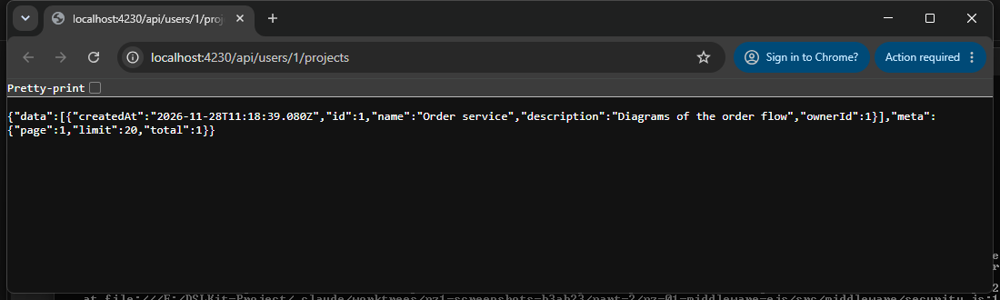

Рисунок 16 – Ответ GET /api/users/1/projects в окне браузера: проекты пользователя

Ошибки проверки данных, в том числе неизвестное поле и несуществующий проект, показаны на рисунке 17.

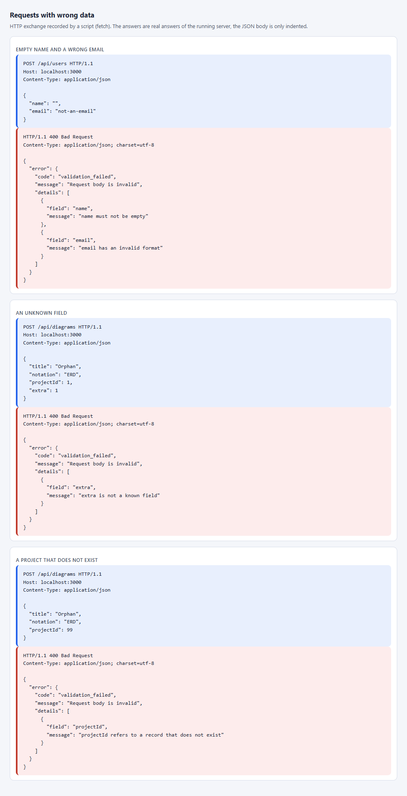

Рисунок 17 – Ответы 400 с перечнем проблем полей, записанные скриптом (не окно Postman)

Частичное изменение и полная замена записи показаны на рисунке 18.

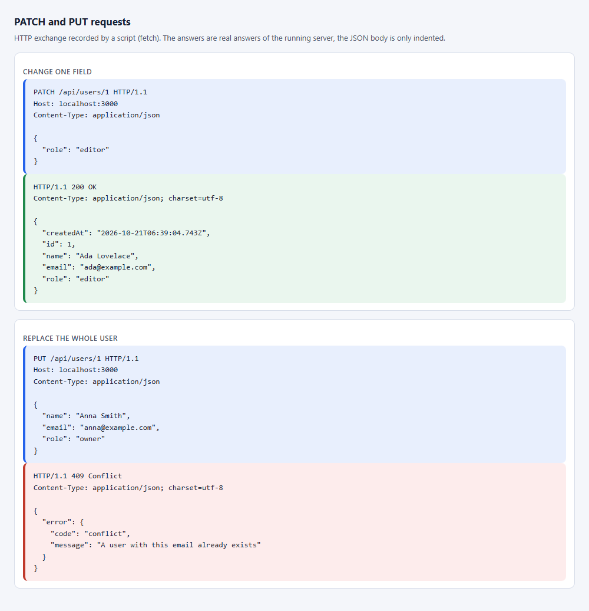

Рисунок 18 – Запросы PATCH и PUT и ответы сервера, записанные скриптом (не окно Postman)

Дополнительные операции с диаграммой показаны на рисунке 19: повторная публикация ничего не меняет, копия создаётся черновиком.

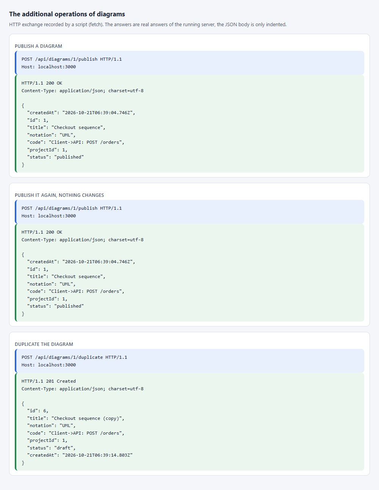

Рисунок 19 – Запросы publish и duplicate и ответы сервера, записанные скриптом (не окно Postman)

Удаление пользователя с проектами отклоняется, а удаление диаграммы проходит, как на рисунке 20.

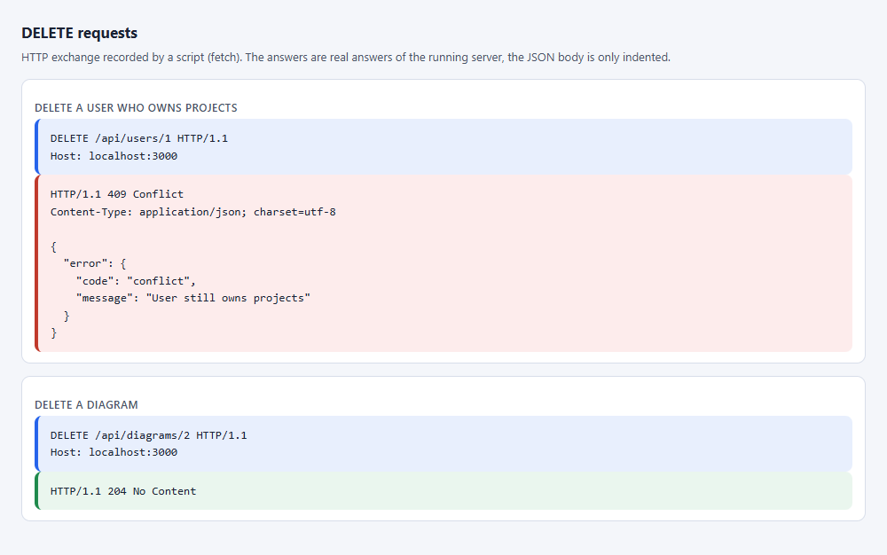

Рисунок 20 – Запросы DELETE: ответ 409 для пользователя с проектами и ответ 204 для диаграммы, записанные скриптом (не окно Postman)

Результат команды `npm test` с числом тестов и покрытием кода показан на рисунке 21.

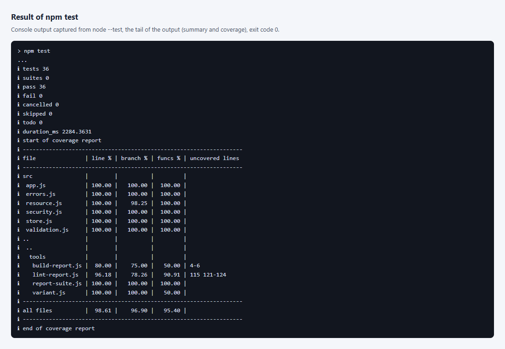

Рисунок 21 – Конец вывода команды npm test: число пройденных тестов и таблица покрытия (вывод процесса, снятый как текст)

## 4 Ответы на контрольные вопросы

25. Что такое «межресурсные связи» и как их реализовать в REST API (например, получить заказы пользователя)?

    Это связи между записями разных ресурсов, например проект принадлежит пользователю, а диаграмма проекту. В API связь выражают тремя способами. Первый способ: поле-ссылка в записи, в работе это `ownerId` у проекта и `projectId` у диаграммы, и сервер проверяет, что такая запись существует. Второй способ: вложенный маршрут для чтения, например `GET /api/users/:id/projects` отдаёт проекты пользователя, а `GET /api/projects/:id/diagrams` диаграммы проекта. Третий способ: фильтр списка, то же самое даёт `GET /api/projects?ownerId=1`. Вложенность стараются держать не глубже двух уровней, а имена ресурсов пишут во множественном числе. Связь защищает и удаление: пользователь с проектами и проект с диаграммами не удаляются, ответ 409.

26. Какие статус коды используются для редиректов (3xx)? Нужны ли они в REST API?

    Код 301 означает постоянный перенос адреса, код 302 временный, коды 307 и 308 делают то же, но сохраняют метод запроса, код 303 отправляет клиента к другому адресу методом `GET`, а код 304 сообщает, что кэшированный ответ ещё актуален. В Express редирект делает `res.redirect(status, url)`. В REST API редиректы нужны редко: после `POST` возвращают 201 с заголовком `Location` и самой записью, а не перенаправляют клиента. Применяют их при переезде адреса или версии API и код 304 при условных запросах с `ETag`. В этой работе редиректов нет.

27. Как в документации API указать возможные коды ошибок и их описание?

    В OpenAPI у каждой операции в разделе `responses` перечисляют коды, например `400`, `404` и `409`, и для каждого дают описание и схему тела. Общую схему ошибки описывают один раз в `components` и подключают ссылкой. В работе документация лежит в файле `API.md`: в таблице каждого маршрута есть столбец с возможными кодами ошибок, а раздел «Errors» показывает единый вид ответа `{ "error": { "code", "message", "details" } }` и перечисляет значения `code` с кодами состояния. Так клиент знает, какие ошибки ждать и как их разобрать.

## Заключение

Для проекта DSLKit спроектирован и реализован REST API с тремя связанными ресурсами. Он поддерживает операции CRUD, фильтрацию, поиск, сортировку, страницы, публикацию и копирование диаграмм, проверяет входные данные и связи между записями и отвечает ошибками единого формата. Описание API и примеры запросов собраны в `API.md`, автоматические тесты покрывают весь код. Запросы проверены в Postman, а описание API показано в Swagger UI.

## Приложение А (обязательное) Листинг файла app.js

{{code:part-2/pz-02-rest-api/src/app.js}}

## Приложение Б (обязательное) Листинг файла resource.js

{{code:part-2/pz-02-rest-api/src/resource.js}}

## Приложение В (обязательное) Листинг файла validation.js

{{code:part-2/pz-02-rest-api/src/validation.js}}
