# Practical Session No. 3. Routing in React Applications

## 1 Purpose of the Work

To master routing in a React application: configure routes, build a single-page application with several pages, use dynamic routes and protected routes on the example of the DSLKit project, a web editor for diagrams as code (SaaS direction).

## 2 Choice of the React Router Version

The assignment names React Router v6 with a note "v6?". The `react-router-dom` library version 7.18.4 is used. The whole API from the assignment (`BrowserRouter`, `Routes`, `Route`, `Link`, `NavLink`, `Outlet`, `Navigate`, `useParams`, `useNavigate`, `useLocation`) works in version 7 library mode the same way as in v6. Version 7 is maintained, compatible with React 19 and already used in the application from the first part of the course. If needed, the code moves to v6 with `npm i react-router-dom@6` without changes.

## 3 Work Progress

### 3.1 Route Map

The application consists of the pages shown in Table 1. All pages, including sign-in and sign-out, live inside the shared layout route `Layout`, which renders the menu and inserts the page content through `Outlet`.

Table 1 – Application routes

| Path           | Page                   | Access                          |
| -------------- | ---------------------- | ------------------------------- |
| `/`            | Home                   | open                            |
| `/catalog`     | Template catalog       | open                            |
| `/catalog/:id` | Template card          | open, a wrong `id` leads to 404 |
| `/about`       | About                  | open                            |
| `/login`       | Sign in (simulated)    | open                            |
| `/logout`      | Sign out, redirect `/` | open                            |
| `/dashboard`   | Dashboard              | after sign-in only              |
| `/admin`       | Admin section          | admin role only, else 403       |
| `*`            | 404                    | open                            |

### 3.2 Menu and Dynamic Route

The menu is built with `NavLink`, the function in `className` receives the `isActive` flag and adds the active item class. The home link has `end` so that it does not stay active on every path. The `/catalog/:id` page reads the parameter with `useParams`, looks up the template in the data and, if none is found, renders the 404 page in place with the `NotFound` component, the address does not change. The "Back" button calls `navigate(-1)`. Breadcrumbs stand above the content: the `Breadcrumbs` component splits `pathname` into parts and builds the trail "Главная / Каталог / template name", the last item is marked with `aria-current`. For an unknown address and an unknown `id` no trail is shown. The catalog, dashboard and admin pages load lazily through `lazy`, and `Layout` wraps `Outlet` in `Suspense` with the message "Загрузка страницы…", so the menu stays on the screen while the page code downloads. The catalog reads its filter from the address with the `useSearchParams` hook: the link `/catalog?q=UML&sort=title` immediately shows the filtered and sorted list. The query is cut to the limit from `limits.json`, a whitespace-only query and an unknown sort are ignored, and the query text is output as text. The code is given in Appendix A.

### 3.3 Protected Route and Fake Login

The `PrivateRoute` component works as a wrapper route: for a signed-in user it renders `Outlet`, otherwise it redirects to `/login` and passes the whole requested address, with the query and the hash, in `state` without showing it in the address bar. The login form asks for a user name. An empty name and a name made of spaces are rejected, the length limit comes from the file `src/limits.json`. The session is kept in the `AuthProvider` state and in `localStorage`, and a record without a valid name does not count as a login. After the login `Login` returns to the requested page or to `/dashboard`. The return address is checked by the `safeReturnPath` function: foreign addresses that start with `//` or with a protocol name are ignored. Logout is a separate route `/logout` that clears the session and returns to the home page declaratively. A login or logout in another tab is picked up by the `storage` event. The role is derived from the name: the name `admin` in any letter case gives the admin role, other names give the user role. The `RoleRoute` component is nested in `PrivateRoute` and lets only the admin role through to `/admin`, while other roles get the 403 page in the site style. A guest on `/admin` first lands on the sign-in and returns to `/admin` after signing in as admin.

A server check is impossible in this work, so the guard hides pages in the interface and does not protect data. In a real project the server checks access by a token.

### 3.4 Accessibility and Error Pages

After a route change the page is not reloaded, so the focus stays on the clicked link. The `Layout` component moves the focus to the main content and updates the tab title so that a screen reader announces the new page. There is a skip link and one level-one heading per page. The 404 page uses the error card of the first-part site and is shown for any unknown path and for an unknown `id`. The identifier from the address is never inserted into the page as markup. The 500 page appears through `ErrorBoundary` when rendering fails.

### 3.5 Appearance

The application uses the styles and markup of the first-part site: a sticky header with the logo, a menu with the active item marked by `aria-current`, a phone menu button, a moon and sun theme switch, cards, form fields and a footer. There is only one main button on every screen.

### 3.6 Demonstration

The home page with the menu and the sticky header is shown in figure 1.

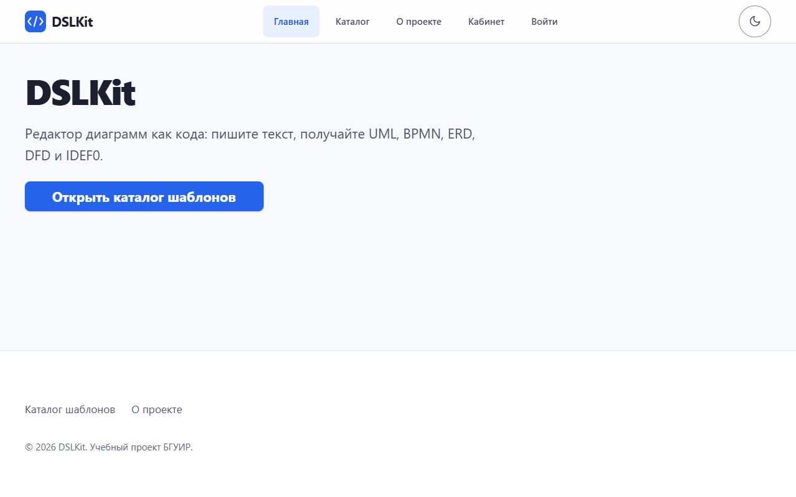

Figure 1 – Home page of the application in the light theme

The menu with the highlighted item "Каталог" and the template cards are shown in figure 2.

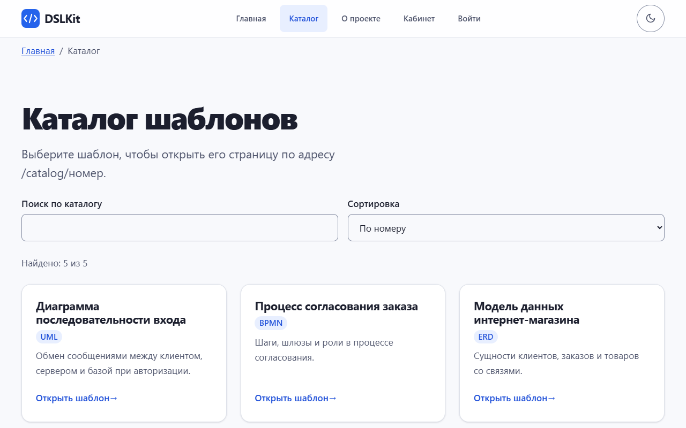

Figure 2 – Template catalog with the sticky header and the highlighted menu item

The "About" page is opened at `/about` and its menu item is highlighted, as figure 3 shows.

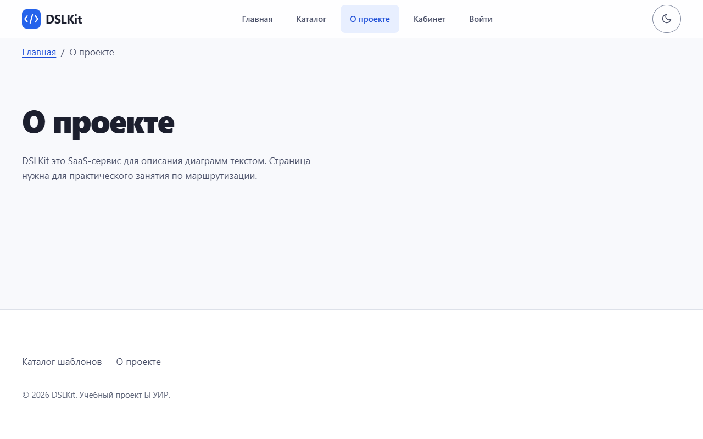

Figure 3 – The "About" page at `/about` with the menu item "О проекте" highlighted

The dynamic route `/catalog/2` opens the template card, as figure 4 shows.

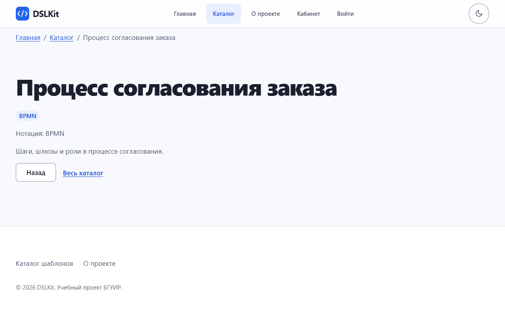

Figure 4 – Template page opened at the address `/catalog/2`

The address `/catalog/999` with a missing identifier leads to the 404 page, shown in figure 5.

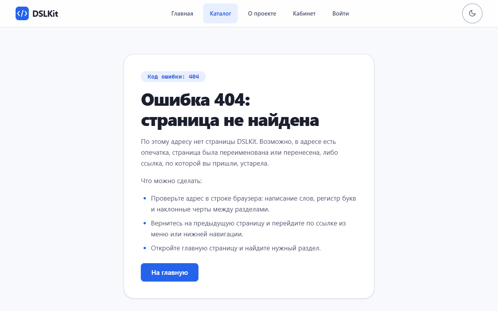

Figure 5 – Error page 404 for an unknown template identifier

For an unknown path a styled 404 page is shown, and it is visible in figure 6.

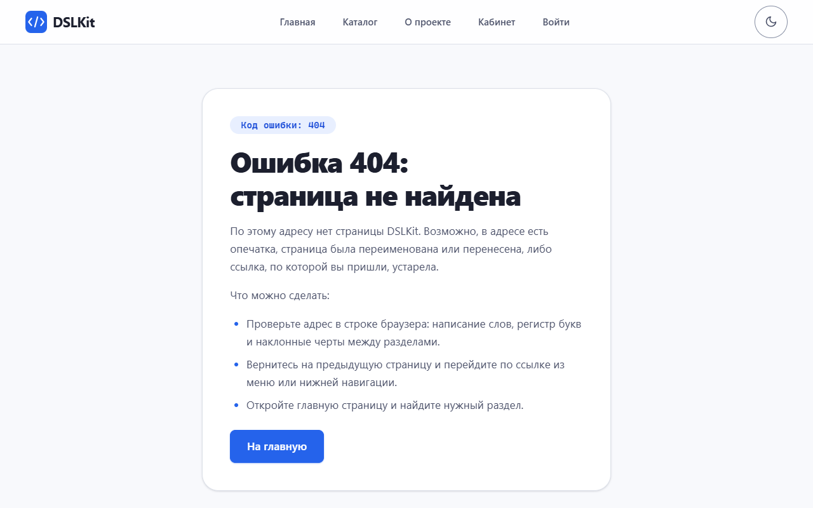

Figure 6 – The page "Ошибка 404: страница не найдена" in the site style

A guest who opens `/dashboard` lands on the login form with a hint, as in figure 7.

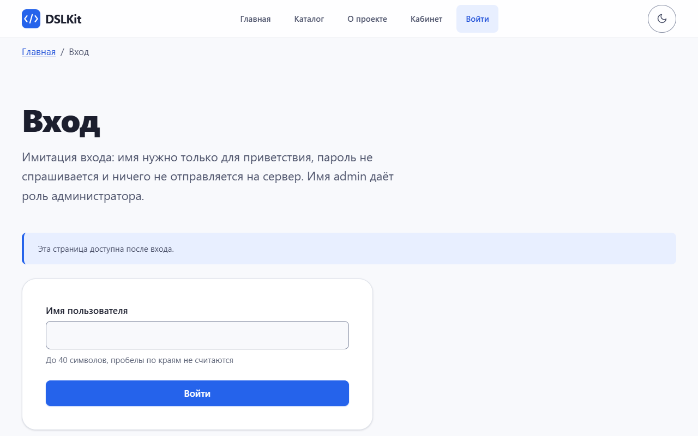

Figure 7 – Login form with the hint "Эта страница доступна после входа"

The error for an empty name is visible under the field in figure 8.

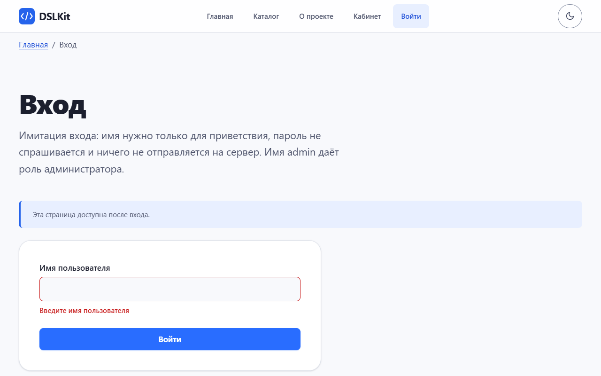

Figure 8 – Login form with the error message for an empty name

After login the requested page opens, and it is visible in figure 9.

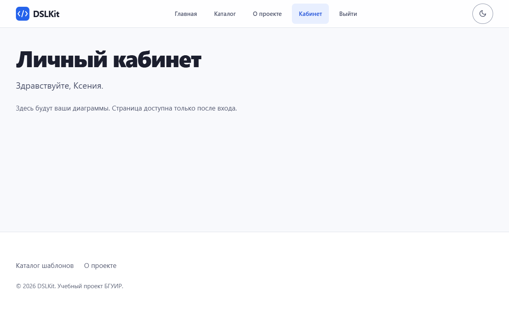

Figure 9 – Dashboard after login with the greeting and the menu item "Выйти"

The catalog filter is kept in the address, as in figure 10.

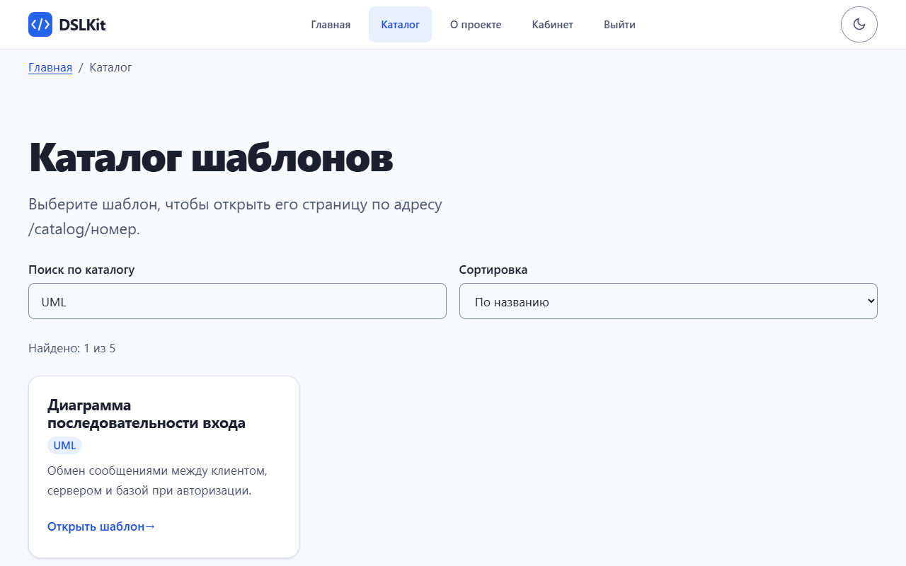

Figure 10 – Catalog at the link `/catalog?q=UML&sort=title` with breadcrumbs and the found count

A regular user on the administrator page sees the 403 error, as in figure 11.

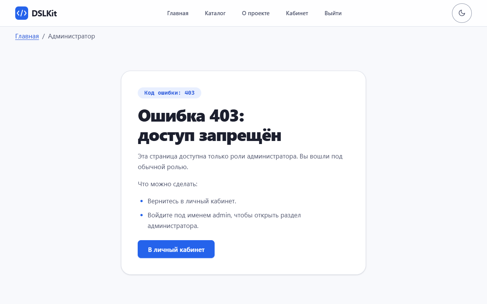

Figure 11 – Error page 403 for a user without the admin role

On a phone width of 375 pixels the cards go in one column, as in figure 12.

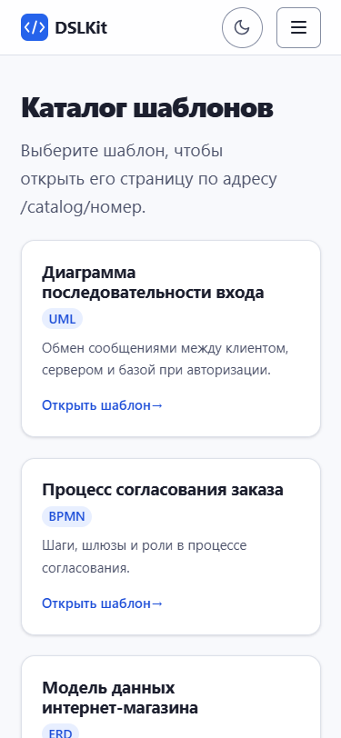

Figure 12 – Template catalog on a screen 375 pixels wide

The phone menu opens with the three bar button and is shown in figure 13.

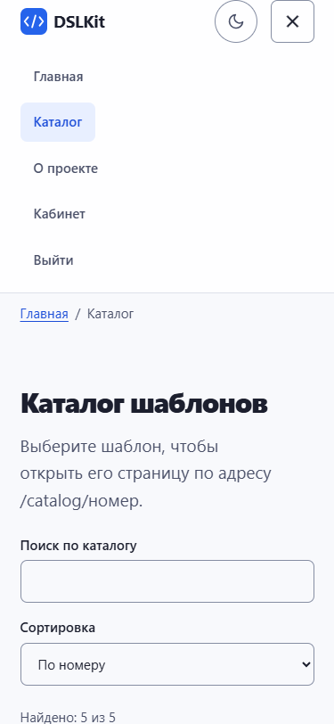

Figure 13 – Opened menu on a screen 375 pixels wide

The dark theme is switched on with the moon icon in the header and is shown in figure 14.

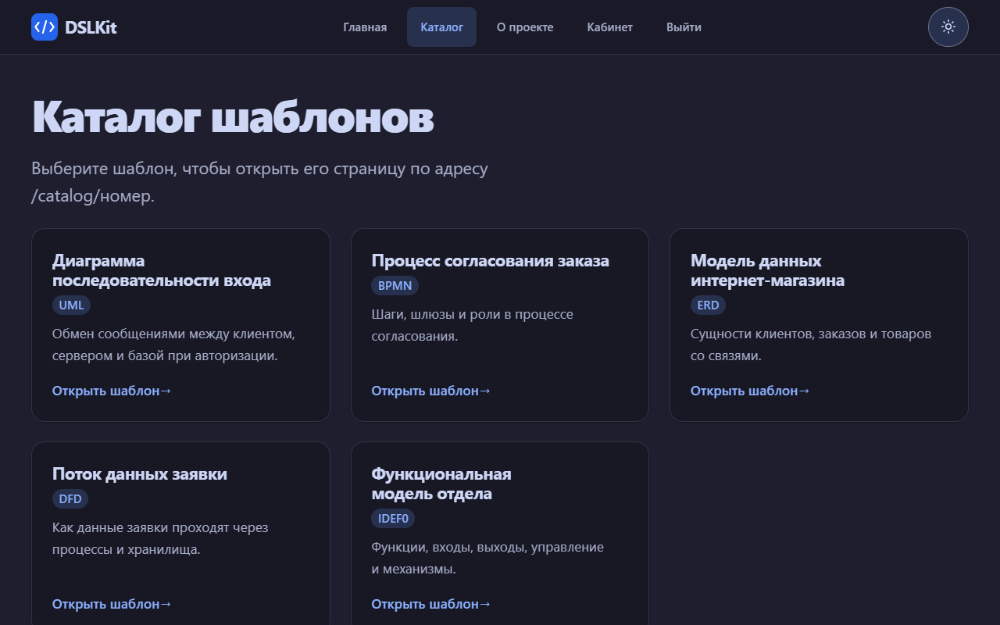

Figure 14 – Template catalog in the dark theme

### 3.7 Testing

One hundred and twenty-two automated tests on `MemoryRouter` check all the pages, the catalog filter in the address (a huge and a whitespace-only query, a forged sort, markup in the query), lazy loading with the fallback message, breadcrumbs, the admin-only route (guest, user, admin, a logout in another tab), a double click on the sign-in button, the `NavLink` highlight, the dynamic route, the 404 page, the guest redirect, the return with query parameters, the name check, a forged return address, a logout in another tab, the focus move, markup rendered as text and the 500 page. The manual check is described in `README.md`.

### 3.8 Addresses and hosting

The app can be hosted not at the server root. A build with the variable `VITE_BASE=/dslkit/` puts the files into a sub-folder, and the `AppRouter` component takes it as `basename`. A build with the variable `VITE_ROUTER=hash` switches the app to `HashRouter`: addresses look like `/#/catalog`, and a static host needs no redirect rules to `index.html`. By default the usual `BrowserRouter` works.

## Conclusion

The Vite application contains eight routes, a menu with the active item highlighted, a dynamic route handling an unknown parameter, a 404 page a protected dashboard with simulated sign-in and programmatic navigation, a catalog filter through `useSearchParams`, lazy page loading, breadcrumbs and a section for the admin role only. `react-router-dom` 7 is chosen, its API for the tasks of this work matches v6.

## Answers to Control Questions

25. **How does `BrowserRouter` differ from `HashRouter`?** The first uses ordinary addresses and needs the server set up to return `index.html`, the second keeps the path after `#` and works on static hosting without setup.
26. **How to make a modal window with its own route?** Nest the modal route in the gallery page and show it through `Outlet` over the content, closing is `navigate(-1)`.
27. **How to test routing?** Wrap the component in `MemoryRouter initialEntries={['/catalog/2']}` and check the rendering and the transitions. The tests of the project are written this way.

## Appendix A (mandatory) Key Code Fragments

```jsx
// App.jsx: full route map, Layout provides the menu and Outlet
<Routes>
  {/* Layout route without a path: menu, header, footer and Outlet for the pages */}
  <Route element={<Layout />}>
    {/* Home: index route, the address / */}
    <Route index element={<Home />} />
    {/* Catalog (lazy loaded), the filter in ?q= and ?sort= */}
    <Route path="catalog" element={<Catalog />} />
    {/* Dynamic route: id is read with useParams, an unknown id renders 404 in place */}
    <Route path="catalog/:id" element={<CatalogItem />} />
    {/* The "About" page, highlighted in the menu by NavLink */}
    <Route path="about" element={<About />} />
    {/* Login form (a signed-in user is redirected to the dashboard) */}
    <Route path="login" element={<Login />} />
    {/* Logout: clears the session and returns to the home page */}
    <Route path="logout" element={<Logout />} />
    {/* Protected group: without a login a redirect to /login that remembers the address */}
    <Route element={<PrivateRoute />}>
      {/* Dashboard (lazy loaded) */}
      <Route path="dashboard" element={<Dashboard />} />
      {/* Nested role check: admin only, other roles get 403 */}
      <Route element={<RoleRoute role="admin" />}>
        <Route path="admin" element={<Admin />} />
      </Route>
    </Route>
    {/* Any unknown path: the 404 page, the route stays last */}
    <Route path="*" element={<NotFound />} />
  </Route>
</Routes>
```

```jsx
// App.jsx: lazy loading, Layout wraps Outlet in Suspense
const Catalog = lazy(() => import('./pages/Catalog'));
<Suspense fallback={<p role="status">Загрузка страницы…</p>}>
  <Outlet />
</Suspense>
```

```jsx
// Catalog.jsx: the filter in the address
const [searchParams, setSearchParams] = useSearchParams();
const raw = (searchParams.get('q') ?? '').slice(0, limits.search.maxLength);
setSearchParams({ q: value }, { replace: true });
```

```jsx
// RoleRoute: lets only the needed role through
return auth.role === role ? <Outlet /> : <Forbidden />;
```

```jsx
// CatalogItem: URL parameter and the 404 page in place
const { id } = useParams();
const template = findTemplate(id);
if (!template) return <NotFound />;
```

```jsx
// PrivateRoute: protection and remembering the requested path
const from = `${location.pathname}${location.search}${location.hash}`;
return isAuth ? <Outlet /> : <Navigate to="/login" replace state={{ from }} />;
```

```jsx
// Login: programmatic navigation after the simulated sign-in
login(name);
navigate(safeReturnPath(location.state?.from), { replace: true });
```
