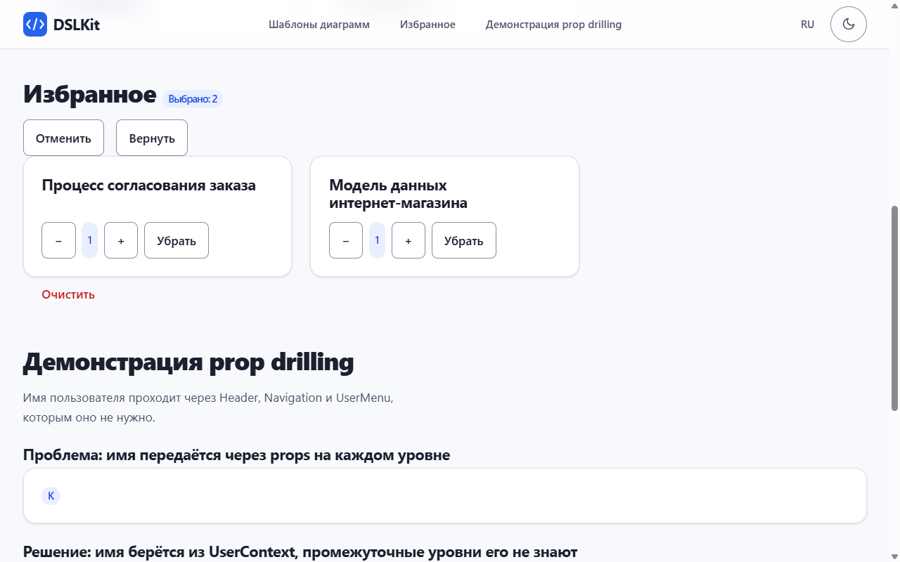

# Practical Session No. 4. Application State Management

## 1 Purpose of the Work

To master global state management in React with the Context API and the `useReducer` hook: to show the prop drilling problem, solve it with contexts and implement the business logic of the DSLKit project, a web editor for diagrams as code (SaaS direction), as a reducer and a provider.

## 2 Work Progress

### 2.1 The Prop Drilling Problem

The hierarchy `PropDrilling` → `DrillingHeader` → `Navigation` → `UserMenu` → `UserAvatar` passes the user name through all levels, although only `UserAvatar` uses it. Three intermediate components receive `userName` only to pass it on, so any data change requires edits along the whole chain. The code is given in Appendix A.

The solution is shown next to it in the same page section. The user name lives in `UserContext`, while `ContextHeader`, `ContextNavigation` and `ContextMenu` receive no props: `ContextAvatar` reads the name with the `useUser` hook. The nesting depth is the same, but the passing of data down the chain disappears and adding a level needs no edits.

### 2.2 Theme and Language Contexts

`ThemeProvider` keeps the theme in `useState`, switches it with `toggleTheme` and writes it to the `data-theme` attribute of the root element, and CSS variables change the colors of the whole page. `LanguageProvider` keeps the language and a dictionary in Russian and English, components receive the `t(key)` function and do not accept texts through props. Context values are wrapped in `useMemo` so that consumers do not re-render without a data change.

### 2.3 Favorites on useReducer and Context

The subject area is favorite diagram templates. The state is an array of `{ id, qty }` objects. The reducer handles the actions `ADD` (without duplicates), `REMOVE`, `TOGGLE`, `INCREMENT`, `DECREMENT`, `SET_QTY` and `CLEAR`, returns a new array and never changes the old one, and an unknown action leaves the state unchanged. The quantity is always a whole number from 1 to the `maxQty` limit of `limits.json`, and a value out of range, fractional or not a number is replaced by the nearest valid one. `FavoritesProvider` is split into two contexts: the data (`useFavorites`) changes with every action, while `dispatch` (`useFavoritesDispatch`) never changes, so a component that only sends actions is not re-rendered when the data changes. A template card and the "Избранное" panel work with one state without passing it through props, and the panel has "minus" and "plus" buttons and the current quantity. The list is saved to `localStorage` by an effect and read by the lazy initializer of `useReducer`.

The "Undo" and "Redo" buttons in the favorites panel work through the `withHistory` function. It wraps the reducer and keeps the state as `{ past, present, future }`. An action that changes nothing creates no history step, and a new change clears the redo steps. The favorites reducer itself stays the same and is checked by the same tests.

### 2.4 Resistance to Foreign Data

The content of `localStorage` can be edited by hand. The `sanitizeFavorites` function keeps only known template identifiers, once each, repairs a damaged quantity and accepts the old format with a list of identifiers as quantity 1. The theme and the language are accepted from storage only with valid values, otherwise the theme follows the system setting and the language is Russian. Blocked storage and broken JSON do not break the application. Texts are rendered as text, so markup in a user name is not executed, and an empty name in the prop drilling chain is replaced by a question mark. The 500 page is shown through `ErrorBoundary` when rendering fails.

### 2.5 Appearance

The application uses the styles and markup of the first-part site: a sticky header with the logo and a menu of the page sections, a language button, a moon and sun theme switch with a tooltip, cards and a footer. The theme switch and the language button read the same contexts as the other components, and the header labels change with the language.

### 2.6 Demonstration

Diagram templates in cards with the favorite buttons are shown in figure 1.


Figure 1 – Template cards with the "В избранное" buttons in the light theme

Two chosen templates go to the "Избранное" panel, where the counter is visible, as in figure 2.


Figure 2 – The "Избранное" panel with two templates and the counter of chosen items

The buttons with the signs "+" and "−" change the quantity through reducer actions, and figure 3 shows the result.


Figure 3 – The "Избранное" panel with the quantity 3 for the first template

Removing one template with the "Убрать" button leaves only the other ones in the panel, as in figure 4.



Figure 4 – The "Избранное" panel after one of three templates is removed

After the page is reloaded the choice and the quantity are kept, as figure 5 shows.


Figure 5 – The "Избранное" panel after a page reload

The theme switch changes the colors of the whole page, as figure 6 shows.


Figure 6 – Page in the dark theme with the tooltip at the switch

Changing the language translates the headings, the template names and the button labels, as in figure 7.


Figure 7 – Page after switching the language to English

The prop drilling problem and its solution through the context stand side by side, as in figure 8.


Figure 8 – Block with the name passed through props and the block with the same name from `UserContext`

The "Очистить" button resets the list with the `CLEAR` action and the panel shows a message, as in figure 9.


Figure 9 – The "Избранное" panel after the list is cleared

On a phone width of 375 pixels the blocks go in one column, as in figure 10.


Figure 10 – Application page on a screen 375 pixels wide

### 2.7 Testing

This work has no server and no routes, so the pages 401, 403 and 404 are not needed, and for the errors of the application itself there are two pages built from the catalogue of texts `src/shell/errorCatalog.js`. The 500 page is shown when an unexpected error occurs while rendering, and the "No connection to the server" page with a retry button is shown when a part of the code could not be downloaded. Each answers three questions: what the error is, why it happened and how to solve it. The technical text of the error goes to the console only and never reaches the page.

Eighty-one automated tests check the reducer as a pure function, the quantity change with its limits, the split of the contexts (the number of re-renders), the prop drilling problem and its solution, a double click on the buttons, the theme and language switching, saving of the choice, adding, removing and clearing favorites, restoring after a reload, broken data, a storage write error, the prop drilling demo, markup rendered as text and the 500 page.

## Conclusion

Prop drilling is shown on a chain of five components and removed with the theme, language and favorites contexts, and the block with the solution stands next to the problem. The business logic lives in a pure reducer, the state and `dispatch` are available in any component through the `useTheme`, `useLanguage`, `useFavorites` and `useFavoritesDispatch` hooks, and favorites persist between sessions.

## Answers to Control Questions

25. **Can `useReducer` be used without Context?** Yes, for the local state of one component, for example a form or a counter: `const [n, dispatch] = useReducer(r, 0)`.
26. **How does Context plus `useReducer` differ from Redux?** It is simpler and needs no dependencies for small projects, but there are no debugging tools, middleware and exact subscriptions as in Redux.
27. **How to get only `dispatch`?** Move `dispatch` to a separate context, then the component is not re-rendered when the state changes. The project does exactly this with `useFavoritesDispatch`.

## Appendix A (mandatory) Key Code Fragments

```jsx
// PropDrilling.jsx: userName passes through components that do not need it
<DrillingHeader userName={userName} />
// DrillingHeader → Navigation → UserMenu → UserAvatar
```

```jsx
// PropDrilling.jsx: the solution, the name comes from the context
<UserContext.Provider value={userName}>
  <ContextHeader />
</UserContext.Provider>
// ContextAvatar: const userName = useUser();
```

```jsx
import { createContext, useContext, useEffect, useMemo, useRef, useState } from 'react';

export const THEME_KEY = 'dslkit.theme';

const ThemeContext = createContext(null);

const systemTheme = () => (typeof window.matchMedia === 'function' && window.matchMedia('(prefers-color-scheme: dark)').matches ? 'dark' : 'light');

// A saved choice wins, otherwise the system preference decides (light first, as on the Part 1 site).
// Anything else in storage is ignored.
export function readTheme() {
  try {
    const saved = localStorage.getItem(THEME_KEY);
    if (saved === 'light' || saved === 'dark') return saved;
  } catch {
    // Storage is blocked: use the system preference.
  }
  return systemTheme();
}

export function ThemeProvider({ children }) {
  const [theme, setThemeState] = useState(readTheme);
  const chosen = useRef(false);

  // The root attribute lets the colour tokens of dslkit.css switch the whole page.
  useEffect(() => {
    document.documentElement.dataset.theme = theme;
  }, [theme]);

  const value = useMemo(() => {
    // Only the two known themes are accepted, anything else is ignored.
    const setTheme = (next) => {
      if (next !== 'light' && next !== 'dark') return;
      chosen.current = true;
      setThemeState(next);
    };
    // The functional update makes two toggles in a row flip twice, not once.
    const toggleTheme = () => {
      chosen.current = true;
      setThemeState((prev) => (prev === 'light' ? 'dark' : 'light'));
    };
    return { theme, setTheme, toggleTheme };
  }, [theme]);

  // Only a choice made by the user is stored, so the system preference is still followed until then.
  useEffect(() => {
    if (!chosen.current) return;
    try {
      localStorage.setItem(THEME_KEY, theme);
    } catch {
      // The choice lives in memory only.
    }
  }, [theme]);
  return <ThemeContext.Provider value={value}>{children}</ThemeContext.Provider>;
}

// Outside the provider there is no value to read: fail with a message that names the provider.
export const useTheme = () => {
  const value = useContext(ThemeContext);
  if (value === null) throw new Error('useTheme must be used inside ThemeProvider');
  return value;
};
```

```jsx
import { createContext, useContext, useEffect, useMemo, useReducer } from 'react';
import { TEMPLATES } from '../data/templates';
import limits from '../limits.json';

export const FAVORITES_KEY = 'dslkit.favorites';
export const MAX_QTY = limits.maxQty;
export const MAX_HISTORY = limits.maxHistory;

// Quantity is always a whole number from 1 to MAX_QTY, anything else is replaced by the nearest valid value.
export function clampQty(value) {
  const number = Math.trunc(Number(value));
  if (!Number.isFinite(number)) return 1;
  return Math.min(MAX_QTY, Math.max(1, number));
}

const changeQty = (state, id, next) => state.map((item) => (item.id === id ? { ...item, qty: clampQty(next(item.qty)) } : item));

const isTemplateId = (id) => TEMPLATES.some((template) => template.id === id);

// State is an array of { id, qty }. Every action returns a new array and never mutates the old one.
// A missing action, a null state and an id that is not a template are ignored instead of stored.
export function favoritesReducer(current, action) {
  const state = Array.isArray(current) ? current : [];
  switch (action?.type) {
    case 'ADD':
      if (!isTemplateId(action.id) || state.some((item) => item.id === action.id)) return state;
      return [...state, { id: action.id, qty: 1 }];
    case 'REMOVE':
      return state.filter((item) => item.id !== action.id);
    case 'TOGGLE':
      if (!isTemplateId(action.id)) return state;
      return state.some((item) => item.id === action.id) ? state.filter((item) => item.id !== action.id) : [...state, { id: action.id, qty: 1 }];
    case 'INCREMENT':
      return changeQty(state, action.id, (qty) => qty + 1);
    case 'DECREMENT':
      return changeQty(state, action.id, (qty) => qty - 1);
    case 'SET_QTY':
      return changeQty(state, action.id, () => action.qty);
    case 'CLEAR':
      return [];
    default:
      return state;
  }
}

// localStorage can hold anything: keep only known template ids, once each, with a valid quantity.
// A plain id (the format of the first version) is accepted as quantity 1.
export function sanitizeFavorites(value) {
  if (!Array.isArray(value)) return [];
  const known = new Set(TEMPLATES.map((template) => template.id));
  const seen = new Set();
  const result = [];
  for (const entry of value) {
    const isObject = entry !== null && typeof entry === 'object' && !Array.isArray(entry);
    const id = isObject ? entry.id : entry;
    if (!known.has(id) || seen.has(id)) continue;
    seen.add(id);
    result.push({ id, qty: isObject ? clampQty(entry.qty) : 1 });
  }
  return result;
}

function loadFavorites() {
  try {
    return sanitizeFavorites(JSON.parse(localStorage.getItem(FAVORITES_KEY)));
  } catch {
    return [];
  }
}

// Undo and redo around any reducer: the state is { past, present, future }, the wrapped reducer only sees `present`.
// An action that changes nothing (the reducer returns the same array) leaves no step in the history, a new change clears the redo steps.
export const withHistory = (reducer, limit = MAX_HISTORY) => (state, action) => {
  if (action?.type === 'UNDO') {
    if (state.past.length === 0) return state;
    return { past: state.past.slice(0, -1), present: state.past.at(-1), future: [state.present, ...state.future] };
  }
  if (action?.type === 'REDO') {
    if (state.future.length === 0) return state;
    return { past: [...state.past, state.present].slice(-limit), present: state.future[0], future: state.future.slice(1) };
  }
  const present = reducer(state.present, action);
  if (present === state.present) return state;
  return { past: [...state.past, state.present].slice(-limit), present, future: [] };
};

const favoritesWithHistory = withHistory(favoritesReducer);
const initialHistory = () => ({ past: [], present: loadFavorites(), future: [] });

// Two contexts: the data changes often, dispatch never changes.
// A component that only sends actions subscribes to the second one and is not re-rendered when the data changes.
const FavoritesStateContext = createContext(null);
const FavoritesDispatchContext = createContext(null);
// Whether undo and redo have a step: only the two buttons subscribe to it.
const FavoritesHistoryContext = createContext(null);

export function FavoritesProvider({ children }) {
  const [state, dispatch] = useReducer(favoritesWithHistory, undefined, initialHistory);
  const favorites = state.present;
  const history = useMemo(() => ({ canUndo: state.past.length > 0, canRedo: state.future.length > 0 }), [state.past.length, state.future.length]);

  useEffect(() => {
    try {
      localStorage.setItem(FAVORITES_KEY, JSON.stringify(favorites));
    } catch {
      // Storage is blocked or full: the state still works in memory.
    }
  }, [favorites]);

  return (
    <FavoritesStateContext.Provider value={favorites}>
      <FavoritesDispatchContext.Provider value={dispatch}>
        <FavoritesHistoryContext.Provider value={history}>{children}</FavoritesHistoryContext.Provider>
      </FavoritesDispatchContext.Provider>
    </FavoritesStateContext.Provider>
  );
}

// Outside FavoritesProvider there is no value to read: fail with a message that names the provider.
const insideProvider = (value, hook) => {
  if (value === null) throw new Error(`${hook} must be used inside FavoritesProvider`);
  return value;
};

export const useFavorites = () => insideProvider(useContext(FavoritesStateContext), 'useFavorites');
export const useFavoritesHistory = () => insideProvider(useContext(FavoritesHistoryContext), 'useFavoritesHistory');
export const useFavoritesDispatch = () => insideProvider(useContext(FavoritesDispatchContext), 'useFavoritesDispatch');
```

```jsx
// Templates.jsx: the data and dispatch come from different contexts
const favorites = useFavorites();
const dispatch = useFavoritesDispatch();
dispatch({ type: 'INCREMENT', id: template.id });
```
