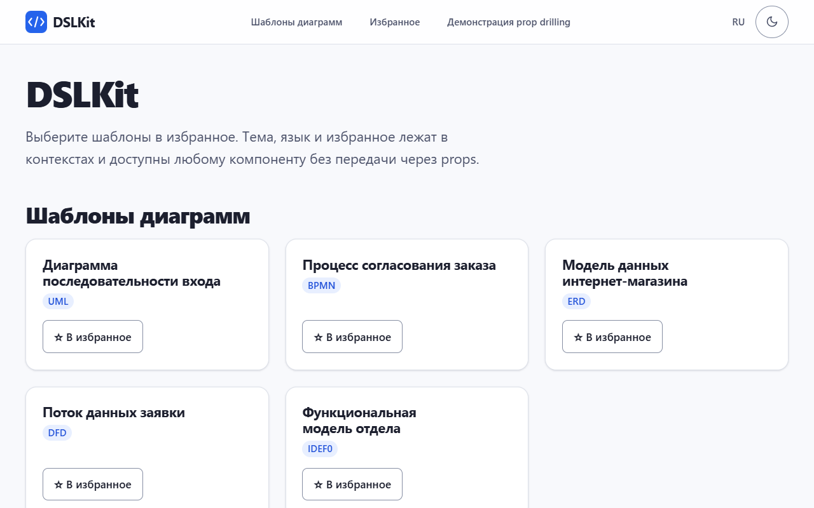
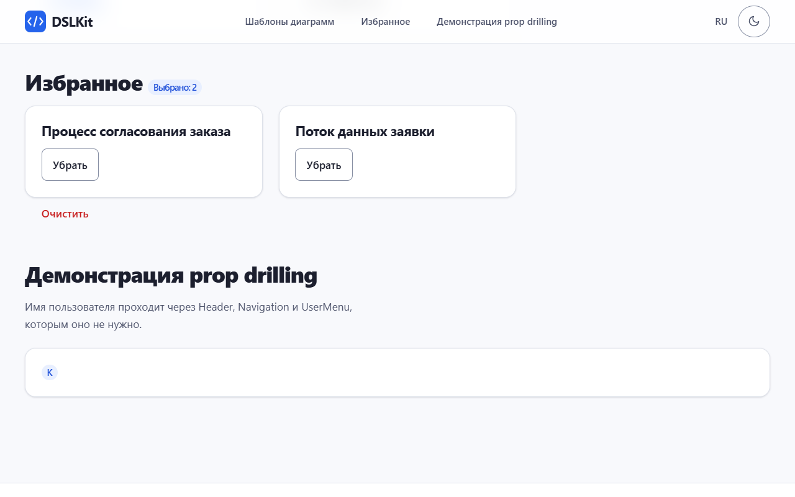
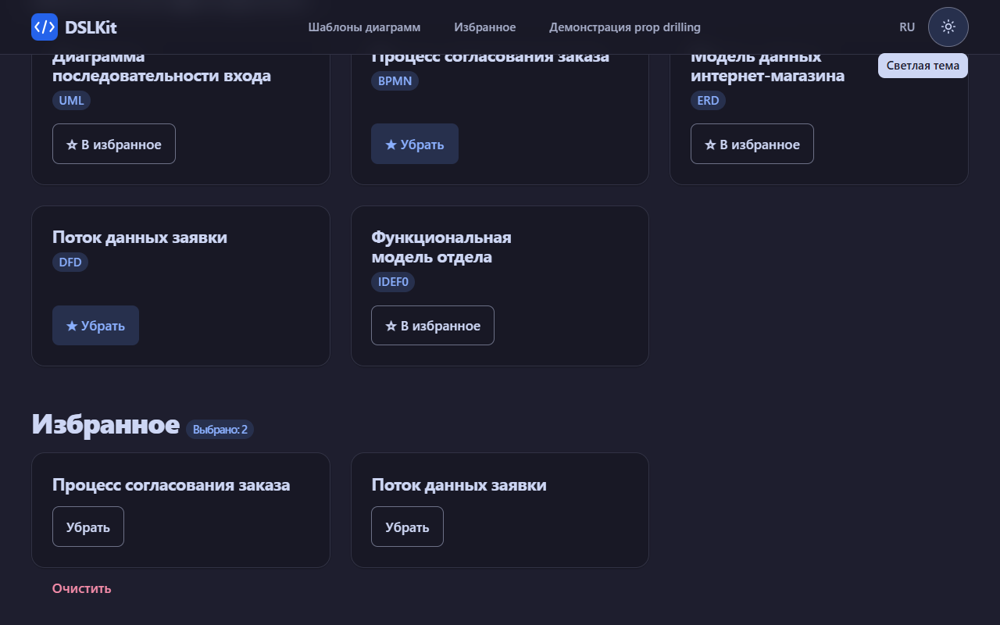
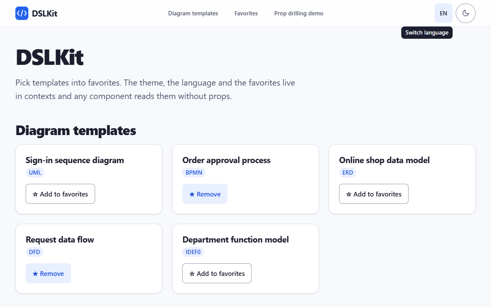
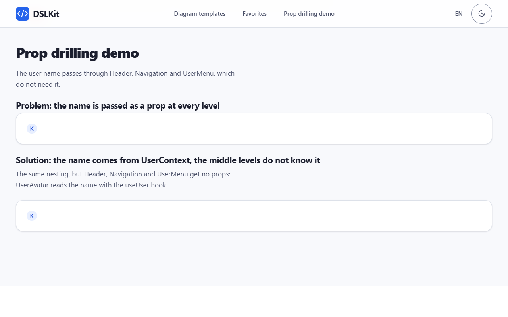

# Practical Session No. 4. Application State Management

## 1 Purpose of the Work

To master global state management in React with the Context API and the `useReducer` hook: to show the prop drilling problem, solve it with contexts and implement the business logic of the DSLKit project, a web editor for diagrams as code (SaaS direction), as a reducer and a provider.

## 2 Work Progress

### 2.1 The Prop Drilling Problem

The hierarchy `PropDrilling` → `DrillingHeader` → `Navigation` → `UserMenu` → `UserAvatar` passes the user name through all levels, although only `UserAvatar` uses it. Three intermediate components receive `userName` only to pass it on, so any data change requires edits along the whole chain. The code is given in Appendix A.

The solution is shown next to it in the same page section. The user name lives in `UserContext`, while `ContextHeader`, `ContextNavigation` and `ContextMenu` receive no props: `ContextAvatar` reads the name with the `useUser` hook. The nesting depth is the same, but the passing of data down the chain disappears and adding a level needs no edits.

### 2.2 Theme and Language Contexts

`ThemeProvider` keeps the theme in `useState`, switches it with `toggleTheme` and writes it to the `data-theme` attribute of the root element, and CSS variables change the colors of the whole page. `LanguageProvider` keeps the language and a dictionary in Russian and English, components receive the `t(key)` function and do not accept texts through props. Context values are wrapped in `useMemo` so that consumers do not re-render without a data change.

### 2.3 Favorites on useReducer and Context

The subject area is favorite diagram templates. The state is an array of `{ id, qty }` objects. The reducer handles the actions `ADD` (without duplicates), `REMOVE`, `TOGGLE`, `INCREMENT`, `DECREMENT`, `SET_QTY` and `CLEAR`, returns a new array and never changes the old one, and an unknown action leaves the state unchanged. The quantity is always a whole number from 1 to the `maxQty` limit of `limits.json`, and a value out of range, fractional or not a number is replaced by the nearest valid one. `FavoritesProvider` is split into two contexts: the data (`useFavorites`) changes with every action, while `dispatch` (`useFavoritesDispatch`) never changes, so a component that only sends actions is not re-rendered when the data changes. A template card and the "Избранное" panel work with one state without passing it through props, and the panel has "minus" and "plus" buttons and the current quantity. The list is saved to `localStorage` by an effect and read by the lazy initializer of `useReducer`.

### 2.4 Resistance to Foreign Data

The content of `localStorage` can be edited by hand. The `sanitizeFavorites` function keeps only known template identifiers, once each, repairs a damaged quantity and accepts the old format with a list of identifiers as quantity 1. The theme and the language are accepted from storage only with valid values, otherwise the theme follows the system setting and the language is Russian. Blocked storage and broken JSON do not break the application. Texts are rendered as text, so markup in a user name is not executed, and an empty name in the prop drilling chain is replaced by a question mark. The 500 page is shown through `ErrorBoundary` when rendering fails.

### 2.5 Appearance

The application uses the styles and markup of the first-part site: a sticky header with the logo and a menu of the page sections, a language button, a moon and sun theme switch with a tooltip, cards and a footer. The theme switch and the language button read the same contexts as the other components, and the header labels change with the language.

### 2.6 Demonstration

Diagram templates in cards with favorite buttons are shown in figure 1.



Figure 1 – Template cards with the "В избранное" buttons in the light theme

Two chosen templates go into the "Избранное" panel, where the counter is visible, as in figure 2.



Figure 2 – The "Избранное" panel with two templates and the selected counter

Switching the theme changes the colours of the whole page, which figure 3 shows.



Figure 3 – The page in the dark theme with the tooltip at the switch

Changing the language translates the headings, the template names and the button labels, as in figure 4.



Figure 4 – The page after switching the language to English

The prop drilling problem and its solution through a context stand side by side, as in figure 5.



Figure 5 – The block with the name passed through props and the block with the same name from `UserContext`

### 2.7 Testing

Thirty-eight automated tests check the reducer as a pure function, the quantity change with its limits, the split of the contexts (the number of re-renders), the prop drilling problem and its solution, a double click on the buttons, the theme and language switching, saving of the choice, adding, removing and clearing favorites, restoring after a reload, broken data, a storage write error, the prop drilling demo, markup rendered as text and the 500 page.

## Conclusion

Prop drilling is shown on a chain of five components and removed with the theme, language and favorites contexts, and the block with the solution stands next to the problem. The business logic lives in a pure reducer, the state and `dispatch` are available in any component through the `useTheme`, `useLanguage`, `useFavorites` and `useFavoritesDispatch` hooks, and favorites persist between sessions.

## Answers to Control Questions

25. **Can `useReducer` be used without Context?** Yes, for the local state of one component, for example a form or a counter: `const [n, dispatch] = useReducer(r, 0)`.
26. **How does Context plus `useReducer` differ from Redux?** It is simpler and needs no dependencies for small projects, but there are no debugging tools, middleware and exact subscriptions as in Redux.
27. **How to get only `dispatch`?** Move `dispatch` to a separate context, then the component is not re-rendered when the state changes. The project does exactly this with `useFavoritesDispatch`.

## Appendix A (mandatory) Key Code Fragments

```jsx
// PropDrilling.jsx: userName passes through components that do not need it
<DrillingHeader userName={userName} />
// DrillingHeader → Navigation → UserMenu → UserAvatar
```

```jsx
// PropDrilling.jsx: the solution, the name comes from the context
<UserContext.Provider value={userName}>
  <ContextHeader />
</UserContext.Provider>
// ContextAvatar: const userName = useUser();
```

```jsx
// ThemeContext.jsx: theme provider
const [theme, setThemeState] = useState(readTheme);
const toggleTheme = () => setTheme((prev) => (prev === 'light' ? 'dark' : 'light'));
useEffect(() => {
  document.documentElement.dataset.theme = theme;
}, [theme]);
```

```jsx
// FavoritesContext.jsx: reducer and provider
export function favoritesReducer(state, action) {
  switch (action.type) {
    case 'ADD':
      return state.some((item) => item.id === action.id) ? state : [...state, { id: action.id, qty: 1 }];
    case 'REMOVE':
      return state.filter((item) => item.id !== action.id);
    case 'INCREMENT':
      return changeQty(state, action.id, (qty) => qty + 1);
    case 'DECREMENT':
      return changeQty(state, action.id, (qty) => qty - 1);
    case 'SET_QTY':
      return changeQty(state, action.id, () => action.qty);
    case 'CLEAR':
      return [];
    default:
      return state;
  }
}

const [favorites, dispatch] = useReducer(favoritesReducer, undefined, loadFavorites);
```

```jsx
// Templates.jsx: the data and dispatch come from different contexts
const favorites = useFavorites();
const dispatch = useFavoritesDispatch();
dispatch({ type: 'INCREMENT', id: template.id });
```
